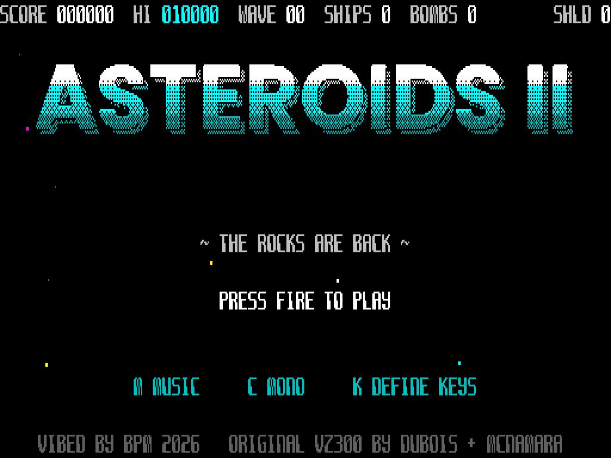
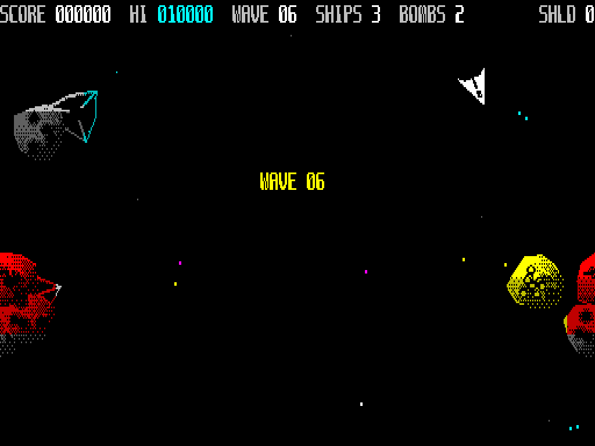

# ASTEROIDS II
### for the Microbee Premium Plus
***"The rocks are back"***
**VIBED BY BPM 2026**

Asteroids II started life on the VZ300 as a sequel to the classic VZ *Asteroids* by Dubois & McNamara. Now it comes to the **Microbee Premium Plus** with a new engine: a smooth, flicker-free, full-colour bitmap shooter that runs the original game rules unchanged.

Crack open four kinds of asteroid: **stone**, gold-bearing **ore**, **volatile** rock that bursts into shrapnel, and hollow **crystal**. Collect the jewels the ore drops and chain them for up to **4× points**. Grab shields, smart bombs, spread shot, rapid fire and extra ships. Dodge the Raider saucer, the Hunter that aims at you, the diving Stinger and drifting mines. When it all gets too much, hit **hyperspace** or set off a **smart bomb**.

## Features
- **512 × 256 full-screen bitmap** with a 16-colour Microbee palette, on black space
- **Flicker-free double-buffered display**, flipped in the vertical blank
- **Large, detailed sprites:** shaded, cratered rocks, a 32-angle player ship, particle explosions and a parallax star field
- **Three-voice beeper** title music and sound effects
- **Full attract sequence:**
  - chrome title logo
  - controls page
  - enemy files
  - treasure and power-ups
  - live computer demo
  - high-score table
- **High-score initials entry**
- **Redefinable keys**, with ESC to cancel, TAB to restore the defaults, and no key allowed two jobs
- **Joystick support**
- **Monochrome mode** for amber and green screens
- A '70s retro-future font throughout

## Tech specs
- **Machine:** Microbee Premium Plus, Z80 at 3.375 MHz, **512K RAM required**
- **Display:** 6545 CRTC, 64 × 16 characters of 8 × 16 = 512 × 256 pixels. All 32K of PCG RAM is used as two complete bitmap screens, flipped via the 6545 start address in vertical blank. Text is drawn straight into the bitmap with a custom font.
- **Frame rate:** up to 25 frames/s. The game itself always runs at a fixed 25 ticks/s, whatever the frame rate.
- **Sprites:** 229 sprites, each pre-shifted 4 ways and compiled into Z80 code
- **Sound:** original 3-voice 1-bit mixer at ~16.6 kHz on the speaker (PIO B bit 6). Effects step 50 times a second.
- **Game logic:** the original VZ300 game code, running in its own 32K bank
- **Format:** DS80 CP/M disk (`AST2.DS8`). Type `AST2` at the `A>` prompt.

## Memory
- **Total in use: about 326K.** That's 288K of main RAM (nine 32K banks) plus all 38K of video RAM.
- **Video RAM:** 32K PCG (both bitmap screens), plus 2K each of screen, colour and attribute RAM, all in use
- **Engine:** 15K of code in the upper 32K, plus buffers for the text layer, redraw queues, erase lists, sound mixer and stack
- **Game logic:** 10K of original VZ300 code, plus 8K of game state (objects, particles, variables), in its own 32K bank
- **Sprites:** **216K** of compiled sprite code across seven 32K banks
- **Loading:** 237K is read from disk. The loader stages it through a spare bank, then takes over the whole machine, switching out CP/M and the ROMs.
- **Requires:** a 512K Premium Plus. The loader checks and tells you if there isn't enough.

## Controls
- **Rotate left:** U or ←
- **Rotate right:** I or →
- **Thrust:** O or ↑
- **Fire:** SPACE or Z
- **Hyperspace:** P
- **Smart bomb:** B or ↓
- **Start:** RETURN or 1
- **Joystick:** works too
- **Title screen:** M music on/off · C colour/mono · K define keys
