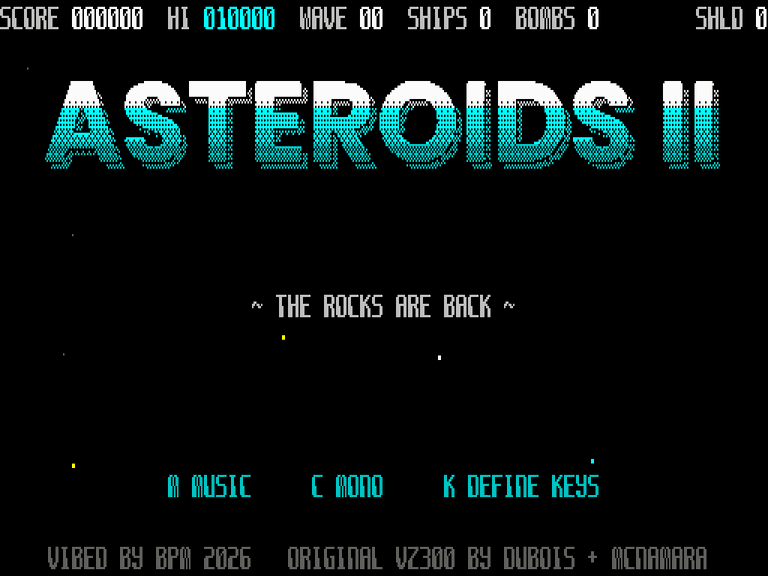

# ASTEROIDS II — Microbee Premium Plus

VIBED BY BPM 2026. A native Microbee Premium Plus version of the VZ300 game
[*Asteroids II*](../Asteroids2), running the original game logic unchanged
on a new flicker-free, double-buffered Microbee engine.



**Run it:** boot `release/AST2.DS8` from SD, then type `AST2` at the `A>`
prompt. Needs a Premium Plus with **512K** (the loader checks and says so if
not). See [BLURB.md](BLURB.md) for a summary with the tech specs, and
`showcase/` for screenshots.

| Key | Action |
|---|---|
| U / I or ← → | turn |
| O or ↑ | thrust |
| Z or SPACE | fire |
| P | hyperspace |
| B or ↓ | smart bomb |
| RETURN or 1 | start |
| M (title) | music on/off |
| C (title) | colour / monochrome (for amber/green screens) |
| K (title) | define keys (cursor keys, Z and the joystick always work too) |

Microbee joystick works too (fire, up = thrust, down = bomb).
Redefined keys last until the machine is reset.

## Development log

The notes below were written for BPM during development, newest first.

## Update 7: define keys, tidied

* **ESC** cancels at any point; all keys go back to how they were.
* **TAB** restores the default keys (U I O SPACE P B).
* **No key can do two jobs.** A key already given to an earlier action, or
  one of the fixed alternatives (cursor keys, Z), is refused: you hear a
  short "nope" and see "THAT KEY IS TAKEN - TRY ANOTHER", then pick again.
  ESC and TAB can't be assigned.
* Fix: the screen's sounds were silent if the attract demo had just run.
  Front-end sounds now always play.

## Update 6: a more detailed ship

The ship keeps your original wedge silhouette, so it feels and collides the
same, with three details added:
* **Split spine:** a dark slot down the spine from the canopy to the tail,
  so the hull reads as two swept wings.
* **Canopy:** a canopy with a one-pixel glint.
* **Engine ports:** two ports on the trailing edge.

Each detail is about one VZ pixel wide (2×1.3 Microbee pixels). Thinner lines
or dithered shading broke up into noise as the ship rotated through its 32
angles, so I left those out.

## Update 5: controls page

A **CONTROLS** page in the attract cycle, straight after the title. It lists
each action with its key and the fixed alternative, beside a picture of the
ship doing it:
* **Rotate left / right:** turned left or right.
* **Thrust:** flame lit.
* **Fire:** a bullet in front of the ship.
* **Hyperspace:** shimmering inside a shield ring.
* **Smart bomb:** inside a shockwave ring.

If you redefine keys (K on the title), the page shows your keys. The page
is static, like the enemy files page, so the music plays at full quality
(the mixer runs 87% of the time). An animated version cost the music too
much.

## Update 4: sound that holds up when the game is busy

**Why effects dropped out.** The effects were fine; they just weren't getting
any play time. A 1-bit beeper only makes sound while the CPU is driving it,
and in-game it only got the frame's leftover time. On a busy frame that was
nothing, so whole 40 ms stretches went silent. The effects' pitch and volume
steps were also only handed to the mixer once per frame, so in a slow frame a
"pew" lost its sweep. Making effects shorter would not have helped.

**What changed**
* The effect sequencer now steps exactly 50 times a second, at each
  vertical blank, whatever the frame rate. Sweeps and fades keep their shape.
* Every 20 ms field gets at least ~2.4 ms of effect sound. If the leftover
  time didn't provide it, the mixer tops it up at the start of the next
  field. Effects are now heard as a steady 50 Hz-gated sound instead of
  random gaps.
* Measured in busy waves: windows where an effect should sound but nothing
  plays are now 0–2% (they were 16–50%). The cost is roughly 0.5–1 fps,
  only while an effect is playing.

**Attract music no longer cuts out between pages.** A page change used to
rebuild the whole screen map and clear the old page cell by cell, giving a
0.4–0.7 s silence. Now:
* both screens are wiped with a fast PUSH fill;
* the screen map is only built once, at start-up;
* during the change, the music sequencer keeps ticking and the mixer keeps
  playing.

The only silence left is the demo page, where the music pauses on purpose.

## Update 3: faster, thinner

Measured in the emulator with the same scripted play on both builds (90 s
per run):

| | before | now |
|---|---|---|
| waves 1–2, average | 17.7 fps | 22.4 fps (median 24) |
| wave 4, average | 14.6 fps | 20.5 fps |
| waves 6–8, average | 12–13 fps | 20–21 fps |
| busiest moments | 8–9 fps | 12–13 fps |

The game logic still runs at exactly 25 ticks/s whatever the frame rate.

**Thinner objects**
* Explosions use 24 particles instead of 40.
* A bullet is 2 dots instead of 3.
* The star field has 12 stars instead of 24.

**Rocks passing under the score bar.** Rocks wrap from the bottom of the
screen to the top, under the HUD. Every HUD letter they touched used to go
through the general text-redraw queue, twice per frame (once for the old
position, once for the new). The HUD row now has its own path: the touched
columns are flagged and redrawn in one pass straight from the font. This
cost up to 15% of a frame when big rocks sat at the screen edge.

**Faster drawing, same picture**
* Colouring a sprite's cells uses an unrolled store run instead of a loop.
  Rows that contain text are checked against the text's actual columns, so
  a rock beside a banner is no longer treated cell by cell.
* Erasing a sprite no longer repaints its cells' colours (every dot and
  sprite paints its own cells anyway). The text check only runs when the
  sprite was on a row with text.
* A tighter dot plotter for particles, bullets and stars.
* Precomputed erase entries for the sprite erase spans.

**Faster game-logic housekeeping, same rules**
* Bullets vs rocks: each bullet now checks a list of the live rocks instead
  of all 24 slots, and the y test is inline. Same tests, same order, same
  results.
* The object and particle movers do the same 16-bit adds, walking each
  record with HL/DE instead of IX.

**Sound:** the short mixer bursts that smooth the in-game effects now only
play when a frame is on time, so they never cost frame rate. The S option
(SMOOTH / FAST) is gone, as you asked.

**Fix:** stray letters from the previous attract page (e.g. "THE" by the
stinger) could stay behind the next page's pictures. The old page is now
fully cleared before the new page draws.

## Update 2 (your play-test feedback)

* **Attract music at full speed.** Sound plays in each frame's spare time,
  and the title was redrawing the big logo plus a live demo game every frame,
  which left almost none. The logo, enemy-file and treasure art are now drawn
  once into both screens and protected, so those pages are nearly idle. The
  mixer now runs 73–86% of the time on them, against 77% on the high-score
  page that you said sounded right. The live demo is now its own page,
  between Treasure and High Scores as in your original attract order, and the
  music pauses for it.
* **Smoother in-game effects.** While an effect is sounding, the engine slips
  short bursts of the mixer (~1 ms) in between drawing sprites, text and
  game-logic steps. The 25 Hz on/off chop becomes continuous, slightly grainy
  sound. (Since Update 3 the bursts only play when a frame is on time, so
  they no longer cost frame rate, and the S option has gone.)
* **Easier start.**
  * Wave 1 has 2 large rocks, wave 2 has 3, and wave 3 has 4 (your original
    opening count). It then grows as before, up to 7.
  * Rocks on waves 1–2 move slower.
  * No enemies appear on wave 1.
* **Define keys** (K): set rotate left/right, thrust, fire, hyperspace and
  smart bomb to any keys.
* **Fix:** the high score could show garbage before the first game, because
  leftover RAM was read as a score. That RAM is now cleared at start-up.

---

## What was wrong with the Codex alpha, and what I did

I booted Codex's disk in an emulator through your BN60 ROM and CP/M,
captured the display line by line as the beam scans it, and profiled it.

### 1. Heavy flicker → now double-buffered and tear-free
Codex erased and redrew every sprite **on the visible screen**. The beam
catches sprites half-drawn: in captured frames the ship was missing from
most frames. A 6545 trick fixes this properly: the Premium's screen,
colour and attribute RAM are 2K each but one 64×16 screen only uses 1K, so
there is room for **two complete screens**. Page 0 uses PCG banks 0–7, page 1
banks 8–15. The game draws the hidden page, then flips by changing the 6545
start address (R12/R13) during vertical blanking. Every frame on view is
complete.

### 2. Game speed tied to frame rate → now a fixed 25 ticks/second
Codex ran one game tick per drawn frame. It drew about 20 frames/s in a
quiet scene, so the whole game ran ~20% slow and slowed further as things got
busy. The original runs at 25 ticks/s (every 2nd field). The engine counts
vertical blanks and runs exactly 25 ticks per second however long a frame
takes. Measured: 24.98–25.0 ticks/s over 2-minute soak tests. Your original
code already has `fs_poll` calls for this; I hooked them up to the Microbee
blank counter.

### 3. Rocks a third of their real size, hit boxes shrunk → true scale
Codex's large rock was 24 px wide. In your original it is 15 VZ pixels, which
is 60 Microbee pixels. Codex then shrank the hit radii to match the small art,
which changed how the game plays. A VZ pixel is exactly 4×4 Microbee pixels
with the same 2:3 shape, so I re-rendered your original vector shapes, from
the **same random seed**, at 4× resolution. The rocks have shaded craters,
ore veins, volatile fissures and hollow crystals. Your original hit radii are
restored untouched.

### 4. A faster renderer
* **Column-major bitmap.** Each byte column of the screen is 256 bytes in
  one PCG bank, so sprites draw downwards with `inc l` and wrap vertically
  for free.
* **Compiled sprites.** Each sprite × 4 shifts becomes Z80 code: solid bytes
  are stored, edges are ORed, empty bytes are skipped. 229 sprites take
  ~197K in 7 memory blocks. Codex's art took 15 blocks and needed 1MB; this
  needs **512K**.
* **Erase by spans.** Only the rows each column actually drew are cleared.
* The game logic stays in its own 32K block, exactly as you wrote it.

### 5. Your '70s retro-future font everywhere
I hand-drew the font in the style of your reference: rounded box letters with
the heavy bottom-left leg, 7×10 in the 8×16 cell. Both pages use all 32K of
PCG, so there are no spare characters to hold a font. Instead a **text layer**
draws the glyphs straight into the bitmap. When a sprite crosses a text cell,
that cell is queued and redrawn on top. The HUD, title, enemy files, treasure
page, banners, high scores, initials entry and score pop-ups all use it. No
Microbee ROM characters are shown.

### 6. A Microbee palette, not the VZ's
The background is black space. Sprites are two-tone per character row: rocks
are grey, gold, red or cyan with darker lower shading. The saucer is magenta,
the ship white and bullets cyan. Particles fade white-hot → yellow → red →
dark red, or cyan → blue for exhaust. Stars are multi-coloured near and dim
grey far. The title logo is cold chrome (white / cyan / dark teal), the text
is greys with a single cyan accent, and the HUD has grey labels with white
values. **C** gives full monochrome for amber/green monitors.

### 7. Finished front end
* The title logo floats over a live demo game, with your three-voice title
  music.
* Enemy files, treasure + power and high-score pages, as in the original
  attract cycle.
* High-score **initials entry**, as in the original.

### 8. Sound
Your original 3-voice 1-bit mixer and all its effects and music, on PIO B
bit 6. The sample loop is padded to your VZ mixer's ~16.6 kHz, so pitches
match. As on the VZ, the beeper plays in the spare time of each frame.

### 9. Removed
* **Serial mouse.** It needed an interrupt for every serial bit, which steals
  time, jitters the beeper and is unverified on hardware. It isn't useful for a
  rotate-and-thrust game. Everything now runs with interrupts off.
* Codex's 1MB requirement.

## Performance (emulated Premium Plus, 3.375 MHz)
* Up to 25 frames/s: about 22 on average in the early waves, 20–21 in
  waves 6–8, and 12–13 in the very busiest moments (see Update 3).
* The game itself always runs at full speed (25 ticks/s).
* Codex's alpha ran 12–20 frames/s, with flicker and the game slowing down.

## What has NOT been verified on real hardware
Everything was tested in my own Premium Plus model: z80core plus the
hardware description Codex derived from uBee512, booting your BN60 ROM and
the real CP/M disk sectors. Please check these on your machine:
1. The page flip (6545 R12/R13 start address = 0 or 1024).
2. Vertical-blank detection (6545 status bit 5).
3. The keyboard scan (light-pen method, as in your earlier ports) and the
   joystick.
4. The 512K memory check and loader.

If anything misbehaves, tell me what you see. A photo of the screen is
perfect.

## Building
Everything is in Python with no external assembler. The sources are in
`src/`:

```
cd src
python3 tools/build.py --base <any DS80 CP/M disk with CCP.SYS>
```

* `src/`: the Microbee engine (`engine.asm`), the simulation bank wrapper
  (`sim.asm`) and the loader template.
* `orig/`: your untouched original VZ300 sources, which the simulation bank
  is generated from.
* `tools/zasm.py`: an sjasmplus-compatible Z80 assembler written for this
  project.
* `tools/port_sim.py`: makes the simulation bank from `orig/`.
* `tools/art.py`, `tools/sprc.py`, `tools/retrofont.py`: art, the sprite
  compiler and the font.
* `tools/beemu.c` + `tools/bee.py`: the Premium Plus emulator used for
  testing (the `t_*.py` scripts). It needs the BN60 ROM and character ROM,
  which aren't included.
