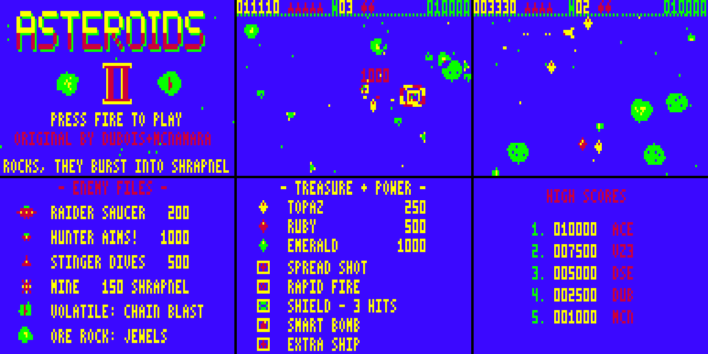

# ASTEROIDS II

Sequel to *VZ Asteroids* (Dubois & McNamara) for the Dick Smith VZ300.
Vibed by BPM, 2026. Original code, graphics and music.

Blast, split and shatter your way through escalating waves:
- Crack ore rocks for spinning jewels and chain them for up to ×4 points.
- Set off volatile rocks for chain-reaction shrapnel.
- Duel raider saucers, aiming hunters, diving stingers and creeping mines.
- Grab spread shot, rapid fire, shields and smart bombs.

## Play it

Copy `release/AST2.VZ` to the SD card and load it from the BennVenn SD loader. It's a type F1 binary that loads at $8000 and runs from $8000. Expect about a second of blank screen at start-up while the sprites are prepared.

| Action | Keyboard | Joystick (detected automatically) |
|---|---|---|
| Rotate | U / I | left / right |
| Thrust | O | up |
| Fire (hold for auto-fire) | Z or SPACE | fire |
| Hyperspace (2.4 s recharge) | P | arm button |
| Smart bomb | B | down |
| Start | fire, RETURN or 1 | fire |
| Music on/off (title screens) | M | — |
| Initials entry | U/I change letter, fire to accept | left/right, fire |

## What's in it

**Rocks** come in four kinds and three sizes, and all of them tumble:
- **Stone** splits in two.
- **Ore** takes 3/2/1 hits and drops jewels.
- **Volatile** bursts into 8 shrapnel shards. These shatter nearby rocks and enemies, and can hit you too.
- **Crystal** is fast and splits in three.

**Enemies:**
- **Raider saucer** (200): wanders and sprays shots, and always drops a pickup.
- **Hunter** (1000): fires aimed shots and drops an emerald.
- **Stinger** (500): a homing dart that dashes in bursts.
- **Mine** (150): creeps after you and bursts into shrapnel when shot.

**Treasure and power-ups:**
- Jewels: topaz 250, ruby 500, emerald 1000. Collect them in quick succession to chain up to ×4.
- Power-ups: spread shot, rapid fire, shield (3 hits, and lets you ram rocks), smart bomb, extra ship.
- An extra ship every 10,000 points.

**Effects:** particles, shock-wave rings, a palette flash and screen shake, a three-layer parallax starfield, and the classic heartbeat that speeds up as the rocks thin out.

**Front end:** an animated title, Enemy Files and Treasure & Power pages, a self-playing demo, and a high-score table with initials. The three-voice title music is in [media/title_music.mp3](media/title_music.mp3).

## Tech specs

- **Code and display:** 100% Z80 machine code, in 128×64 four-colour mode (CG2), at 25 fps.
- **Blue background:** it's a software trick. Sprites are XOR-encoded against blue, so it costs nothing. The VDG border stays green.
- **No flicker or tearing:** every frame is built in an off-screen buffer. That buffer has wrap margins, so objects glide around all four edges. An unrolled stack copy then moves it to video RAM in 6.7 ms, starting on the field-sync edge, so the copy finishes inside the vertical blank.
- **Pacing:** game logic and drawing share a two-field budget. If a frame overruns, it slips by one field instead of tearing. In the test harness it averages 24.4 fps in the busiest waves.
- **Sprites:**
  - 155 sprites, rasterised from vector shapes with the VZ's 2:3 pixel aspect.
  - They include a 32-direction ship and 80 frames of tumbling rocks.
  - All are pre-shifted at start-up into a 14.5 KB cache, so no bits are shifted during play.
- **Sound:**
  - A three-voice mixer drives the 1-bit speaker at about 16.6 kHz, with pulse width as volume and a noise voice.
  - It runs only in idle time, so in game it costs no speed. The trade-off is a slight 50 Hz roughness.
  - SFX run from a bytecode sequencer with priorities.
  - On the title screen the music plays 86% of the time.

The full spec list is in [ASTEROIDS_II_blurb.txt](ASTEROIDS_II_blurb.txt), and a shorter version for forums is in [ASTEROIDS_II_forum_post.txt](ASTEROIDS_II_forum_post.txt).

## Why it needs the BennVenn SD / 128K

It uses about 42 KB while running:

| | |
|---|---|
| Program | 18 KB |
| Back buffer and tables | 7 KB |
| Pre-shifted sprite cache | 14.5 KB |
| Variables, particles and stack (in $7800–$7FFF) | 2 KB |

A standard 16K expansion only gives 32 KB. The BennVenn's second 10 KB SRAM bank at $4000 (port $37 = 3) holds most of the sprite cache. The game leaves the DOS bank and $F800–$FFFF alone, and makes no mapper writes during loading. On a machine without the bank, it says so on screen.

The original *VZ Asteroids* needed an expanded machine too (a 16K RAM pack).

## Memory map

| Address | Use |
|---|---|
| $4000–$67FF | SRAM bank 1: sprite cache |
| $7800–$79FF | stack |
| $7A00 | variables |
| $7C00 | row table |
| $7D00 | particles and stars |
| $8000–$C823 | program and data |
| $D000–$F7FF | back buffer, object tables, sprite descriptors, cache overflow |

## Building

From `src/`, run `./build.sh`. This needs `python3` with Pillow, and `sjasmplus` on the PATH (or set `SJASMPLUS=`). It writes `build/AST2.VZ`, which matches `release/AST2.VZ` byte for byte.

- `tools/gen_assets.py` generates the sprites, font and logo.
- `tools/gen_tables.py` generates the sine and note tables.
- `tools/gen_music.py` compiles the title tune.

## Testing

`tools/vzemu.c` is a cycle-counting VZ300 test harness. Build it with `cc -O2 -o tools/vzemu tools/vzemu.c tools/z80core/z80.c`, then run it with `tools/run.sh`.

It models:
- field sync and the keyboard matrix
- the joystick ports
- BennVenn banking
- the speaker (to WAV)

It also captures the display line by line as the beam would draw it, guards against stray writes, and profiles cycle use. It has no ROM or DOS, so it isn't a full emulator.

## Status

- Tested in the harness: attract loop, full games, game over and initials entry, and a 10-minute AI soak test to wave 9 with no crashes.
- Not yet confirmed on real hardware: joystick feel, speaker sound, and loading through the real DOS.
- High scores are kept until power-off. Saving them to SD is planned, and needs the BennVenn DOS file-call details.

## Credits

Original *VZ Asteroids* by Dubois & McNamara. *Asteroids II*, 2026, vibed by BPM.
The test harness uses the superzazu/z80 CPU core (MIT licence, included in `src/tools/z80core/`).
