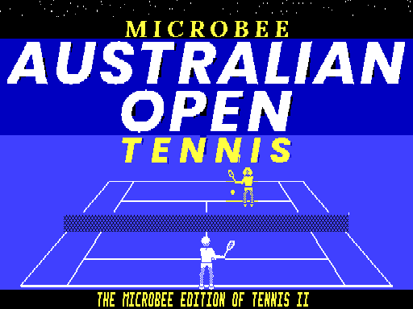
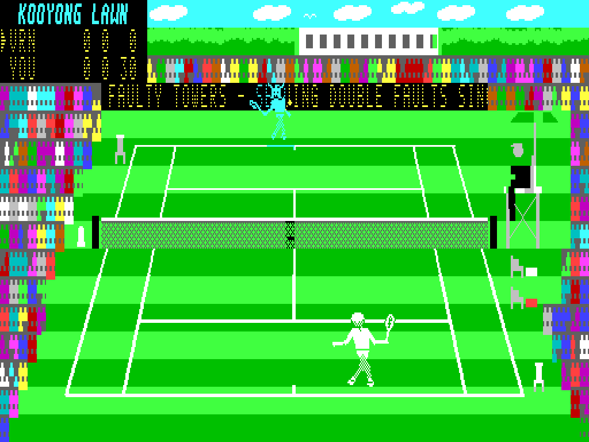
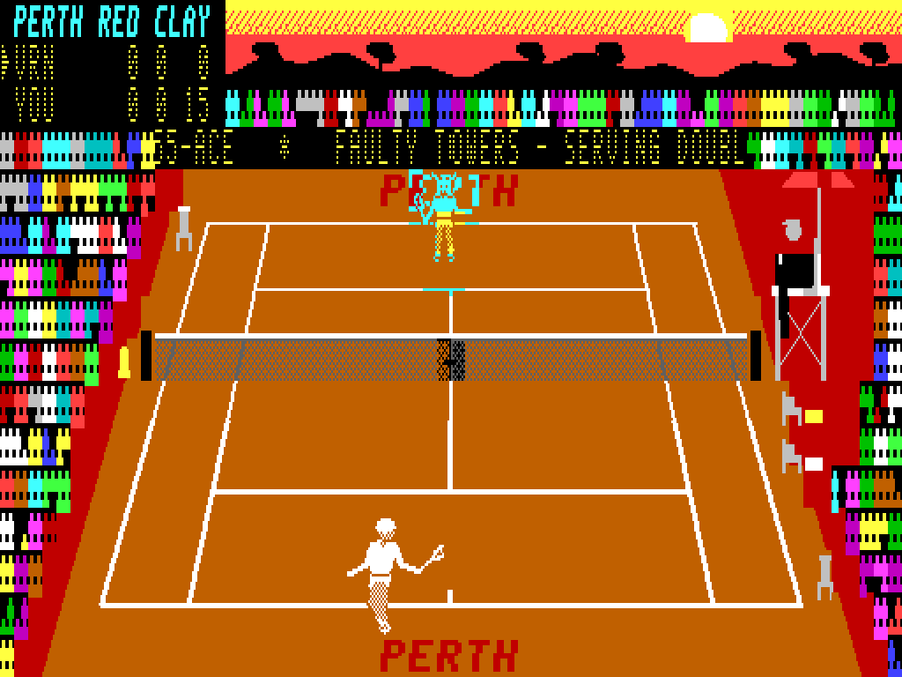
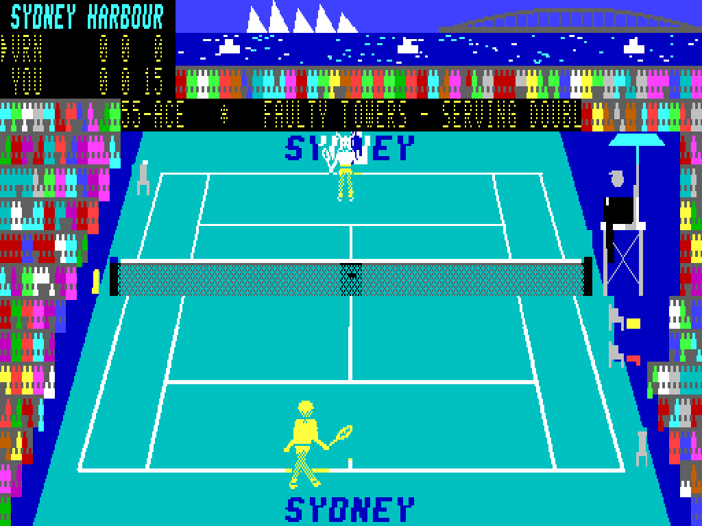
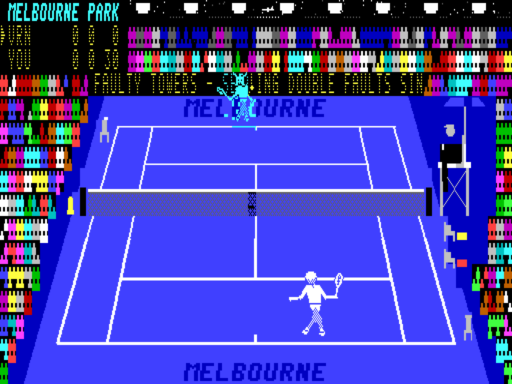
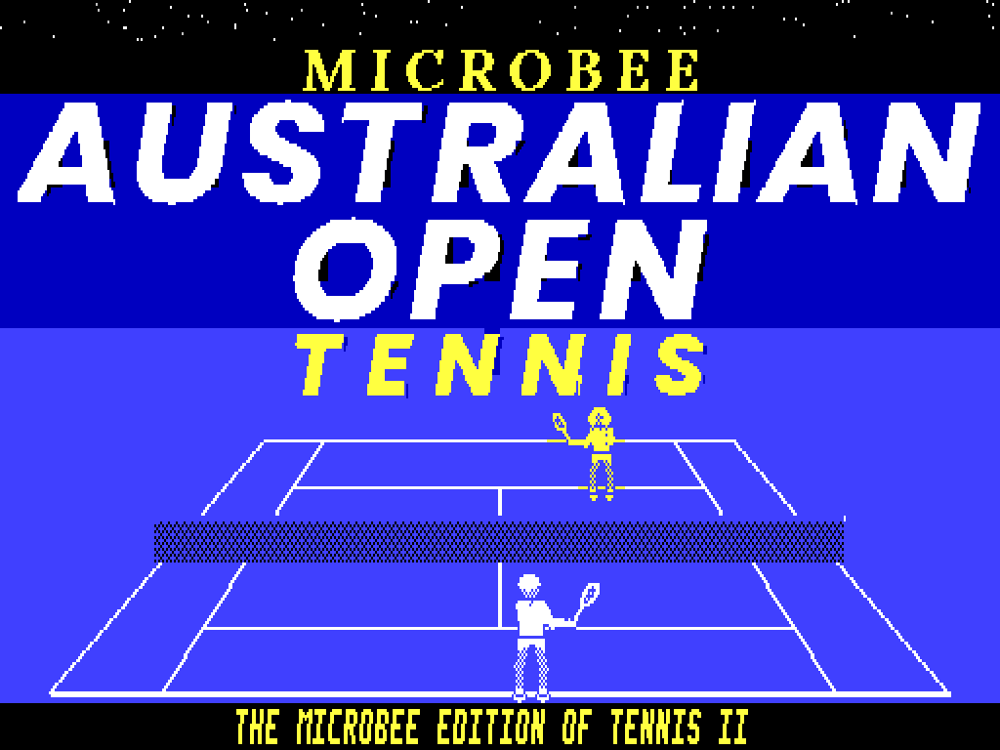
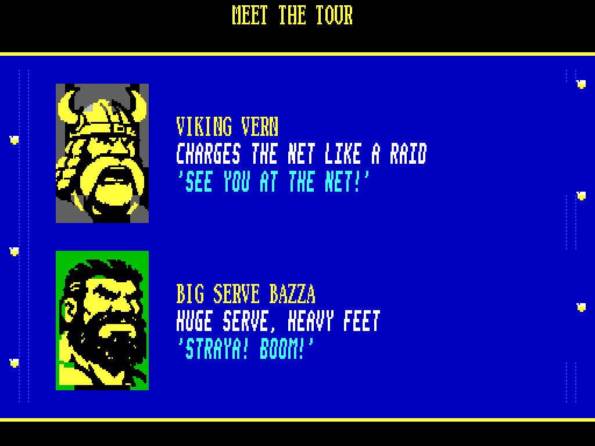

# MICROBEE AUSTRALIAN OPEN TENNIS
### for the Microbee Premium Plus
***"New balls, please."***
**VIBED BY BPM 2026**

TENNIS II was a Grand Slam on the VZ300. Now it walks out onto centre court on the **Microbee Premium Plus**. The match engine is still the VZ game's own code, rule for rule, around a brand-new display engine. It shows a sunlit, perspective court in full Microbee colour, with packed grandstands, an umpire in his chair and a scrolling LED sponsor board on the end wall.

Play the **Summer Tour** across four tournaments: grass at **Kooyong**, red clay at sunset in **Perth**, the hard court by the Harbour Bridge in **Sydney**, and the **Australian Open** under the lights at **Melbourne Park**. Win all four for the **Grand Slam**. The tour saves itself to disk after every match.

The eight caricatured players on the tour each play their own way, from Rookie Rusty to the reigning champion Mr VZ. Lobby Lou lobs, Viking Vern charges the net and Big Serve Bazza booms it down. Your swing is automatic. Where the ball meets you sets the angle, holding left or right steers it, and fire gives you a power drive, or a smash if the ball is high. Hit three winners in a row and you're **ON FIRE**.

| | |
|---|---|
|  |  |
|  |  |
|  |  |

## Features
- **Five courts:** Kooyong Lawn, Perth Red Clay, Sydney Harbour, Melbourne Park, and the hidden **Classic 1984** court (press C on the menu). Each court has its own scenery, colours and run-off lettering.
- **A living stadium:**
  - grandstands of pixel spectators who cheer, and do the wave after aces and winners
  - an umpire who follows the ball and raises his arm for calls
  - line judges, ball kids and players' chairs
  - clouds drifting over Kooyong
  - gulls crossing the sky, and a plane blinking over Melbourne Park at night
- **The LED sponsor board:** 34 sponsor messages and retro jokes scroll smoothly along the end wall, in a new shuffled order every match ("FAULTY TOWERS - SERVING DOUBLE FAULTS SINCE 1982", "NOW WITH 20% MORE TENNIS", "640K? SHOW OFF.").
- **Animated players:** 36 poses seen from the near end and the far end, with run cycles, backswing, contact and follow-through, serves, and celebrations and slumps between points. The far player is drawn in perspective.
- **Caricature portraits** of the whole tour, drawn from BPM's own artwork.
- **Tennis-style type throughout:** a sporty italic, an LED scoreboard face and a classic serif.
- **Monochrome mode** for amber and green monitors. Every court and screen is redrawn in dot patterns made for a one-colour screen.
- **Two-player matches**, exhibition matches against any rival on any court, and **target practice** with a ball machine.
- **Summer Tour saved to disk**, plus a Hall of Fame and your settings, saved to `SAVE.DAT`.
- **Two-channel beeper** music and sound effects: a tune for every screen, a racket "thunk" on every hit, line calls, the net cord, and a crowd that hisses and applauds.
- A full **attract sequence**:
  - title screen with a rally
  - how to play
  - meet the tour
  - a demo match
  - the Hall of Fame

## Tech specs
| | |
|---|---|
| **Machine** | Microbee Premium Plus: Z80 at 3.375 MHz, 1MB RAM, 32K PCG RAM, 6545 CRTC |
| **Display** | 64 × 16 character cells of 8 × 16 pixels (512 × 256), 16 colours, a colour pair per cell. Two screen pages flipped in the vertical blank, so there's no flicker or tearing. |
| **Graphics** | Every court is a full-screen PCG picture (up to about 550 unique glyphs, plus crowd and umpire animation glyphs). Sprites are composited into private glyphs each frame from pre-shifted, column-trimmed frames, with a 120-glyph pool per screen page. |
| **Perspective** | A pinhole projection of the VZ game's flat court. The far player is drawn at 72% size. |
| **Frame rate** | About 22-23 frames a second in a match. Game logic runs one step per 50 Hz field, so the speed of play matches the VZ original even when a frame takes longer to draw. |
| **Sponsor board** | 42 board glyphs rewritten from four pre-shifted copies of the messages (one RAM block per 2-pixel shift), half the board a frame, so it costs about 1-2% of a frame. Each message is a separate segment, so every match shuffles the running order. |
| **Sound** | Two-channel pin-pulse beeper engine from the VZ game, retimed for the Premium (127 T-state loop, 26.6 kHz), with a 1K white-noise table for the crowd |
| **Disk** | DS80 (80 tracks × 2 sides × 10 × 512 bytes). Boots to the CP/M `A>` prompt with no shell. `AOT.COM` loads 17 files into the RAM banks (about 21 seconds), and the game then takes over the machine. |
| **Saving** | The game drives the WD2793 disk controller directly to write `SAVE.DAT` |
| **Source** | About 10,700 lines of Z80 assembly, plus about 4,800 lines of Python tools that draw all the art, compile the courts and sprites, write the music and build the disk |

## RAM used
The Premium Plus's 1MB is 32 blocks of 32K. The game uses 23 of them (736K), and about 340K of that is loaded from the disk.

| Block(s) | Contents | Size |
|---|---|---|
| 0 (upper 32K) | the program (8000-C4FF), white-noise table (D000), screen maps and render tables (D400-E7FF), variables, stack, video window (F000) | 32K |
| 1 | restore lists, background maps, crowd and umpire animation lists, save buffer | 15K |
| 2 | the front end: menus, tour, attract screens | 6K |
| 4-9 | player sprites: 72 body frames, 18 heads, ball, shadows, gulls, plane | 125K |
| 10, 11, 15, 16 | the sponsor board's messages, pre-shifted 0/2/4/6 pixels | 4 × 21K |
| 12 | three fonts, small sprites | 4.5K |
| 13, 14 | packed pictures: five courts in colour and mono, title, info, trophy | 53K packed |
| 18 | Kooyong's cloud loop, pre-shifted 8 ways | 12K |
| 21, 22 | unpacking scratch | 64K |
| 23-25 | title, info and trophy pictures, kept unpacked | 96K |
| 26 | portraits of the tour (80 × 80 caricatures) | 24K |

**PCG RAM (32K, 2048 glyphs):** banks 0-9 hold the court picture with its crowd and umpire variants, plus the sponsor board and cloud glyphs. Banks 10-12 hold the fonts and banks 12-13 the portraits. Banks 14-15 hold the sprite pools, one per screen page.

## To play
Boot `release/AUSOPEN.DS8`, type `AOT` at the `A>` prompt, then press **C** for colour or **M** for monochrome.

| Action | Keys |
|---|---|
| Move | Q A M , or the arrow keys, or a joystick |
| Hit harder (smash when the ball is high) | SPACE / SHIFT / fire |
| Lob / drop shot | pull back / push up as you hit |
| Steer the shot | hold left / right as you hit |
| Serve | fire to toss, fire again to hit |
| Pause (X quits), sound | P, S |
| Player 2 | I K J L + H, or the joystick |

More pictures: [gameplay](screenshots/gameplay/) · [screens](screenshots/info/)
