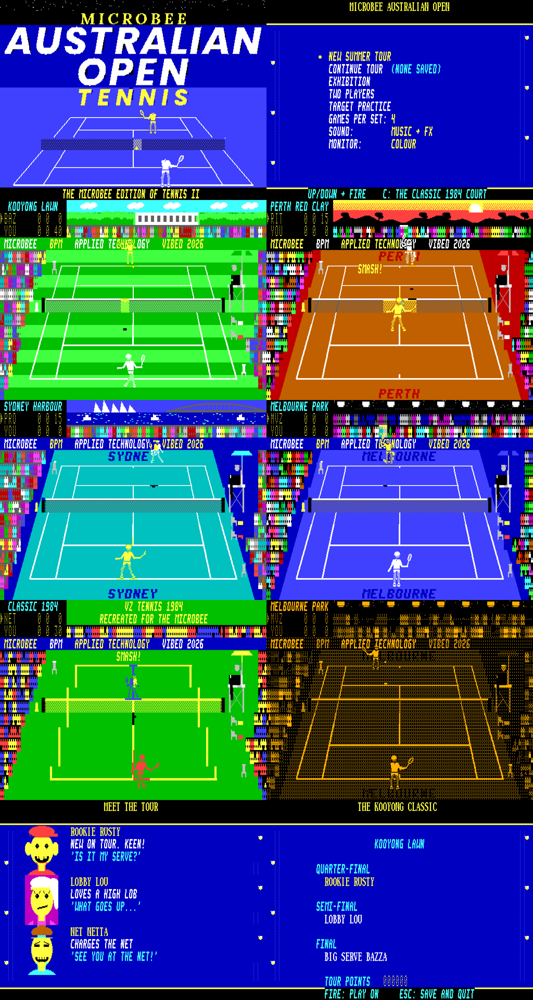

# MICROBEE AUSTRALIAN OPEN TENNIS

The Microbee Premium Plus edition of **TENNIS II - GRAND SLAM** (VZ300).
VIBED BY BPM 2026.

It needs a Microbee Premium Plus with 1MB RAM and 32K PCG RAM.

## Play it

`release/AUSOPEN.DS8` is a DS80 disk image (80 tracks, 2 sides, 10 × 512
sectors). It boots to CP/M's `A>` prompt with no shell. At the prompt type

    AOT

Then press **C** for a colour monitor or **M** for monochrome.

| Action | Keys |
|---|---|
| Move | Q A M , or the arrow keys, or a joystick |
| Hit harder (smash when the ball is high) | SPACE / SHIFT / fire |
| Lob / drop shot | pull back / push up as you hit |
| Steer the shot | hold left / right as you hit |
| Serve | fire to toss, fire again to hit |
| Pause (X quits while paused), sound | P, S |
| Two players: player 2 | I K J L + H, or the joystick |
| Main menu: unlock the CLASSIC 1984 court | C |

## What's in it

- **The VZ game, rule for rule.** The match engine is TENNIS II's own code:
  - serving, faults and lets
  - the automatic swing, aimed by where the ball meets you
  - power, lobs, drops, smashes and volleys
  - the eight computer players' styles
  - deuce, tie-breaks and change of ends
  - ON FIRE
  
  The Microbee draws it with a new engine.
- **A 512 × 256 court** of 8 × 16 PCG cells in 16 colours, drawn in true perspective.
  - Every cell is its own glyph.
  - The two players, ball, shadow and effects are blitted into private glyphs from a pool each frame.
  - The two screen pages flip on the 6545 start address.
  - It runs at about 25 frames a second. When a sound is playing, a busy frame is stretched to three fields so the beeper gets its time, and the game logic keeps step.
- **Five courts, each a place:**
  - **Kooyong:** striped grass, the white clubhouse and gum trees.
  - **Perth:** red clay under a desert sunset.
  - **Sydney Harbour:** a teal hard court with the sails and the bridge.
  - **Melbourne Park at night:** the Australian Open blue under the floodlights, with camera flashes in the upper tier.
  - **CLASSIC 1984:** the VZ original's look, unlocked with C.
- **Courtside:**
  - grandstands on three sides, with a crowd that cheers and does Mexican waves
  - an umpire in a tall chair who follows the ball, raises his arm for calls and leans in
  - an LED sponsor board on the end wall that scrolls BPM's sponsor messages ("NOW WITH 20% MORE TENNIS")
  - clouds drifting over Kooyong, gulls crossing the sky, and a plane blinking over Melbourne Park at night
  - the players' chairs, a ball kid and line judges
  - sponsor boards, and the venue's name painted on the run-off
  - a stadium scoreboard
- **Animated players:** 36 frames in two views, at two sizes. They run, wait with a backswing, hit forehands and backhands, serve, smash, lunge, celebrate and sulk. Each character has their own head and kit colour.
- **Fonts:** a sporty italic, a dot-matrix scoreboard face and a classic serif for the honour boards.
- **Monochrome mode** for amber or green monitors. It has its own dot-pattern art, not a grey version of the colour art.
- **The Summer Tour.** Win the Kooyong Classic, the Perth Clay Cup and the Sydney Harbour Open, then the Australian Open, for the Grand Slam. It saves to `SAVE.DAT` on the disk after every match, and the saved tour is picked up with CONTINUE TOUR.
- **Other modes:** Exhibition, Two Players and Target Practice.
- **Hall of Fame:** kept on the disk with your settings.
- **Caricature portraits** of the whole tour, from BPM's reference art (`resources/portraits_ref.png`), at 80 × 80 pixels. Net Netta is now **Viking Vern**.

## Build

You need Python 3 with numpy and Pillow, plus gcc for the LZ packer. From `tools/`:

    python3 build.py

This writes everything into `build/`:
- the art (`venues.py`, `players.py`, `frontpics.py`, `fonts.py`)
- the program and the front end (`src/main.asm`)
- the CP/M loader (`src/loader.asm`)
- the disk (`build/AUSOPEN.DS8`)

`tools/zasm.py` is the bundled assembler. `tools/emu` and `tools/mbee.py` are the Premium Plus model the game was tested in.

Test scripts:
- `tools/run.py`: preloads the RAM blocks
- `tools/tourtest.py`: a computer-driven Summer Tour soak
- `tools/slamtest.py`: reaching the Grand Slam ending
- `tools/flow.py`: saving and reloading the disk

## Memory

| Where | What |
|---|---|
| 8000h–BFFFh | program (engine, match, sound, music, services) |
| D400h–E7FFh | background maps, cell map, sprite pool records |
| E800h–EFFEh | variables, stack |
| block 1 | restore lists, base maps, crowd and umpire lists, save buffer |
| blocks 10, 11, 15, 16, 18 | the sponsor board's messages (one block per 2-pixel shift), Kooyong's cloud loop |
| block 2 | front end (runs at 0000h) |
| blocks 4–9 | player sprites (each has the court's first 512 glyphs at 0000h) |
| block 12 | fonts |
| blocks 13–14 | packed courts and pictures |
| blocks 21, 23–26 | unpacking, cached pictures, portraits |
| PCG banks 0–9 | background, 10–12 fonts, 12–13 portraits, 14–15 sprite pools |

## Testing

Tested in the emulator only:
- every menu
- a full Summer Tour, through to the Grand Slam ending
- matches on every court, in colour and mono
- saving to and reloading from the disk image
- long computer-v-computer soaks

Not checked:
- on a real Premium Plus
- the CP/M boot and loader. They're the BILBIES! loader with a load offset added, but no boot ROM was available here.
