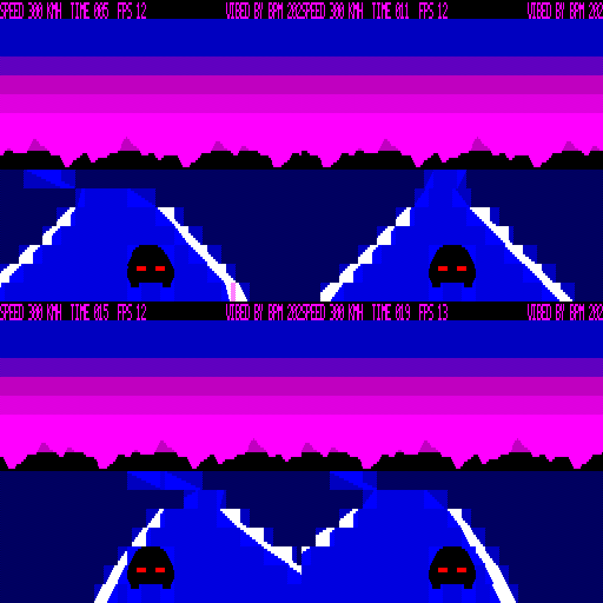

# BEELINE (working title) — Microbee Premium Plus 3D racer

Engine milestone (phases 1–3 of the brief): hardware investigation, rendering experiments and benchmarks for a 3D racing game on the Microbee Premium Plus, native Z80.

VIBED BY BPM 2026

## Loading

Boot `release/BEELINE.DS8`, then type a program name at the `A>` prompt:

| Program | What it is |
|---|---|
| `RACE` | Pseudo-3D "PCG strip" road: curves, hills, crests, kerbs, dithered bands, page flipping, 3 colour themes. FPS on the top line. |
| `BENCH` | Video RAM speed test. Wait ~8 s, photograph the screen. Emulator figures: 591 599 474 472 472 973 599. |
| `CUBE` | Solid polygon test: a dither-shaded cube rasterised live into a PCG bitmap. FPS top left. |

Each program takes over the machine; press RESET to leave.

## RACE controls

| Key | Action |
|---|---|
| M / SPACE / cursor up | Accelerate |
| N / cursor down | Brake |
| Z X (or , .) | Steer |
| C | Change colour theme |

## Measured

| | Emulator | Real Premium Plus |
|---|---|---|
| BENCH (blocks/s) | 591 587 464 462 462 954 599 | 603 517 415 413 465 954 527 |
| Video RAM wait states | — | about 4 T per screen/colour/PCG access; none on attribute RAM (emulator now models this with `-vwait 4`) |
| RACE on the road | 13.5 fps | about 12.9 fps (emulator with wait states) |
| CUBE | 20 fps | not yet reported |

Version 2 (low camera, horizon at 60% of the screen as in the reference photos) is about 15% faster than version 1, which ran at 11.25 fps with wait states. Version 1's FPS counter missed vertical blanks and showed about 1.66 times the true rate; version 2 polls often enough to count every field.

The static PCG library for the whole road is 128 of 2048 characters.

## Building

`src/build.sh` needs Python 3 (Pillow for screenshots) and gcc. It builds the PCG library and tables, assembles the three programs with the bundled assembler (`tools/zasm.py`), builds the cycle-counting test emulator (`tools/beemu.c`) and writes `build/BEELINE.DS8` (`tools/build_disk.py`; system tracks and CCP.SYS in `resources/` are from the earlier Premium disks in this repo).

The programs find the video window themselves at start-up (`src/vidmap.asm`): if CP/M hasn't mapped it at F000h they locate CP/M's memory block and map it there.
