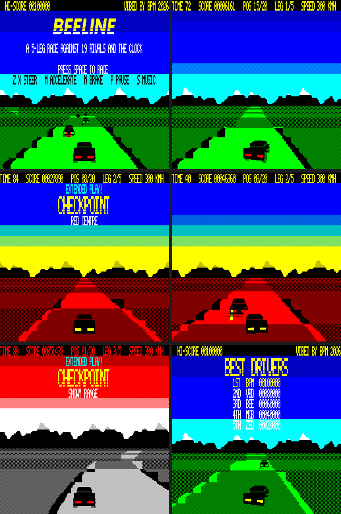
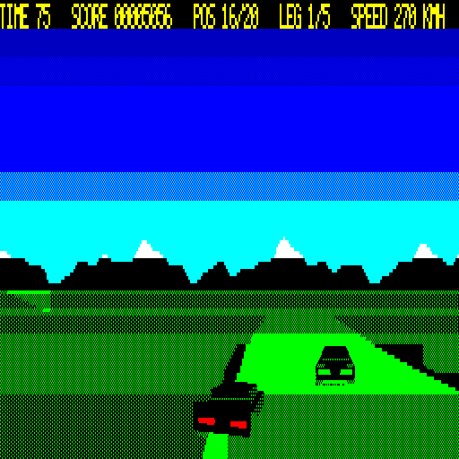
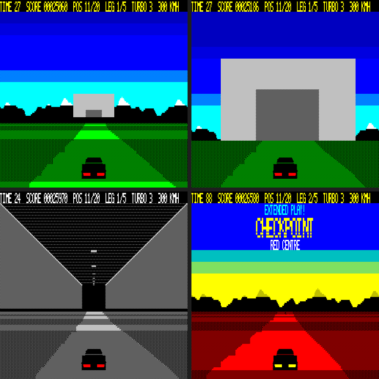

# BEELINE — a 3D road race for the Microbee Premium Plus

A five-leg point-to-point race against 19 rivals and the clock, in native Z80 on a Microbee Premium Plus. The 3D road is built from PCG characters that are redrawn on every frame.

VIBED BY BPM 2026







## Loading

Boot `release/BEELINE.DS8`, then type `BEELINE` at the `A>` prompt. `BEELINE.COM` loads `BEELINE.DAT` from the same disk. The game takes over the machine; press RESET to leave.

Also on the disk:

| Program | What it is |
|---|---|
| `BENCH` | Video RAM speed test. Wait ~8 s and photograph the screen. |
| `CUBE` | Solid polygon test: a dither-shaded cube drawn into a PCG bitmap on every frame. |

## Playing

| Key | Action |
|---|---|
| M / cursor up | Start, accelerate |
| N / cursor down | Brake |
| SPACE | Turbo (three per leg, topped up at each checkpoint) |
| Z X (or , . or cursor left/right) | Steer |
| P | Pause |
| S | Music on/off |
| ESC | Back to the title screen |

- **The race.** The five legs are GREEN VALLEY, RED CENTRE, SNOWY RANGE, COAST AT DUSK and NIGHT RUN, and each has its own colours and road character. You start with 80 seconds. Every checkpoint adds time ("EXTENDED PLAY!"); finish leg 5 for a bonus of 10,000 points per second left, plus 500,000 for a win.
- **Rivals.** You start last of 20. Pass rivals to move up (POS on the top line); if you dawdle, they pass you back. Rivals get quicker on each leg, and ordinary traffic is on the road too.
- **Slipstream.** Sit right behind a car at speed for about a second and you get a free burst of speed ("SLIPSTREAM!"). A turbo does the same for 3 seconds: top speed rises from 300 to 360 km/h.
- **Tunnels.** Legs 1–4 end in a tunnel through the mountains. The checkpoint is inside, and you drive out into the next leg's scenery.
- **Forgiving.** A bump or a trip onto the verge only costs speed. You lose no lives and there are no explosions.
- **Scores.** Score comes from distance at speed, plus 1,000 points per overtake. The top five are kept with initials until the machine is reset.
- **Title screen.** Shows the race on autopilot, cycling through all five legs, and alternates the logo with the best drivers.

## How it works

- **Road** (`road.asm`): segment projection with curves, hills and crest occlusion. Each road row is built from PCG characters in the hidden page's banks 1–8 (double buffered). The band dither patterns and the road edges are composited per scan line, then the pages flip with the 6545's start address. Details of the engine are in the earlier version notes below.
- **Track** (`track.asm`, `tools/mktrack.py`): each leg is a list of sections (length, curve, slope). These are streamed into a 256-segment ring 40 segments ahead of the camera, easing between sections so the road always flows.
- **Rivals** (`traffic.asm`, `tools/mktraffic.py`):
  - **Sprites.** The car is rendered from the same 3D model as the player's car, at 8 sizes with 4 sub-cell shifts each. They are stored as vertical strips of (mask, ink) pairs with transparent padding, so a car at any height on screen is just a pointer into a strip.
  - **Drawing.** Each car is projected between two road points and clipped by the crest in front of it. It is then composited into the road row while that row is being built: each cell takes a new PCG slot. Fully solid cells copy only the ink, and cells over plain road use a fast compositor.
  - **Tail lights.** Cells that are wholly car get the light colour, and the colours are put back on the next redraw of that page.
- **The field.** RIVALS counts the cars ahead of you in the whole race. The next unseen rival is a distance up the road that closes at (your speed − the rivals' pace), so overtaking moves you up genuinely.
- **Tunnels** (`tunnel.asm`, `tools/mktunnel.py`):
  - **Track.** Tunnel segments are flagged in the track ring. On the approach, the projection stops at the tunnel mouth, so no road is drawn beyond it.
  - **Portal.** The rows above the mouth's road line show the portal. It is built from static PCG characters made at start-up: a solid face, the dithered opening, and the opening's edges and corners at every sub-cell offset. So it grows smoothly without compositing anything, and its attributes and colours are only rewritten when it outgrows what that page already shows.
  - **Inside.** The sky rows show a pre-drawn ceiling and walls in perspective. Ceiling lights rush towards you, animated by swapping the codes of the centre columns as you move. The road takes on the grey tunnel colours.
- **Text** (`ui.asm`):
  - **Overlay.** Rows 1–8 hold text over the sky, with ink chosen against the sky colour behind it. A row is only repainted when it changes or when the sky under it was redrawn.
  - **Big letters.** The HUD font, quadrupled in PCG bank 12, with speed-cuts in the lower half.
  - **Logo.** Rendered from an italic typeface into static PCG characters.
- **Sound** (`snd.asm`, `tools/mksound.py`): the speaker is driven from the frame-wait loop, so notes play while the CPU would otherwise wait for the page flip. Each frame, a sound gets at least ~3 ms even if the frame is late. The result is short, slow "dink, dink-dink-dink" blips for the music, plus effects for the countdown, overtakes, crashes, checkpoints and the time-bonus tally.
- **Memory**:
  - `BEELINE.COM` stays below 8000h (in case CP/M has the video window at 8000h).
  - Before taking over the machine, it reads `BEELINE.DAT` into 9000h–D7FFh through the BDOS. That file holds the static PCG, track, rival sprites and sound.
  - Runtime buffers are at 8000h, and the composited player-car table is built at D800h after CP/M is gone.

## Measured (emulator with the real machine's video wait states)

| | |
|---|---|
| BEELINE in a race | 16.0 fps average. The lock is 3 fields per frame (16.7 fps), and 88% of frames make it; the rest (several close rivals, sharp crests) take 4. |
| Engine alone (v4) | 12.3 fps |
| BENCH (blocks/s) | emulator 603 507 414 413 472 973 599 · real Premium Plus 603 517 415 413 465 954 527 |
| CUBE | 18 fps |

Still to be confirmed on the real machine: the frame rate in a race, and how the beeper sounds.

## Earlier milestones

- **v7 — tunnels.**
- **v6 — 3-field lock, turbo and slipstream.** The player's car is now drawn inside the road-row pass, reusing that row's phases and slot records. The road is projected at 11 points out to 18 segments instead of 16 out to 24 (no visible change). Curve physics runs once per frame, and the HUD and keys are polled more cheaply. The race average rose from 12.3 to 16.0 fps.

- **v5.1 — kerbs off.** The roadside chevrons cost about 9% of every frame (about 23,000 T-states), and the frames that kept the lock rose from 91% to 96%. Every road row is now verge | road | verge.

- **v4 — faster engine.** About 20% less work per frame, verified pixel for pixel against v3. Lower horizon (line 80). The two rows nearest the horizon skip kerbs. The frame lock dropped from 5 fields to 4.
- **v3 — dithered ground and animated car.** One ground colour on black per theme, with verge, kerb chevrons and road told apart only by dither. Every light/dark band swaps the patterns. The car is a 3D model in 5 steering poses with dithered side panels and tyres.
- **v2 — flat colours,** 12.9 fps.

## Building

`src/build.sh` needs Python 3 (with Pillow) and gcc. It generates the PCG library, logo, track, rival sprites and sound tables. It assembles the programs with the bundled assembler (`tools/zasm.py`; the game is split into `BEELINE.COM` and `BEELINE.DAT` with `--split`), builds the cycle-counting test emulator (`tools/beemu.c`, which also emulates enough BDOS to load the data file), and writes `build/BEELINE.DS8` (`tools/build_disk.py`). The system tracks and CCP.SYS in `resources/` come from the earlier Premium disks in this repo.

For testing, `tools/run.py` runs the game in the emulator and saves frames, a GIF and timing. Poking `demo` to 1 makes the autopilot play a normal game, for example:

```
python3 tools/run.py build/BEELINE.COM build/beeline.sym 9000 tests/start.keys out/demo --every 100 --vwait 4 --poke 0x<demo>,1
```
