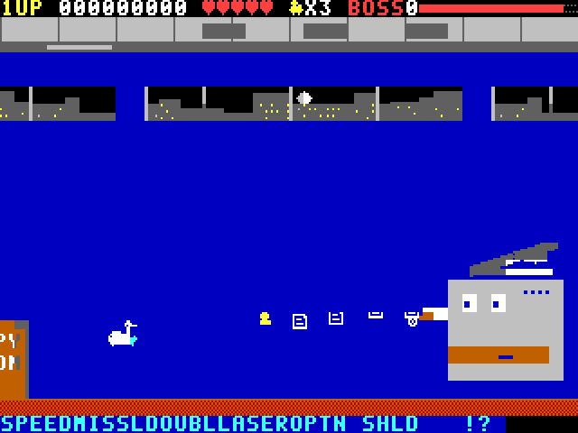

# BELLARIUS! (Microbee Premium Plus)

A Parodius-style comedy horizontal shoot-'em-up for the Microbee Premium Plus: a cranky goose in a flying bathtub, a pig on a piggy bank, a wind-up robot and a Microbee take on five silly stages, a birthday cake that fights back and THE CEO. VIBED BY BPM 2026.



## Run it
1. Put `release/BELLARIUS.DS8` (a DS80 800K disk image) on the Premium Plus SD card and boot it.
2. At the CP/M `A>` prompt type `BELLS` and press RETURN.
3. Press **C** for a colour monitor or **M** for monochrome (amber/green).
4. SPACE at the title, then pick a pilot and a skill level.

| Key | Action |
|---|---|
| arrows or Q A O P, or joystick | fly |
| SPACE or fire (hold) | shoot |
| X (or Z / M) | take the lit upgrade |
| C on pilot select | AUTO upgrades on/off |
| H | pause (ESC while paused quits) |
| S | sound: music + effects / effects / off |

## What's in it
- 4 pilots plus an unlockable fifth (POLLY the parrot, for clearing the game), each with their own handling, missile, double, laser and options.
- 5 stages, each with its own gag, enemies, terrain and boss: THE OFFICE IN THE CLOUDS (the Copytron 9000), CANDY CASTLE (the Birthday Cake), TOY BOX (the Jack-in-the-Box), SPACE OPERA (the One-Man Band) and HEAD OFFICE (the CEO). Then the ending.
- The capsule bar: SPEED MISSL DOUBL LASER OPTN SHLD !? (the last one wipes the screen).
- Bells: shoot them to bounce them, every third hit changes the colour; juggle a hot bell through a wave for a multiplier.
- Forgiving: hearts, not one-hit deaths (EASY 5, NORMAL 3, HARD 1), invulnerability after a hit, respawn on the spot with your capsules floating back.
- Title, attract demo, hall of fame, how-to-play, pause, name entry; scores and unlocks saved to SAVE.DAT on the disk.
- Music: public-domain classics arranged for the two-voice beeper, Parodius-fashion: the Can-can (title), Eine kleine Nachtmusik, The Entertainer, Flight of the Bumblebee, the William Tell gallop, In the Hall of the Mountain King, Bach's Toccata (bosses), Ride of the Valkyries (the CEO) and Ode to Joy (the ending).

## Build
Needs Python 3 with numpy and Pillow, and gcc for the test emulator.

```
cd src
python3 tools/build.py        # assembles, packs the art, writes build/BELLARIUS.DS8
```

## Test in the emulator
`src/tools/run.py` drives a Z80 + Premium Plus model (`tools/emu`). `RASTER=1` selects the raster-accurate model (`tools/emu_raster`, `mbee_raster.py`) with video RAM wait states and the 40-column dot clock. Test scripts: `stagetest.py N`, `bossfps.py`, `frontshots.py`, `savetest.py`, `loadertest.py`, `soak.py`, `perfmatrix.py`.

## Status
- Everything plays end to end in the emulator; soak tests run clean.
- Frame rate (raster model, stage 1): 22–23 fps unpowered, 15–17 fps mid-power, 12–14 fps fully powered. Boss fights 15–18 fps. An optimisation pass is still to come.
- Real hardware: the first test showed four small pictures and junk glyphs; fixed by selecting the 40-column dot clock (`in a,($09)` with A=1) — awaiting confirmation. Saving to the SD floppy emulation is untested on real hardware.

See `docs/DESIGN.md` for the full design.
