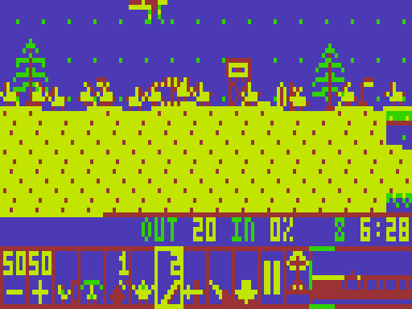

# Bilbies!

An original "guide the little critters home" puzzle game for the Dick Smith VZ300. Dig, build and block to get your bilbies home safely through 24 levels across Mild, Tricky, Tough and Wild, with Australian set pieces from the Harbour Bridge to Uluru.

Original characters, levels, artwork and jingles. The title tune is an arrangement of Grieg's *In the Hall of the Mountain King* (1875, public domain).

## You need
- VZ300 with the BennVenn SD loader and 128K RAM expansion (both 10K SRAM banks are used)

## Loading
Copy `release/BILBIES.VZ` to the SD card and run it from the BennVenn SD loader. It's the whole game in one file; there are no DAT files. If a RAM bank is missing, it tells you which one.

## Controls
Q A O P or joystick move the cursor (push against an edge to scroll). See `NOTES.txt` for the full controls and skill list.

## Folders
- `release/`: the game
- `src/`: Z80 source, Python level/art/music tools, test emulator; `build.sh` rebuilds it
- `screenshots/`: title, menus, level maps and set pieces
- `NOTES.txt`: the full manual
