# Bix the Bilby: The Star Digger (Microbee Premium Plus)

**The Lost Levels: five worlds, twenty stages, five bosses.** *VIBED BY BPM 2026*

A native Microbee version of the VZ300 game [Bix the Bilby](../Bix). It is not the VZ program with new video routines. The levels, the enemies and Bix's physics come from the VZ source, and a new display engine and new art sit under them.

Bix is a bilby, and bilbies come out at night. So the game is played at night: the paper is black everywhere, and the far scenery of the VZ game (hills, ridges, the moon) is painted into the sky in soft dithered dots, with twinkling stars.


| | |
|---|---|
| 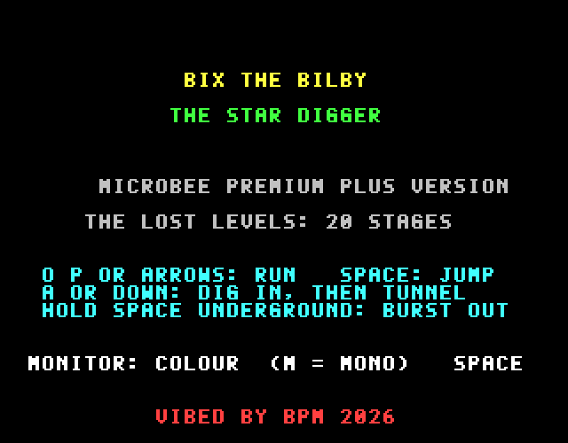 | 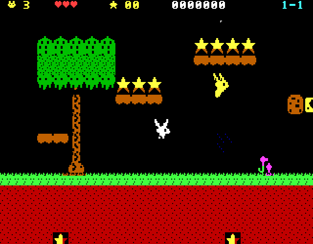 |
| 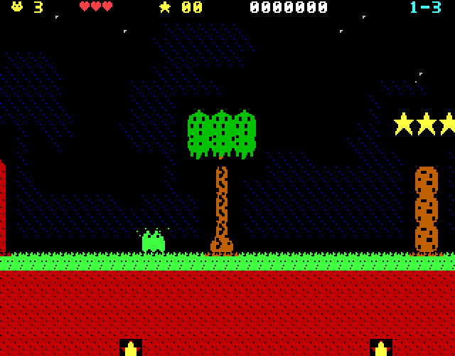 | 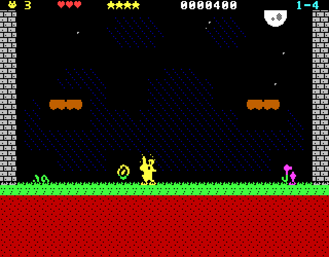 |
| 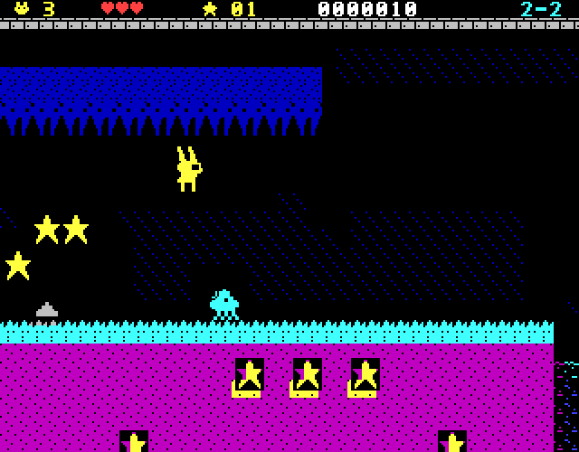 | 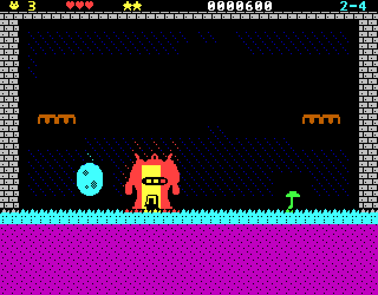 |
| 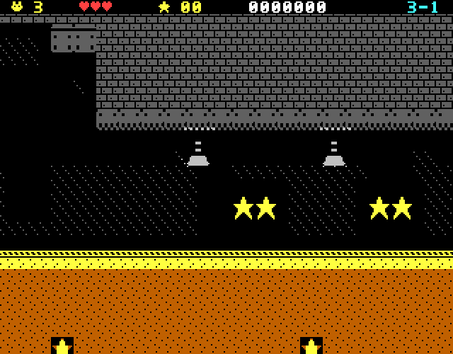 | 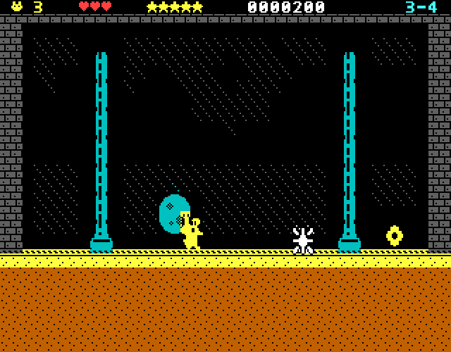 |
| 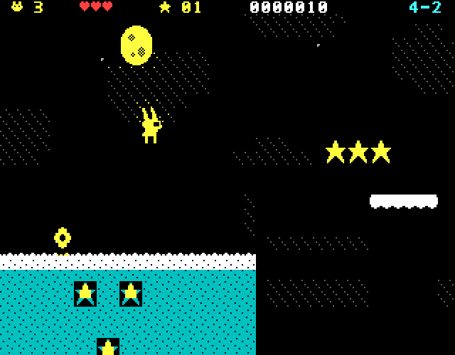 | 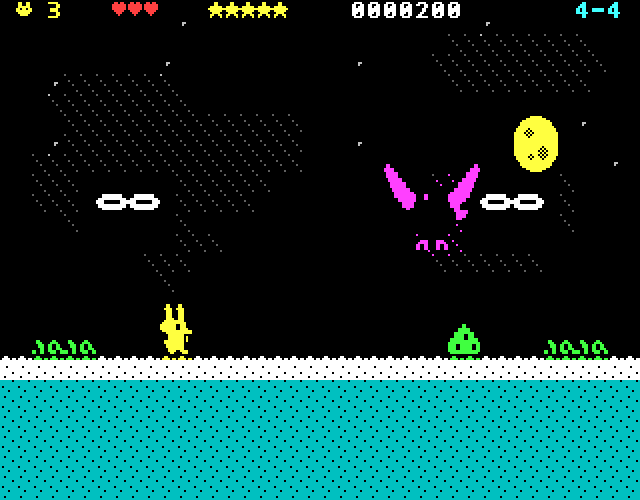 |
| 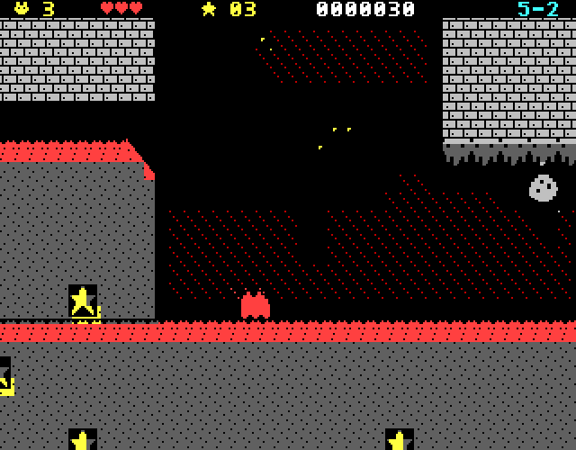 | 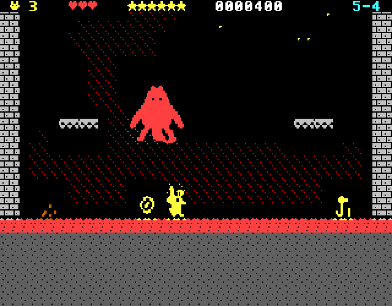 |
| 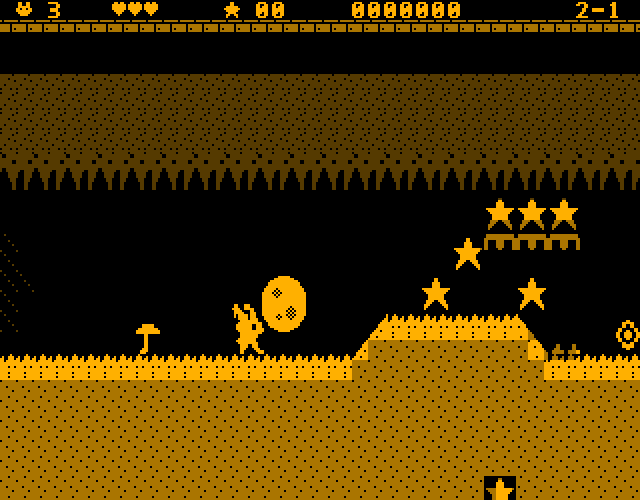 | |

## To run it

`release/BIX.DS8` is a double-sided 80-track disk image. Boot it and type **BIX** at the `A>` prompt. Press **M** for a monochrome monitor or **C** for colour, then SPACE.

| | Keys | Joystick |
|---|---|---|
| Run | O / P or ← → | left / right |
| Jump (hold for higher) | SPACE or M | fire |
| Dig in (standing on earth) | A or ↓ | down |
| Tunnel underground | O P Q A or arrows | any direction |
| Burst out | hold SPACE underground | fire |
| Music on / off | S | |
| Give up | ESC | |

Needs a Premium Plus: 1 MB RAM, 32K PCG RAM.

## What is in it

The VZ game's "Lost Levels" update: in each world, the first level, then two new levels, then the boss.

| World | Stages | Boss |
|---|---|---|
| 1 | Gumleaf Gully, Billabong Bend, Termite Towers | King Cane: stomp him six times, jump his shockwave |
| 2 | Crystal Caverns, The Glow Mines, The Sunless Sea | The Geode Golem: only a burst from under the ground hurts him |
| 3 | Clockwork Works, Conveyor Chaos, The Furnace | Rust-o-Tron: drops hot bolts, then lands to cool off; stomp it then |
| 4 | Skyward Isles, Cloud Nine, Storm Front | Thunderhawk: dives at Bix and lands dazed |
| 5 | Molten Peaks, Ashfall Ridge, The Caldera | The Magma Dragon: hops like King Cane, then takes to the air; eight hits |

- The screen is the full 40 × 25 cells of 8 × 10 pixels (320 × 250, PAL). The top line is the status line; the playfield is 40 × 24 cells.
- Every level is 16 tiles high (the VZ levels are 12): two more rows above, and two more of earth with star pockets to tunnel down to.
- Bix's full move set from the VZ game: run, skid, variable jump, slopes, springs, one-way logs, burrowing in eight directions and the burst.
- Each stage has its own tune (the VZ game's tunes, as slow blips). A boss's hits left show as stars in the status line.
- The text is a bold font of its own, two pixels to a stroke.
- Not yet: particles, the level clock, the title picture, time attack, high scores, a proper ending sequence. The floating logs and lifts move a whole cell at a time.

## How it differs from the VZ version

| | VZ300 | Microbee |
|---|---|---|
| Picture | 128 × 64, four colours | 320 × 250, one ink a cell on black, 16 colours |
| View | 16 × 7 tiles, scrolls both ways | 20 × 12 tiles, scrolls both ways |
| Scroll step | 1 VZ pixel | 2 pixels across (the same distance); 3 or 4 lines down |
| Backgrounds | hills in a second colour | the same shapes as dithered dots in the night sky |
| Frame rate | 25 | 23 to 25 (see below) |

## How the engine works

The 6545 can only move the picture a whole cell. Everything finer is done with the PCG.

- **Quads.** Each screen cell shows a 2 × 2 block of the world's cell glyphs (a "quad") at one of twelve offsets: four across (0, 2, 4, 6 pixels) by three down (0, 3, 7 lines). The offset is the PCG bank: all twelve pictures of a quad are kept at the same screen code in banks 0 to 11, so a fine scroll step is one attribute byte a cell, written to all 960 cells by a run of `PUSH` instructions in the vertical blanking.
- **Slots.** 127 screen codes are shared by the quads on show, with reference counts and a free ring. A quad coming on takes a slot and its twelve pictures go to the PCG in the next blanking. The pictures are built once per stage, when it loads, into a cache in RAM blocks 6, 21 and 22, and go to the PCG straight from there (no copy in the main 64K). A sprite's cell takes its background's picture from the same cache.
- **Coarse scroll is free.** The start address moves the picture a whole cell; the screen RAM is a ring of 2048 cells, so only the column or row coming on is written. The status line moves with the start address and is rewritten (codes, banks, colours: about 2 000 T) at each step.
- **The night painting is budgeted.** The scenery dots are cell-sized patterns at three densities. The stage builder thins the painting until no screen anywhere in the level needs more than 116 different quads.
- **Colour.** Paper is black everywhere, so a sprite over the painting shares its black. A quad that joins two inks takes, at each offset, the ink of the side showing more of itself; such cells are kept in per-column bitmaps and recoloured when the offset changes.
- **Sprites** are composed as in FrillSeeker: a private glyph for each cell a sprite touches, in two PCG pools that take turns.
- **No interrupts.** The vertical blanking is found by polling the 6545's status, inside the long loops too, so a blanking is never missed.

Measured in the emulator by `tools/alltest.py`, which visits six places in every level and fights every boss: 22.7 to 24.2 frames a second in the levels, and 21.5 to 25 in the boss fights. A frame is two fields; the slow ones are where a row of 40 cells comes on during a vertical pan (with the two-ink cells recoloured as the picture moves down), or many new quads come on at once. `tools/bench.py` runs a fixed course over four stages for comparing builds.

How the time is kept down:

- The frame's work runs while the last frame is on show; new slots' pictures go to the PCG in the middle blanking as soon as it is seen (as many as it has room for), and the second blanking only switches the picture (start address, the PUSH fill, the cells that changed, the status line).
- The recolour pass writes a cell only if its ink really changes between the old offset and the new one.
- A cell with the same quad as the one before it skips the quad table.

## Real machine

Earlier builds have run on a real Premium Plus: they load and scroll both ways. Still to confirm there with this build: the PAL 312-line timing with 25 rows of 10 lines, and the sound.

## To build it

Python 3 with numpy and Pillow, and a C compiler for the emulator.

```
python3 tools/fixjr.py        # builds everything into build/ (and fixes long JRs)
python3 tools/tour.py out/    # visits each part of Gumleaf Gully, saves pictures
python3 tools/alltest.py out/ # visits every stage and beats every boss by script
python3 tools/prof2.py 0 230  # where a frame's T-states go, by routine
python3 tools/bench.py        # frames a second over a fixed course
```

- `src/engine.asm`: start-up, stage loading, the frame, the sprite compositor, input
- `src/map.asm`: the quad engine: scroll steps, slots, recolouring, uploads, the status line
- `src/logic.asm`: Bix, the enemies and the items, lifted from the VZ source by `tools/port.py`
- `src/game.asm`: the front end, the camera, and what joins the two
- `tools/night.py`: the night tiles, the sky painting and the quad builder; `tools/data.py`: the twenty stages, from the VZ game's level files in `tools/vz/`
- RAM blocks: 4 game, 5 map code and tables, 7 the cell map, 6, 21 and 22 the quad picture cache, 8 to 15 the stages, 16 to 20 the sprites
- `tools/emu`: the Premium Plus model used for testing (its Z80 core looks like superzazu/z80, MIT licence; it is not part of the game)
