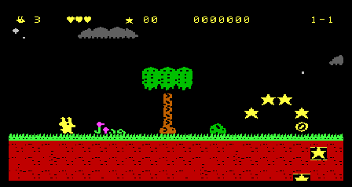
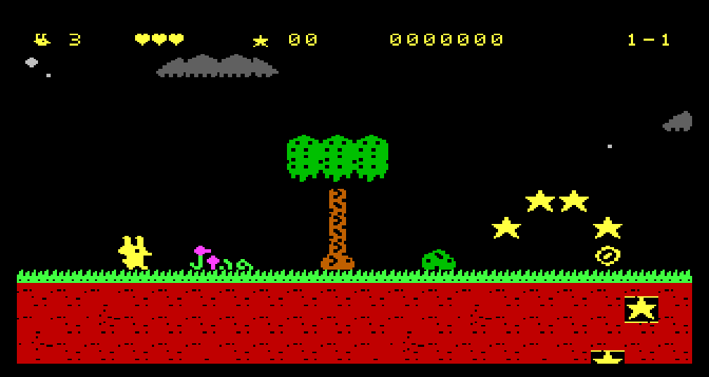
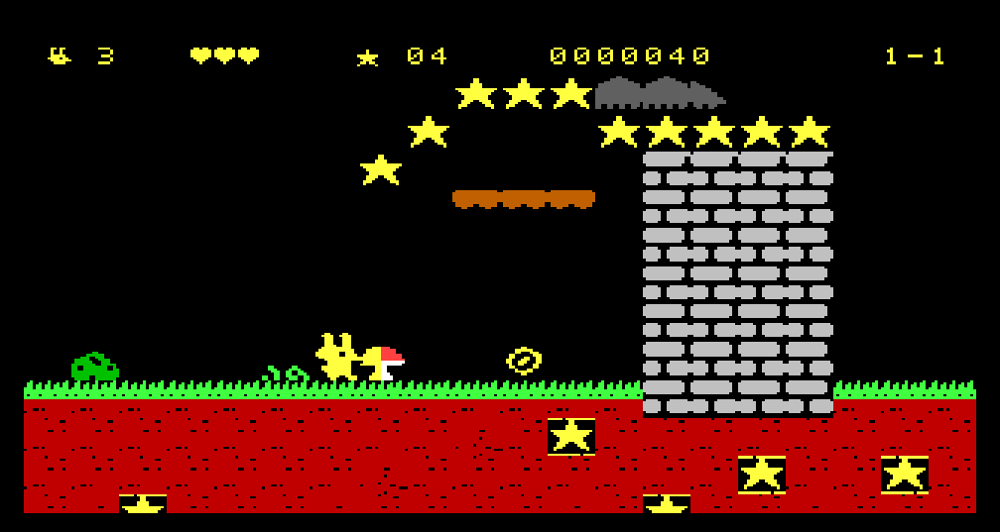
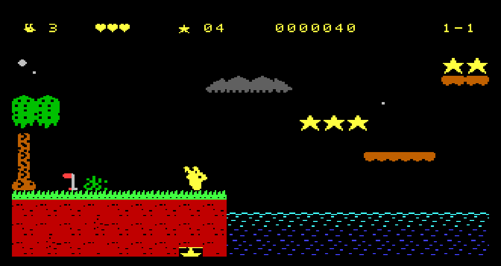
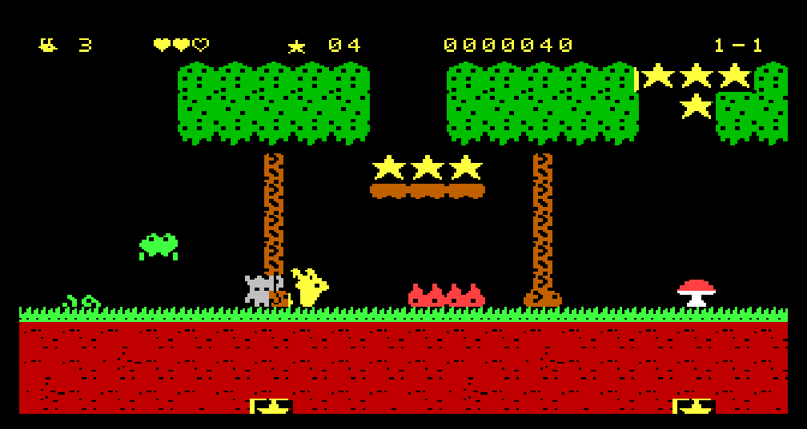
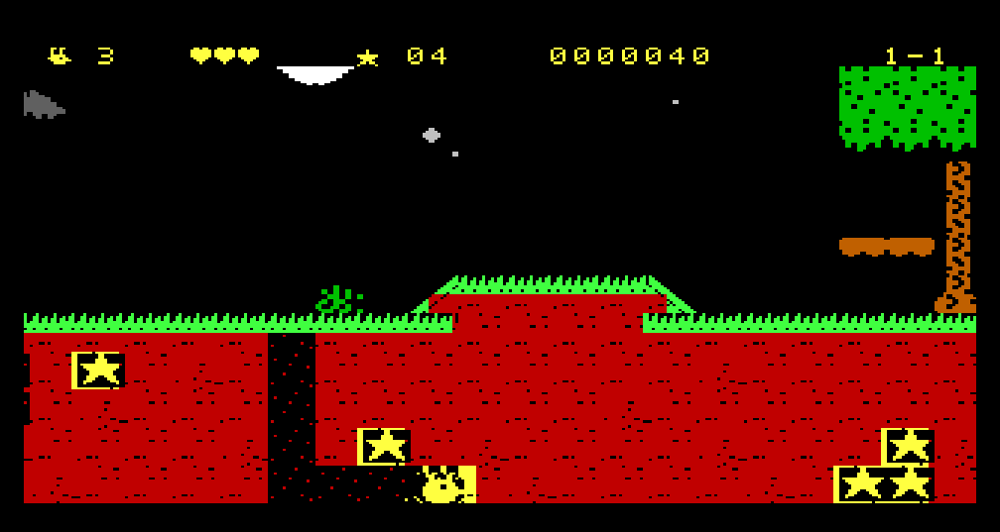
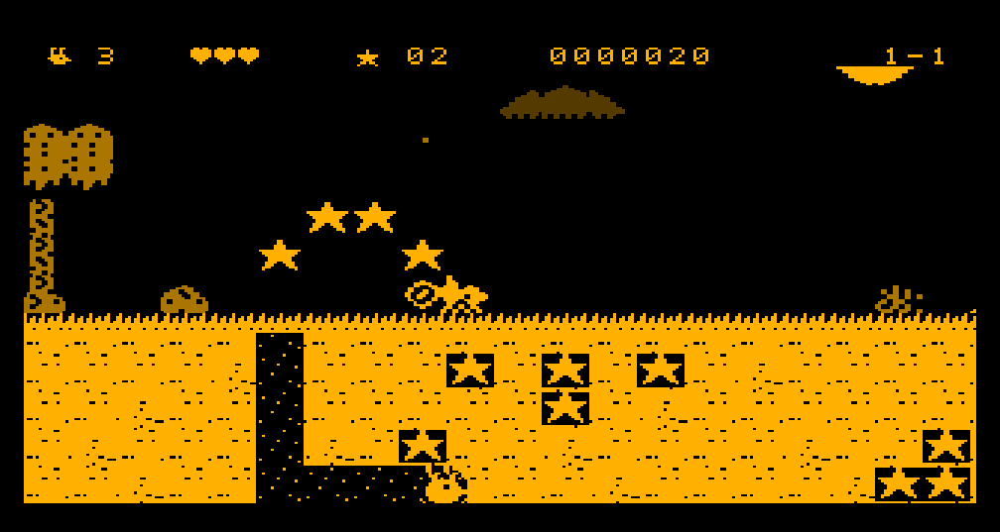

# Bix the Bilby: The Star Digger (Microbee Premium Plus)

**Prototype: World 1-1, Gumleaf Gully.** *VIBED BY BPM 2026*

A native Microbee version of the VZ300 game [Bix the Bilby](../Bix). It is not the VZ program with new video routines. The level, the enemies and Bix's physics come from the VZ source, and a new display engine and new art sit under them.



| | |
|---|---|
|  |  |
|  |  |
|  |  |

## To run it

`release/BIX.DS8` is a double-sided 80-track disk image. Boot it and type **BIX** at the `A>` prompt. Press **M** for a monochrome monitor or **C** for colour, then SPACE.

| | Keys | Joystick |
|---|---|---|
| Run | O / P or ← → | left / right |
| Jump (hold for higher) | SPACE or M | fire |
| Dig in (standing on earth) | A or ↓ | down |
| Tunnel underground | O P Q A or arrows | any direction |
| Burst out | hold SPACE underground | fire |
| Music on / off | S | |
| Give up | ESC | |

Needs a Premium Plus: 1 MB RAM, 32K PCG RAM.

## What is in the prototype

- All of Gumleaf Gully, 288 tiles long and now 16 tiles high (the VZ level is 12): two more rows of sky, with a high log and stars over each spring, and two more of earth, with star pockets to tunnel down to. This is a first pass at the taller layout and has not been balanced by play.
- The level's parts: the dig spots and buried stars, the wall to dig under, the billabong and its floating logs, the drop-bear forest, the thorn field over the secret tunnel, the climb, the gully run and the exit burrow.
- Bix's full move set from the VZ game: run, skid, variable jump, slopes, springs, one-way logs, burrowing in eight directions and the burst.
- Bull ants, magpies, drop-bears, cane toads and witchetty grubs, the Wattle Glow shield, the 1-UP, checkpoints, hearts, lives.
- In-game blip music (Bix's motif) and sound effects, played in the time the frame has left.
- Not yet: particles, the level clock, the other worlds and bosses, the title picture, high scores.

## How it differs from the VZ version

| | VZ300 | Microbee |
|---|---|---|
| Picture | 128 × 64, four colours | 320 × 200, one ink a cell on black, 16 colours |
| View | 16 × 7 tiles, scrolls both ways | 20 × 11½ tiles, scrolls both ways |
| Scroll step | 1 VZ pixel | 2 Microbee pixels across (the same distance), 8 lines down |
| Bix's movement | whole VZ pixels | half that: the game's sixteenths show |
| Frame rate | 25 | 25 |

## How the engine works

- **Coarse scroll is free.** The 6545's start address moves the picture a whole cell. The screen RAM is used as a ring of 2048 cells, so only the column coming on is written.
- **Fine scroll is one byte a cell.** Every join of two neighbouring 8 × 8 glyphs that can appear (362 of them in this level) is stored at four shifts, at the same screen code in four PCG banks. Shifting the picture two pixels means writing each cell's bank number.
- **The bank numbers are written by a ladder.** It is 500 `LD DE,nn` / `PUSH DE` with the stack pointer in the attribute RAM: 10.5 T a cell, about 10 700 T for the screen, inside one vertical blanking. There are four ladders (one a shift) and their operands are updated as cells come on, so nothing is worked out when one runs.
- **Vertical scroll is a row at a time.** A row step of the start address brings one row of 40 cells on. The camera follows the height Bix last stood at, so an ordinary jump does not move it; a spring, a burst or a long fall does.
- **The 6545 slide was tried and dropped.** Holding the picture down 0 to 6 lines with the vertical total adjust (R5) works in the emulator, but on a real Premium Plus the picture did not visibly move, so the status line (drawn the same amount up to cancel it) bounced instead. The code is still in the engine (`smooth` in `vars.inc`) and is switched off.
- **Sprites** are composed as in FrillSeeker: a private glyph for each cell a sprite touches, in two PCG pools that take turns.
- **The floating logs are not sprites.** They are glyphs written into the map, so they scroll and shift like scenery and cost almost nothing.
- **Colour clash is kept down by rule.** Paper is black everywhere. A cell that joins two inks takes the ink of the side showing more of itself, and is recoloured when the shift changes that. Solid ground keeps its own ink under a sprite.

Measured in the emulator on a tour of the whole level (`tools/tour.py`): 24.4 frames a second, with 15 frames in 752 taking three fields instead of two. Before the level could scroll vertically it was 10 in 765. The slow frames are mostly ones where a row comes on (about 20 000 T to build when it is solid earth) in a frame that is already busy, so a fast vertical pan, such as a long fall, can drop a frame or two.

## Not yet tested on a real machine

Everything above was measured in the Premium Plus model in `tools/emu`. It has now run on a real Premium Plus: it loads and scrolls both ways. Still to confirm there:

1. The start address walking all the way round the 2048-cell ring (the picture wrapping from the end of the screen RAM to its start).
2. The stack pointer in the attribute RAM (the ladder).
3. The sound: it has not been heard.

The disk's boot and load could not be run in the model (no boot ROM in the repository). The loader is FrillSeeker's, which loads on the real machine.

## To build it

Python 3 with numpy and Pillow, and a C compiler for the emulator.

```
python3 tools/fixjr.py        # builds everything into build/ (and fixes long JRs)
python3 tools/tour.py out/    # visits each part of the level, saves pictures
python3 tools/prof.py         # where a frame's T-states go
```

- `src/engine.asm`: the scroll, the ladders, the sprite compositor, the frame
- `src/map.asm`: the world as a map of cell glyphs, and the code that turns it into screen cells
- `src/logic.asm`: Bix, the enemies and the items, lifted from the VZ source by `tools/port.py`
- `src/game.asm`: the front end, the camera, and what joins the two
- `tools/gfx.py`, `tools/data.py`: the art and the level, from the VZ game's own art and level files in `tools/vz/`
- `tools/emu`: the Premium Plus model used for testing (its Z80 core looks like superzazu/z80, MIT licence; it is not part of the game)
