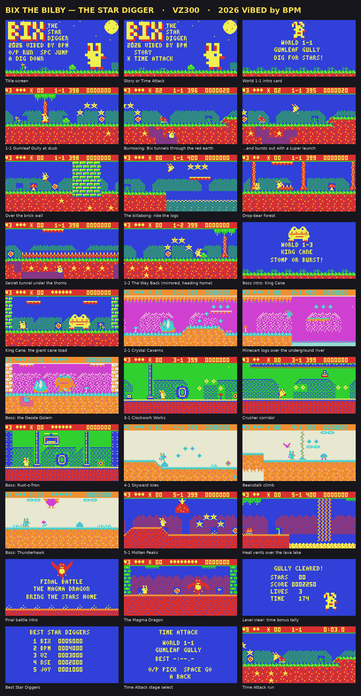

# Bix the Bilby: The Star Digger

An original scrolling platformer and mascot for the Dick Smith VZ300. Run, jump, dig and tunnel through five worlds, from Gumleaf Gully to the Molten Peaks, and beat the bosses: King Cane, the Geode Golem, Rust-o-Tron, the Thunderhawk and the Magma Dragon. Includes time attack and high scores.

Mode 1, 128×64, four colours. 2026, ViBED by BPM.

## You need
- VZ300 with the BennVenn SD loader and 128K RAM expansion
- Joystick optional (auto-detected)

## Loading
Copy `release/BIX.VZ` to the SD card and load it like any .VZ game. It loads at $8000 and starts by itself.

## Controls
| Action | Keys | Joystick |
|---|---|---|
| Run | O / P (or Z / X) | left / right |
| Jump (hold for higher) | SPACE or M | fire (or up) |
| Dig in (standing on earth) | A | down |
| Tunnel underground | O P Q A | any direction |
| Burst out | hold SPACE underground | fire |

## Folders
- `release/`: the game
- `src/`: Z80 source, Python art/level/music tools, test emulator; `build.sh` rebuilds it
- `screenshots/`: every level, plus an animated jump-and-dig
- `NOTES.md`: the full design notes, level by level, boss by boss
