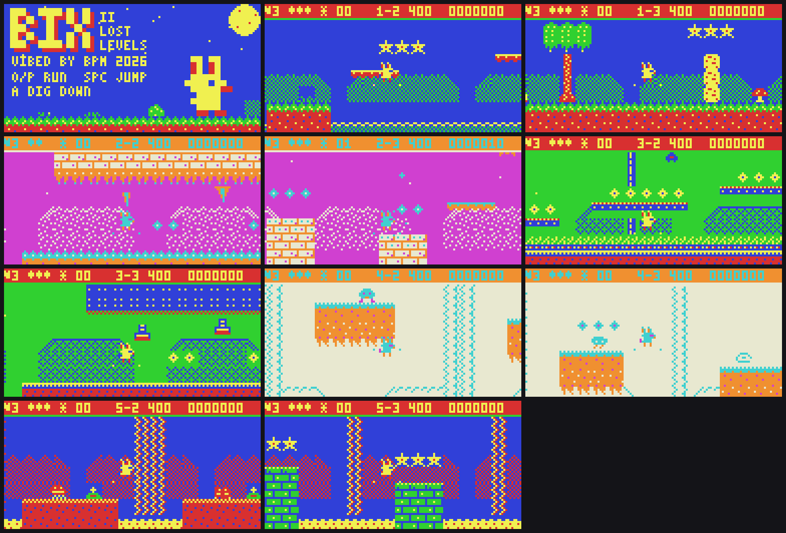

# BIX THE BILBY 2: THE LOST LEVELS
### VIBED BY BPM 2026

The sequel to *Bix the Bilby: The Star Digger* for the Dick Smith VZ300 with the
BennVenn SD loader and 128K. The first game had to fit in one load, so each
world's second stage was the first stage played backwards ("The Way Back").
Bix 2 loads every stage from the SD card instead. That makes room for two
brand-new acts in each world before the boss: **20 stages in all**.

## You need
- VZ300 with the BennVenn SD loader and 128K RAM expansion
- Joystick optional (both joysticks work)

## Loading
Copy **all 21 files** from `release/` into the same folder on the SD card:
`BIX2.VZ` and `BIX2L01.DAT` ... `BIX2L20.DAT`. Load `BIX2.VZ` like any .VZ game.
Each stage is read from the card when you reach it (about half a second).
If a file is missing you get "CAN'T READ SD FILE" with its name; copy it over
and press SPACE to try again. If the .DAT files are from a different build of
the game you get "OLD SD FILE - COPY AGAIN".

## Controls
| Action | Keys | Joystick |
|---|---|---|
| Run | O / P (or Z / X) | left / right |
| Jump (hold for higher) | SPACE or M | fire (or up) |
| Dig into the ground | A (standing on earth) | down |
| Tunnel underground | O P Q A | all directions |
| Burst out | hold SPACE underground | fire |
| Music on / off | S | |

## The worlds
Each world is three acts and a boss.

| | Act 1 | Act 2 (new) | Act 3 (new) | Boss |
|---|---|---|---|---|
| 1 | Gumleaf Gully | **Billabong Bend**: stepping stones, a log hill to burrow through, the big billabong | **Termite Towers**: mounds to dig through, termite stacks, a tunnel under a rock lid | King Cane |
| 2 | Crystal Caverns | **The Glow Mines**: minecarts over two chasms, a stalactite gallery, lift shafts | **The Sunless Sea**: an underground lake of rafts and rock islets, a bat roost | The Geode Golem |
| 3 | Clockwork Works | **Conveyor Chaos**: a belt staircase over the live floor, a stamping line, the tower lift | **The Furnace**: the slag channel, the hammer room, a scrap mountain, the ladle line | Rust-o-Tron |
| 4 | Skyward Isles | **Cloud Nine**: the cloud ferry, an updraft ladder, two layers of thunderheads, a beanstalk | **Storm Front**: bounce isles, a lightning isle, the gale, a storm cellar to dig under | Thunderhawk |
| 5 | Molten Peaks | **Ashfall Ridge**: ash drifts to burrow, a rockfall gully, a geyser field, cinder cones | **The Caldera**: vents over the lava lake, obsidian halls, magma falls, the vent chimney | The Magma Dragon |

Every new act has its own in-game tune, checkpoints, buried stars, a 1-UP
hidden underground, and a bonus block. As before: a 400-second clock, a time
bonus, the water and pit rescue, three hits a life, Time Attack on all 15 acts,
the high-score table and the attract demo.

## How the SD loading works
- The DOS stays alive. Bix 2 runs in SRAM bank B (port $37 = 7) and leaves the
  DOS's bank and the top of upper bank 0 alone.
- Each `BIX2Lnn.DAT` holds one stage: the map, the spawn list, the tileset, the
  enemy and boss frames, Bix's frames and the tune (2.0-2.4K each). It is read
  into upper bank 0 and unpacked from there.
- The DOS is called the way the user's machine already runs Graves 'n'
  Gargoyles and Dracula's Castle II: sector buffer $F800, interrupts off and
  IM 1, DI after every call, and a 4K stack. Because the game keeps its
  variables in $7800-$7BFF (the ROM/DOS system area), it parks them in upper
  bank 0 and puts back the DOS's copy for the duration of each call.

See `NOTES.md` for the memory map and the full development notes.
