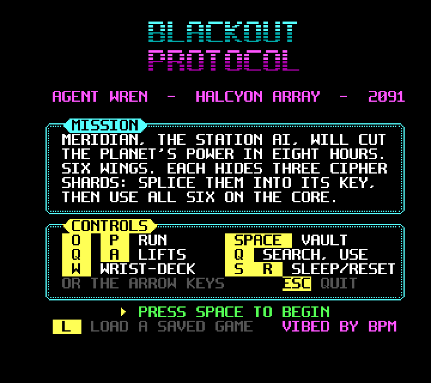
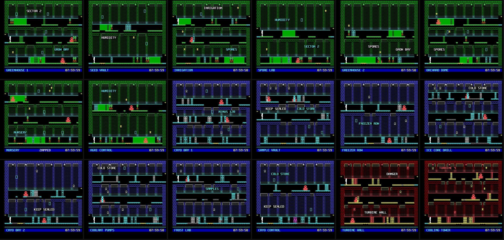
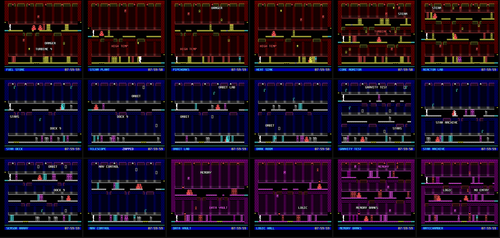
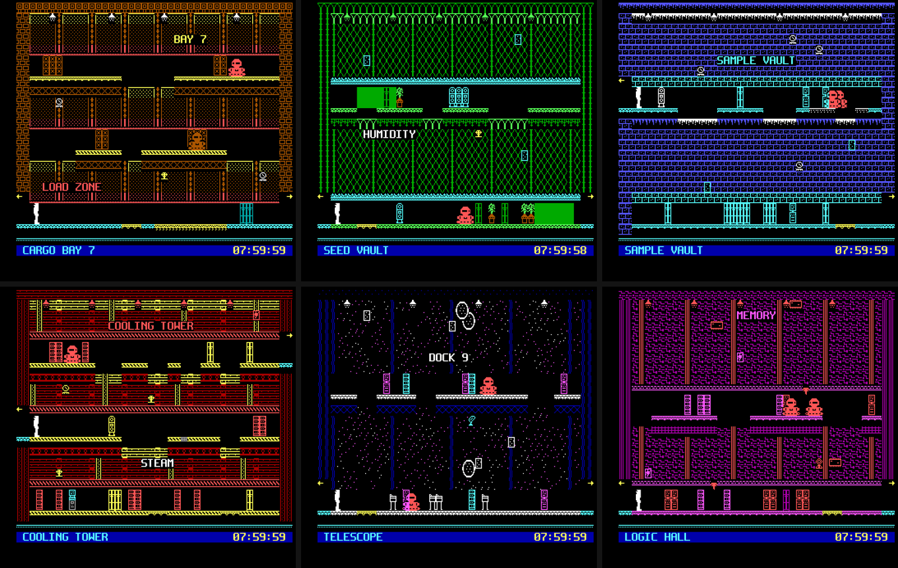
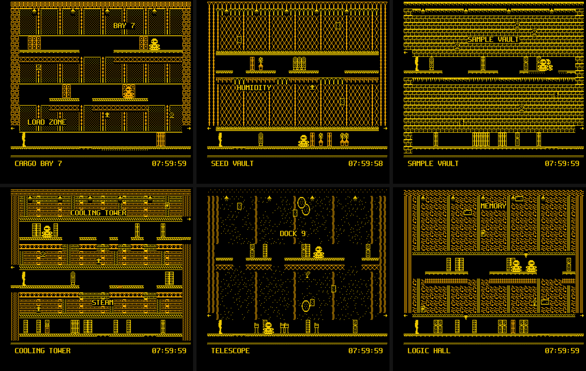
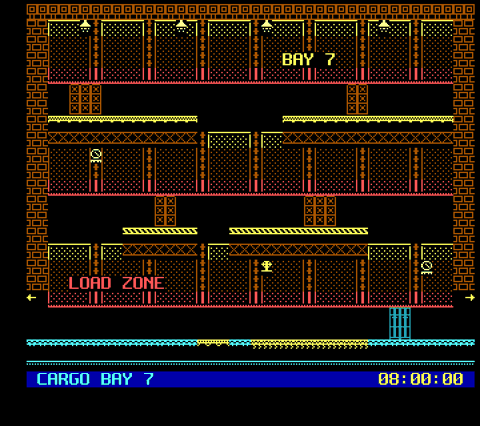
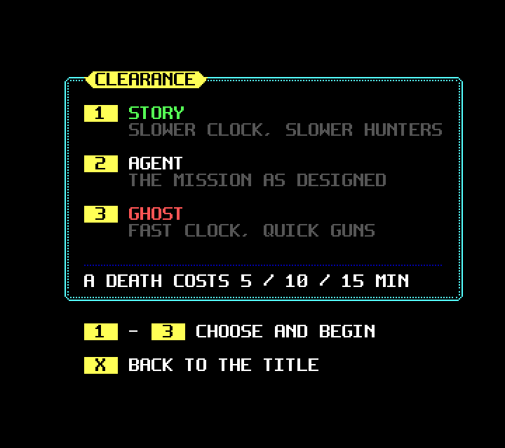
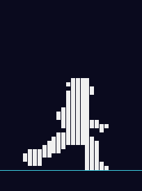

# Blackout Protocol (Microbee Premium Plus)

An original action-puzzle game in the style of *Impossible Mission*, for the
**Microbee Premium Plus** (1 MB RAM, 32 KB PCG RAM). It runs in a full-screen
PAL mode of 42×24 cells (336×288 pixels) and comes on one double-sided
80-track disk.

MERIDIAN, the AI of the HALCYON ARRAY station, will cut the planet's power in
eight hours. Agent Wren must search six wings of the station for 18 cipher
shards. Three shards are spliced into each wing's key, and all six keys open
MERIDIAN's core.

## Running it

1. Put `release/BLACKOUT.DS8` in drive A (keep it writable, since saved games go on it).
2. Boot it. The game starts by itself.

At start-up the game reads everything into the 1 MB of RAM through CP/M, so
nothing is loaded during play. The disk carries a small loader of its own in
place of the CP/M command processor (see *Auto-boot* below), so it boots
straight into the game.

In the uBonPC emulator, `src/play.bat` boots the disk.

## Controls

| Key | Action |
|---|---|
| `O` / `P` or ← / → | run left / right |
| `Q` / `A` or ↑ / ↓ | ride a lift; search or use (`Q` / ↑) |
| `SPACE` | vault (a forward somersault over robots and gaps) |
| `W` | wrist-deck: map, keys, shards, codes, time; `S` there to save |
| `S` / `R` at a security terminal | use a SLEEP code (robots off 20 s) / a RESET code (lift pads back) |
| `ESC` | pause (`Y` quits to the title) |
| `L` (title) | load a saved game |

## The game

- **47 rooms in six wings**: Docking, Hydroponics, Cryo Labs, Reactor Deck,
  Observatory and the MERIDIAN Core. They're joined by twelve smoothly
  scrolling lift shafts, one room-height per floor, and each wing has its own
  architecture (shafts included), so they look different even on a mono screen.
- **Searching**: stand at a piece of furniture and hold `Q`. It might hide a
  shard, a SLEEP or RESET code, or nothing. Searched furniture is half-toned.
- **Robots**: patrols, zappers, hunters and sentries, plus steam vents and
  laser gates. They zap at close range when you're in front of them. Watch
  their patterns, vault them, change floors, or put them to sleep from a
  security terminal.
- **Splice terminals**: each wing's key is a punch card cut into three
  shards. You find the shards scrambled, then turn (`R`) and flip (`F`) them
  until the three fill the card exactly. `H` gets help for ten minutes of the
  clock.
- **Tone locks**: in five wings a security terminal is locked by a tone
  sequence. MERIDIAN plays it and you repeat it on keys 1–6, over three rounds.
  It opens for a SLEEP and a RESET code.
- **The clock**: a death costs game time, and when it reaches zero, it's dark.
- **Three levels**, all built to be finished:
  - *Story*: about 5 hours on the clock, 3 minutes a death, slow robots.
  - *Agent*: about 3 h 50, 6 minutes a death.
  - *Ghost*: about 2 h 45, 12 minutes a death, faster robots and guns.

  On Story and Agent, a **SHARD SIGNAL** tells you when a room you enter still
  hides a shard.
- **Saves**: four slots on the disk. Slot 0 is an autosave made each time a key
  comes online.
- **MERIDIAN speaks**, with nine original lines, and there's an original
  sectioned title tune plus wing stings.
- **Attract mode**: if the title is left alone, Wren plays a demo by herself.

| | |
|---|---|
|  |  |
|  |  |
|  |  |

## Wren's animation

Wren's run and somersault are rotoscoped from Eadweard Muybridge's *Animal
Locomotion* (1887, public domain): Plate 60 (a man running) and Plate 363
(a running somersault). The joint angles were read off each photograph and
drive a skeleton that renders a clean 24×24 sprite.

## Technical notes

- **Display**: the 6545 is set to 42×24 cells of 8×12. Each cell is its own
  PCG character, on two double-buffered pages. Video RAM can only be reached
  in horizontal blanking, so the game draws into a software copy of the screen
  and sends across only the cells that changed. Logic runs once per 50 Hz
  field, so the game keeps time when a busy room draws at 25 fps.
- **Memory**: rooms, sprites (pre-shifted and pre-mirrored), speech and music
  live in the 1 MB banks. The information screens are overlays loaded only
  while they're up.
- **Sound**: two-channel music on the 1-bit speaker. Speech is "clipped
  speech" (the speaker flips where the voice crosses zero), so it plays at
  full volume on a real Microbee speaker.
- **Auto-boot**: the Microbee CP/M boot code loads `SHELL.SYS` if a disk has
  one, otherwise `CCP.SYS`. Disk A has no `SHELL.SYS` (**the Microbee shell is
  not used**). Its `CCP.SYS` is a 384-byte loader (`src/src/autoboot.asm`) that
  reads `BLACKOUT.COM` and runs it. The disk works write-protected and is still
  an ordinary CP/M disk.
- **Saving through CP/M**: the game overwrites CP/M while it runs, so it keeps a
  copy in a spare bank. To save, it swaps CP/M back for a moment, lets the BDOS
  write `SAVES.DAT`, then swaps itself back. That's CP/M's own disk code, so it
  works on SD-card Premium Plus disk images too. A write-protected disk just
  shows SAVE FAILED.

## Building

`src/` holds everything: the Z80 source (`src/src`), the Python generators
(`src/tools`: rooms, art, font, music, speech, disks), the Muybridge reference
plates (`src/ref`) and the emulator test scripts (`src/test`). Put
`sjasmplus.exe` in `src/tools/` and run `src/build.ps1`. The disks come out in
`src/outputs/BLACKOUT.DS8`. `src/DESIGN.md` is the full design and development log.

Blackout Protocol is an original game: its names, art, music and speech are
its own, made in the style of *Impossible Mission*, not copied from it.
