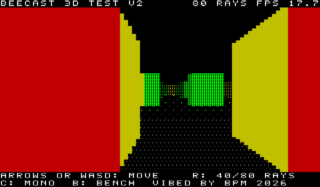

# BUNYIP (working title) — Microbee Premium Plus first-person game

A Wolfenstein-style first-person game for the Microbee Premium Plus, native Z80, in the 40 × 25 mode with 8 × 10 cells.

VIBED BY BPM 2026

## Status: work in progress

| Part | State |
|---|---|
| Wall engine (`release/BEECAST2.DS8`, program `RAY`) | Runs on a real Premium Plus |
| Game: four zones, doors and keys, levers and gates, creatures, bosses, items, sprites, loading from disk | Being built; sources in `src/` |

## The engine test

Boot `release/BEECAST2.DS8` and type `RAY` at the `A>` prompt.

| Key | Action |
|---|---|
| Cursor keys or W A S D | Walk and turn |
| R | 80 rays / 40 rays |
| C | Colour / mono |
| B | Benchmark (hall and corridor frame rates) |

Emulator benchmark: 80 rays — hall 17.6 fps, corridor 25.4 fps; 40 rays — hall 20.6, corridor 31.6.

## How the walls are drawn

Each character cell shows one PCG glyph whose left and right halves are wall to different heights, so 80 half-columns of picture come from at most 880 cell writes. The PCG bank picks the dither shade, colour RAM the ink. Rays are grid walks using log tables (no multiplies); only every second ray is always cast. Two screen pages are flipped in vertical blank and only changed cells are rewritten.
