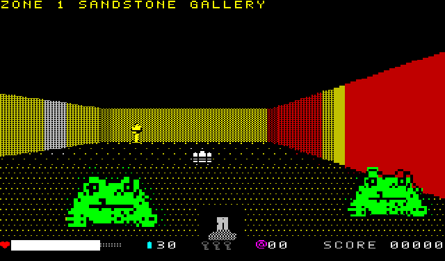
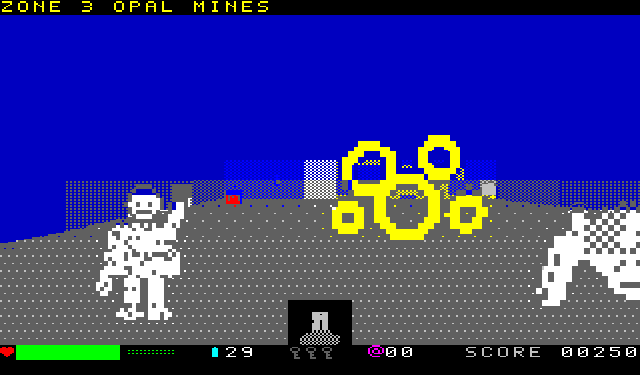
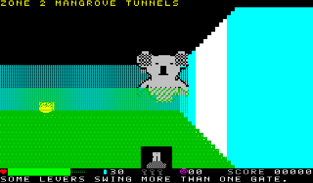
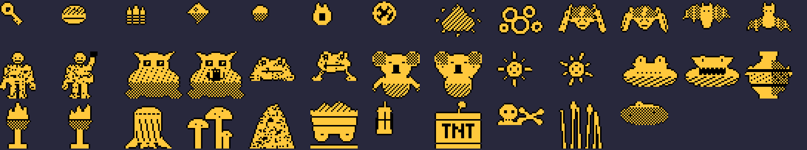

# BUNYIP (working title) — Microbee Premium Plus first-person game

A Wolfenstein-style first-person adventure for the Microbee Premium Plus, native Z80, in the 40 × 25 mode with 8 × 10 cells.

VIBED BY BPM 2026

## Status: work in progress

| Part | State |
|---|---|
| Wall engine (`release/BEECAST2.DS8`, program `RAY`) | Runs on a real Premium Plus |
| Game (`release/BUNYIP.DS8`, program `BUNYIP`) | Playable in the emulator. **Not yet tried on real hardware.** |

The game's loader is adapted from HULLBREACH's (which runs on hardware), but this disk has only been run in the test emulator so far.

## Playing

Needs a Premium Plus with 1MB RAM. Boot `release/BUNYIP.DS8`, type `BUNYIP` at the `A>` prompt.

| Key | Action |
|---|---|
| Cursor keys or W A S D | Walk and turn |
| Z / X | Sidestep |
| SPACE | Zap |
| E or RETURN | Use: doors, levers, secret walls |
| M | Map of what you have seen |
| P | Pause |
| C | Colour / amber mono |

Four zones, each with its own colours, maze, lever-and-gate puzzle, creatures, scenery and guardian:

| Zone | Creatures | Scenery | Guardian |
|---|---|---|---|
| Sandstone Gallery | redbacks, flying foxes, cane toads | urns (smash them for what's inside), braziers, bones | giant redback |
| Mangrove Tunnels | flying foxes, yowies, drop bears | stumps, glowing fungus, bull ant nests (they sting) | giant flying fox |
| Opal Mines | yowies, redbacks, min min lights (they throw fire) | ore carts, lanterns, TNT (shoot it from a distance; it sets off its neighbours) | giant yowie |
| The Bunyip's Deep | yowies, redbacks, saltwater crocs | bones, reeds, boiling mud (it burns) | the Bunyip |

Creatures flicker white and burst into a puff of smoke when they fall, and sometimes leave charges or a meat pie. The Southern Cross pickup gives double zaps for about 30 seconds (the zapper and its counter turn yellow). Health is a bar; when it runs out you are knocked down and get up again.

 

## How it works

- **Walls:** each character cell shows one PCG glyph whose left and right halves are wall to different heights, so 80 half-columns of picture come from at most 880 cell writes. Rays are grid walks using log tables. Two screen pages flip in vertical blank, and only changed cells are rewritten.
- **Sprites:** 37 images (creatures with two frames, items, scenery, smoke). Each is shrunk once to 16 sizes and stored as byte columns, plain and shifted half a cell, packed into RAM blocks 6–21. The things every zone uses are made at start-up. Each zone's creatures and scenery are made while its story screen is shown. Drawing works one character cell at a time: the sprite's lines for the cell are built first, and cells where nothing shows are skipped. A cell the sprite covers completely skips reading the background back. Otherwise the cell's glyph is read back from PCG RAM, and the sprite is laid over it in a private glyph. The cell takes the sprite's colour only where the sprite is most of what is lit in it.
- **Memory:** program 8000h–DD5Fh. Block 1 holds the tables and the zone map (plus a 1K "scenery in the way" map). Block 2 holds the four zones, block 3 the sprite masters, and block 4 the glyphs plus the sprite directory. Blocks 6–21 hold the shrunk sprites.

Frame rates in the emulator: about 12–20 fps in open rooms, dropping to 5–8 fps with two or three big creatures close up. Creatures now keep about two cells away and lunge, which keeps the biggest sprites off the screen.

## Building

`src/bn.sh` builds everything into `src/build/` (Python 3 with Pillow, gcc for the test emulator): the engine tables and glyphs, the sprites, the zones (`tools/zones.py` also checks that every zone can be finished), the program, the loader and `BUNYIP.DS8`. `tools/rungame.py` runs the game in the test emulator; `--at zone,x,y,angle` starts anywhere.

