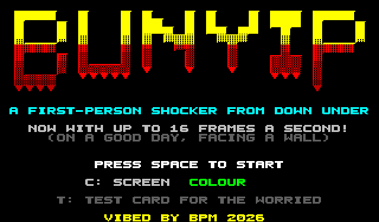
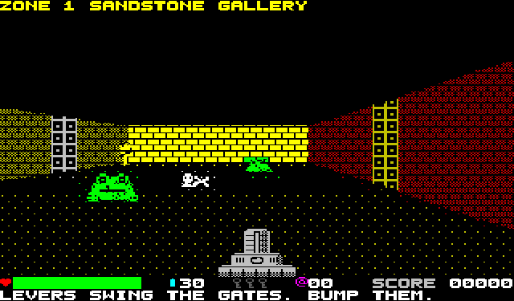

# BUNYIP (working title) — Microbee Premium Plus first-person game

A Wolfenstein-style first-person adventure for the Microbee Premium Plus, native Z80, in the 40 × 25 mode with 8 × 10 cells.

VIBED BY BPM 2026

## Status: work in progress

| Part | State |
|---|---|
| Wall engine (`release/BEECAST2.DS8`, program `RAY`) | Runs on a real Premium Plus |
| Game (`release/BUNYIP.DS8`, program `BUNYIP`) | Loads and runs on a real Premium Plus: walls, HUD, title, music and controls work. Sprites were garbled on hardware through four builds; by the fourth the backgrounds behind them were right and the sprites themselves came out as thin vertical strips. The half-cell-shifted sprite copies were being built with the Z80's `RRD` instruction, the only use of it in the game, and the test emulator reproduces those strips when `RRD` is made to misbehave. This build makes the shifted copies with plain ANDs and rotates. **Not yet confirmed on hardware.** |

The title screen's `T` key shows a test card: video memory read-back, `RRD` and `RLD`, whether RAM blocks 5-31 are each their own memory, and video writes with a high block mapped.

## Playing

Needs a Premium Plus with 1MB RAM. Boot `release/BUNYIP.DS8`, type `BUNYIP` at the `A>` prompt.

| Key | Action |
|---|---|
| Cursor keys or W A S D | Walk and turn |
| Z / X | Sidestep |
| SPACE | Zap |
| E or RETURN | Use: doors, levers, secret walls |
| M | Map of what you have seen |
| P | Pause |
| C | Colour / amber mono |
| R | Sharp walls (80 rays) / fast walls (40 rays) |

SPACE on the title goes to the skill menu: SHE'LL BE RIGHT (half damage), HURT ME PLENTY, FLAMIN' NIGHTMARE (double). Left alone, the title plays its three-voice tune and then cycles through the story, the keys and the locals.

Doors are the walls made of square panels, gates are bars, and walls marked with arrows are levers and exits.

Four zones, each with its own colours, maze, lever-and-gate puzzle, creatures, scenery and guardian:

| Zone | Creatures | Scenery | Guardian |
|---|---|---|---|
| Sandstone Gallery | redbacks, flying foxes, cane toads | urns (smash them for what's inside), braziers, bones | giant redback |
| Mangrove Tunnels | flying foxes, yowies, drop bears | stumps, glowing fungus, bull ant nests (they sting) | giant flying fox |
| Opal Mines | yowies, redbacks, min min lights (they throw fire) | ore carts, lanterns, TNT (shoot it from a distance; it sets off its neighbours) | giant yowie |
| The Bunyip's Deep | yowies, redbacks, saltwater crocs | bones, reeds, boiling mud (it burns) | the Bunyip |

Creatures flicker white and burst into a puff of smoke when they fall, and sometimes leave charges or a meat pie. The Southern Cross pickup gives double zaps for about 30 seconds (the zapper and its counter turn yellow). Health is a bar; when it runs out you are knocked down and get up again.

 

## How it works

- **Walls:** each character cell shows one PCG glyph whose left and right halves are wall to different heights, so 80 half-columns of picture come from at most 880 cell writes. Rays are grid walks using log tables. Two screen pages flip in vertical blank, and only changed cells are rewritten. Each zone has its own 8 x 10 wall textures (lit face, shaded face, accent) and floor; doors, gates and lever panels have textures shared by all zones. The 12 banks of wall glyphs are generated on the Z80 when a zone loads.
- **Sprites:** 37 images (creatures with two frames, items, scenery, smoke). Each is shrunk once to 16 sizes and stored as byte columns, plain and shifted half a cell, packed into RAM blocks 6–21. The things every zone uses are made at start-up. Each zone's creatures and scenery are made while its story screen is shown. Drawing works one character cell at a time: the sprite's lines for the cell are built first, and cells where nothing shows are skipped. A cell the sprite covers completely skips reading the background back. Otherwise the cell's background glyph is copied from a tileset kept in RAM, and the sprite is laid over it in a private glyph. Which glyph, bank and colour the wall renderer left in a cell is worked out from the column's state; no video memory is read back. The cell takes the sprite's colour only where the sprite is most of what is lit in it.
- **Sound:** effects are short bursts of speaker toggles with sweep and noise, one burst per frame. The title tune is a three-voice pulse mixer at about 18 kHz.
- **Memory:** program 8000h–E37Fh. Block 1 holds the tables and the zone map (plus a 1K "scenery in the way" map). Block 2 holds the four zones, block 3 the sprite masters, and block 4 the glyphs plus the sprite directory. Blocks 6–21 hold the shrunk sprites.

Frame rates in the emulator: a scripted 60-second play session averages about 16 fps (17 with fast walls), up from 13 in the first playable build. Quiet rooms run at 15–27 fps. A close fight with two or three big creatures still drops to about 5 fps, because nearly every character cell around them has to be recomposed. Creatures keep about two cells away and lunge, which keeps the biggest sprites off the screen.

## Building

`src/bn.sh` builds everything into `src/build/` (Python 3 with Pillow, gcc for the test emulator): the engine tables and glyphs, the sprites, the zones (`tools/zones.py` also checks that every zone can be finished), the program, the loader and `BUNYIP.DS8`. `tools/rungame.py` runs the game in the test emulator; `--at zone,x,y,angle` starts anywhere.

