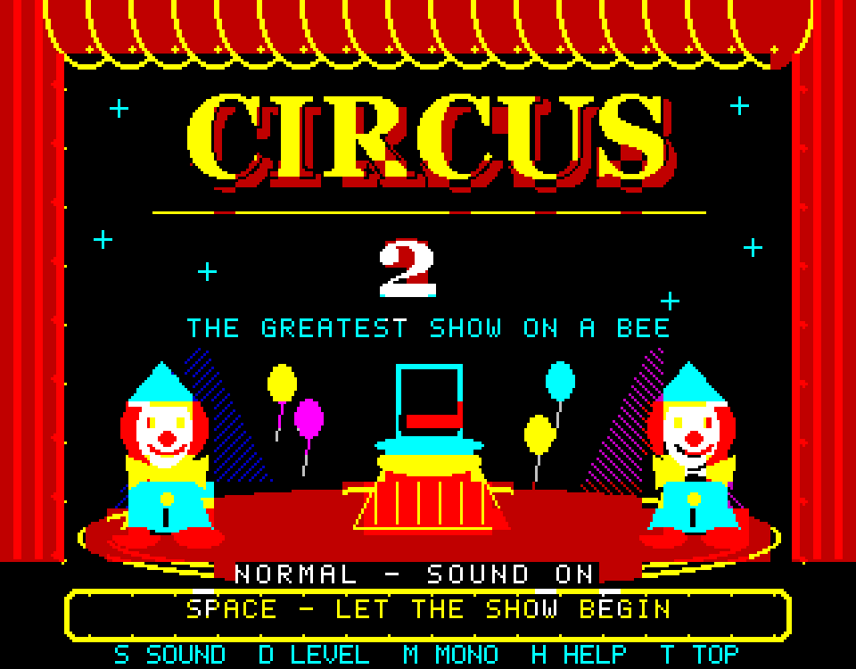
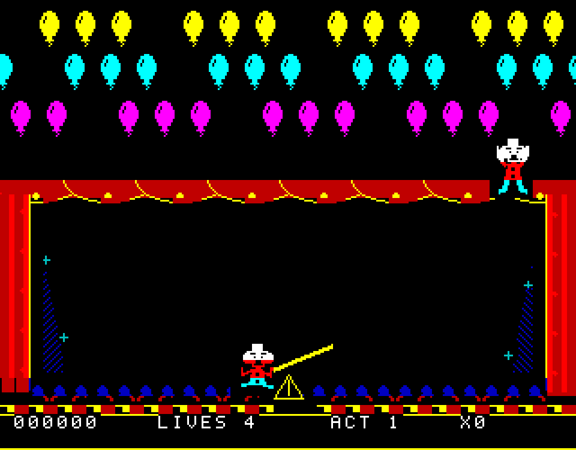
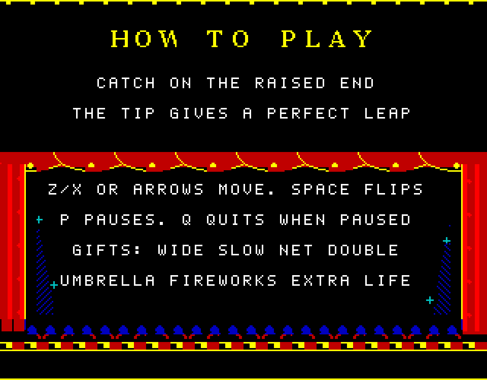
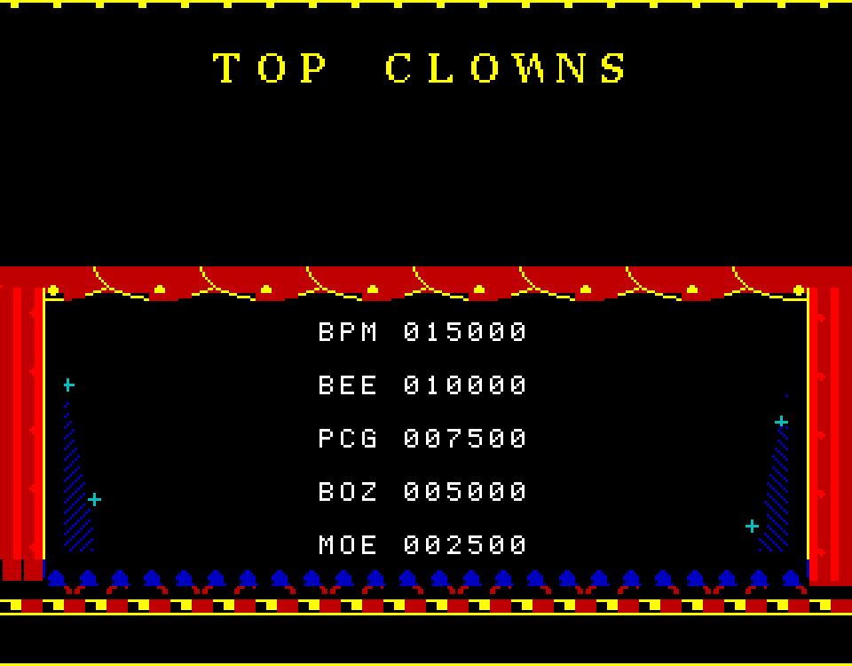
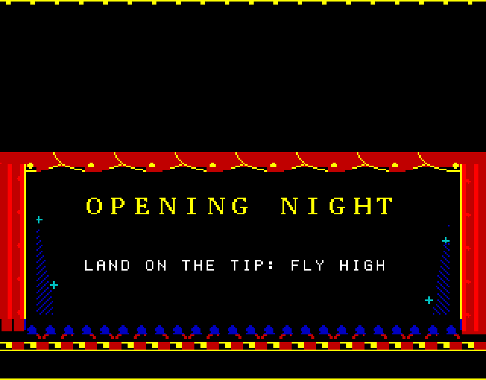
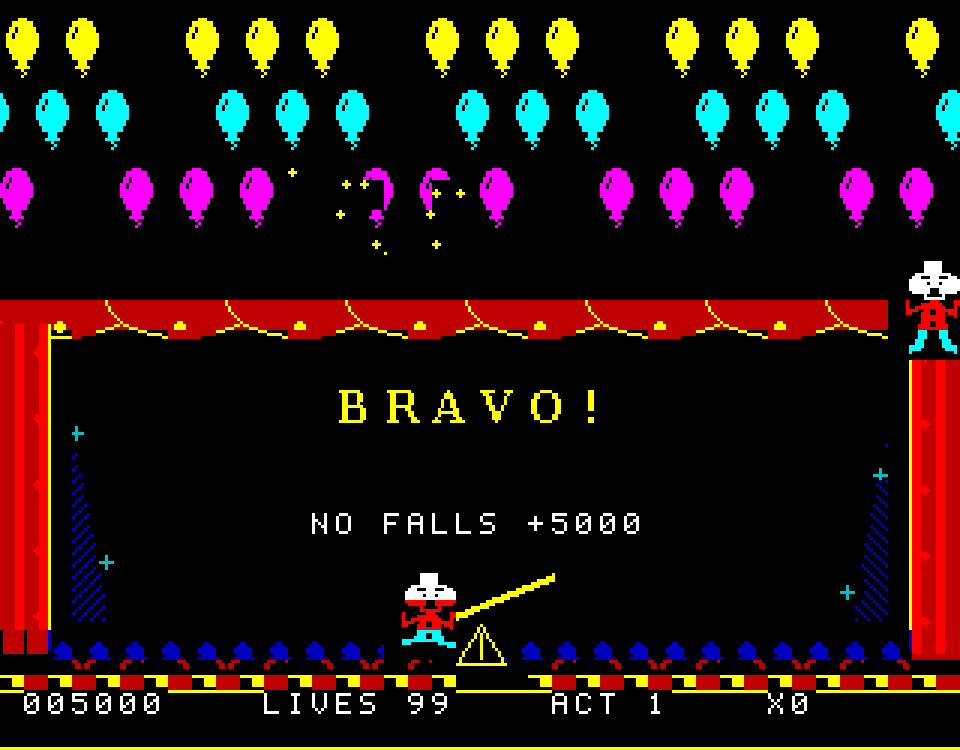
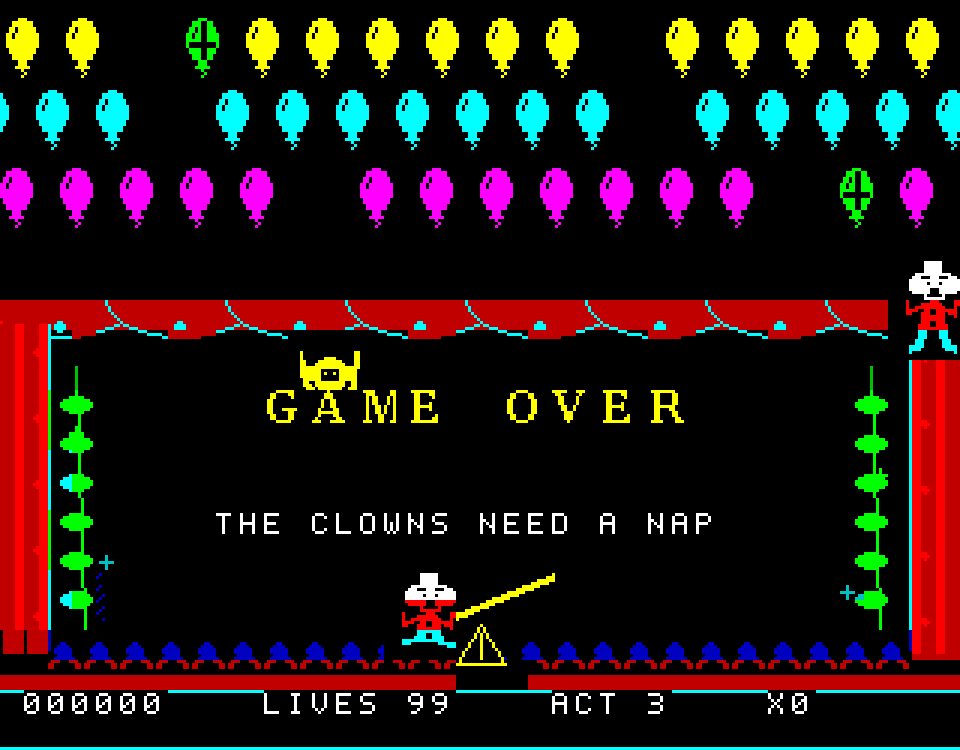
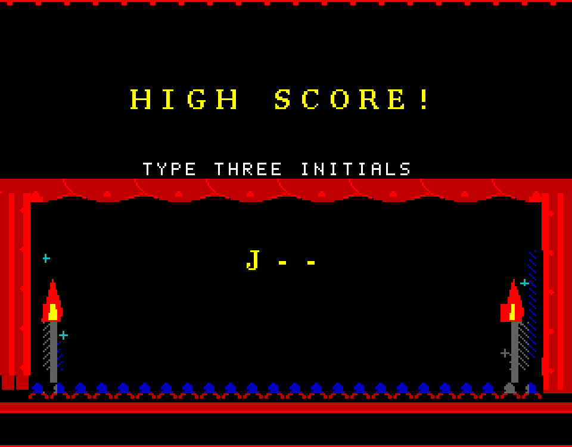
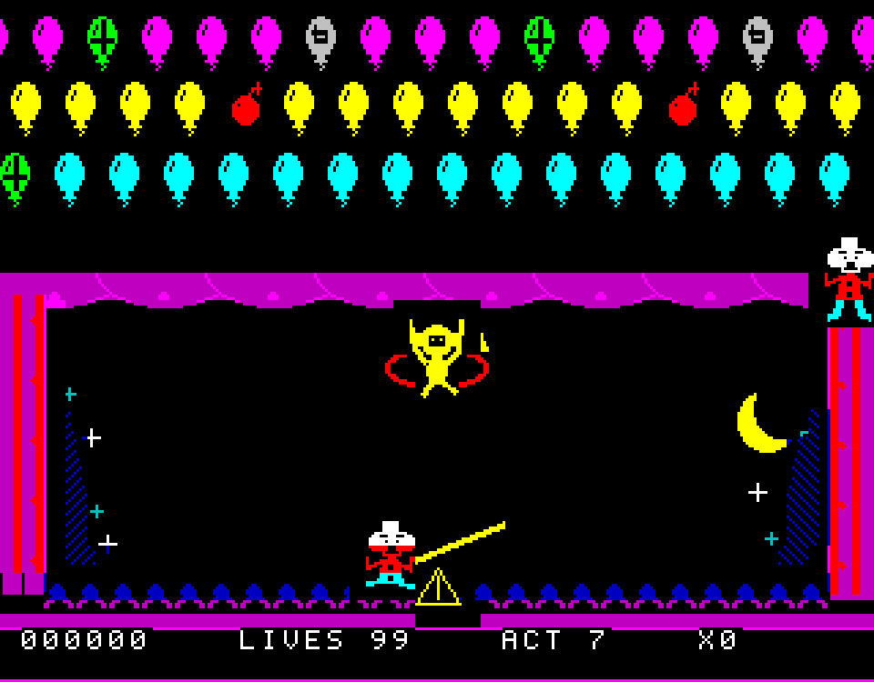
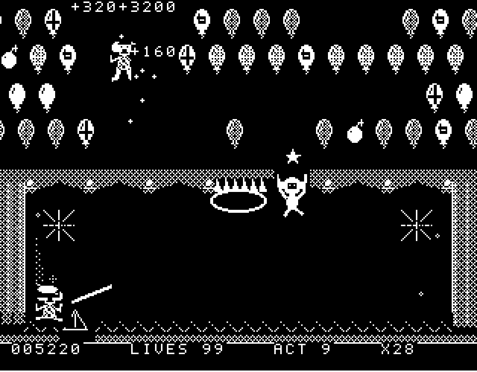

# Circus 2 Spectacle (Microbee Premium Plus)

**Nine acts, an encore at higher speed, a demo AI, high scores, colour and monochrome.** *VIBED BY BPM 2026*

A native Microbee version of the VZ300 game [Circus 2](../Circus2). The rules and the clown and seesaw physics come from the VZ source. The display engine and all the art are new: 8×10 PCG cells, 32K of colour PCG, and banked scenery held in the Premium Plus's 1 MB of RAM.

| | |
|---|---|
|  |  |
|  |  |
|  |  |
|  |  |
|  |  |

## To run it

`release/CIRCUS2.DS8` is a double-sided 80-track CP/M disk image (DS80). Boot it on a Premium Plus or in ubee512 and type **CIRCUS2** at the `A>` prompt.

| Key | Action |
|---|---|
| Z / X or arrows | Move the seesaw |
| SPACE | Flip the seesaw, start the show |
| P | Pause (S toggles sound, Q quits to title while paused) |
| S | Sound on/off (title) |
| D | Level: Easy (5 lives), Normal (4), Hard (3) |
| M | Colour or ordered-dither monochrome |
| H | How to play |
| T | Top Clowns high-score table |

The title screen shows the current level and sound setting.

Catch the falling clown on the raised end of the seesaw. Landing on the tip gives a perfect leap. Gift balloons drop tokens: WIDE seesaw, SLOW, NET, X2 score, UMBRELLA, FIREWORKS and an extra life. An act with no falls scores +5000.

## Building

Needs Python 3.12 with Pillow and numpy, the `z80` 1.2.0 package (only for the tests), and [sjasmplus](https://github.com/z00m128/sjasmplus) 1.24. The art scripts use the Windows fonts Consolas Bold and Georgia Bold.

```
cd tools
python build.py --assembler path\to\sjasmplus.exe
```

This draws the artwork (`art.py`, `spectacle.py`, `pixfont.py`), writes the banked asset blocks `build/B04.DAT` to `B24.DAT`, assembles `build/CIRCUS2.COM` and packs everything into `build/CIRCUS2.DS8`.

## Tests

Run these from `tools`. `ppmodel.py` is a Premium Plus model built on the `z80` package.

| Script | Checks |
|---|---|
| `test_controls.py` | Move, flip, pause/resume/quit, high-score entry, curtain, frame timing, fixed 25 Hz rules |
| `test_longrun.py` | All nine acts in sequence to the encore; 140 s attract soak in both modes; asset banks never corrupted |
| `test_spectacle.py` | Mono toggle, all 18 scene/mode combinations, PCG residency, demo-AI play |
| `regression.py` | Frame cost and AI score for each act |
| `test_disk.py --rom bn60.rom` | Boots the disk to `A>`, runs `CIRCUS2`, starts play |
| `tour.py` | Screenshots every screen to `build/tour-*.png` |

## Source

- `src/main.asm`: hardware set-up, includes the rest
- `src/game.asm`: rules, physics, demo AI, render loop
- `src/frontend.asm`: title, help, high scores, HUD
- `src/video.asm`: back buffer, sprites, text
- `src/banked.asm`: 1 MB bank switching, PCG upload
- `src/sound.asm`, `keyboard.asm`, `timing.asm`, `rowcache.asm`
