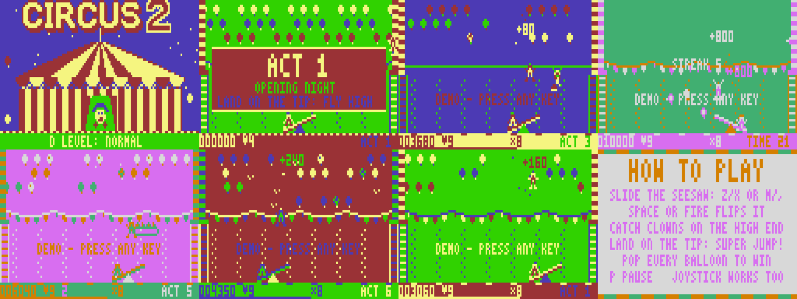
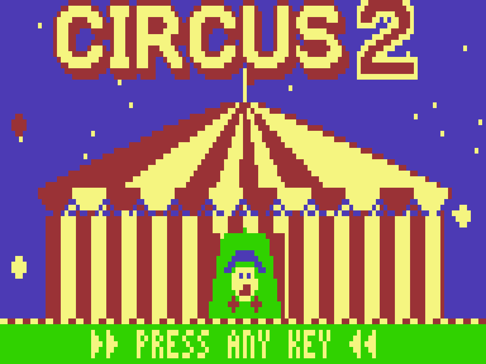
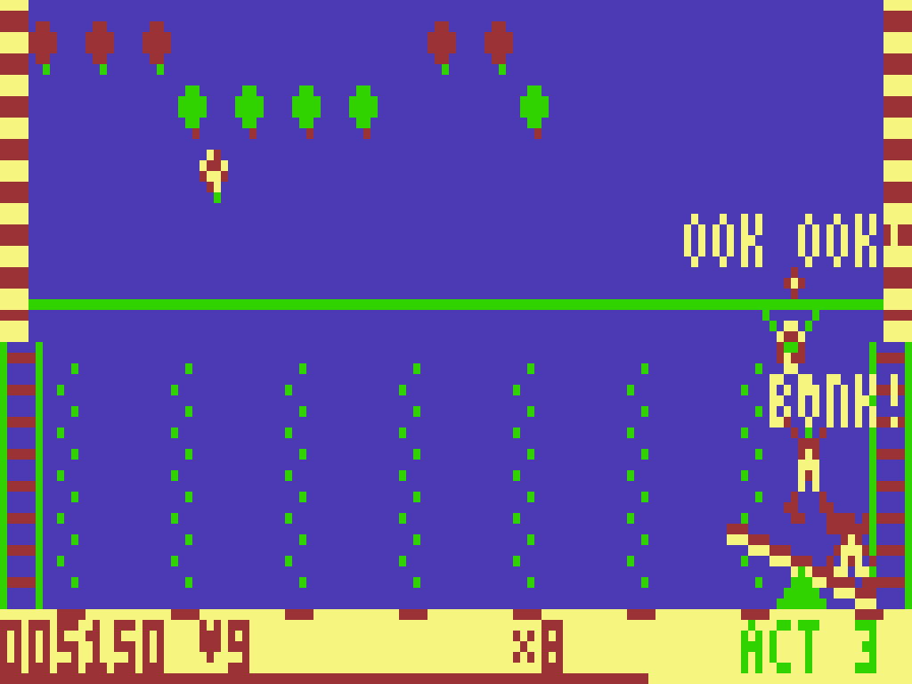
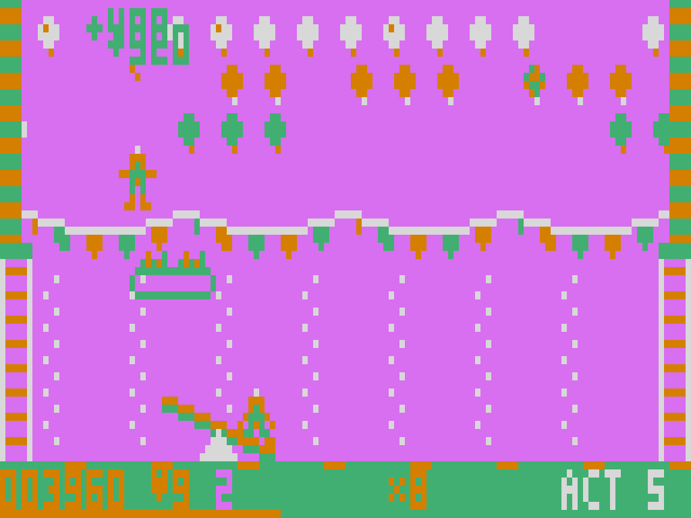
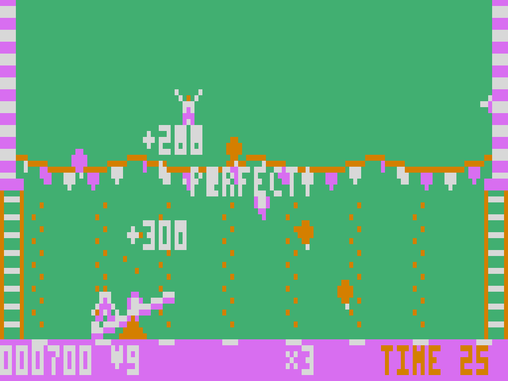

# CIRCUS 2 — for the Dick Smith VZ200 / VZ300

A deluxe sequel to the VZ classic **Circus**: same seesaw-and-balloons core, now with
nine themed acts, bonus rounds, power-ups, combos, a monkey with custard pies, a ring of
fire, a full attract sequence and a Mode 1 big-top title.  *Vibed by BPM 2026.*
Original code, graphics and music (the act-start jingle is a reharmonised nod to the
original game's tune).



| | |
|---|---|
|  |  |
|  |  |

More pictures are in `screenshots/`, and a ready-to-post description with specs is in `BLURB.md`.

## Running it

| | |
|---|---|
| File | `release/CIRCUS2.VZ` (23,219 bytes, binary type `$F1`, loads and autostarts at `$8000`) |
| Machine | VZ300 (or VZ200) **with RAM expansion covering `$7800–$F9FF`**, e.g. the BennVenn SD + 128K as it boots |
| Load | From the BennVenn SD menu like any other `.VZ` |
| Exit | Reset / power-cycle (the game takes over the machine; no return to BASIC) |

It will **not** run on a stock 16K VZ300 or an 8K VZ200: the code image alone is 23K, and
the double-buffered display needs another ~9K of buffers.

Hardware assumptions:
- No BennVenn mapper writes, no DOS calls, nothing touched at or above `$FA00`.
- Own IM2 frame interrupt (257-byte vector table at `$F800`, so any data-bus value works).
  The ISR returns with interrupts off, and they're re-enabled once field sync (bit 7 of
  `$6800`) goes high again, because the VZ's INT follows the 56-line field-sync pulse.
- Joystick 1 is read on port `$2C` (directions + fire/arm). It's auto-detected: if the
  port doesn't read idle at boot, the joystick is ignored.
- No ROM routines are used, so `$7800–$7FFF` serves as the background buffer.

## Controls

| Action | Keys | Joystick |
|---|---|---|
| Move seesaw left | `Z` or `M` | left |
| Move seesaw right | `X` or `,` | right |
| Flip seesaw | `SPACE` or `RETURN` | fire |
| Pause | `P` (then `S` sound on/off, `Q` quit to title) | |
| Title options | `S` sound on/off, `D` difficulty Easy/Normal/Hard | |
| Start | any other key, or fire | fire |
| High-score name | type letters (`RETURN` to finish) | up/down picks a letter, fire moves on |

## How it plays

Slide the seesaw so the falling clown lands on the **raised** end; the other clown is
catapulted into the balloons. **Where** he lands sets the launch:

- near the pivot: a weak hop that reaches the bottom row
- middle of the plank: a medium launch
- the tip: **PERFECT!** — a big launch that hits the ceiling and pops on the way down too

Holding left/right at the moment of landing steers the launch. Fire flips the seesaw, so
you can catch on either side. If a clown hits the occupied end he gets a **BONK!** and a
second chance; miss the plank and it's **OUCH!** (one life).

Pop every balloon to clear the act.

**Scoring and rewards**
- Combos: each pop in an unbroken chain multiplies its value, up to x8. A flight with no
  pops resets the chain.
- Streaks: every 5 catches in a row is worth a bonus and a confetti burst.
- Clearing a row: **ROW CLEAR!** +500.
- Finishing an act without a fall: **NO FALLS** +5000.
- Extra life every 20,000 points.

**Special balloons**
- Striped **gift** balloons drop a power-up token. Catch it on the plank or touch it with a
  clown.
- **Bombs** pop their neighbours, including the balloons above and below.
- **Steel** balloons take two hits.
- **Gold** balloons in the bonus rounds are worth 500.

**Power-ups:** W wide seesaw · S slow motion · N safety net (stacks to 3) · 2 double points ·
U umbrella (slow descent) · F fireworks (pops six random balloons) · 1 extra life.
Active power-ups show on the HUD and blink as they run out.

**Acts:**
1. Opening Night — the original's colours
2. Gifts Galore
3. Monkey Business — pies stick the seesaw; bonk the monkey for 250
4. Bonus: Balloon Bonanza — 30 seconds, no falls
5. Ring of Fire — fly through the hoop for points and combo
6. Bombs Away — 4 rows, bombs and steel
7. The Night Show — bobbing rows, monkey and hoop
8. Bonus: Prize Pop
9. Grand Finale

After Act 9 comes **ENCORE!**, which loops back to Act 1 with faster rows. Each act has its
own palette: one of the two CSS colour sets, plus a rotating background colour.

## Presentation

- **Title:** Mode 1 big-top artwork with an outlined logo, chasing marquee lights,
  twinkling stars, a winking clown in the tent door and balloons floating up both sides.
  A two-voice circus march plays (original composition), and the bottom line cycles
  messages and options.
- **Attract sequence:** title → AI demo (it plays a real act, a different one each lap) →
  How to Play → Goodies → Top Clowns → Coming Up → title. Any key starts a game, including
  during the demo.
- **Act cards:** each act opens on a framed card with the name and a hint, to the original
  Circus jingle (reharmonised). Theatre curtains close at the end of each act and open on
  the next.
- **In the arena:**
  - bunting garland and faint stitched tent-canvas seams
  - barber-pole tent poles that roll and floor lights that chase (colour cycling done by
    writing a few bytes, so it costs no frame time)
  - particle bursts, confetti, floating score pop-ups, a dizzy-star splat
  - sound effects: boing, pop, clang, splat
- **Celebrations:** BRAVO! confetti and a fanfare when an act is cleared; GAME OVER gets a
  sad-trombone tag; then high-score entry.

## Building

Requires `python3` with Pillow, and [sjasmplus](https://github.com/z00m128/sjasmplus).

```
cd src
./build.sh          # -> src/build/CIRCUS2.VZ  (+ circus2.lst listing)
```

The build reproduces `release/CIRCUS2.VZ` byte for byte. Assembly source is in
`src/asm/` (`main.asm` includes the rest).

`tools/mkgfx.py` generates `build/gfx.inc`. It contains:
- the 3x5 font
- all sprites, pre-shifted ×4 with masks, drawn in logical colours
- the LZ-compressed title (`tools/title.py`) and background
- lookup tables

`tools/mkvz.py` wraps the raw binary in a VZ header.

### Memory map

| Address | Use |
|---|---|
| `$7000–$77FF` | video RAM (Mode 1) |
| `$7800–$7FFF` | background buffer (2K) |
| `$8000–$DA9A` | code + data (file image) |
| `$DD00–$E1AF` | variables (dirty-span tables page-aligned at `$DD00`/`$DE00`) |
| `$E200–$EBFF` | balloon-row strips (4 rows × 4 pixel shifts × 5 lines) |
| `$EC00–$F5FF` | back buffer with 8-row top and bottom clip margins (visible at `$ED00`) |
| `$F600–$F7FF` | stack |
| `$F800–$F900` | IM2 vector table |
| `$F901–$F96D` | title/high-score variables |
| `$F9F9` | `JP isr` |

### Engine notes

- **Display:** double-buffered Mode 1 at a locked 25 fps; physics runs two substeps per
  update.
- **Dirty tracking:** only the byte spans drawn this frame or last frame are restored from
  the background and copied to the screen.
- **Balloon rows:** pre-rendered circular strips in four pixel shifts. A row is copied only
  on frames where it actually moved or was drawn over.
- **Recolouring:** sprites are XOR-recoloured whenever the act's background colour changes,
  so one sprite set serves every palette.
- **Sound:** two square-wave voices, one on each speaker bit (bits 0 and 5), generated in
  the idle time of every frame. The pitch table is calibrated to the loop timing. In play
  the sound is chopped at 25 Hz (gritty). The title and the jingles get nearly the whole
  frame.

## What was tested (in emulation)

Not yet tested on real hardware. All testing used a VZ300 test harness
(`src/tools/vzemu.c`): a Z80 core plus a VZ memory map, keyboard matrix, joystick ports,
latch/speaker, and a field-sync-driven level interrupt (312 lines, 56-line sync). It
needs the [superzazu/z80](https://github.com/superzazu/z80) core (MIT, not included)
cloned to `../../z80core` relative to `src/tools/`.

- A full attract loop, including demos of different acts, ran for 60,000 frames
  (20 minutes) with no crash and no stray writes to ROM or `$FA00+`.
- A real game from the title: act card, play, losing every life, Game Over, return to title.
- High-score entry: a qualifying score was inserted, initials typed, and the table updated.
- Pause, sound toggle and resume.
- A forced run through all 9 acts, both bonus rounds and into ENCORE.
- Screenshots of every theme, every info screen and the curtain transitions were checked.
- Music pitch was checked per voice from the recorded speaker bits; notes come out within
  the 8-bit counter's resolution.
- Frame timing was measured per update. Typical acts hold 25 fps, with about 2% of updates
  running one frame late during big pop bursts. The heaviest act (The Night Show) is about
  5% late. That's measured with the demo AI running, which a real game doesn't have.

## Known limitations

- **High scores and settings are not saved to SD.** They're kept in RAM until reset. The
  BennVenn DOS file API wasn't used, to stay clear of DOS memory at run time.
- **Pitch and timing** depend on the emulated cycle counts. Real-hardware video RAM
  contention, if any, could shift pitch slightly or add a little more slowdown.
- **Sound effects in play are chopped at 25 Hz**, because the CPU spends most of each frame
  drawing. There is no in-game music: that's by design, as in the original.
- **The joystick fire button** is read together with the arm button (port `$2C`, bit 4).
- **Only joystick 1** is supported.
