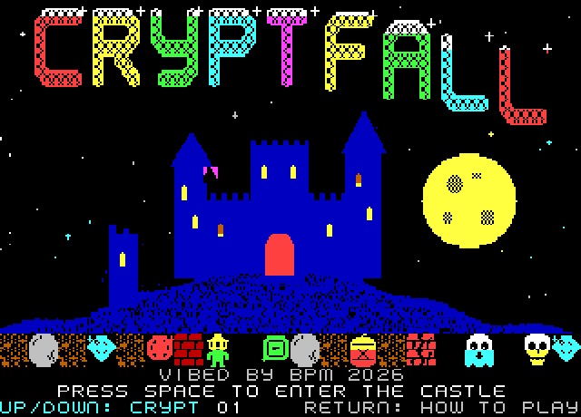
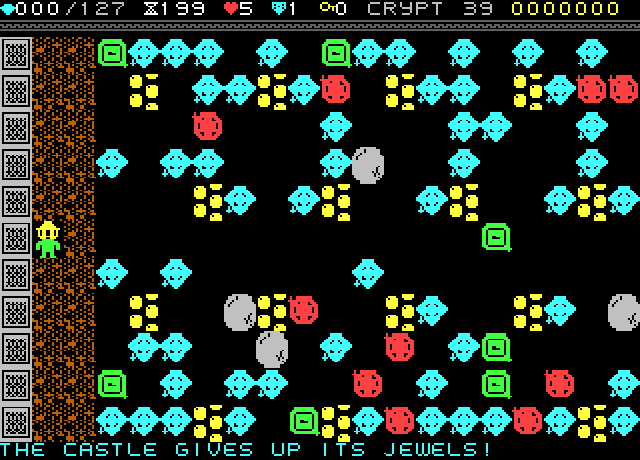
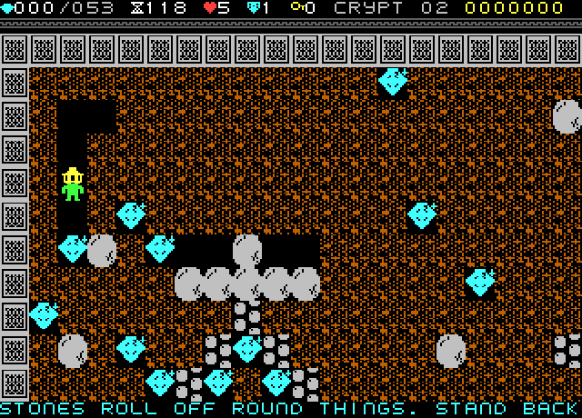
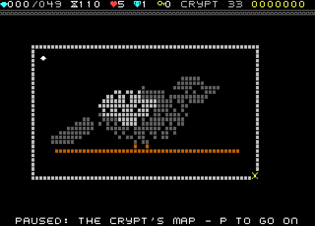
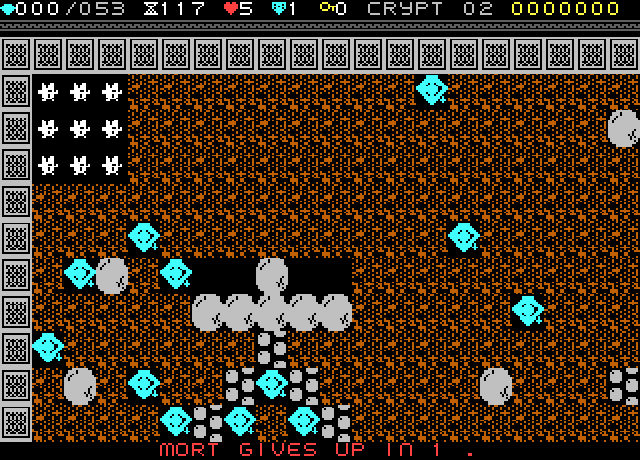
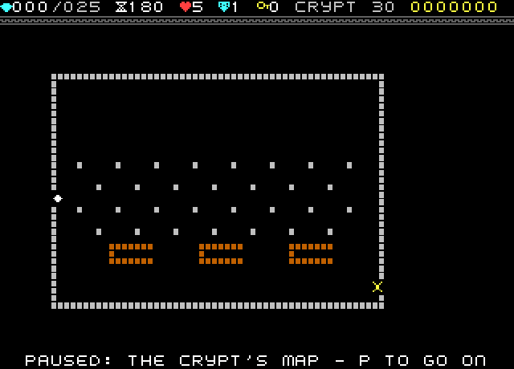

# CRYPTFALL
### for the Microbee Premium Plus
***"Dig. Collect. Don't look up."***
**VIBED BY BPM 2026**

Mort the gravedigger tunnels under a haunted castle. Dig through the earth, collect jewels until the gate opens, and get out before the candle burns down. Stones, jewels and powder kegs fall and roll by fixed rules, so every crypt can be planned, not just survived.

CRYPTFALL is an original Boulder Dash-style game: forty crypts, every one bigger than the screen in both directions, so exploring them is part of the puzzle. Each crypt brings in one idea on its own — rolling stones, a caged bat, a cracked wall, a powder keg, an enchanted grate, a hunting skull — and later crypts bring the ideas back together. Seven of the forty are jewel-storm bonus rooms, where the crypt opens with hundreds of jewels already tumbling down and a bonus crypt costs no life if you fail it. A handful are picture crypts, painted from the dirt, wall, block and jewel pieces into a shape you only see whole from the pause map: a grinning skull, a rose window, a raven, a clock face.

It's built to be forgiving. Mort starts every attempt with a ward that takes one blow that would have killed him, there are five lives, and giving up (R, then R again) costs nothing — a countdown, Mort goes up in jewels, and the crypt starts again. The furthest crypt reached is saved, so a game over never sends you back to the start.

| | |
|---|---|
|  |  |
|  |  |
|  |  |

## Features
- **Forty crypts**, 33–64 tiles wide and 24–32 tiles tall: every one scrolls in all four directions. Any crypt you've reached can be chosen from the title screen.
- **Progressive design**: each crypt introduces one idea cleanly — rolling stones, a caged bat, cracked walls, powder kegs and chains, an enchanted grate, keys and doors, a hunting skull, spreading slime — then later crypts combine several at once, ending with one that uses everything.
- **Seven jewel-storm bonus crypts**: the crypt opens with hundreds of jewels already falling, for a big, noisy collect-athon. The later storms mix in stones, bats and skulls to dodge while you catch. Failing a bonus crypt costs no life.
- **Picture crypts**: several crypts are painted from the tile set into a recognisable shape — a skull, an organ, a cauldron, a library shelf, a rose window, a raven, a clock face — visible whole on the pause map.
- **A full set of pieces to build crypts from**: four kinds of earth, three walls and three solid blocks (each with its own colour per crypt), two steels, three heavy things (the stone that rolls, the slab that never rolls, the urn that breaks into a gem), three jewels worth one/two/three, four haunters with different movement (ghosts hug the left wall, bats the right wall and burst into jewels, knights march to and fro, the skull hunts Mort down), cracked walls, an enchanted grate that turns falling things into jewels, spreading slime, locked doors and keys, and five treasures and charms (crown, chalice, ward, hourglass, heart).
- **Deterministic falling physics**: a stone, jewel or keg falls when nothing is under it and rolls off anything round to a free side, so every crypt can be worked out, not just reacted to.
- **The whole presentation**: a jewelled, hand-drawn title with a castle and moon, an attract-mode demo, a high-score roll saved to disk, four help pages, a pause screen that shows the whole crypt as a map, and a satisfying give-up countdown that ends in a jewelled explosion.
- **A full soundscape on the beeper**: proper noise (not patterned buzz) for digging and pushing, a crack and thud for falling stone, chinks for jewels, a low rumble under blasts and crumbling walls, and Mort's "Oww!" running straight into an explosion when he's caught. No in-game music — the beeper is kept for sound effects during play.
- **Saves to disk**: the high-score roll and the furthest crypt reached are written back with a write-protect check first, so a protected disk plays normally and just doesn't save.

## Tech specs
| | |
|---|---|
| **Machine** | Microbee Premium Plus: Z80 at 3.375 MHz, 6545 CRTC, 32K of bank-switched PCG RAM |
| **Display** | 40 × 25 character cells of 8 × 10 pixels: 320 × 250, a full PAL picture — the "40X25 8X10" table from MODES.COM, the tallest mode that still leaves room for two double-buffered screen pages in the Premium Plus's 2K of screen RAM. Uses the 40-column (6.75 MHz) dot clock, selected the same way as the earlier 40-column Microbee games (`LD A,1` / `IN A,(09h)`) |
| **Tiles** | Each crypt tile is 2 × 2 character cells (16 × 20 pixels) with its own ink per cell. A crypt loads only the pictures it actually uses (up to 31 of them) into PCG bank 0; animated tiles (jewels twinkling, the magic grate, explosions) are drawn by rewriting their patterns in place |
| **Screen pages** | Two pages flipped in vertical blanking; a change list tracks which tiles moved each step so only those cells are redrawn, falling back to a full redraw if too much changed in one step (a dense jewel storm, say) |
| **Pause map** | The whole crypt drawn in one screen using quarter-block PCG glyphs, one per 2 × 2 tile, so a picture crypt is seen whole |
| **Timing** | 3 fields a frame, 2 frames a cave step (about 8 steps a second) in ordinary crypts; jewel storms slow to about two-thirds speed while hundreds of jewels are moving at once, then recover |
| **Sound** | The beeper plays in the idle time of every frame: a two-voice pin-pulse engine for tones and the title/ending music, and a 16-bit Galois LFSR for proper noise (dirt, blasts, the "appear" puff) rather than reading program bytes as noise |
| **Cave data** | Each crypt is an 18-record (2.3K) block: a 256-byte header (size, quota, time, jewel values, grate/slime timers, the tile-picture list, theme colours, name and hint) followed by a 32 × 64 tile map. The game reads the crypt count from the data file and loads one record at a time with no hard-coded limit |
| **Disk** | Standard DS80: 80 tracks × 2 sides × 10 sectors × 512 bytes (819,200 bytes), Microbee sector skew. Boots and auto-starts through `SHELL.SYS`/CCP with CP/M left alive; crypts and the score file are read and written through BDOS, so it works off whatever drive it booted from |
| **Source** | About 5,700 lines of Z80 assembly across hardware, video, input, sound, disk, game logic and front-end modules, plus roughly the same again in Python tools that draw the art, compile the crypts, build the disk image and play-test every crypt in an emulator model of the real machine before it ships |

## To play
Boot `release/CRYPTFAL.DS8` (or copy it to an SD card as drive A). The game starts by itself — nothing to type. If it doesn't, `release/CRYPTCMD.DS8` boots to the `A>` prompt; type `CRYPT` and press RETURN.

| Action | Keys |
|---|---|
| Move | Arrow keys |
| Reach without stepping (dig or take what's there) | SPACE + arrow |
| Pause / see the crypt's map | P |
| Give up (no life lost) | R, then R again |
| Quit to the title | ESC, then ESC again |
| Sound / title music on and off | S / M |
| Joystick on PIO port A | J |

More pictures: [gameplay](screenshots/gameplay/) · [title & help](screenshots/info/) · listen: [digging & collecting](docs/sfx_dig_collect.wav) · [a jewel storm](docs/sfx_gemstorm.wav)
