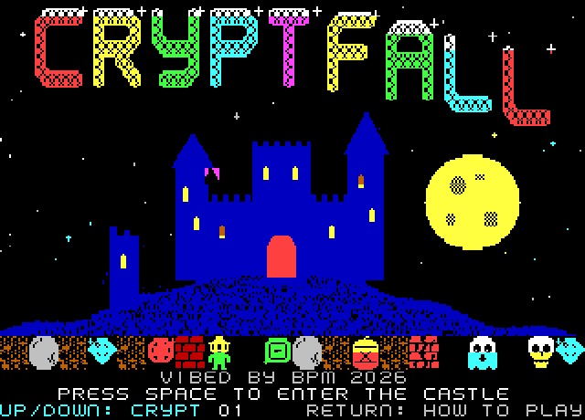
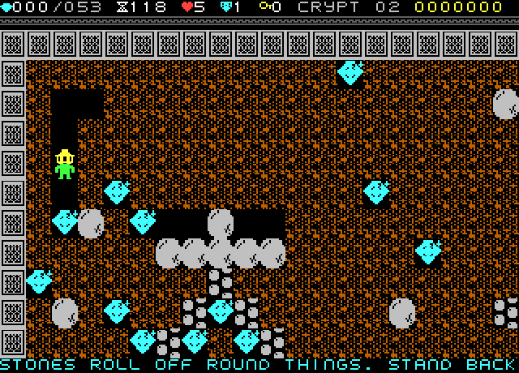
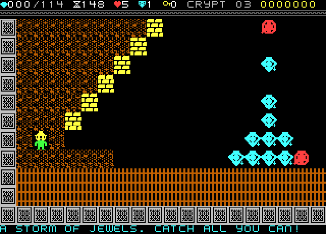
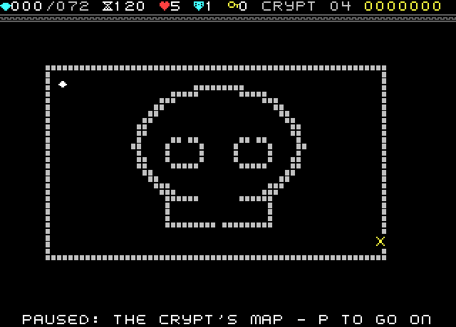
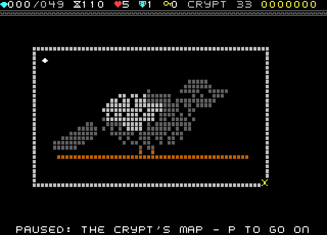
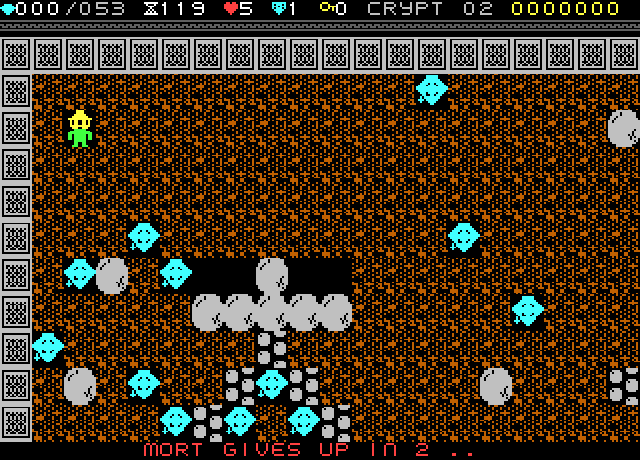
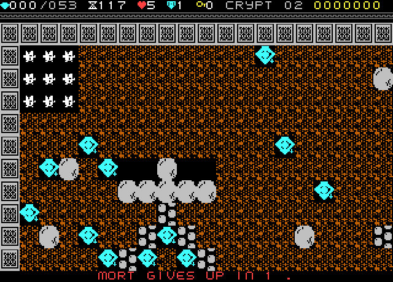

# CRYPTFALL

**An original Boulder Dash-style cave-digging game for the Microbee Premium Plus.**
*VIBED BY BPM 2026*



Mort the gravedigger tunnels under a haunted castle. Dig through the earth, collect jewels until the gate opens, and get out before the candle burns down. Stones, jewels and powder kegs fall and roll by fixed rules, so every crypt can be planned.

Forty crypts, every one bigger than the screen in both directions, so exploring them is part of the puzzle. Each crypt brings in one idea on its own, then later ones bring the ideas back together, ending with one that uses everything. Seven are jewel-storm bonus rooms where hundreds of jewels are already tumbling when the crypt opens. A few are picture crypts, painted into a shape you only see whole from the pause map.

The release blurb with tech specs is in [BLURB.md](BLURB.md). More pictures: [gameplay](screenshots/gameplay/) · [title & help](screenshots/info/). The release package is `release/CRYPTFALL_v2.zip`.

| | |
|---|---|
|  |  |
|  |  |
|  |  |

## To play

`release/CRYPTFAL.DS8` is a double-sided 80-track Microbee disk image (DS80 / DS8). Boot it — CP/M loads and the game starts by itself, nothing to type.

If your machine doesn't auto-start it, `release/CRYPTCMD.DS8` is the same disk without the auto-start: boot it, then at the `A>` prompt type

```
CRYPT
```

Needs a **Microbee Premium Plus** (32K PCG RAM).

## Controls

| Key | Does |
|---|---|
| Arrow keys | Move Mort |
| SPACE + arrow | Reach that way without stepping (dig or take what is there) |
| P | Pause, and see the whole crypt as a map |
| R, then R again | Give up: a countdown, a jewelled explosion, the crypt starts again. No life is lost |
| ESC, then ESC again | Leave the castle |
| S / M | Sound effects / title music on and off |
| J | Joystick on PIO port A on and off |

On the title: UP / DOWN pick the crypt to start at (any you have reached), SPACE plays, RETURN turns the pages (roll, four help pages, demo).

## Testing

Everything below ran in an emulator model that boots the disk image from power-on through the real BN60 boot ROM and the disk's own CP/M, BIOS and BDOS (`tools/emu`, `tools/mechtest.py`, `tools/solve.py`, `tools/playthrough.py`, `tools/disktest.py`).

| Test | Result |
|---|---|
| Mechanics | Falling, rolling, pushing, all four haunters, kegs and chains, cracked walls, the grate, slime, doors, pickups, the ward, the clock, lives, game over, and the give-up countdown with no life lost |
| Every crypt | All 40 cleared with recorded solutions |
| Whole campaign | One sitting from crypt 1 to the ending |
| Saving | High scores and the furthest crypt reached are written to disk and read back after a cold boot; a write-protected disk plays normally and reports it wasn't saved, with no sector written and no system error |
| Speed | Full speed (3 fields a frame) in ordinary crypts; jewel storms slow to about two-thirds speed while hundreds of jewels are moving, then recover |

The game booted and started by itself on BPM's real Premium Plus (amber monitor), with a dot-clock fix for the 40-column display confirmed working on hardware. This screen-mode revision (320 × 250, the 8 × 10 cell table) hasn't been back on the hardware yet.

## Source layout

```
src/        main.asm and its parts: hw, video, input, sound, disk, logic, game, front
caves/      one text file a crypt (painted by tools/crypts.py, tuned by tools/tune.py)
tools/      build.py, tiles.py, art.py, title.py, caves.py, paint.py, crypts.py, tune.py,
            gallery.py, build_disk.py, zasm.py, bot.py, solve.py, mechtest.py,
            disktest.py, playthrough.py, mkdemo.py, emu/
tests/      small caves for the mechanics tests
resources/  CP/M system tracks, CCP.SYS, BN60 boot ROM (for the tests)
```

Build with `python3 tools/build.py`; run everything with `python3 tools/test_all.py`. Needs Python 3 with numpy and Pillow, and gcc for the emulator model. The Z80 core in `tools/emu` appears to be superzazu/z80 (MIT licence, https://github.com/superzazu/z80), used for testing only.
