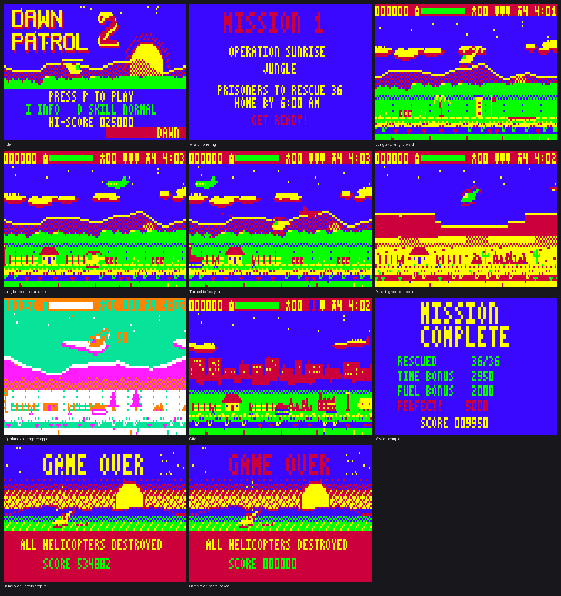

# Dawn Patrol 2 (VZ300 + BennVenn SD/128K)

The sequel to the 1985 VZ game Dawn Patrol. Original code, graphics and music.
2026 - ViBED by BPM.

Needs a VZ300 with the BennVenn SD loader and 128K RAM expansion.

## Files
- `release/DP2.VZ` - the game. Copy to the SD card and load from the BennVenn menu (loads at $8000).
- `src/` - Z80 source (sjasmplus). `main.asm` includes the rest; `gen*.asm` are generated by the build.
- `tools/build.py` - generates all graphics, levels, music and speech, assembles, writes `out/DP2.VZ` (a finished copy is in `release/`).
- `tools/art.py` - sprites, font and the four level themes (pixel art as text).
- `tools/music.py` - the three tunes for the 3-channel beeper engine.
- `tools/speech.py` - the prisoners' "Hi!" / "Bye!" voice synthesis (1-bit).
- `tools/vzemu.c` - small VZ300 + BennVenn test emulator (screenshots, WAV capture, profiler).
- `screenshots/` - emulator screenshots.

## Building
Needs Python 3 with Pillow and numpy, and sjasmplus (https://github.com/z00m128/sjasmplus)
built in a folder named `sjasmplus` next to this project folder.

    cd tools
    python3 build.py            # release build -> out/DP2.VZ
    DEBUG=1 python3 build.py    # debug build: keys 1-4 on the title pick the level,
                                # L finishes a level, K destroys the chopper

Emulator: `gcc -O2 -o vzemu vzemu.c z80.c` using the Z80 core from
https://github.com/superzazu/z80, then `./vzemu out/DP2.VZ <frames> <script> [shotprefix] [wav]`.

## Memory map
- $4000-$67FF SRAM window: bank 1 (port $37=1) world band + voices, bank 3 (=3) parallax bands.
- $8000-$D3FF code; $D400 back buffer; $E000-$FFFF pre-shifted sprites.
- Expansion page 2 (port $37=5, $B800-$FFFF): compressed scenery, title/game-over pictures, music, texts.

## Controls
Q up, A down, , left, M right, N turn, SPACE fire, P pause - or either joystick.
