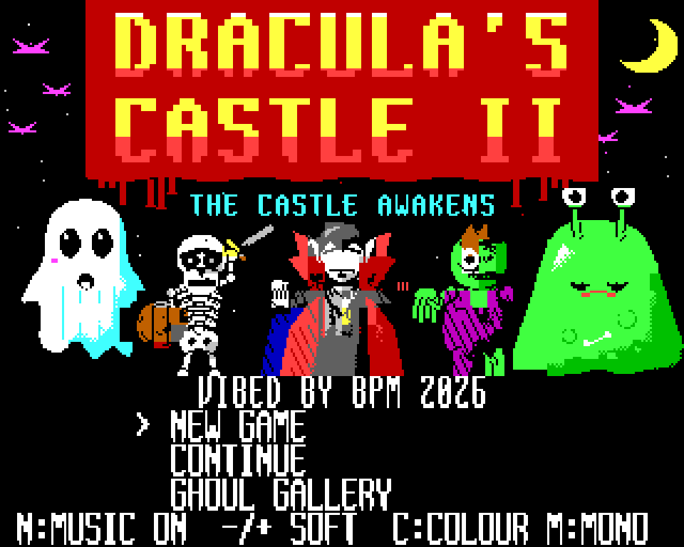
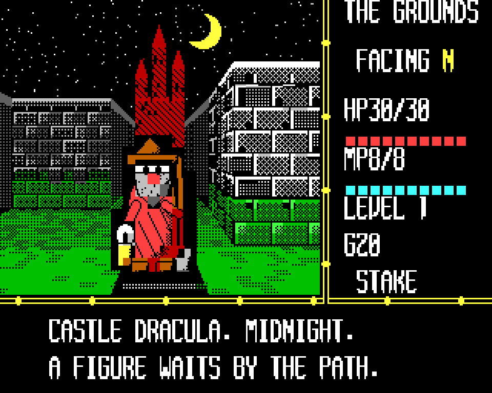
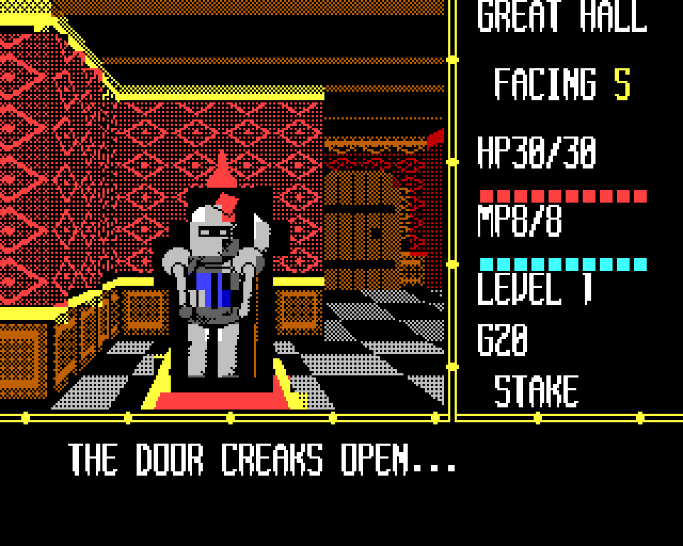
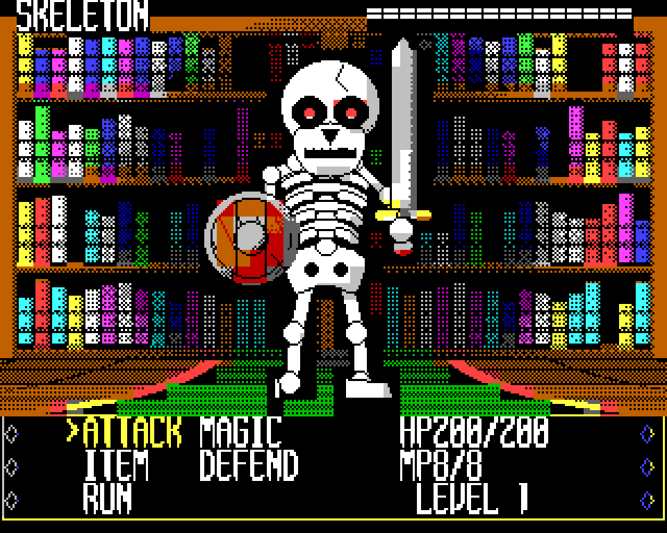
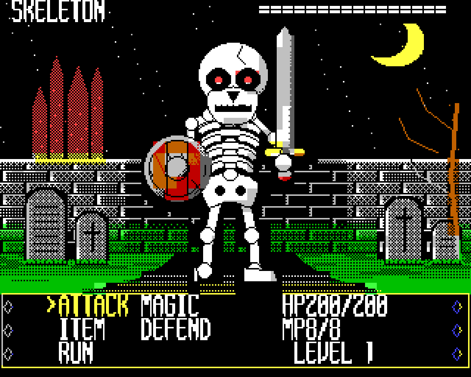
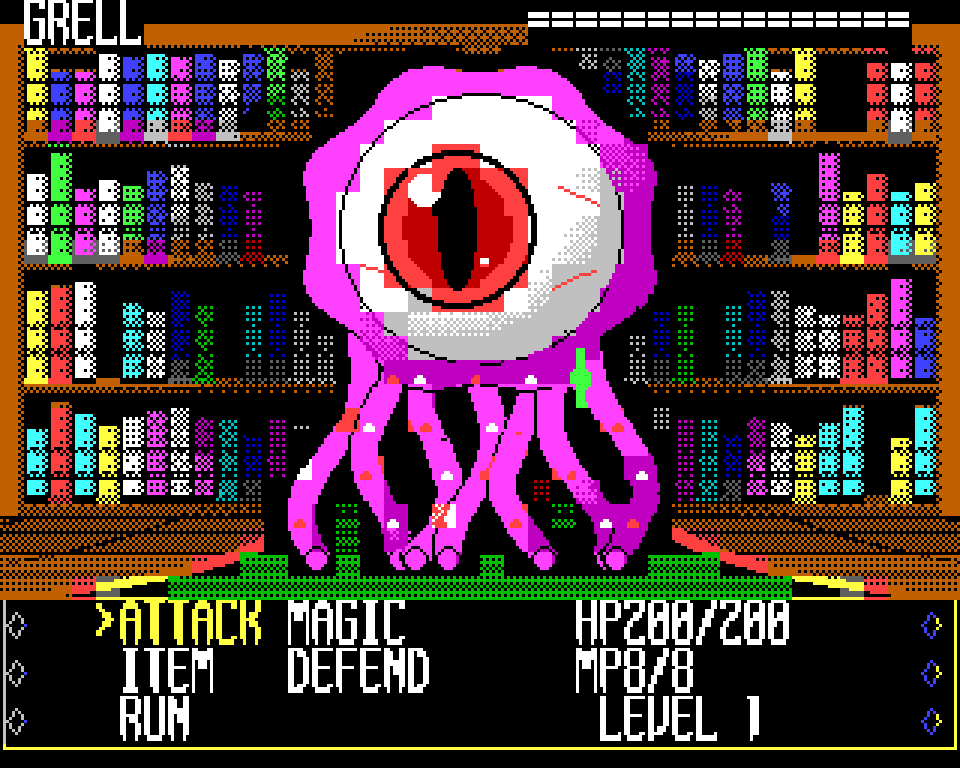
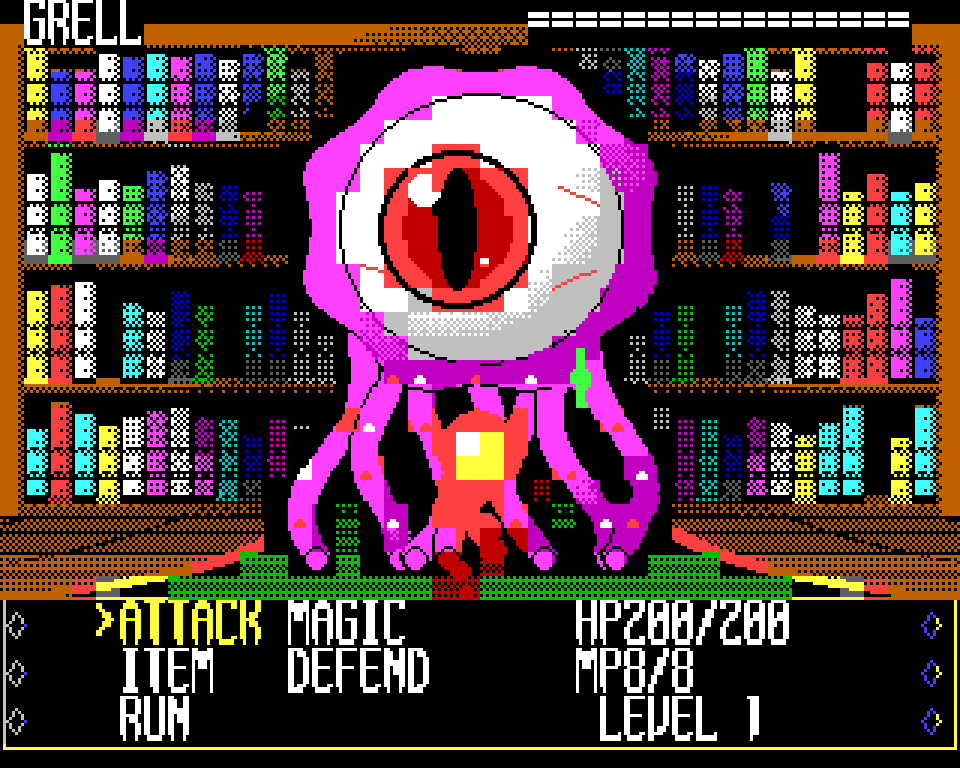
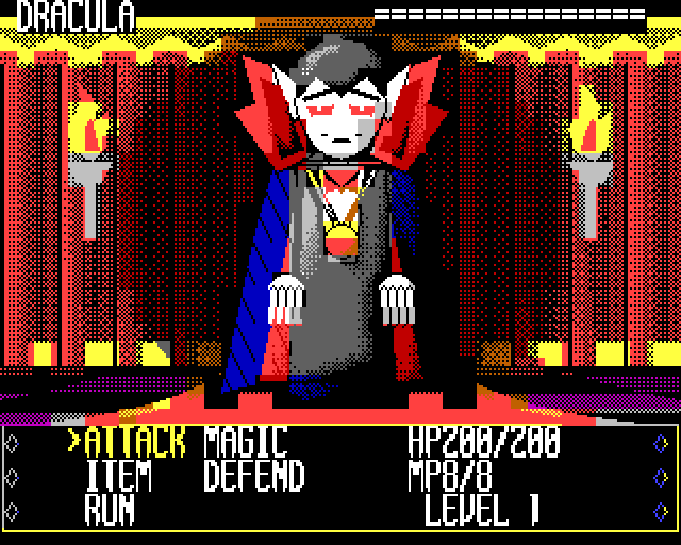

# DRACULA'S CASTLE II: THE CASTLE AWAKENS
### for the Microbee Premium Plus
***"Something ancient has woken."***
**VIBED BY BPM 2026**

*Transylvania, 1897.* The villagers of Borgo Pass whisper of strange lights in the old castle on the hill. Folk have vanished. Graves lie open. The dead walk.

DRACULA'S CASTLE II was a first-person gothic RPG for the VZ300, a sequel to the 1984 BASIC game. Now the castle wakes up on the **Microbee Premium Plus**. The game is the VZ's own: the same maps, monsters, stats, story and music. Every picture is redrawn for the Microbee's 16-colour character graphics, and the display and combat are rebuilt for speed.

Walk the castle in first person through six areas: **the Grounds**, **the Great Hall**, **the Library**, **the Dungeons**, **the Clock Tower** and **Dracula's Tower**. Talk to the ghosts who still haunt it, buy potions from a prisoner through the bars, find the keys that open each new wing, and ring the great bell that wakes the Count.

Fight twelve "groovy ghoulie" monsters in quick turn-based battles. The bat, skeleton, ghost, zombie, slime, knight and bride fight in whichever room you meet them, while the Gargoyle, Grell, Ghoul King, Bat Lord and Dracula wait in their own lairs. Swing your sword, cast fire, throw holy water, and watch them dissolve.

| | |
|---|---|
|  |  |
|  |  |
|  |  |
|  |  |

## Features
- **Six areas in first person**, each with its own walls, floors, decorations and furniture: torchlit grounds under a crescent moon, a checkerboard great hall with suits of armour, bookshelves and candelabra, wet dungeon cells, turning clockwork gears, and black marble veined with red. Turning takes about a tenth of a second.
- **The groovy ghoulies:** all twelve monsters redrawn as cartoon creatures with thick ink outlines and big eyes, each with idle, attack and hit poses. The ghost floats through eight poses.
- **Battles in the room you are in.** Ordinary monsters are laid over the current area's room when the fight loads, so a skeleton in the library fights among the bookshelves.
- **Drawn battle effects:**
  - a curved sword arc
  - a fireball that rises, flares and bursts into embers
  - holy water that falls as drops, then a gold cross with sparkles
  - claw rakes when you are hit, and sparkles when you level up
  - an ordered dissolve when a monster dies
- **Fast, aggressive combat:** each animation step redraws only the cells that change. A one-hit skeleton fight takes about three seconds from the encounter to back in the maze, and the area's likely monsters are already unpacked when you meet them.
- **Illustrated automap**, an inventory and status page, and centred story pages on a dark leaf with a gold rule.
- **Monochrome mode** for amber and green monitors, with its own title and dithered artwork made for one-colour screens. Choose colour or mono at any time.
- **The VZ's three-voice beeper music**, a tune for every area, with two voicings: SOFT, made for the Microbee's speaker, and the original VZ sound.
- An **attract sequence**:
  - the title, with its cast
  - the story so far
  - a tour of the six areas
  - the Ghoul Gallery, a bestiary of all twelve monsters
- The four hidden **1984 tribute screens** from the VZ game.

## Tech specs
| | |
|---|---|
| **Machine** | Microbee Premium Plus: Z80 at 3.375 MHz, 1MB RAM, 32K PCG RAM, 6545 CRTC |
| **Display** | 40 × 32 character cells of 8 × 8 pixels (320 × 256), 16 colours, a colour pair per cell. Separate artwork for one-colour monitors. |
| **First-person view** | A 26 × 24-cell window composed in a work buffer from wall, decoration and object runs, then written to the screen. Each area's art (up to about 1,700 glyphs) stays unpacked in RAM, and floor objects are merged into PCG bank 13 as they come into view. A turn redraws in 4 to 5 frames. |
| **Monsters** | Drawn cell-exact: every cell a monster touches holds only the monster and black, so its cells lay cleanly over any room. Rooms use PCG banks 0 to 4, monsters banks 5 to 13, the font banks 14 and 15. |
| **Combat display** | Each step recomposes only the monster's window, or the cells an effect touches, and writes those rows just after the frame sync, staying ahead of the beam. Effects are pixel-merged into a spare PCG bank over the cells beneath them. |
| **Loading** | A buffered decompressor. Entering an area also unpacks its room and its two or three likely monsters, so most fights load in about a third of a second. |
| **Sound** | The VZ game's three-voice pulse beeper engine, retimed for the Premium (210 T-state loop, about 16 kHz), with a frame-locked note sequencer |
| **Disk** | DS80 (80 tracks × 2 sides × 10 × 512 bytes). Boots to CP/M. `DRACULA.COM` loads 21 files, about 660K, into the RAM blocks and the game then takes over the machine. |
| **Saving** | RAM checkpoints at the stone angels, as on the VZ. They are lost at power-off. |
| **Source** | About 11,800 lines of Z80 assembly, plus about 6,000 lines of Python tools that draw all the art, pack the areas and monsters, check every screen against reference pictures and build the disk |

## RAM used
The game runs from the upper 32K and uses 29 of the Premium Plus's 32 blocks of 32K for everything else.

| Block(s) | Contents |
|---|---|
| 1 | the VZ game's working RAM image: maps, text grid, panels |
| 2 | unpacking scratch |
| 3 | the combat screen: composed frames, room backdrop, masks |
| 4-13, 15-23 | packed art, maps, text and music: 19 banks, about 600K |
| 14 | character shapes for the text screens |
| 26, 27, 29 | the current area's battle room and its likely monsters, unpacked |
| 28 | the program image, then the current area's maze art |
| 30, 31 | the ghost's poses and the area's maze pieces |

## To play
Boot `release/DRACULA.DS8`, type `DRACULA` at the `A>` prompt, then press **C** for colour or **M** for monochrome.

| Action | Keys |
|---|---|
| Step forward | W / I / up arrow |
| Turn left / right | A / J / left, D / L / right |
| Turn around | S / K / down |
| Act: talk, open, search, select | SPACE / RETURN, or fire |
| Map, inventory, pause (Q quits) | M, E, P |
| Music on/off | N |
| SOFT / VZ music | - / + (the ;+ key) |
| Colour / monochrome | C / M (on the title or while paused) |

A joystick on PIO port A also works.

The original **DRACULA'S CASTLE II** for the VZ300 is in [`../DraculasCastle2`](../DraculasCastle2).

More pictures: [gameplay](screenshots/gameplay/) · [title and attract sequence](screenshots/info/)
