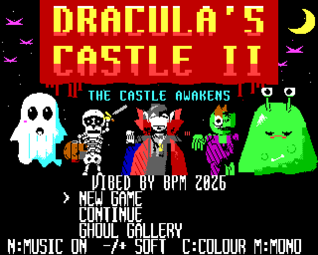
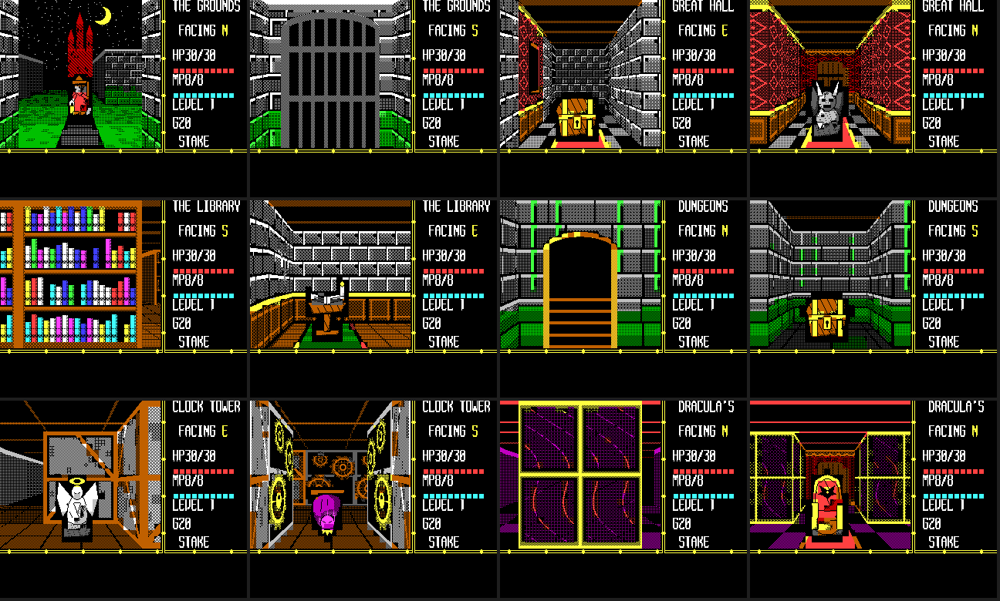
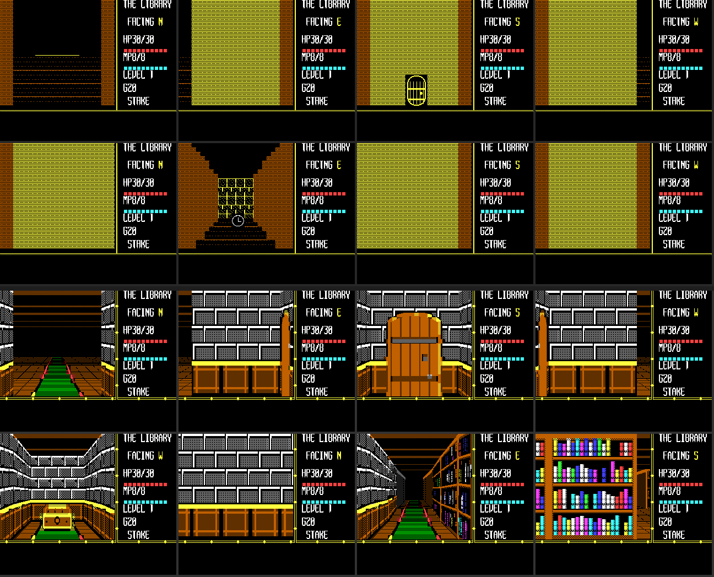
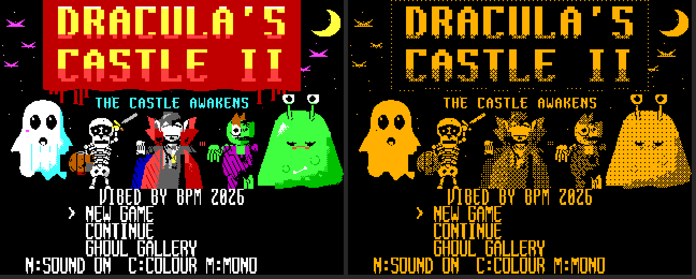
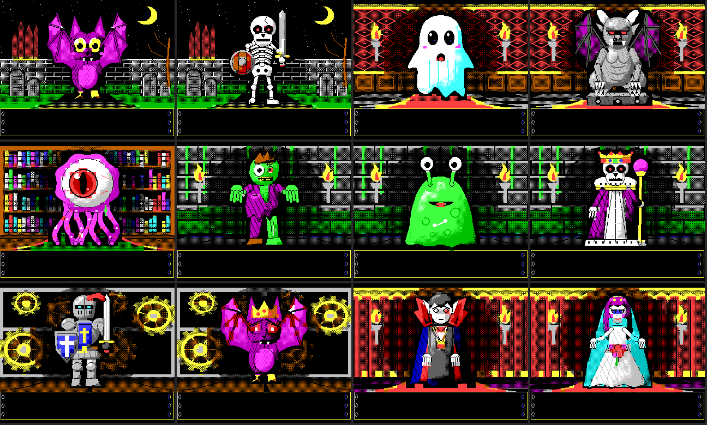
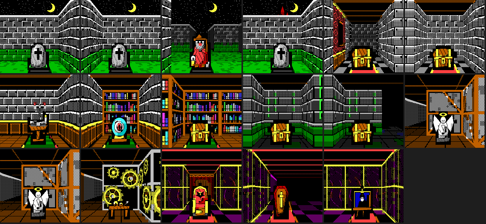
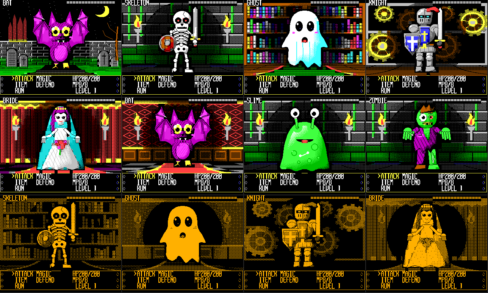
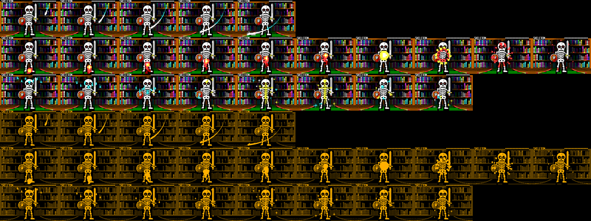

# Dracula's Castle II: The Castle Awakens (Microbee Premium Plus)

The Microbee conversion of the VZ300 game in `../DraculasCastle2`. First-person
gothic RPG: six areas, twelve monsters, the hidden "Forgotten Maze 1984".

Vibed by BPM, 2026.

## Running it

Boot `release/DRACULA.DS8` (819,200-byte DS80 image), and at the prompt type
`DRACULA`. Choose **C** for colour or **M** for a one-colour monitor.

Needs a Premium Plus (1MB RAM, 32K PCG).

**Status: v1.0 release.** Played on a real Premium Plus with an amber monitor
during development. See [BLURB.md](BLURB.md) for the release write-up and
`release/DRACULA2_MICROBEE_v1.0.zip` for the download.

## Controls

W/I/up forward, A/J/left and D/L/right turn, S/K/down turn around.
SPACE or RETURN acts. M map, E inventory, P pause, N music on/off,
- SOFT music (made for the Microbee speaker), + (the ;+ key) VZ music.
C/M on the title or while paused changes the display. Q quits from pause.
A joystick on PIO port A also works. Saves are RAM checkpoints and are lost at
power-off, as on the VZ.

## History

ChatGPT Codex did the first conversion: boot loader, disk, 40x32 screen,
battles, gallery, map and story pages. This version picks that up, redraws
the first-person view for every area and makes it four to seven times faster,
redraws every monster and makes battles about three times faster.
`CHANGES.md` lists each change and the reason for it.

## Building

Python 3 with Pillow and numpy, and gcc (or zig on Windows) for the test
emulator.

    python tools/build.py          # writes build/DRACULA.DS8
    python tools/check_maze.py CM  # every view against the reference picture
    python tools/check_speed.py
    python tools/check_port.py     # needs resources/bn60.rom

Two files are not in the repository and must be put in `resources/` first:
`DRVB.DS8` (a Microbee system disk, used for its boot tracks) and, for the
boot test only, `bn60.rom`.

- `tools/maze_native.py` draws the walls, floors, decorations and objects.
- `tools/maze_atlas.py` packs them for the game.
- `src/mb_world.asm` is the view and panel code.
- `original/` and `baseline-release/` are the VZ300 v1.0.1 source and data the
  port is generated from.

The Z80 core in `tools/emu/` looks like superzazu/z80 (MIT licence). It is
only used for testing.
