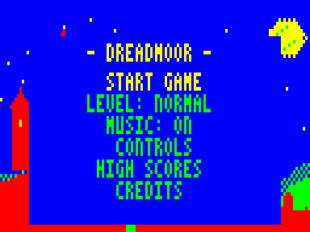
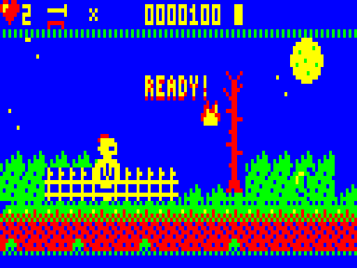
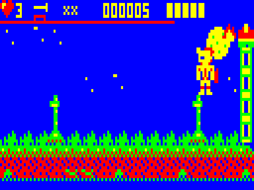
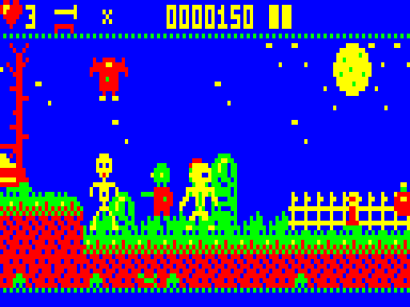

# DREADMOOR — Sir Tinplate's Long Night

A gothic fantasy arcade platform adventure for the Dick Smith VZ300.
Inspired by Ghosts 'n Goblins and Ghouls 'n Ghosts, without the cruelty.
Target: VZ300 + BennVenn SD loader + 128K SRAM. Mode 1 (128×64, 4 colours) throughout.
© 2026 — ViBED by BPM

## Loading

Copy `release/DREADMR.VZ` to the SD card and run it from the BennVenn loader. It loads at
$8000 and starts by itself. Needs the 128K SRAM expansion.

*(DREADMOOR is the working title.)*

 
 

## The game

The sorcerer **Morgrave** has stolen the seven **Sunstones**. The sun will not rise and the
dead walk the land. Only one knight is awake: **Sir Tinplate**, the least impressive knight
in the realm, in borrowed tin armour.

### This build (v0.1) contains

- **Stage 1: Gallows Hill**, a 176-tile-wide scrolling graveyard. It has a fenced meadow, a hill of
  graves, the bog with plank bridges, a crypt you can run across, spikes, high ledges, a
  second hill, two checkpoints, and a boss arena.
- **Visibly evolving armour on the sprite itself:** Undies → Tin → Steel (pauldrons) →
  Enchanted (sparkles) → Royal (cape and crest) → Legendary (winged helm).
  Hits knock armour off a stage at a time, with pieces flying. You only lose a life when hit in
  your undies. Armour pickups repair you, or upgrade you once you're at full strength.
  Checkpoints also repair you. Upgrades are permanent and survive continues.
- **Weapons:** lance, twin daggers, arcing battle axe, and a fire torch that leaves a burning
  flame on the ground. Picking up a weapon you already own **enchants** it (glowing lance that
  pierces, double daggers). Swap between owned weapons at any time.
- **Magic:** hold fire to charge, or press M, to call a **lightning storm**. The palette
  flashes, bolts fall and everything on screen is struck. Potions refill up to three charges.
- **Enemies:** Grave Zombies (rise out of the ground), Rattlebones (keeps fighting after his
  head is knocked off), Crypt Bats, Mourning Ghosts (flicker-transparent, drift through walls),
  Gallows Crows, the fire-spitting Grave Bloom, and **Gristle the Imp** (mini-boss).
- **Boss: GRAVEMAW, the Skull Under the Hill.** A 32×28 composite skull and jaw rises out of
  the ground. It's only vulnerable while its jaw is open and its eyes blaze; otherwise shots
  clink off the bone. It spits fireball volleys. In phase 2 it slams the ground (telegraphed
  by a shudder) and summons bats. Its health bar replaces the HUD divider.
- Chests, coins, jewels, potions, weapon pickups, extra lives, random drops.
- **Front end:** a lightning-lit animated title (castle, flickering windows, bats, ghost,
  descending gothic logo). There's also a menu, story pages, a "Creatures of the Night"
  bestiary, a self-playing demo, a hall of heroes, controls and credits pages, stage cards,
  game over with continue countdown, stage clear, and an ending.
- **Difficulty:** Casual (5 lives, longer invulnerability, weaker boss) / Normal / Expert
  (faster zombies, hits strip two armour stages).
- **Music:** gothic title organ (D minor), a macabre march for Gallows Hill, a chromatic
  boss theme, and jingles, plus 16 sound effects. The S key toggles music in-game.

### Controls

| Keyboard | Joystick | Action |
|---|---|---|
| O / P | left / right | walk |
| Q | up | jump (hold for higher) |
| A | down | crouch |
| SPACE | fire | throw; hold to charge magic |
| W or RETURN | arm button | change weapon |
| M | | cast magic |
| H | | pause |
| S | | music on/off |

Both joysticks work interchangeably (directions read via ports $2C/$29).

## Technical design

### Rendering (flicker-free, snow-free)

- **Background rings in SRAM:** the level is pre-rendered into two 48-byte-wide ring buffers
  in SRAM bank B, one for each 2-pixel scroll phase. New columns are rendered at the edges as
  the camera moves, so scrolling never redraws the whole map. The camera and objects sit on
  even pixels: 2-pixel steps match the hero's walking speed.
- **Off-screen frame buffer:** each frame the visible window is copied from the ring to a
  frame buffer with 4-byte side margins (so sprites never need horizontal clipping). Then
  scenery-aware extras (a moon that only draws over pure sky, so trees and pillars pass in front
  of it), objects, shots, the hero and particles are composed over it.
- **Interrupt-driven blit:** the frame-sync interrupt (IM2) copies the finished frame to
  video RAM with an unrolled stack-based copy (12.75 T-states per byte). It finishes inside
  vertical blank, which the emulator confirms with zero snow accesses in every test run. The
  HUD is only re-sent when it changes, in a field of its own.
- **Sprites:** sprites are pre-shifted for both phases at build time and mirrored at run time
  through a lookup table. The hero's 8 frames × 2 phases are **built at run time** from
  layered "class" data (body plus armour pieces), so all six armour stages cost ~1.5 KB.
- **Performance:** about 25 fps in gameplay, with roughly 30% of the CPU left over.

### Audio

Two pulse channels mixed by time-multiplexing on the 1-bit speaker (~27.5 kHz sample loop).
Pulse width doubles as volume: notes attack at ~25% duty and decay to ~5%, with a gap
before the next note. That makes the sound quiet, blippy and detached rather than shrill. The
sequencer and sound effects run in the 50 Hz interrupt. The tone loop fills the idle time of
every frame, which gives the in-game music a gritty 25 Hz texture.

### Memory map

```
$4000-$4A7F  SRAM bank B  ring buffer, phase 0      (title art while in menus)
$4A80-$54FF  SRAM bank B  ring buffer, phase 2
$5500-$6068  SRAM bank B  frame blit routine
$6100-$66FF  SRAM bank B  hero layered class data
$7000-$77FF  video RAM    rows 0-8 HUD, 9-59 playfield, 60-63 border
$7800-$7FFF  IM2 table, stack, HUD buffer, lookup tables
$8000-$F98B  program + data (the end of the load image becomes variables and frame buffer)
```

Port $37 is set to 3 (SRAM bank B) at start-up. The loader's DOS bank (value 1) isn't
used yet by this build, which currently uses RAM up to about $FCA0 (see the SD notes).

### BennVenn SD DOS interface (decoded from the 13 Ghosts loader)

The DOS lives in SRAM bank A (port $37 = 1) at $5F00 and keeps its variables at $FB00 upward,
so $FA00-$FFFF must be left alone by anything that calls it at run time.

| Call | In | Out / effect |
|---|---|---|
| `($FB80)` | | address of the 512-byte sector buffer |
| `call $5F00` | A=1, HL → `"NAME"` (in quotes, 8 chars) | open file; OK if `($FB03)=1` and `($FB05)≠1` |
| `call $5F03` | A=1 | read the first sector into `($FB80)` |
| `call $5F09` | | read the next sector into `($FB80)` |

13 Ghosts copies each sector to its destination with `out ($37),3` around the LDIR when the
target is SRAM bank B, then restores the DOS mapping. Its file table entries are
destination (2), length (2), bank flag (1), then the quoted name (10).

### Not yet in this build (next milestones)

- **SD streaming of stage packs** (map, enemy sprite set, music per stage) using the DOS
  interface above. This needs the RAM at $FA00-$FFFF given back to the DOS, which stage packs
  make possible by moving stage data out of the resident program.
- **Save games and high scores on SD.** The calls above only read; a write call still needs to be found.
- Further stages: Witchwood, the Drowned Village, the Swamp of the Damned, Crystal Deeps,
  Demon Castle, Haunted Sky, and Morgrave's Citadel, each with its own tiles, enemies, boss and
  music. More weapons (crossbow, boomerang, holy orb, bombs, enchanted sword) and more spells
  (fire wave, shield, freeze).
- Parallax cloud layer, 1-bit speech ("READY!", "GAME OVER"), bonus vaults.

## Building

Requirements: Python 3 (with Pillow, only for previews) and gcc for the test emulator
(`gcc -O2 -o emu/vzemu emu/vzemu.c`).

```
./build.sh                         # -> build/DREADMR.VZ  (loads at $8000, autoruns)
./build.sh dbg START ARM OWNED CHEAT   # test build: start x, armour 0-5, weapon bits, invincible
```

- `tools/z80asm.py`: the two-pass Z80 assembler used for this project. It supports local labels,
  `phase`, `dsect`, and automatic jr→jp relaxation.
- `tools/art.py`: all pixel art (tiles, sprites, hero layers, font).
- `tools/mkassets.py`: generates tiles, pre-shifted sprites, the level, music, blit
  routines and the RLE-packed title art.
- `emu/vzemu`: a headless VZ300 test emulator (PAL timing, IM2, BennVenn SRAM banking,
  keyboard and joystick). It also does snow detection, screenshots, a mono preview, WAV capture,
  a profiler, write watchpoints and a crash PC trail. Snow timing assumes the display starts 94
  lines after the field-sync interrupt; that needs confirming on real hardware.
