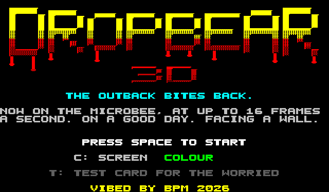
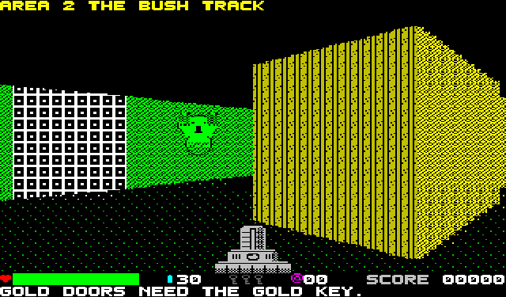
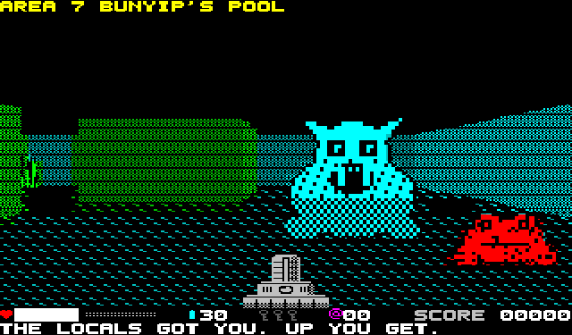
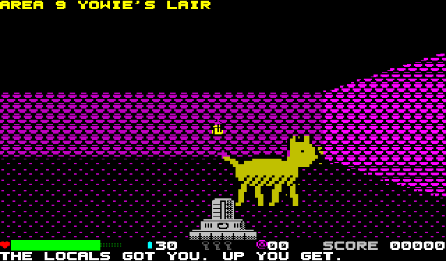
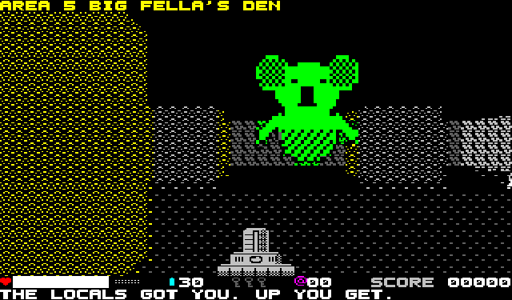

# DROPBEAR 3D — Microbee Premium Plus

The Microbee version of the VZ300 game DROPBEAR 3D: a first-person shooter in native Z80 for the Microbee Premium Plus, in the 40 × 25 mode with 8 × 10 cells. It is built on the BUNYIP engine (`Bunyip-Microbee`) with DROPBEAR 3D's world, critters, bosses and jokes.

VIBED BY BPM 2026

| | |
|---|---|
|  |  |
|  |  |

## Status

Version 0.1, **not yet tested on real hardware**. In the emulator:
- all nine areas load and draw;
- walking through a way out takes you to the next area, and walking back brings you to the area as you left it;
- the whole game is checked as finishable by `tools/zones.py` (351 steps to the ute, every item reachable).

A full start-to-finish playthrough in the emulator has not been done yet.

## Playing

Needs a Premium Plus with 1MB RAM. Boot `release/DROPBEAR.DS8` and type `DROPBEAR` at the `A>` prompt.

| Key | Action |
|---|---|
| Cursor keys or W A S D | Walk and turn |
| Z / X | Sidestep |
| SPACE | Blast |
| E or RETURN | Open doors, pull levers |
| M | Map of what you have seen |
| P | Pause |
| C | Colour / amber mono |
| R | Sharp walls (80 rays) / fast walls (40 rays) |

Drop bears have overrun the outback. Fight through nine connected areas, beat the Big Three and get back to your ute. There are 20 opals to find.

| Area | Theme | Who's there |
|---|---|---|
| The Homestead | Station: brick and iron, oil drums, lamps | Drop bears, cane toads, magpies |
| The Bush Track | Bush: hedges, termite mounds, shrubs | Drop bears, magpies, snakes, fruit bats |
| Gum Tree Maze | Bush hedge maze | Snakes, magpies, a bat, a bear. The gold key is in here |
| The Old Mine | Mine: rock, mine carts, lamps | Huntsmen, bears, a bat |
| Big Fella's Den | Mine | **Big Fella**, plus huntsmen |
| The Billabong | Swamp: mud, reeds, stumps | Cane toads, snakes, fruit bats, bears |
| Bunyip's Pool | Swamp | **The Bunyip**, plus toads and snakes |
| The Ridge | Ridge: sandstone, shrubs, termites, bones | Dingoes, snakes, bears |
| Yowie's Lair | Lair: cliffs and bones | **The Yowie**, plus dingoes and huntsmen |

How it plays:
- **Moving between areas:** walk into the pink arrowed walls. Each area remembers what you beat, opened and picked up.
- **Doors, keys and gates:** doors are panelled walls. Gold, blue and red doors each want their key. Levers swing barred gates, and beating a big one opens its gate.
- **Secrets and goodies:** bump the cracked-looking walls for secrets. Shoot oil drums for goodies. Vegemite gives 25 health.
- **Forgiving:** if you get knocked down, you get up at the door you came in by.

The title runs DROPBEAR 3D's three-voice title tune, then the story, the controls and "Meet the locals". There are three skill levels: SHE'LL BE RIGHT, HURT ME PLENTY and FLAMIN' NIGHTMARE.

## Differences from the VZ300 version

- The map scroll in the maze is not used: M always shows what you have seen.
- Wall B (crates, bark and so on) shares wall A's pattern in a different colour, because the engine has six wall-texture banks.
- Creatures burst into a puff of smoke instead of flying chunks.

## Building

`src/bn.sh` builds everything (Python 3 with Pillow, gcc for the test emulator). It makes the tables and glyphs, the sprites (`tools/art.py`), the nine areas (`tools/zones.py`, which also checks the game can be finished), the front end (`tools/front.py`), the program, the loader and `DROPBEAR.DS8`. `tools/rungame.py frames keys outdir --at area,x,y,angle` runs it in the test emulator, starting anywhere.

Memory: the program is at 8000h. RAM block 2 holds the nine areas (800h each) and the front end. Sprites go in blocks 6–22, and each area's saved state in blocks 23–31.
