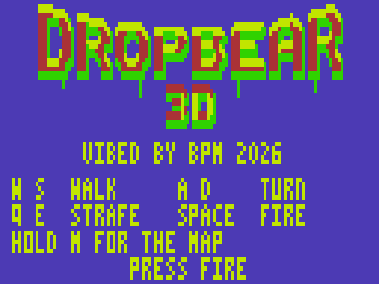
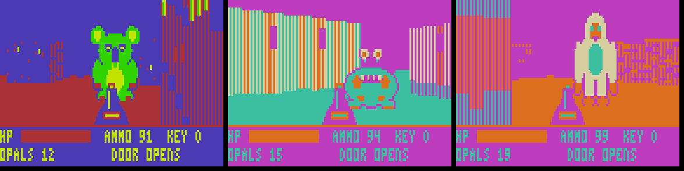
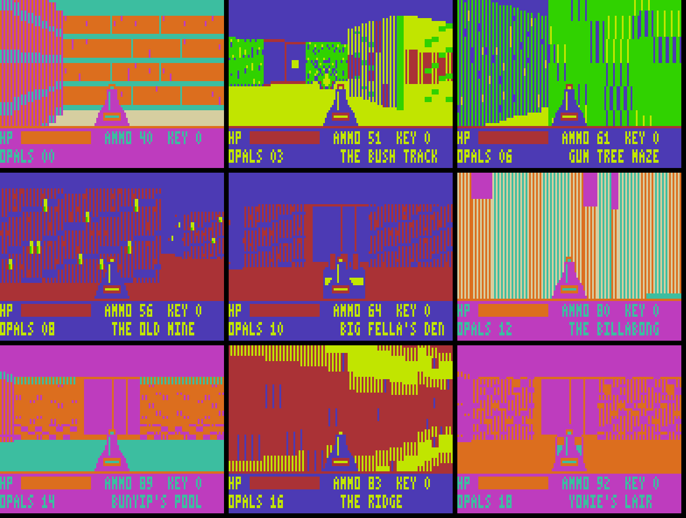

# DROPBEAR 3D

A first-person drop bear hunt for the Dick Smith **VZ300**: textured 3D walls, nine connected areas with their own colour schemes, keys, switches, secret walls, an automap and three bosses, all in Z80 machine code.

Vibed by BPM, 2026.

## The game

Drop bears have overrun the outback. Fight your way through nine connected areas, beat the Big Three and get back to your ute.

| Area | Theme | What's there |
|---|---|---|
| The Homestead | Station: brick, crates, tin | Start. Two secret walls |
| The Bush Track | Bush: hedges, gum trees | The hub. A locked door guards the way to the mine |
| Gum Tree Maze | Bush | A hedge maze holding the key and the map |
| The Old Mine | Mine: dark, things fade into the gloom | Find the switch to open the gate |
| Big Fella's Den | Mine | **Boss 1: Big Fella**, a huge drop bear |
| The Billabong | Swamp: misty dusk, reeds and mud | Fruit bats. A key, a locked door, a secret |
| Bunyip's Pool | Swamp | **Boss 2: the Bunyip**, which lunges in bursts |
| The Ridge | Ridge: sandstone and bones | A maze with a switch-gate and a locked bonus room |
| Yowie's Lair | Lair: dark, cliffs and bones | **Boss 3: the Yowie**, who gets faster as it gets hurt. Beat it and the way to the ute opens |

### Things to know

- **Areas remember their state.** Bears you beat stay beaten and doors you open stay open, so you can walk back and forth freely.
- **Keys** open locked doors (padlock texture). The key count is in the status panel.
- **Switches** are walls with a lever. Walk into one to open the gates (barred walls) in that area.
- **Beating a boss** opens the gates in its arena.
- **Cracked walls** are secret. Walk into one and it opens, usually onto an opal. There are 20 opals in all, and the end screen tells you how many you found.
- **The map:** hold M. Some areas have it from the start; in the maze areas you have to find the map scroll first.
- **It's forgiving.** Bites cost 4–16 health from 100, Vegemite jars give 25 back, and if you go down you start again at the door you came in by, with full health and everything you collected.
- **Ammo** boxes give 15. If you run very low, the blaster slowly recharges, so you can never get stuck.

## Controls

| Key | Action |
|---|---|
| W / S | Walk forward / back |
| A / D | Turn left / right |
| Q / E | Strafe left / right |
| SPACE | Fire |
| M (hold) | Map |

Joystick 1 also works if it is plugged in at start-up: directions to move and turn, fire to shoot, and hold the arm button to strafe.

## Hardware

VZ300 with a BennVenn SD loader and its 128K RAM expansion. Copy `release/DROPBEAR.VZ` to the SD card and run it. It is a single 17 KB file that loads at $8000–$C556, then unpacks itself into:

| Where | What |
|---|---|
| $8100–$F7FF main RAM | Engine, compiled wall scalers, some sprites, text, world, code |
| $F800–$FFFF | Work areas, including the view buffer |
| SRAM bank 1 ($4000–$67FF, mapper value 1) | The active wall textures and most sprites |
| SRAM bank 3 ($4000–$67FF, mapper value 3) | The saved state of every area and the texture library |

Each area's four wall textures are copied in from the bank 3 library when you walk into it. Nothing is read from the SD card after loading. This overwrites the DOS in SRAM (as Cybernoid does), so power-cycle to leave the game.

## Status

Version 0.2. The whole game has been played start to finish in the project's own Z80 simulator: all nine areas, three bosses, all 20 opals, at about 18 frames a second. Dying and respawning were also tested. The engine's timing was checked on a real VZ300 with the benchmark in `bench/`, which matched the simulator exactly. The banked memory layout follows what the bank probes showed on the real machine, but this version has not yet been run on real hardware.

## Folders

| Folder | What's in it |
|---|---|
| `release/` | `DROPBEAR.VZ`, ready for the SD card |
| `src/` | `dropbear.asm` (the game), `build.py` (tables, textures, sprites, world, packer), `z80tools.py` (assembler and simulator), `play.py` (plays the whole game in the simulator) |
| `screenshots/` | Pictures and a playthrough GIF from the simulator |
| `bench/` | RAYBENCH, the raycaster speed test that came first |

To rebuild: `python3 build.py` in `src/` (needs Python 3 with Pillow). `python3 play.py` plays it through and reports frame rates.
