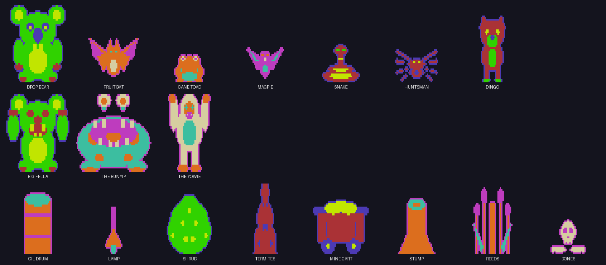
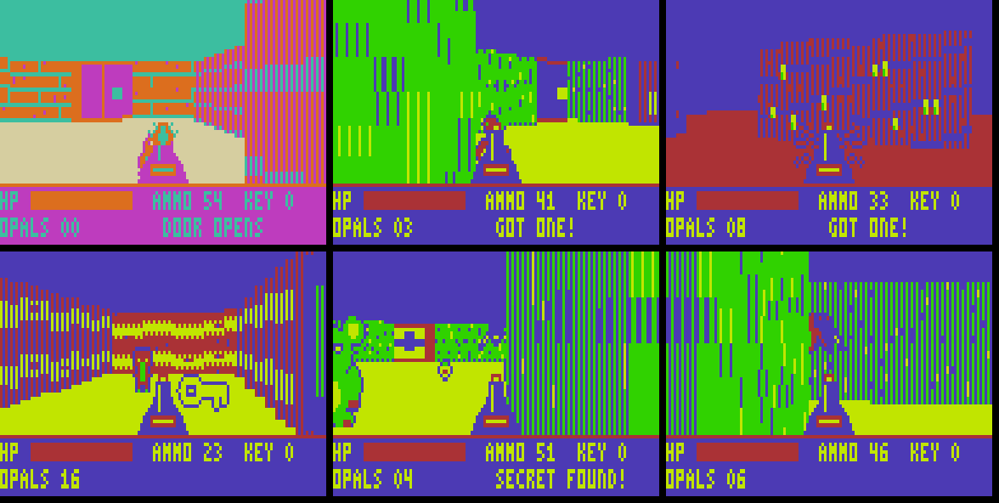
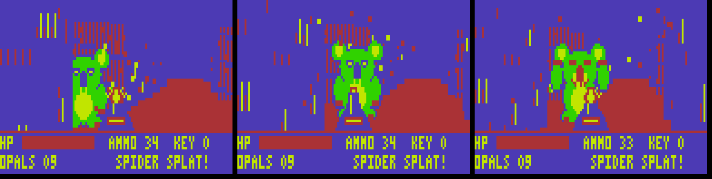

# DROPBEAR 3D

A first-person drop bear hunt for the Dick Smith **VZ300**: textured 3D walls, nine connected areas with their own colour schemes, ten kinds of creature, exploding enemies, furniture, keys, switches, secret walls, an automap and three bosses, all in Z80 machine code.

Vibed by BPM, 2026.

## The game

Drop bears have overrun the outback. Fight your way through nine connected areas, beat the Big Three and get back to your ute.

| Area | Theme | Who's there |
|---|---|---|
| The Homestead | Station: brick, crates, tin, oil drums, lamps | Drop bears, cane toads, magpies |
| The Bush Track | Bush: hedges, gum trees, shrubs, termite mounds | Drop bears, magpies, snakes, fruit bats |
| Gum Tree Maze | Bush hedge maze | Snakes, magpies, a bat, a bear. The key and the map are in here |
| The Old Mine | Mine: dark, mine carts, lamps | Huntsman spiders, bears, a bat |
| Big Fella's Den | Mine | **Boss 1: Big Fella**, plus spiders |
| The Billabong | Swamp: misty dusk, reeds, stumps | Cane toads, snakes, fruit bats, bears |
| Bunyip's Pool | Swamp | **Boss 2: the Bunyip**, which lunges in bursts, plus toads and snakes |
| The Ridge | Ridge: sandstone, shrubs, termites, bones | Dingoes, snakes, bears |
| Yowie's Lair | Lair: dark cliffs and bones | **Boss 3: the Yowie**, who gets faster as it gets hurt, plus dingoes and spiders |

### Things to know

- **Creatures:**
  - Toads hop at you in bursts; magpies and bats swoop at eye level.
  - Snakes are slow but bite hard; spiders and dingoes are quick.
  - Anything asleep wakes when it sees you or when you get within about three steps.
- **Beaten creatures explode** into a spray of chunky pieces that bounce off the floor. Bosses go up in a big burst with a screen flash.
- **Areas remember their state.** Whatever you beat stays beaten and doors stay open.
- **Keys** open padlocked doors. **Switches** (walls with a lever) open barred gates in that area. **Beating a boss** opens the gates in its arena.
- **Cracked walls** are secret: walk into one. There are 20 opals to find.
- **Hold M** for the map. In the maze areas you have to find the map scroll first.
- **Drums, carts, shrubs, termite mounds and stumps** block your way; lamps, reeds and bones don't.
- **It's still forgiving.** If you go down, you start again at the door you came in by, with full health and everything you collected. Vegemite jars give 25 health, and the blaster slowly recharges when you're nearly out of ammo.

## Controls

| Key | Action |
|---|---|
| W / S | Walk forward / back |
| A / D | Turn left / right |
| Q / E | Strafe left / right |
| SPACE | Fire |
| M (hold) | Map |

Joystick 1 also works if it is plugged in at start-up: directions to move and turn, fire to shoot, and hold the arm button to strafe.

## Hardware

VZ300 with a BennVenn SD loader and its 128K RAM expansion. Copy `release/DROPBEAR.VZ` to the SD card and run it. It is a single 24 KB file that loads at $8000–$E000.

The loader first checks that both extra RAM banks are present. If either is missing, it shows "NEEDS BENNVENN 128K RAM" instead of crashing. It then unpacks itself into:

| Where | What |
|---|---|
| $7800–$79FF | Object list and flying pieces |
| $7A00–$7FFF | Bank-copy routine and some sprites |
| $8100–$F7FF main RAM | Engine, compiled wall scalers, sprites, text, world, code |
| $F800–$FFFF | Work areas, including the view buffer |
| SRAM bank 1 ($4000–$67FF, mapper 1) | Active wall textures and sprites |
| SRAM bank 3 ($4000–$67FF, mapper 3) | More sprites, switched in as each one is drawn |
| High bank ($B800–$FFFF, mapper 5) | Saved state of every area and the texture library, copied in and out only when you change area |

Nothing is read from the SD card after loading, so power-cycle to leave.

## Status

Version 0.3. The whole game has been played start to finish in the project's own Z80 simulator: all nine areas, three bosses and all 20 opals. It runs at a median of about 16 frames a second, dipping to about 14 in the busiest rooms. Dying and respawning were also tested.

The engine's timing was checked on a real VZ300 (see `bench/`). Version 0.2 ran on real hardware. This version adds the high bank ($B800–$FFFF, mapper value 5), which is new to this game.

## Folders

| Folder | What's in it |
|---|---|
| `release/` | `DROPBEAR.VZ`, ready for the SD card |
| `src/` | `dropbear.asm` (the game), `build.py` (tables, textures, sprites, world, packer), `z80tools.py` (assembler and simulator), `play.py` (plays the whole game in the simulator), `prof.py` (shows where each frame's time goes) |
| `screenshots/` | Pictures and a playthrough GIF from the simulator |
| `bench/` | RAYBENCH, the raycaster speed test that came first |

To rebuild: `python3 build.py` in `src/` (needs Python 3 with Pillow). `python3 play.py` plays it through and reports frame rates.
