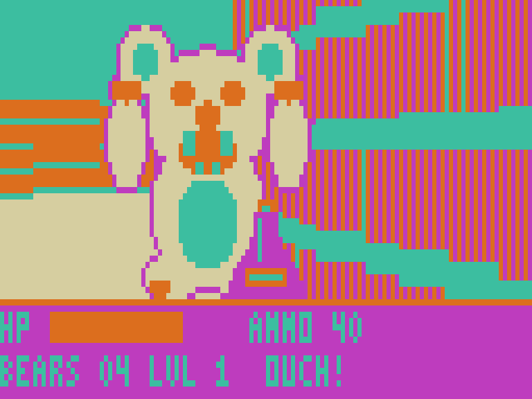

# DROPBEAR 3D

A first-person bear hunt for the Dick Smith **VZ300**. Textured 3D walls, scaled sprites, three levels and a boss, all in Z80 machine code.

Vibed by BPM, 2026.

## The game

The old research station is overrun with drop bears. On each level, find the key, then reach the exit door (the one with the big arrow). Level 3 is Big Fella's den, and he is sitting on the key.

- Bears take two hits. Big Fella takes twelve.
- You have 100 health and bites are small, so there is no instant death. Vegemite jars give 25 back.
- If the bears get you, you restart the same level with full health.
- Ammo boxes give 15 shots. If you run very low, the blaster slowly recharges, so you are never stuck.
- Walk into a door to open it.

## Controls

| Key | Action |
|---|---|
| W / S | Walk forward / back |
| A / D | Turn left / right |
| Q / E | Strafe left / right |
| SPACE | Fire |

Joystick 1 also works if it is plugged in at start-up: directions to move and turn, fire to shoot, and hold the arm button to strafe.

## Hardware

VZ300 with a BennVenn SD loader and its RAM expansion. Copy `release/DROPBEAR.VZ` to the SD card and run it. It needs no data files and does not use the SD card after loading.

## Status

Version 0.1. The whole game has been played start to finish in the project's own Z80 simulator (about 15 to 18 frames a second). The engine's timing was checked on a real VZ300 with the benchmark in `bench/`, which matched the simulator exactly. The finished game has not yet been run on real hardware.

## Folders

| Folder | What's in it |
|---|---|
| `release/` | `DROPBEAR.VZ`, ready for the SD card |
| `src/` | `dropbear.asm` (the game), `build.py` (tables, art, levels, packer), `z80tools.py` (assembler and simulator), `play.py` (plays the game in the simulator) |
| `screenshots/` | Pictures and a playthrough GIF from the simulator |
| `bench/` | RAYBENCH, the raycaster speed test that came first (v0.1 and v0.2) |

To rebuild: `python3 build.py` in `src/` (needs Python 3 with Pillow).
