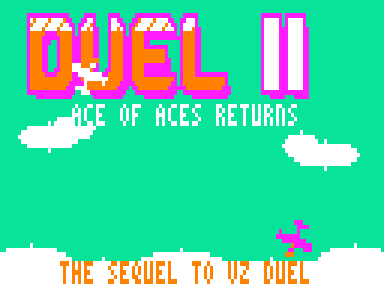
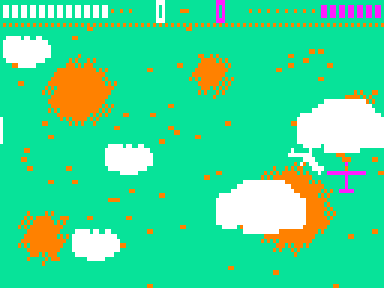
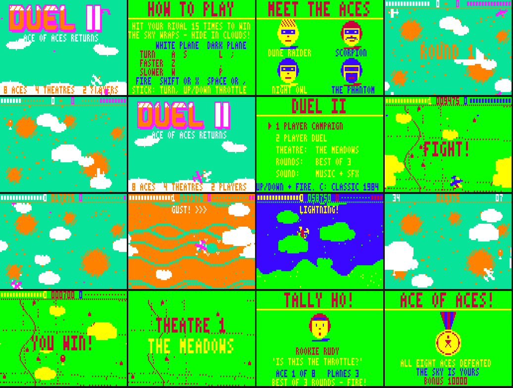

# DUEL II — ACE OF ACES RETURNS

Sequel to the VZ200/VZ300 game *DUEL* (its title screen calls it *"ACE OF ACES"*), for the
Dick Smith VZ300 / VZ200 with the **BennVenn SD loader + 128K**.
ViBED by BPM 2026. Version 1.0. Original code, graphics and music. Nothing from the original game is included.







## Play it

Copy `release/DUEL2.VZ` to the SD card and run it from the BennVenn SD loader.
- It's a single type F1 binary. It loads at $8000 (to $EDF4) and runs from $8000. There are no other files.
- It needs the **128K expansion** (RAM up to $FFFF, and the card's SRAM at $4000–$67FF).

### Controls

The original's keys still work.

| Action | White plane (player 1) | Dark plane (player 2) | Joystick |
|---|---|---|---|
| Turn left / right | A / S | L / ; | left / right |
| Faster | Z | . | up |
| Slower | W | P | down |
| Fire | SHIFT or X | SPACE or , | fire |

Joystick 1 flies the white plane and joystick 2 the dark one. In the 1-player campaign, either stick or the white plane's keys will do.

| Other keys | |
|---|---|
| RETURN | pause (Q quits while paused) |
| M | sound: music + effects → effects only → off |
| Menus | up/down (W/Z, Q, P, or a stick), SPACE / RETURN / fire to choose, A/S or left/right to change a setting |
| C (on the menu) | unlocks **CLASSIC 1984** |

## From the original to the sequel

**What the original does.** *DUEL* is 3.3K of machine code that loads at $8220 and makes no ROM calls.
- It's a two-player dogfight on one Mode 1 screen: a green sky with yellow cloud puffs.
- A **white plane** (drawn yellow) fights a **blue plane**. Each turns through 8 directions and has a 10-step throttle.
- The screen wraps around in every direction, for planes and bullets alike.
- Each plane has 5 short-range bullets. **Hit the other plane 15 times to destroy it**, then the title page names the winner.
- Each player has a row of 15 dots across the top.
- **Planes hide under the clouds.** That's the game's big idea.
- Sound is two beeps, one for a shot and one for a hit.
- It copies the whole screen to video RAM every frame, so it snows and its speed varies.

**Kept for the sequel:**
- the top-down, wrap-around dogfight
- turning plus a throttle
- short-range guns
- 15 hits to win, shown as the dot rows at the top
- clouds you can hide in, which hide bullets too
- White Plane v Dark Plane, on the original's keys

**New:**
- **Smooth flying.** 16 headings with sub-pixel movement, corrected for the 4:3 screen, at a steady 25 frames a second with no snow.
- **1-player Campaign:** eight computer aces across four theatres. Each duel is best of 3 rounds, and you have 3 planes.

  | Theatre | Aces | Hazard |
  |---|---|---|
  | **The Meadows** (the original's greens) | Rookie Rudy, Farmer Fritz | — |
  | **The Ocean** (cyan sea, white clouds) | Salty Sue, Captain Kraken | — |
  | **The Desert** (orange dunes) | Dune Raider, Scorpion | **gusts** blow everything sideways |
  | **Night Storm** (blue night, green storm clouds) | Night Owl, The Phantom | **lightning**: a cloud flickers, then strikes any plane under it (2 hits) |

  Each ace has a portrait, a catchphrase and a style. Some are slow to turn or hesitate. Later aces lead their shots, break away when you get on their tail, or hide in clouds when losing (the Night Owl and the Phantom). Slowing down tightens your turn, and the aces know it too.
- **Balloon Bust** bonus round after each of the first three theatres. Shoot 20 balloons in 45 seconds for 200 each, and 5000 more if you get them all.
- **2-player Duel** on any theatre, best of 1, 3 or 5.
- **CLASSIC 1984** (press C on the menu): the original's plain green sky with yellow puffs, 8 directions, no power-ups.
- **In the air:**
  - **supply balloons** to shoot for a power-up: Repair (+5), Twin Guns, Turbo or Shield
  - smoke trails when a plane is badly hurt
  - **mid-air collisions** (1 hit each, and you're knocked off course)
  - a beaten plane spins down trailing smoke, blows up, and the pilot floats away under a parachute
- **Scoring** (campaign):

  | | Points |
  |---|---|
  | Hit | 25 |
  | Shoot-down | 500 |
  | Round won | 50 per hit you have left, plus 1000 if you took none |
  | Duel won | 2000 |
  | Balloon | 100 |
  | Beat all eight aces | 10,000 |

**Presentation:**
- **Title screen:** a rounded DUEL II logo over a cyan sky, with two computer aces dogfighting across it.
- **Attract cycle:** title → How to Play → Meet the Aces (2 pages) → a computer v computer demo in a random theatre → Hall of Fame. Start works at any point.
- **Between duels:** a theatre intro over that theatre's own landscape, an ace card before each duel, a Victory or Shot Down page after it, and the **ACE OF ACES** medal ending.
- **In game:** ROUND / FIGHT! banners, winner banners, and pop-ups (TWIN GUNS!, GUST!, LIGHTNING!…).
- **Hall of Fame:** 5 entries with 3-letter initials, saved between loads (see Hardware notes).
- **Sound:** the two-voice pin-pulse beeper engine from Ghost Hunter 2 / Tennis II, with short, separated notes for that gritty sound. All tunes are original:
  - title ("Tally-Ho Two-Step"), info pages, battle loop, Balloon Bust, ending march
  - jingles: start, round, round won, round lost, duel won, game over, power-up, theatre, Hall of Fame
  - 16 effects: guns, twin guns, hits, explosion, crash, balloon pop, power-up, thunder, gust, shield, falling whistle, parachute and more
  - with the music off (effects only), your engine drones, and its pitch follows the throttle

  `media/` has the emulator's speaker output for the title music and a stretch of play.

## Hardware notes

- **Loading:** one .VZ from the BennVenn SD loader, loading low at $8000. This is the same pattern as Tennis II, Xevious v1.2 and Cybernoid v1.1, which work on your machine.
  - There are no ROM calls, and the DOS isn't needed after loading.
  - Interrupts stay off. Frame timing comes from field sync ($68xx bit 7). The game updates every second frame, and field sync is polled during the game's own work so no frame is lost.
- **Memory:**

  | Range | Use |
  |---|---|
  | $4000–$6255 | recoloured, pre-shifted sprites, built for each theatre (SD card SRAM, mapping 1, as the loader leaves it, the same way Cybernoid v1.1 uses it) |
  | $6300–$64FF | recolour tables |
  | $6500–$668F | sprite frame table |
  | $6690–$672F | backdrop saved under pop-up text |
  | $6780–$67A6, SRAM **bank 3** | Hall of Fame and settings (signature and checksum) |
  | $7800–$7B9D | variables |
  | $7C00–$7DFF | commit queue, dirty and erase tables |
  | $7E00–$7F3F | backdrop saved under banners |
  | $7FFE | stack (grows down) |
  | $8000–$EDF4 | code and data (the .VZ, 28,149 bytes) |
  | $F000–$F7FF | backdrop (landscape and HUD) |
  | $F800–$FFFF | composed frame |

- **Records:** kept in SRAM bank 3 (`OUT ($37),3`), in a block of their own just below Tennis II's.
  - They survive reloading the game but not power-off. Another game that uses bank 3 may overwrite them, in which case the signature check just starts a fresh table.
  - At start-up the game probes the bank switch, using the same test as Tennis II, which your BIX bank tests back up. It only saves if bank 1 is untouched and bank 3 holds the test byte.
  - The mapping goes back to 1 straight afterwards.
- **Snow-free drawing:**
  - The game composes each frame in RAM, and every change marks the byte span it touched on that row.
  - In vblank, just those spans are copied to video RAM.
  - Clouds are drawn last, so planes slip underneath them, as in the original.
- **Joysticks:**
  - Joystick 1 is read on $2E/$2D/$2C. Joystick 2 is read on $2B/$27, with its directions also from $29 (as your interface needs).
  - "All four directions at once" is ignored, so having no interface plugged in reads as no input.

## Build

Needs Python 3 with Pillow, plus sjasmplus (https://github.com/z00m128/sjasmplus) if you have it. Otherwise the bundled Python assembler `tools/zasm.py` is used.

```
cd src
./build.sh          # -> ../build/DUEL2.VZ (a finished copy is in release/)
```

- `gen.py` writes `data.inc`. It uses `font.py`, `pics.py` and `music.py`, and holds:
  - the 3×5 font
  - the planes: 16 headings drawn as strokes in aspect-corrected space, pre-shifted 4 ways in logical colours
  - the other sprites
  - the cloud masks
  - the four landscapes and the Classic sky
  - the velocity tables
  - the title picture
  - the nine portraits and the medal
  - all the music

  Previews go to `build/preview/`.
- `mkvz.py` wraps `duel2.bin` into the .VZ file.

`tools/vzemu/` is the small headless VZ300 emulator from Penguin 2 / Tennis II (superzazu/z80 CPU core, MIT licence, see `LICENSE-z80`). Build it with `gcc -O2 -o tools/vzemu/vzemu tools/vzemu/vzemu.c tools/vzemu/z80.c`.
- **New for this project:**
  - the snow log now names the PC and the address
  - `-span a:b` makes a histogram of the cycles between two addresses
- **Test scripts:**
  - `tools/fuzz.py`: random-input soak
  - `tools/media.py`: screenshots, GIFs and audio. The campaign is flown by the built-in computer pilot through the test hooks `autoplay` and `godmode`, which are always 0 on real hardware.
  - `tools/prof.py`: profile report
  - `tools/dis.py`: the Z80 disassembler used to study the original (the original itself is kept only on your PC)

## Testing

Tested **in the emulator only**:
- The whole campaign, flown by the computer pilot, through all 4 theatres, 8 aces, 3 Balloon Busts and the ending.
- Losing: a duel lost → Try Again → game over → initials → Hall of Fame.
- Two-player duels on the Meadows, Ocean, Desert and Classic 1984 (the Night Storm through the demo), the attract cycle, pause/quit and the sound modes.
- Records saved to and reloaded from the emulated SRAM bank 3, with Classic 1984 still unlocked after reloading.
- 4 × 60,000 frames of random input: no crashes, no stack growth, and no video RAM access during the picture apart from the one at power-on. All drawing finished before the picture starts (latest: scanline 77 of 81).
- **Timing:** 97% of game updates take exactly two frames (25 per second); the rest take three.
- **Difficulty:** the computer pilot (a fair player) breezes through the first four aces, starts dropping rounds at the Dune Raider, and is beaten by Scorpion and the Night Owl.

**Not yet checked on real hardware:**
- the real machine's top-border length (the emulator assumes 25 lines; drawing ends about 5 lines before the picture starts)
- the SRAM bank-3 records save
- speaker volume and joystick feel on your interface
- difficulty for a human pilot
- the sprite rebuild when a theatre changes (a fraction of a second, while the screen holds)

## About the original

*DUEL* / *ACE OF ACES* was a VZ200/VZ300 tape game. It has no licence that allows redistribution, so neither the original program nor any of its graphics or code is included here. The sequel was written from scratch after studying it in the emulator. Its disassembly stays on your PC only.
