# EMPIRES : THE LIVING WORLD
### A civilisation and city-building game for the Microbee Premium Plus
**VIBED BY BPM 2026**

From a lonely town hall to the light of the world.

A handful of settlers, a patch of grass and a river. Plough fields and fell forests,
lay roads and bridge rivers, and watch your huts grow into houses and your houses
into manors. Each year the seasons sweep across the land, from spring green and
summer gold to the reds of autumn and winter's white silence, when the farms lie
fallow and only the wise have stored enough grain.

Set your scholars to thirteen arts, from Agriculture to Philosophy, and raise mines,
harbours, schools, temples, hospitals, a university and, at last, the Grand Forum.
You are not alone. Other peoples build their own towns beyond the hills: traders,
builders, scholars, the isolated and the warlike. Send envoys with gifts, agree
trade, forge alliances, and keep your watchtowers manned against raiders.

Choose one of seven tales, from the gentle First Settlement to the vast Age of
Discovery, and find your own path to greatness: prosperity, science, culture,
diplomacy or dominion. Conquest is never needed.

Every world is new. Every season matters. Every empire begins with a single hut.

| | | |
|---|---|---|
| 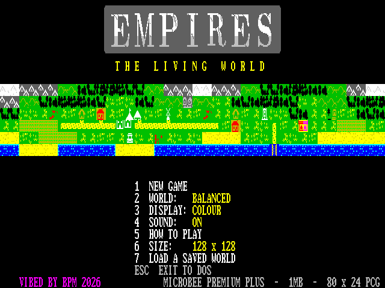 | 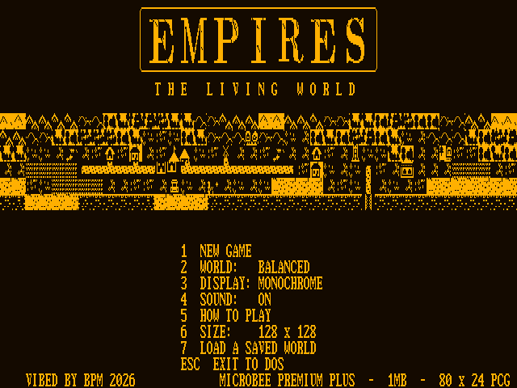 | 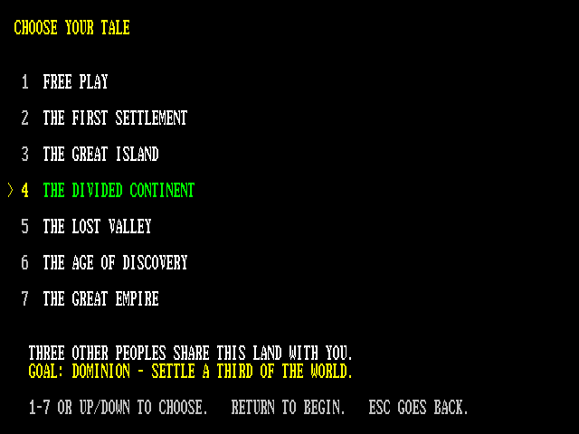 |
| 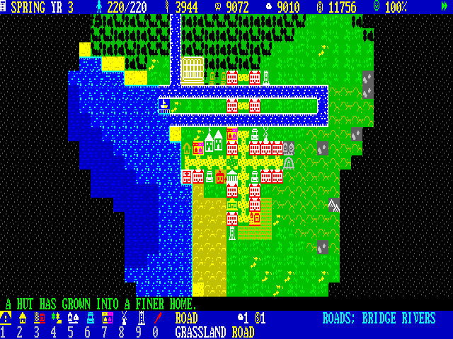 | 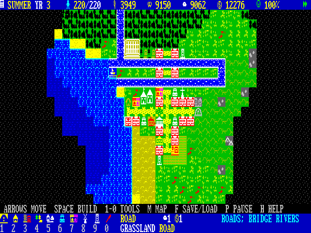 | 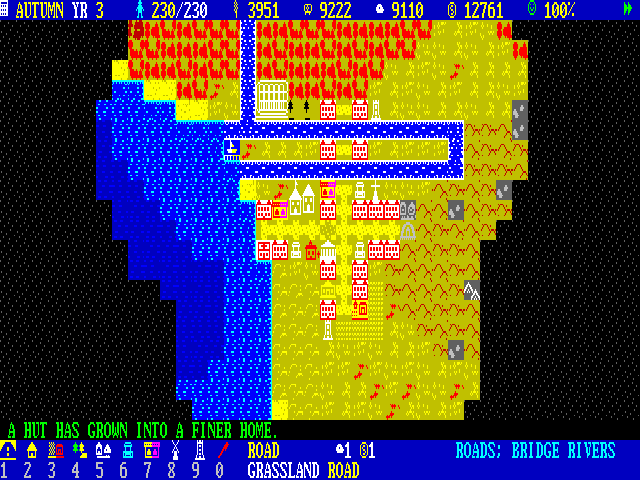 |
| 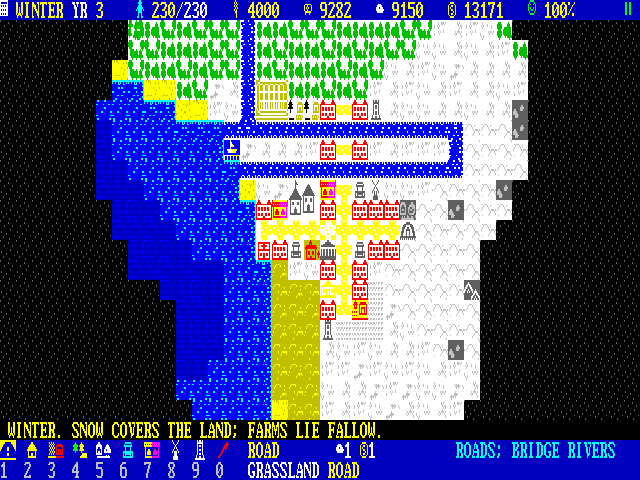 | 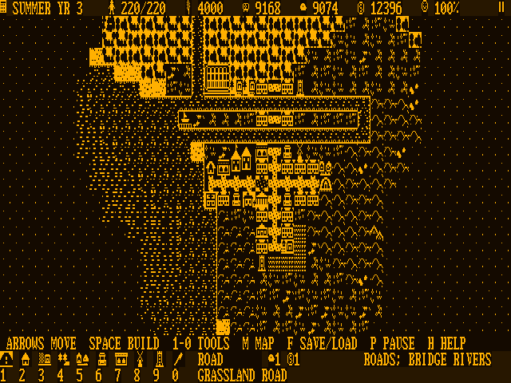 | 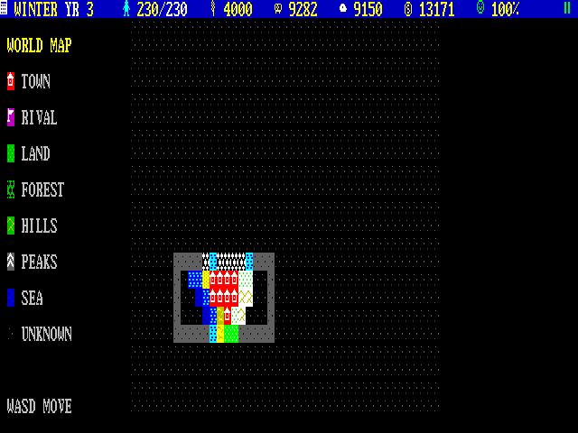 |
| 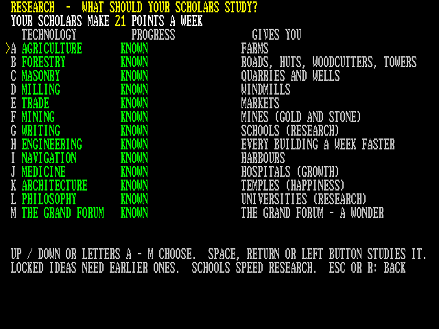 | 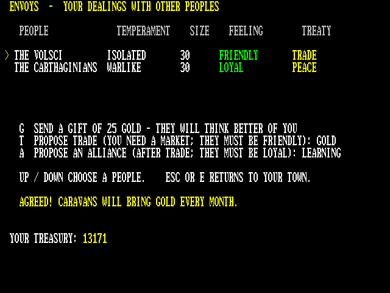 | 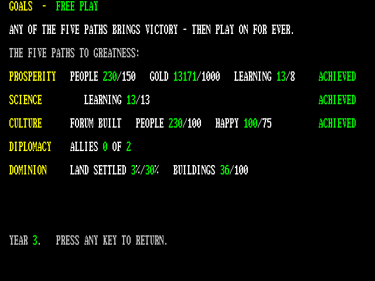 |
| 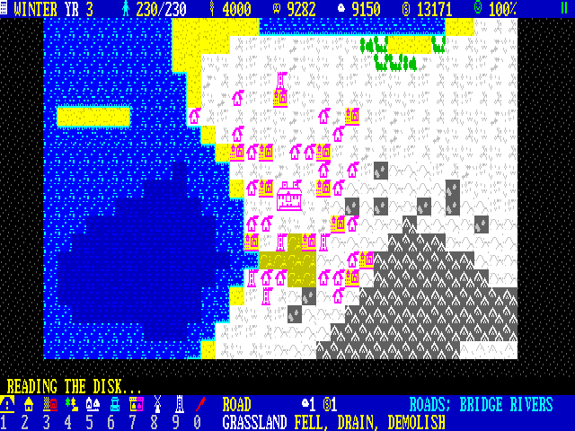 | 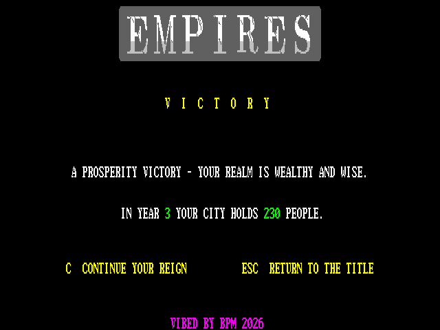 | 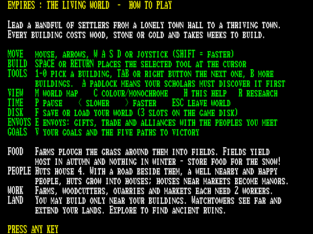 |

## Tech specs

| | |
|---|---|
| **Machine** | Microbee Premium Plus, 1 MB RAM (uses 25 × 32 KB banks, 800 KB) |
| **Media** | One DS80 disk (`EMPIRES.DS8`, 800 KB). Boots straight to `A>`; type `EMPIRES` |
| **Display** | 80 × 24 PCG character screen, 8 × 11 cells (640 × 264 pixels). 697 custom characters across 16 PCG banks |
| **Colour and mono** | Full colour, or a separately drawn monochrome character set for green or amber monitors; switch any time with `C` |
| **Lettering** | Carved marble title and a Roman typeface replacing the Microbee font throughout |
| **Worlds** | Procedural: 128 × 128 or 256 × 256 tiles, five world types (Balanced, Islands, Continental, Frontier, Harsh), rivers, coasts and ancient ruins, held in banked RAM with fast scrolling |
| **Simulation** | Weekly economy of food, wood, stone and gold. 17 building tools, 26 kinds of tile object, houses that evolve, four seasons that recolour the land, random events |
| **Technology** | 13 arts, each unlocking buildings or bonuses; schools and universities speed research |
| **Rivals** | Up to three AI peoples with their own towns, territory, five temperaments, attitude, trade, alliances, war and raids |
| **Scenarios** | Free Play plus six tales: The First Settlement, The Great Island, The Divided Continent, The Lost Valley, The Age of Discovery, The Great Empire |
| **Victory** | Prosperity, science, culture, diplomacy or dominion. Play on after winning |
| **Controls** | Microsoft serial mouse (1200 baud, decoded in software; finds the right input line and polarity itself and calibrates to the CPU clock), keyboard or joystick |
| **Sound** | 1-bit beeper played between video frames, so nothing waits for it: gritty title music with a sub-octave bass line, a victory march, 18 effects |
| **Saving** | Three save slots on the game disk, compressed and checksummed (about 7 KB each) |
| **Code** | All Z80 assembly: 26.9 KB engine, 12.9 KB overlay, 17 KB of art, 3.6 KB loader |
| **Tested** | On a real Premium Plus with an amber monitor: play, mouse, save and load all confirmed |
| **Extras** | `MOUSE.COM` serial-port and mouse tester on the disk |

## You need
- Microbee Premium Plus with 1MB RAM

## Starting
Boot `release/EMPIRES.DS8` (on a Premium Plus without a DS8 drive, boot the image from SD). It goes straight to the `A>` prompt. Type:

    EMPIRES

The loader fills the expanded RAM (dots show progress). Choose **C** for a colour monitor or **M** for monochrome. On the title, **1** starts a new game: pick one of seven tales (Free Play, The First Settlement, The Great Island, The Divided Continent, The Lost Valley, The Age of Discovery, The Great Empire). Free Play uses the world type (**2**) and size (**6**, 128×128 or 256×256) set on the title. **7** loads a saved world. ESC on the title returns to `A>`.

## Keys
| | |
|---|---|
| Mouse, arrows, W A S D, I J K L or joystick | move the cursor (SHIFT = faster) |
| Left / right mouse button | build / next tool |
| SPACE or RETURN | build the selected tool |
| 1–9, 0 / TAB | road, hut, farm, woodcutter, quarry, well, market, windmill, watchtower, clear land |
| B | second page of tools (mine, school, harbour, hospital, temple, university, Grand Forum) |
| R | research |
| E | envoys: gifts, trade, alliances |
| V | goals and the five paths to victory |
| M | world map |
| F | save / load (3 slots on the game disk) |
| C | colour / monochrome |
| P / , / . | pause / slower / faster |
| H | help |
| ESC | leave the world (Y/N) |

## Status
Finished and tested on a real Premium Plus (amber monitor): play, serial mouse, save and load confirmed. Developed alongside a Premium emulator.
## Folders
- `release/`: the bootable disk image and the program on its own
- `src/`: Z80 source, Python art and test tools, `build.sh`, `DESIGN.md` (hardware findings, memory map, status)
- `screenshots/`: colour and mono screens, world map, the five world types

*Rebuilding the disk needs the Microbee system tracks and `CCP.SYS`. These are Microbee system files, so they're not included here; copy them from your own Microbee system disk into `src/src/resources/` (`boot_tracks.bin`, `CCP.SYS`).*
