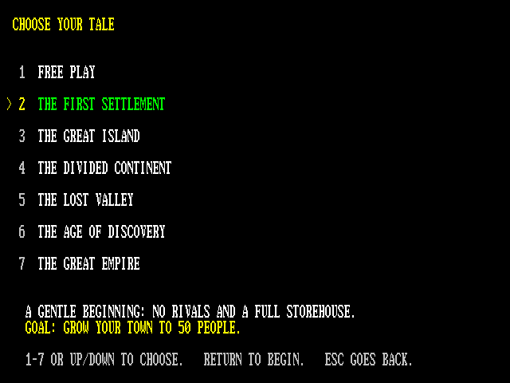
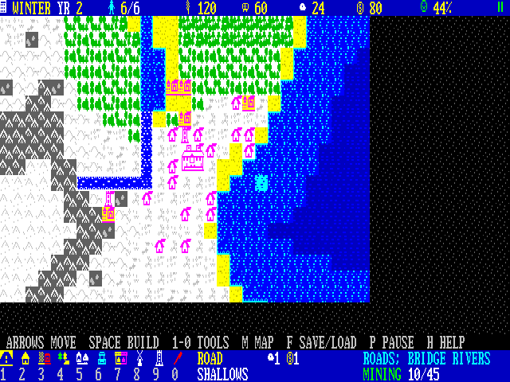
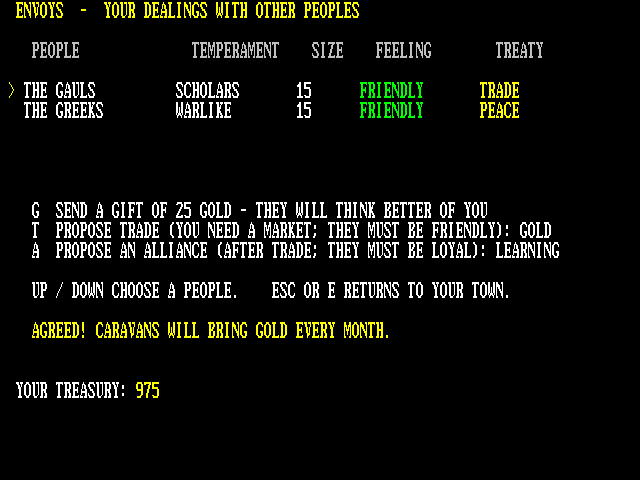
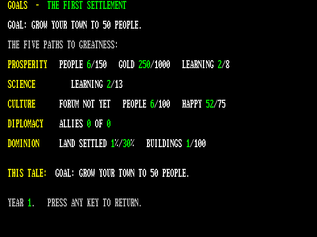

# EMPIRES : The Living World

An original civilisation and city-building game for the Microbee Premium Plus. Lead a handful of settlers from a lonely town hall to a thriving city in a procedurally generated world, learn thirteen arts from farming to philosophy, deal with rival peoples by gift, trade and alliance, and win by prosperity, science, culture, diplomacy or dominion: plough fields, fell forests, build roads and bridges, and watch huts grow into houses and manors as the seasons turn the land from spring green to autumn gold to winter white. Colour and monochrome display modes.

**Milestone 3** · VIBED BY BPM 2026

## You need
- Microbee Premium Plus with 1MB RAM

## Starting
Boot `release/EMPIRES.DS8` (on a Premium Plus without a DS8 drive, boot the image from SD). It goes straight to the `A>` prompt. Type:

    EMPIRES

The loader fills the expanded RAM (dots show progress). Choose **C** for a colour monitor or **M** for monochrome. On the title, **1** starts a new game: pick one of seven tales (Free Play, The First Settlement, The Great Island, The Divided Continent, The Lost Valley, The Age of Discovery, The Great Empire). Free Play uses the world type (**2**) and size (**6**, 128×128 or 256×256) set on the title. **7** loads a saved world. ESC on the title returns to `A>`.

## Keys
| | |
|---|---|
| Mouse, arrows, W A S D, I J K L or joystick | move the cursor (SHIFT = faster) |
| Left / right mouse button | build / next tool |
| SPACE or RETURN | build the selected tool |
| 1–9, 0 / TAB | road, hut, farm, woodcutter, quarry, well, market, windmill, watchtower, clear land |
| B | second page of tools (mine, school, harbour, hospital, temple, university, Grand Forum) |
| R | research |
| E | envoys: gifts, trade, alliances |
| V | goals and the five paths to victory |
| M | world map |
| F | save / load (3 slots on the game disk) |
| C | colour / monochrome |
| P / , / . | pause / slower / faster |
| H | help |
| ESC | leave the world (Y/N) |

## Status
First real-hardware test (Premium Plus, amber monitor) found a sideways-scrolling bug and an invisible cursor in monochrome: both fixed. Developed in the project's own Premium model. Microsoft serial mouse support: run `MOUSE` from the disk to check yours (it shows line activity on every port bit and each decoded packet). Worlds live in the 1MB banked RAM (up to 256×256), worlds save to and load from the game disk (3 slots), and ESC on the title returns cleanly to `A>`. Milestone 3 adds the technology tree, rival peoples with diplomacy and raids, seven scenarios, five victories and defeat, a gentler start and new softer sound.

## Folders
- `release/`: the bootable disk image and the program on its own
- `src/`: Z80 source, Python art and test tools, `build.sh`, `DESIGN.md` (hardware findings, memory map, status)
- `screenshots/`: colour and mono screens, world map, the five world types

*Rebuilding the disk needs the Microbee system tracks and `CCP.SYS`. These are Microbee system files, so they're not included here; copy them from your own Microbee system disk into `src/src/resources/` (`boot_tracks.bin`, `CCP.SYS`).*
