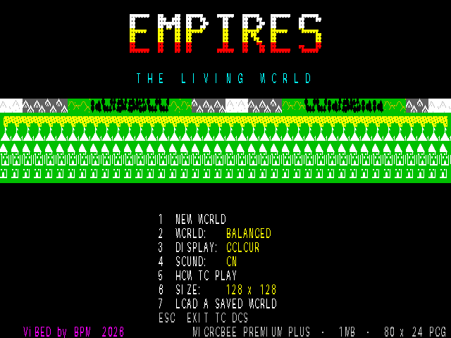
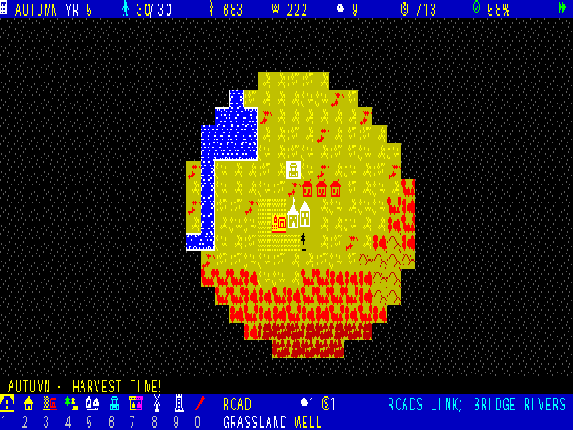

# EMPIRES : The Living World

An original civilisation and city-building game for the Microbee Premium Plus. Lead a handful of settlers from a lonely town hall to a thriving town in a procedurally generated world: plough fields, fell forests, build roads and bridges, and watch huts grow into houses and manors as the seasons turn the land from spring green to autumn gold to winter white. Colour and monochrome display modes.

**Milestone 1** · ViBED by BPM · 2026

## You need
- Microbee Premium Plus with 1MB RAM

## Starting
Boot `release/EMPIRES.DS8` (on a Premium Plus without a DS8 drive, boot the image from SD). It goes straight to the `A>` prompt. Type:

    EMPIRES

The loader fills the expanded RAM (dots show progress). Choose **C** for a colour monitor or **M** for monochrome. On the title, **2** picks the world type and **6** the size (128×128 or 256×256). ESC on the title returns to `A>`.

## Keys
| | |
|---|---|
| Mouse, arrows, W A S D, I J K L or joystick | move the cursor (SHIFT = faster) |
| Left / right mouse button | build / next tool |
| SPACE or RETURN | build the selected tool |
| 1–9, 0 / TAB | road, hut, farm, woodcutter, quarry, well, market, windmill, watchtower, clear land |
| M | world map |
| C | colour / monochrome |
| P / , / . | pause / slower / faster |
| H | help |
| ESC | leave the world (Y/N) |

## Status
Tested in the project's own Premium model (screenshots); not yet run on real hardware. Microsoft serial mouse support added: run `MOUSE` from the disk to check yours. Worlds now live in the 1MB banked RAM (up to 256×256) and EXIT returns cleanly to `A>`. Next: disk saves, technology, rival civilisations, scenarios.

## Folders
- `release/`: the bootable disk image and the program on its own
- `src/`: Z80 source, Python art and test tools, `build.sh`, `DESIGN.md` (hardware findings, memory map, status)
- `screenshots/`: colour and mono screens, world map, the five world types

*Rebuilding the disk needs the Microbee system tracks and `CCP.SYS`. These are Microbee system files, so they're not included here; copy them from your own Microbee system disk into `src/src/resources/` (`boot_tracks.bin`, `CCP.SYS`).*
