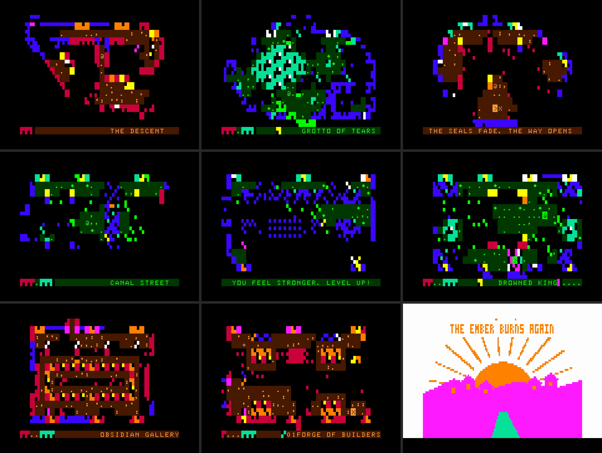

# The Forgotten Depths

An atmospheric dungeon adventure for the Dick Smith VZ300. Beneath the village of Ashford, the Ember is dying. Take your lantern down through three chapters (the Ember Halls, the Drowned City and the Ember Core) and face the Bone Warden, the Drowned King and the Ember Wyrm.

Mode 0 semigraphics with directional torchlight, mode 1 boss portraits, automap and inventory.

**Version 1.3** · VIBED BY BPM · 2026

## You need
- VZ300 (or VZ200) with the BennVenn SD loader and 128K RAM expansion

## Loading
Copy `release/DEPTHS.VZ` to the SD card (it's the whole game; the old `DEPTHS.DAT` is no longer needed) and type:

    LOAD"DEPTHS"

It autostarts.

## Folders
- `release/`: the game, ready to copy to SD
- `src/`: Z80 source (`src/`) and the Python/C build tools (`tools/`, build with `tools/build.py`, assembles with sjasmplus)
- `screenshots/`: pictures from the emulator
- `NOTES.TXT`: the full manual: controls, items, monsters, what's new in each version
