# FRILLSEEKER
### for the Microbee Premium Plus
***"All frill. No fear."***
**VIBED BY BPM 2026**

King Bufo's cane toads have pinched every bug in the Top End. One lizard is hungry enough to go and get them back. **Bluff** is a frilled-neck lizard with more front than a rattler, and his frill is all he needs.

Pop the frill and the toads fall over in fright. A toad on its back is a trampoline. Pop the frill in the air and it's a parachute. Hold the frill open over a mine vent or a monsoon gust and the air carries him up. Keep running flat out and he bolts upright on his hind legs, fast enough to run right across the water. Magpies swoop, ghost bats dive and goannas charge, and the goannas aren't impressed by any frill.

Five regions and 24 rooms stand between Bluff and the King: the red dirt and the billabong, the gorges of stone country, an opal mine, the floodplain in the Wet, and King Bufo's own court. Each room is a full screen of living, animated outback, from twinkling stars to monsoon rain. It's an all-original game made for the Premium Plus, in its full-height 40-column mode.

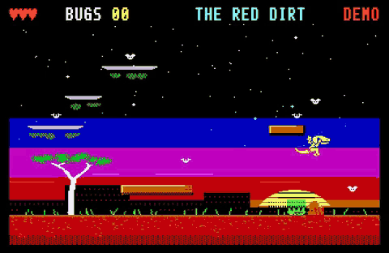

| | |
|---|---|
| 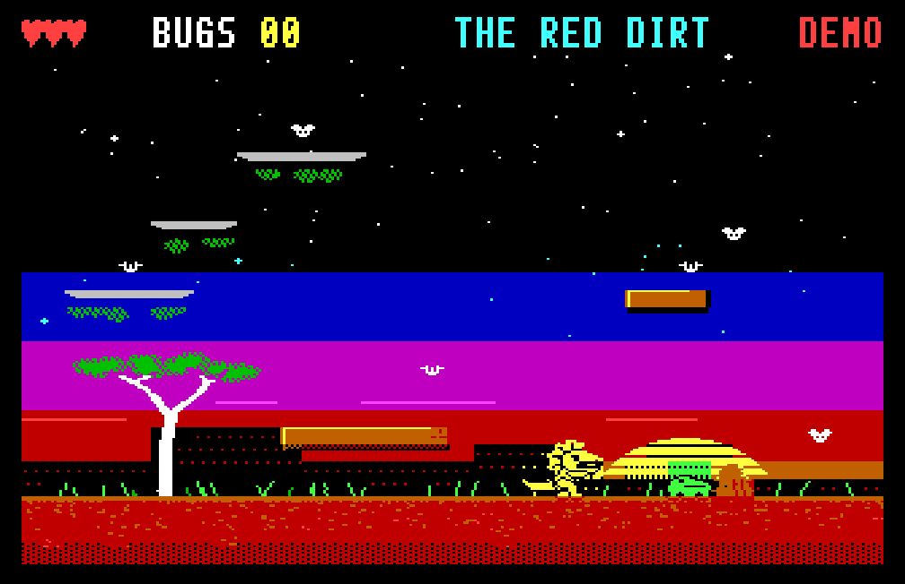 | 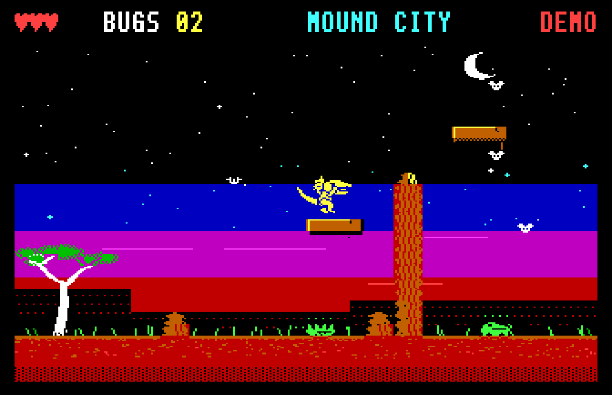 |
| 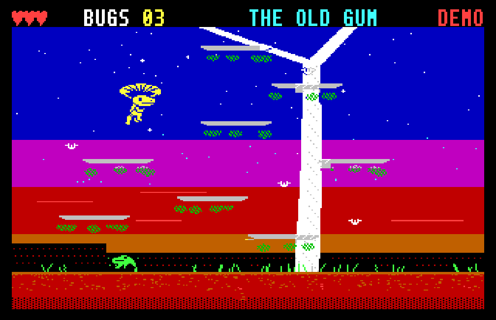 | 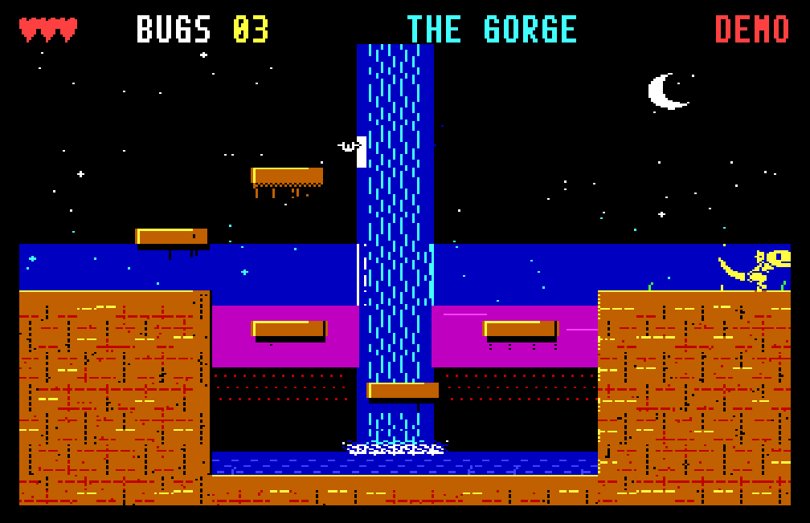 |
| 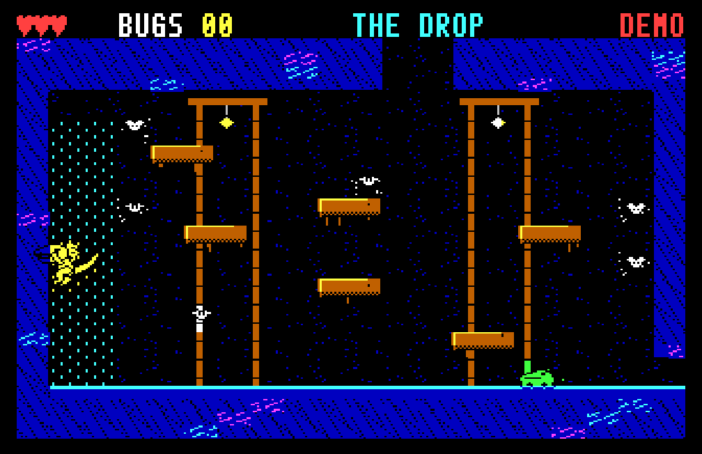 | 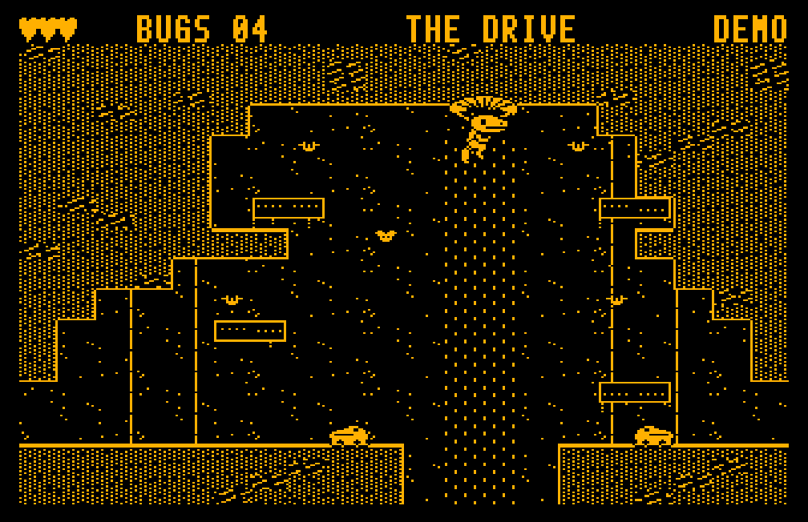 |
| 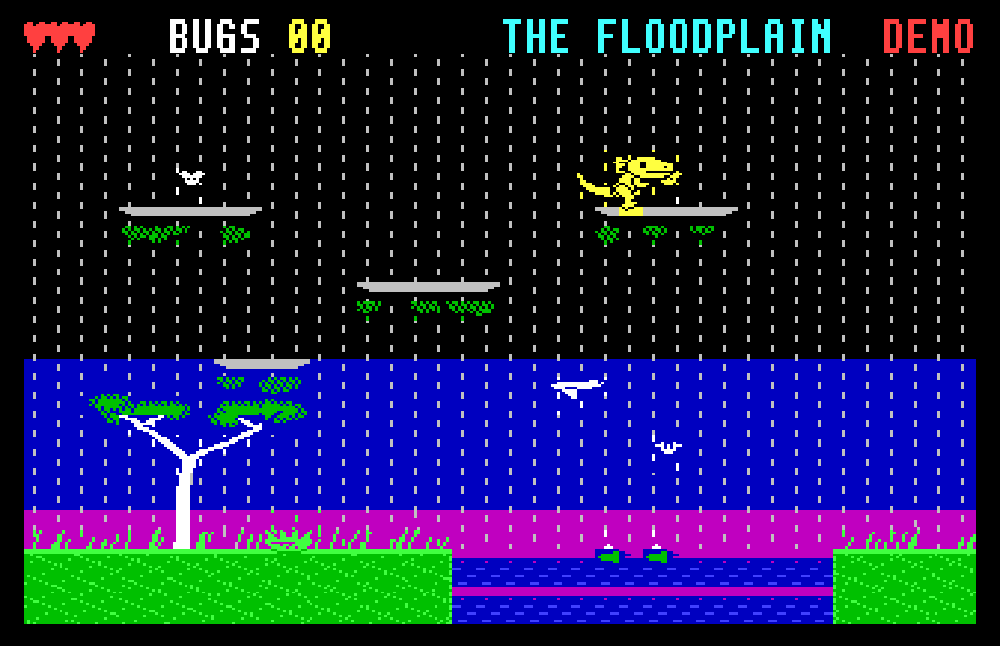 | 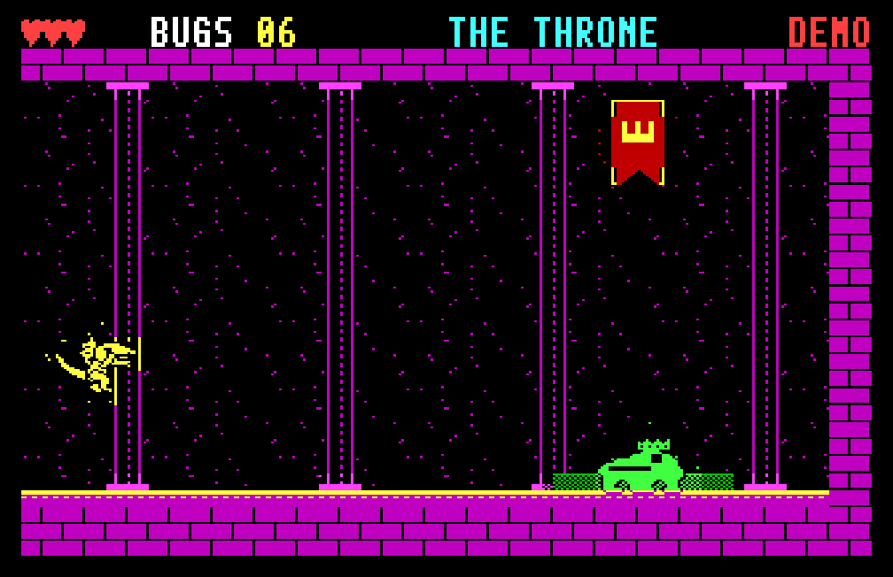 |
| 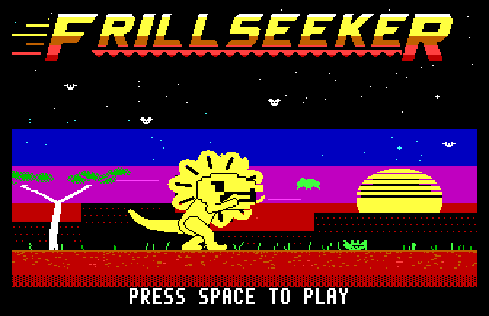 | 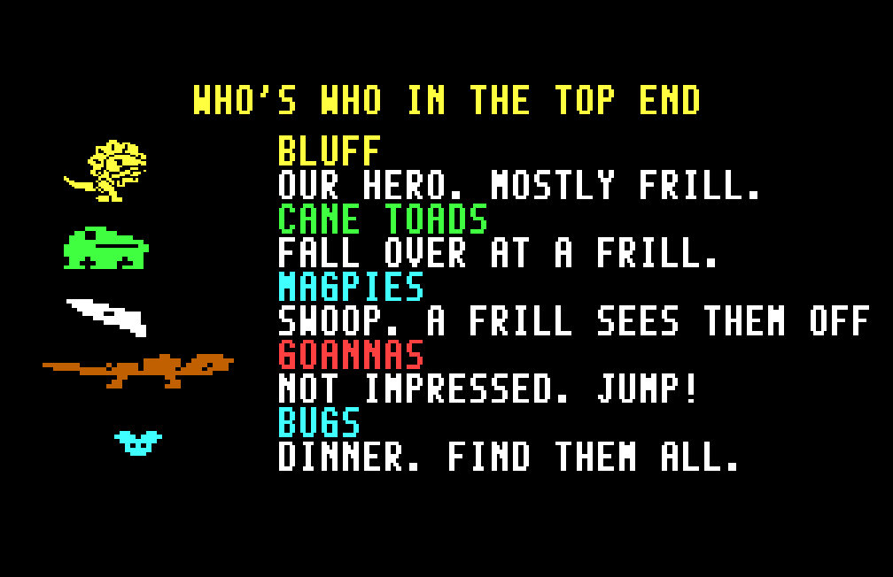 |

The attract sequence, with its music: [showcase/attract.mp4](showcase/attract.mp4)

## Features
- **The bluff:** one button, four uses.
  - On the ground, it scares toads onto their backs and sends magpies and bats packing.
  - In the air, it opens as a parachute.
  - Over an updraught, it carries Bluff up.
  - A flipped toad is a trampoline, so a bluff and a bounce reaches ledges no jump can.
- **The sprint:** keep running flat out and Bluff rises onto his hind legs, like the real thing. At full tilt he can run across water.
- **Five regions, 24 rooms, 98 bugs:**
  - **The Red Dirt:** the savanna at sunset, the billabong, Mound City's termite towers, up the Old Gum into the Canopy, and Lookout Rock.
  - **Stone Country:** the escarpment, a gorge with a waterfall to glide across, a cave of ochre hand stencils, the Chimney climbed ledge by ledge, the moonlit Stone Tops and the Great Rock.
  - **The Diggings:** an opal field. Down the shaft under the poppet head, along the drive, ride the vent air up the winze, and come out into daylight. Ghost bats live down there.
  - **The Wet:** the monsoon floodplain in pouring rain. Sprint across the flood, climb the paperbarks and ride the storm's gusts.
  - **King Bufo's Court:** the larder shelves stacked with bug jars, then the throne room and the King himself. He leaps at you, he's winded when he lands, and three bounces on his royal belly end his reign.
- **A living outback:** stars twinkle, the billabong ripples, and rain falls over the Wet. Updraughts shimmer, opal seams glitter and the bugs buzz. All of it is the background itself, animated by rewriting the PCG.
- **Smooth sprites:** Bluff and the critters move a pixel at a time and are drawn into private glyphs every frame, so nothing flickers or clashes with the scenery.
- **Accessible, never brutal:** three hearts, a moment of safety after every knock, and no instant deaths. Fall in the water and you're back on the last safe ground. Lose all your hearts and you try the region again from its start, keeping every bug you found.
- **The Frillseeker Strut:** an original twelve-bar shuffle in E for three voices and drums on the one-bit speaker, with a growling bass riff, a scooping lead, arpeggio chord stabs, a kick and a snare. There are jingles for a region cleared and for game over.
- **A full attract sequence:**
  - the title with its drawn logo
  - the story so far
  - who's who in the Top End
  - the moves
  - a card for each region, then **Bluff playing that region by himself**, all five in turn
- **Your place kept on the disk:** clearing a region writes `SAVE.DAT`, and **C** at the title carries on from there.
- **Configurable keys** (**K** at the title), also kept on the disk. A joystick always works.
- **Colour or monochrome:** every room, picture and page is drawn twice, once in colour and once in dot patterns for amber and green screens. The loader asks which monitor you have and loads only that set.
- **An ending,** for whoever beats the King.

## Tech specs
| | |
|---|---|
| **Machine** | Microbee Premium Plus: Z80 at 3.375 MHz, 1MB RAM, 32K PCG RAM, 6545 CRTC |
| **Display** | The full-height 40-column mode: 40 × 32 cells of 8 × 8 pixels (320 × 256) at half the dot clock, so the pixels are near-square and the picture fills a 4:3 PAL screen. 16 colours, a colour pair per cell. Rows 0–1 are the status panel and rows 2–31 the playfield: a room of 20 × 15 tiles of 16 × 16. |
| **Rooms** | Each room is one full-screen picture painted by the tools, using up to 768 unique glyphs plus 256 more for the living background. Animated cells (water, rain, stars, updraughts, opal, the bugs) are rewritten in the PCG as the room plays. |
| **Sprites** | 53 frames (29 of Bluff, 24 of the critters, the King and the jars), each pre-shifted to all 8 pixel positions and stored facing both ways, column-trimmed. Every frame they're composited with the scenery under them into a pool of 120 private glyphs. There are two pools, flipped in the vertical blanking. |
| **Frame rate** | A steady 25 frames a second. Game logic runs one step per 50 Hz field. |
| **Sound** | In the attract sequence and the jingles: three phase-accumulator pulse voices and a noise drum voice mixed on the speaker bit, one sample per 205 T (16.5 kHz). Each note's pulse narrows as it decays, and chords are rattled out as fast arpeggios. During play: the strut's bass riff and the sound effects, played in the time the frame leaves spare. |
| **Demonstrations** | Recordings of a pilot program playing the real game in an emulator. The game runs in fixed ticks from a fixed start, so each region's demo is 100–200 bytes of "hold this for that many ticks", and it replays the same game to the pixel. |
| **Disk** | DS80 (80 tracks × 2 sides × 10 × 512 bytes). Boots to the CP/M `A>` prompt with no shell. 90 of 196 blocks are used. `FRILL.COM` loads the program and its blocks: about 236K, with the rooms packed and unpacked in place as they arrive. The game then takes over the machine. |
| **Saving** | The game drives the WD2793 disk controller itself to rewrite `SAVE.DAT`. It checks the directory first, reads every write back, and every wait is bounded. With no disk, nothing is kept. |
| **Source** | About 5,900 lines of Z80 assembly, plus about 5,800 lines of Python tools that draw every room, sprite, picture and page, compose the music, record the demonstrations and build the disk. A raster-timed Premium Plus emulator in C (about 950 lines) is used for testing. |

## RAM used
The Premium Plus's 1MB is 32 blocks of 32K. The game uses 21 of them (672K), plus all 32K of PCG RAM.

| Block(s) | Contents | Size |
|---|---|---|
| 0 (upper 32K) | the program (8000–A0B5), tile map and edge masks (AA00), the four cell shadow tables (AC00–BFFF), the room's glyph patterns (C000–DFFF), sprite compositing buffer, flip lists, living-background list, variables, entities and stack (E000–EFFF), video window (F000) | 32K |
| 1 | the lower window while the game plays | 32K |
| 4–7 | sprite frames: 53 frames × 8 shifts × 2 facings | 117K |
| 8 | the 8 × 16 font | 1K |
| 9–20 | the 24 rooms for the chosen monitor, unpacked, two to a block: picture, colours, tile map, objects, glyphs and animation | 12 × 32K (66K packed on the disk) |
| 21 | the title picture, in colour and in mono | 32K |
| 22 | the front end: the music player and songs, the attract sequence and its pages, the demonstration scripts, the end screens, key choosing and the disk save code | 10K + save buffer |

**PCG RAM (32K, 2048 glyphs):** banks 0–5 hold the room picture, banks 6–7 the living background, bank 11 the font, and banks 14–15 the two sprite pools. The title and the pages use banks 0–10 while they're up.

## To play
Boot `release/FRILL.DS8`, type **FRILL** at the `A>` prompt, then press **C** for a colour monitor or **M** for monochrome.

| Action | Keys |
|---|---|
| Walk / run | **O** and **P**, or the arrow keys |
| Frill (bluff, parachute, ride the air) | **Q** or up |
| Jump | **SPACE** |
| Down | **A** or down |
| Back to the title | **ESC** |
| Carry on from your saved place | **C** at the title |
| Choose your keys | **K** at the title |

A joystick works throughout.

**Tips:** bluff a toad, then bounce on it. Open the frill on the way down to float across gaps. Hold it open in the shimmering air of a vent or a gust to go up. Run in a straight line and keep going to sprint, and sprinting carries you over water. Goannas can't be bluffed, so jump them.

---
**FRILLSEEKER: VIBED BY BPM 2026**
