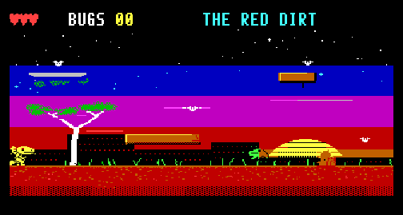
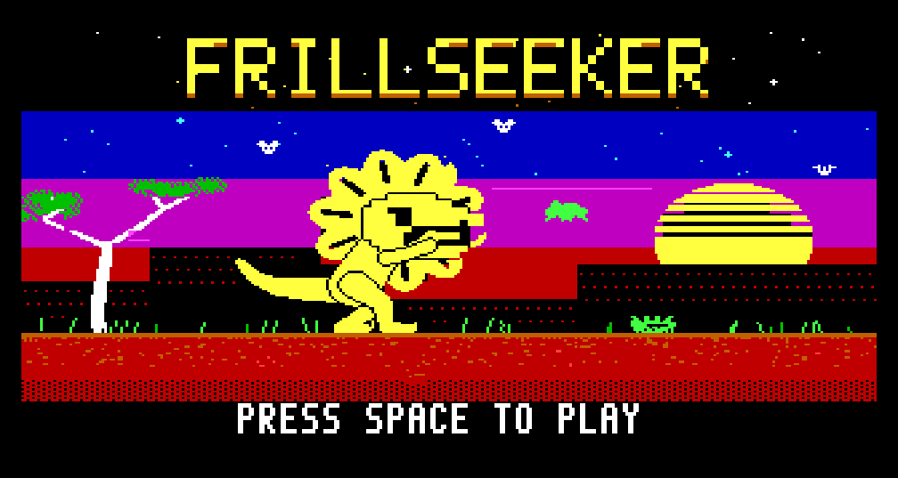
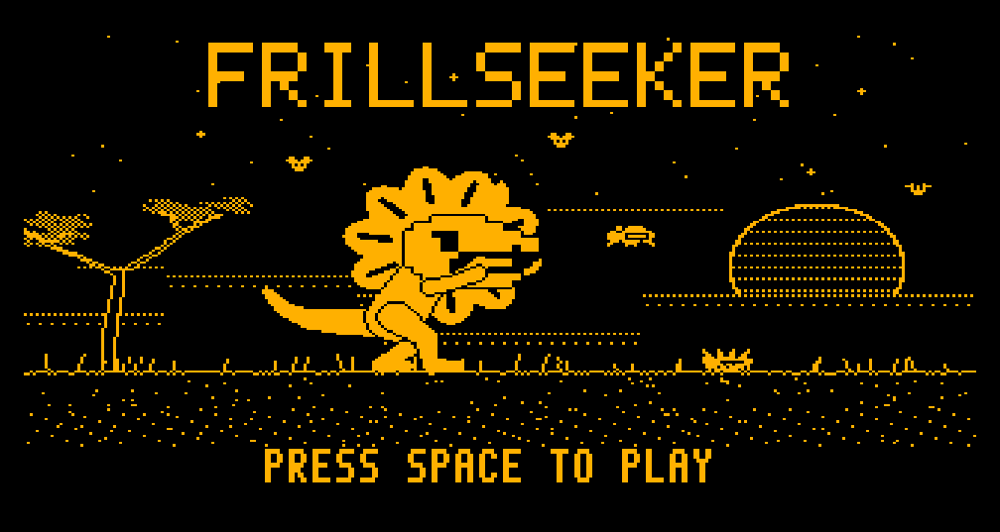
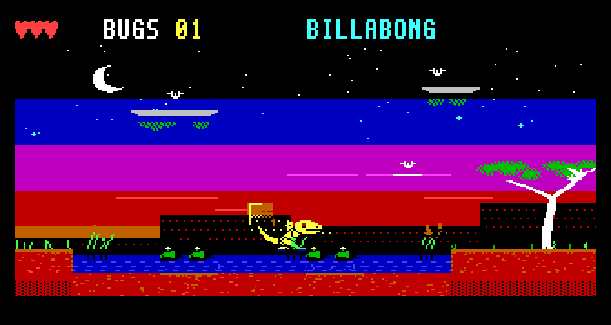
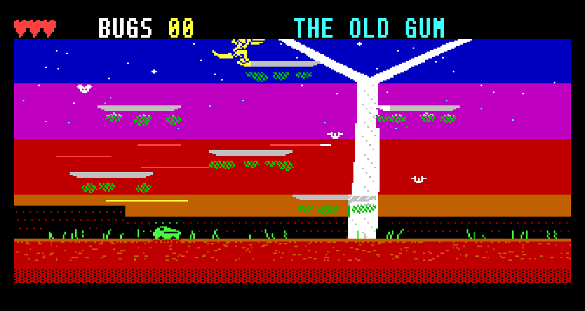
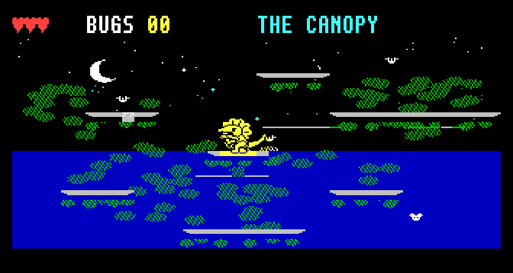
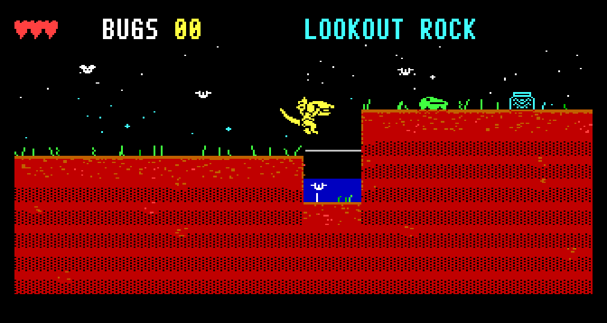
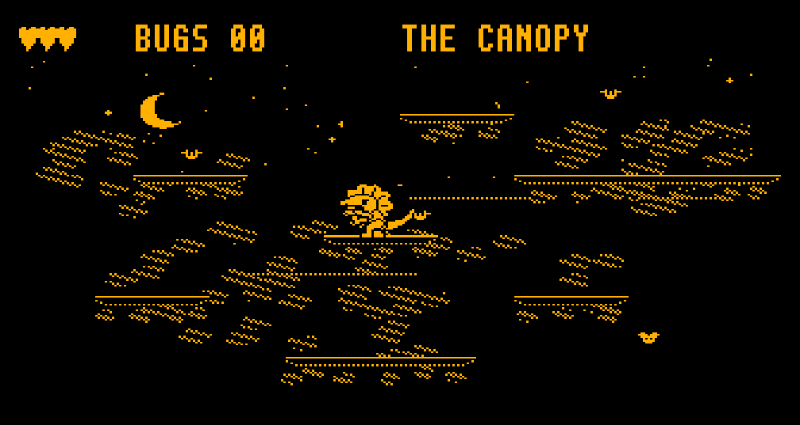

# FRILLSEEKER

**An original mascot platform game for the Microbee Premium Plus — in development.**
*VIBED BY BPM 2026*



**Bluff** is a frilled-neck lizard: the smallest dragon in the Top End, with the
biggest act. King Bufo's cane toads have pinched every bug in the bush and
Bluff wants his dinner back. He cannot hurt a thing. He can only *bluff*:

* **On the ground, pop the frill** and hiss: every toad nearby leaps in fright
  and lands on its back.
* **A toad on its back is a trampoline.** Bounce off its belly to reach what a
  jump cannot.
* **In the air, the frill is a parachute.** Glide.
* **Run flat out and he bolts** — upright on his hind legs, the way real
  frillies do — fast enough to leap further and to run across water.

| | |
|---|---|
|  |  |
|  |  |
|  |  |
|  |  |

## What is playable

**The Red Dirt**, the first region: six rooms from the savanna to the treetops —
The Red Dirt, the Billabong, Mound City, the Old Gum, the Canopy and Lookout
Rock — with 22 bugs to find and King Bufo's larder (a jar of pinched bugs) at
the end. A title screen with its own two-voice theme, a game-over screen and a
region-clear screen. Still to come: the other four regions, more creatures,
King Bufo himself, saving to disk and an ending (see
[docs/DESIGN.md](docs/DESIGN.md)).

## To run it

`release/FRILL.DS8` is a double-sided 80-track Microbee disk image. Boot it,
and at the `A>` prompt type **FRILL**. Press **C** for a colour monitor or
**M** for a monochrome one (the art is drawn separately for each), then SPACE
at the title.

| | Keys | Joystick |
|---|---|---|
| Left, right | ← → or O P | left, right |
| Jump (hold for higher) | SPACE | fire |
| Frill: bluff on the ground, glide in the air | ↑ or Q | up |
| Drop through a branch | ↓ (or A) + jump | down + fire |
| Sprint | keep running flat out on the ground | |

Needs a Premium Plus: 1 MB RAM, 32K PCG RAM.

## What is interesting inside

* **The 40-column mode:** 40 × 25 cells of 8 × 8, 320 × 200 right across the
  tube, with near-square pixels and square cells (the mode BPM proved on the
  real machine with MODES.COM).
* **Sprites that are not tiles.** The PCG holds twice as many glyphs as the
  screen has cells, so each cell a sprite touches gets a private glyph
  composed in RAM, and is simply re-pointed at it in the vertical blanking.
  Two glyph pools take turns: nothing is erased, nothing tears, and Bluff
  moves a pixel at a time and changes shape freely.
* **A living background.** Water drifts, grass sways, stars twinkle, by
  rewriting a few glyphs a frame. The bugs are not sprites at all, just cells
  of background that flutter.
* **Bluff is a puppet**, posed by code and rendered to pixels, so the megabyte
  can hold every in-between: each frame is stored sixteen times, pre-shifted.
* **Every room is a painting,** generated as one picture with its own
  textures, in colour and again for amber. The title picture is painted the
  same way, with Bluff drawn three times the size by the same puppet.
* **Two-voice music** for the title and jingles, from a single speaker bit.
* **A steady 25 frames a second**, with more than half of every frame left
  to make sound in (unlocked, the engine manages 50 with Bluff and a toad).

## To build it

Python 3 with numpy and Pillow, and a C compiler for the emulator.

```
python3 tools/fixjr.py        # builds everything into build/ (and fixes long JRs)
python3 tools/tour.py out/    # plays through the rooms, saves pictures
python3 tools/prof.py         # where a frame's T-states go
```

`src/` is the Z80 (engine, living background, game, sound, loader);
`tools/` the art, room and disk builders and the test harness;
`tools/emu` the Premium Plus model used for testing (its Z80 core looks like
superzazu/z80, MIT licence; it is not part of the game).
