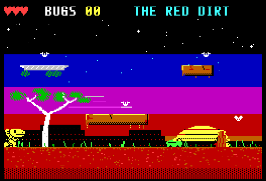
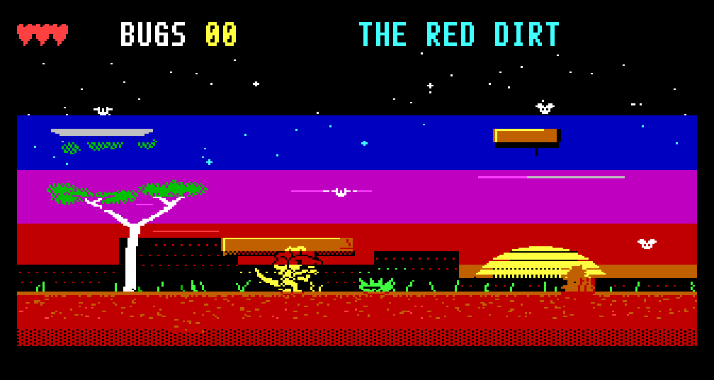
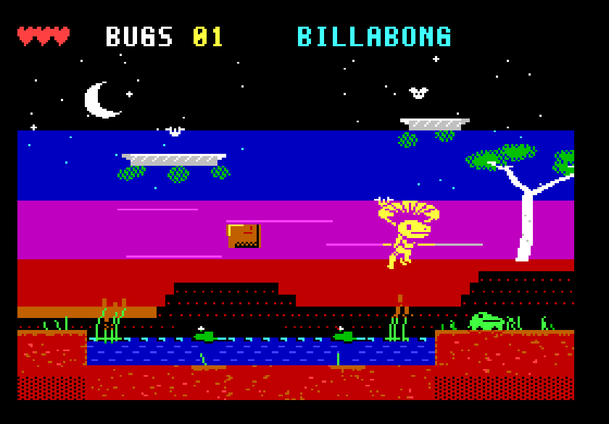
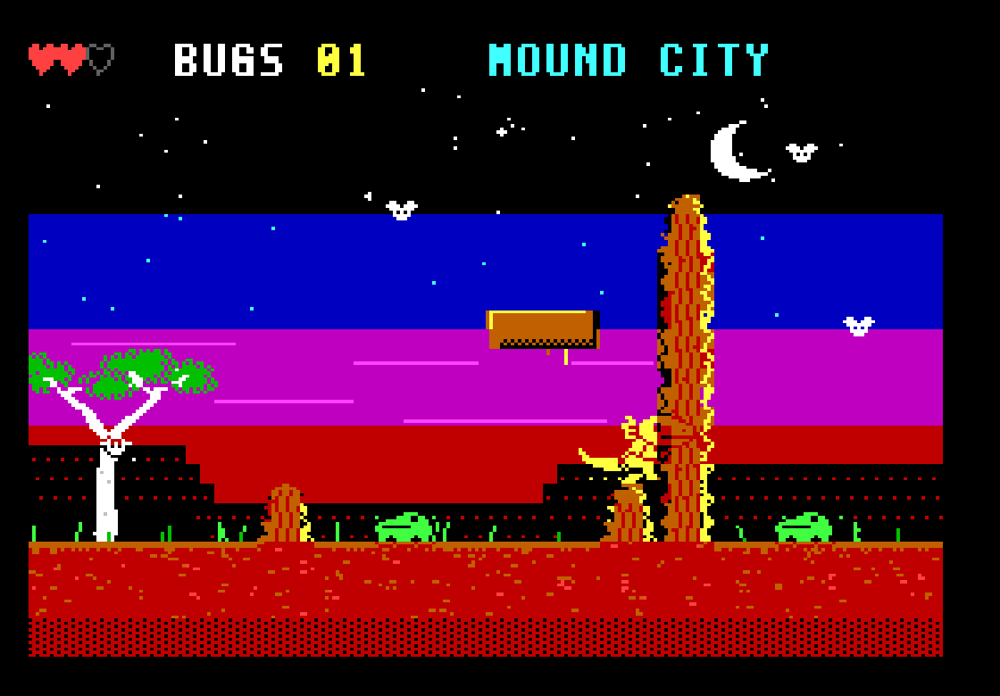
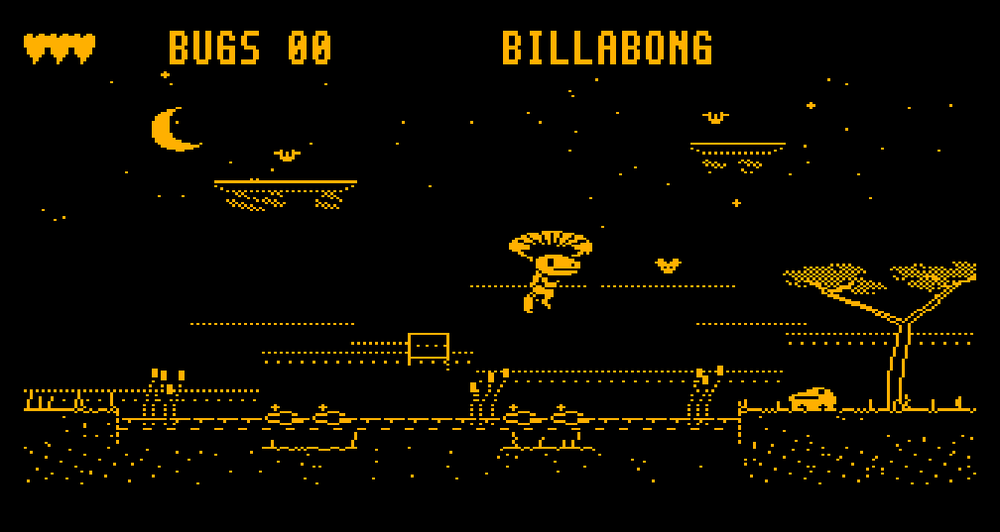

# FRILLSEEKER

**An original mascot platform game for the Microbee Premium Plus — engine prototype.**
*VIBED BY BPM 2026*



**Bluff** is a frilled-neck lizard: the smallest dragon in the Top End, with the
biggest act. King Bufo's cane toads have pinched every bug in the bush and
Bluff wants his dinner back. He cannot hurt a thing. He can only *bluff*:

* **On the ground, pop the frill** and hiss: every toad nearby leaps in fright
  and lands on its back.
* **A toad on its back is a trampoline.** Bounce off its belly to reach what a
  jump cannot.
* **In the air, the frill is a parachute.** Glide.

| | |
|---|---|
|  |  |
|  |  |

## This is a prototype

Three linked rooms that prove the character, the mechanics and the engine.
Not yet a game: no title sequence, map, save or ending. The full plan, the
hardware investigation and the measurements are in
[docs/DESIGN.md](docs/DESIGN.md).

The disk boots and the game runs on a real Premium Plus. The first
40-column build came up as four small pictures (the dot clock select was
missing); this build adds it and is waiting to be tried.

## To run it

`release/FRILL.DS8` is a double-sided 80-track Microbee disk image. Boot it,
and at the `A>` prompt type **FRILL**. Press **C** for a colour monitor or
**M** for a monochrome one (the art is drawn separately for each).

| | Keys | Joystick |
|---|---|---|
| Left, right | ← → or O P | left, right |
| Jump (hold for higher) | SPACE | fire |
| Frill: bluff on the ground, glide in the air | ↑ or Q | up |
| Drop through a branch | ↓ (or A) + jump | down + fire |

Needs a Premium Plus: 1 MB RAM, 32K PCG RAM.

## What is interesting inside

* **The 40-column mode:** 40 × 25 cells of 8 × 8, 320 × 200 right across the
  tube, with near-square pixels and square cells (the mode BPM proved on the
  real machine with MODES.COM).
* **Sprites that are not tiles.** The PCG holds twice as many glyphs as the
  screen has cells, so each cell a sprite touches gets a private glyph
  composed in RAM, and is simply re-pointed at it in the vertical blanking.
  Two glyph pools take turns: nothing is erased, nothing tears, and Bluff
  moves a pixel at a time and changes shape freely.
* **A living background.** Water drifts, grass sways, stars twinkle, by
  rewriting a few glyphs a frame. The bugs are not sprites at all, just cells
  of background that flutter.
* **Bluff is a puppet**, posed by code and rendered to pixels, so the megabyte
  can hold every in-between: each frame is stored sixteen times, pre-shifted.
* **Every room is a painting,** generated as one picture with its own
  textures, in colour and again for amber.
* **A steady 25 frames a second**, with more than half of every frame left
  to make sound in (unlocked, the engine manages 50 with Bluff and a toad).

## To build it

Python 3 with numpy and Pillow, and a C compiler for the emulator.

```
python3 tools/fixjr.py        # builds everything into build/ (and fixes long JRs)
python3 tools/tour.py out/    # plays through the rooms, saves pictures
python3 tools/prof.py         # where a frame's T-states go
```

`src/` is the Z80 (engine, living background, game, sound, loader);
`tools/` the art, room and disk builders and the test harness;
`tools/emu` the Premium Plus model used for testing (its Z80 core looks like
superzazu/z80, MIT licence; it is not part of the game).
