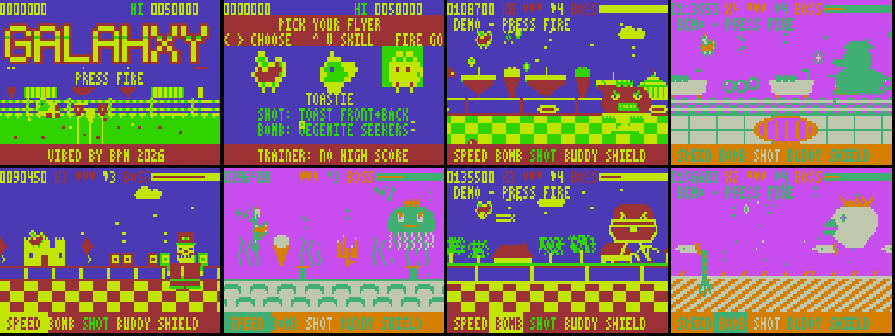

# GALAHXY

An original Parodius / Fantasy Zone-style horizontal shoot 'em up for the **Dick Smith VZ300**
with the **BennVenn SD loader + 128K SRAM** expansion.

VIBED BY BPM 2026

This is the **full game**: six stages, each with its own joke, mechanic, secret, midboss and
three-phase boss, plus the title, attract demo, cast select, power-ups, shop, stage-clear tally,
ending and high-score table. [DESIGN.md](DESIGN.md) covers how it is put together and why.



## Running it

1. Copy all nine files from `release/` to the **root of the SD card**:
   `GALAHXY.VZ`, `GLXCOM.DAT` and `GLXS0.DAT` to `GLXS6.DAT`.
2. Load `GALAHXY.VZ` the way you load any other .VZ (from VZ-DECK or the DOS).
   It loads at $8000, then loads `GLXCOM.DAT` and the front end (`GLXS0.DAT`) itself. Each stage
   loads its own `GLXSn.DAT` as you reach it.
3. Always copy all nine files together. Each build stamps its files, and a mismatched set stops
   with `GLX*.DAT FILES DON'T MATCH` instead of crashing.

If the expansion isn't there, the game says `NEEDS BENNVENN SD + 128K RAM`.

## Controls

| | Keyboard | Joystick |
|---|---|---|
| Move | Q up, A down, O left, P right (Z and X also go left and right) | stick |
| Fire (hold) | SPACE | fire |
| Power up / buy | M (or B) | arm button |
| Pause | RETURN | |
| Music on/off | N | |

On the cast-select screen: left/right picks a flyer, up/down sets the skill level, and **T**
toggles TRAINER (endless lives, no high score). In the trainer, up/down picks the stage to
start on instead. The joystick is found automatically.

## How it plays

**The cast**: three flyers, three weapons.

- **GAZZA THE GALAH**: spreading seeds that fan wider as SHOT goes up. Bomb: macadamias that drop
  and roll along the ground.
- **CAPTAIN CUPPA** (a flying teapot): a steam beam that passes through small fry. Bomb: tea bags
  thrown up and down.
- **TOASTIE** (a flying toaster): heavy toast fired forward *and* backward. Bomb: Vegemite seekers.

**Powering up, Parodius style.** Shooting a red balloon, or a whole formation, drops a **PAV**
(pavlova). Each PAV moves the cursor along the bar at the bottom: SPEED, BOMB, SHOT, BUDDY,
SHIELD. Press M (or the arm button) to take the lit power, or save up PAVs for a bigger one.
Maxed slots go dark.

**Shopping, Fantasy Zone style.** Enemies drop **coins**: every ground enemy drops one, and
flyers drop one now and then. Touch the floating **S balloon** to open the shop. It sells speed,
bombs, a bigger shot, buddy chicks, a bubble shield, cupcakes (hearts) and extra lives.

**Forgiving by design.** Each life has three hearts. Losing a life costs one level of SHOT, BUDDY
and SPEED (not everything), and two PAVs float out so you can power straight back up. Continues
pick up from where you fell.

**Scoring.** Quick kills build a chain (up to x8). Wiping out a whole formation pays a bonus.
Coins are worth 200 x chain. The stage-clear tally adds a no-hit bonus, best chain, coins and
secrets.

## The six stages

The palettes alternate, Fantasy Zone style: odd stages use the bold green/yellow/blue/red set,
even stages the pastel buff/cyan/magenta/orange set.

| # | Stage | Palette | The joke and the mechanic | Secret | Midboss | Boss |
|---|---|---|---|---|---|---|
| 1 | PARTY PLANET | bold | The party snacks have come alive. A fork at the balloon arch: fly high for CLOUD TOPS, low for the LOLLY GARDEN. | the golden gingerbread man | THE CAROUSEL | KING WOBBLE, a giant jelly in a crown |
| 2 | BATH-TIME NEBULA | pastel | Someone left the bath running, in space. Bubbles float up all the time: harmless, but they soak up your shots, and each one you pop pays a coin. | pull the plug | THE SHOWER HEAD | ADMIRAL DUCKWORTH |
| 3 | TOY BOX TOWERS | bold | Walls of toy blocks to shoot your way through, wind-up soldiers and robots. | the surprise block | JACK-IN-THE-BOX | SERGEANT NUTCRACKER |
| 4 | SHERBET SEA | pastel | Under a fizzy sea. Geysers bubble (the tell), then blow a column of fizz up the screen. | the sunken treasure chest | THE ICE-CREAM SUB | QUEEN JELLYFISH, with a tentacle from above |
| 5 | BACKYARD BLITZ | bold | An Aussie backyard gone feral: blowies, thongs, possums and swooping magpies. A fork again. | the golden gnome | THE HILLS HOIST | THE GRILLFATHER |
| 6 | THE GALAH GALAXY | pastel | Space, where every galah comes from. Meteor showers fall on a slant: shoot them (two hits) or slip between them. The moon is cheese. | the golden saucer | THE SPACE CHOOK | THE COSMIC COCKATOO |

Every boss has three phases and a tell before each attack: something lifts, flashes or creaks
first. For example KING WOBBLE lifts his crown before he lobs jelly, and lines up with you and
flashes before the giant spoon comes across. THE COSMIC COCKATOO raises his crest before a fan
of feathers, lines up and flashes before he pecks, and in his last phase a claw comes down from
above while eggs rain.

Bullets get a little faster every two stages. Beat stage 6 for the ending and a bonus for every
life left.

## Building

You need Python 3 (with Pillow, for the preview tools only) and a C compiler for the emulator.

```
python3 tools/build.py              # -> build/sd/GALAHXY.VZ, GLXCOM.DAT, GLXS0-6.DAT
gcc -O2 -o emu/vzemu emu/vzemu.c emu/z80.c
python3 tools/mkscr.py demo && emu/vzemu emu/demo.scr   # scripted emulator run
```

The assembler is `tools/zasm.py`, a two-pass Z80 assembler in Python. The art, scenery, logo, font
and music are all generated from the Python files in `tools/`.

| File | What |
|---|---|
| `src/main.asm` | boot, memory checks, the shell loop and the layout of the output files |
| `src/sys.asm` | IM2 interrupt, double-buffered split screen copy, input, joystick |
| `src/blit.asm` | masked pre-shifted sprite blitter (fast path, plus a clipping path) |
| `src/scroll.asm` | 1-pixel scrolling ground band and half-speed skyline from 4-phase rings |
| `src/objects.asm` | enemies, bullets, collisions, timeline, scoring |
| `src/player.asm` | the three flyers, weapons, buddies, power bar |
| `src/game.asm` | game flow, stage cards, tally, continue, attract-mode autopilot |
| `src/boss.asm` | the stage toolkit: segments, scripted boss engine, arms, walkers, turrets |
| `src/fe0.asm` `fe.asm` `hiscore.asm` `ending.asm` | pack 0: title, cast select, high scores, name entry, ending |
| `src/shop.asm` | the shop |
| `src/stage1.asm` to `stage6.asm` | one stage each: enemy types, timeline, secret, midboss and boss scripts |
| `tools/stages/st0.py` to `st6.py` | each pack's sprites, scenery and tunes |
| `tools/sprites.py` `scenery.py` `sound.py` `logo.py` | the art, scenery, music and logo |
| `emu/` | the test emulator (VZ300 + BennVenn mapper + DOS file calls) and test scripts |

## What has been tested

All testing so far is in the emulator in `emu/`: a VZ300 model with the BennVenn mapper (port $37),
the DOS file calls trapped, a 312-line PAL field and the 6847 timing measured on your machine.
Scripted runs covered:

- boot, title, attract demo and high-score cycle
- cast select, trainer toggle and trainer stage select
- every stage played start to finish by the autopilot: midboss, boss and stage-clear tally
- game over, continue, the ending, name entry, and back to the title for a new game
- the shop: opening it, buying, leaving
- a 140,000-frame random-input soak in the trainer: all six stages, the ending and round again into stage 4, with no crash

Measured frame rate in all six stages: about 70% of frames take two fields (25 fps), about 20%
take three, and a few percent take four in the busiest boss moments.

Not tested: a human playing it. The autopilot doesn't judge difficulty, so the balance of
stages 2 to 6 is my best guess. Tell me what's too hard or too soft and I'll tune it.

**It has not been run on a real VZ300 yet.** The memory map, mapper settings and DOS calls follow
what your machine has already confirmed (see DESIGN.md), but the first hardware run is the real
test. Please check: does it boot and load the .DAT files, does each stage load when you reach
it, does the joystick work, and are the speed and sound OK.

## Saved scores

The high-score table lives in the expansion's SRAM. It survives going back to VZ-DECK and
reloading the game, but not a power-off. Writing to the SD card hasn't been proven reliable on your
DOS, so the game doesn't write to the card.
