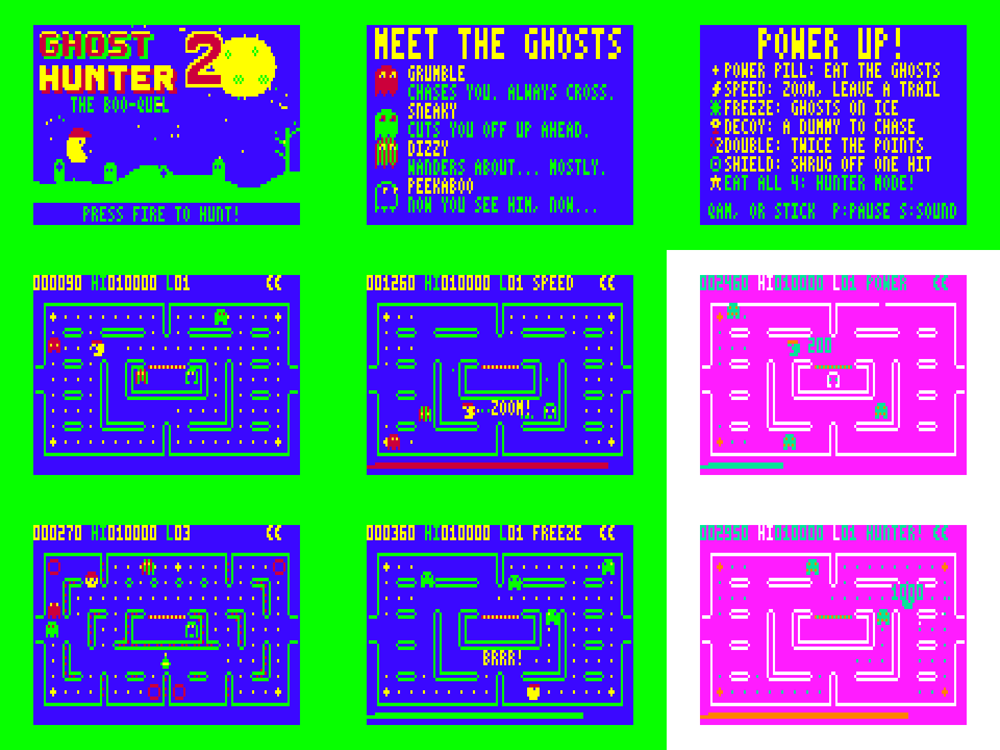
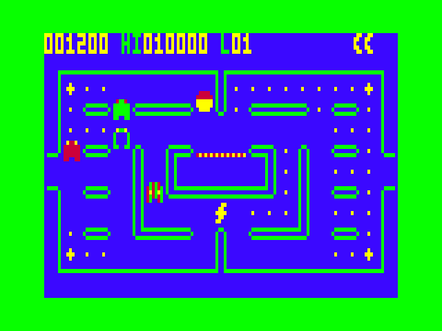

# GHOST HUNTER 2 — "The Boo-quel"

Sequel to *VZ Ghost Hunter* (Dubois & McNamara) for the Dick Smith VZ300 / VZ200.
ViBED by BPM 2026. Original code, graphics and music.





## Play it

Copy `release/GHOST2.VZ` to the SD card and load it from the BennVenn SD loader. It's a type F1 binary that loads at $8000 and runs from $8000.

| Action | Keyboard | Joystick |
|---|---|---|
| Move | Q up · A down · M left · `,` right (same as the original) | either stick; both work |
| Start | SPACE, S or RETURN | fire |
| Pause | P | — |
| Sound on/off (in game) | S | — |
| Initials entry | Q/A change letter, M back, SPACE/fire next, RETURN done | up/down, fire |

## What's in it

**Core loop:** you clear pellets around a maze, run from four ghosts, and eat energisers to turn the tables. While powered up the whole screen swaps to the CSS1 palette, like the original did.

**The ghosts** each have their own readable behaviour:
- **GRUMBLE** (red) chases you directly. He gets enraged (faster, and never retreats to his corner) when few pellets are left; from level 5 this kicks in sooner.
- **SNEAKY** (green) aims 3 cells ahead of you to cut you off.
- **DIZZY** (striped) chases from far away, wanders off when he gets close, and takes random turns more often as the levels go up.
- **PEEKABOO** (hollow) flanks you using GRUMBLE's position. From level 2 he fades to just his eyes now and then.

The ghosts alternate between scatter and chase phases, reverse direction when the phase changes, slow down in tunnels, and come back as eyes after being eaten.

**Power-ups** appear under the ghost house. Each one has its own icon, a pop-up word, a HUD label and a timer bar along the bottom:
- **Energiser:** eat the ghosts. Chains score 200 / 400 / 800 / 1600, with a hit-stop, a screen flash, particles and score pop-ups.
- **SPEED** (lightning bolt): 1.5× speed with an afterimage trail.
- **FREEZE** (snowflake): the ghosts turn to shivering ice and can't hurt you.
- **DECOY** (dummy on a stick): ghosts in chase mode go after the decoy instead of you.
- **DOUBLE** (×2): all points doubled.
- **SHIELD** (bubble): survive one hit; the ghost that hits you is sent home.
- **HUNTER MODE** (star): only spawns after a PERFECT chain (all 4 ghosts on one energiser). You turn into a flaming-cap super hunter, every ghost is prey at 1000 points each, and a short fanfare plays.

Which power-ups can appear depends on the level: SPEED and ×2 from level 1, FREEZE from 2, DECOY from 3, SHIELD from 4.

**Scoring extras:**
- Halloween treasures, rising in value: candy, pumpkin, potion, skull, gem, crown.
- A pellet streak bonus every 30 pellets eaten without stopping.
- An extra life at 10,000.

**Mazes:** six layouts, all checked by script to be fully connected with no dead ends. Each has its own wall style: outline, solid, riveted, railed, or textured.
- **A Classic**
- **B Crossroads**
- **C Teleport Hall:** paired teleporters that warp you diagonally across the maze.
- **D Pillars**
- **E Plazas**
- **F Portal Run:** more teleporters.

All mazes have wrap-around tunnels. Walls are drawn at run time from a 231-byte grid, so new mazes are cheap to add.

**Round cycle:**
A → B → *intermission 1* → C → **GHOST BUFFET** → D → *intermission 2* → E → F → **PELLET PANIC** → repeat.

Each lap is faster. Speeds, ghost release times, frightened time and DIZZY's randomness all scale with the level.
- **GHOST BUFFET:** a 20-second frenzy. Ghosts are permanently frightened and respawn, so eat as many as you can.
- **PELLET PANIC:** the ghosts stay asleep and you have 25 seconds to clear the maze, worth +5000 if you do it.

**Cheeky intermissions:**
- *Who's Hunting Who?* GRUMBLE chases the hero ("BOO!"), then a giant hero chases him back ("EEK!").
- *The Night Shift:* ghosts tiptoe up to a sleeping hero (ZZZ) until he wakes ("WOW!") and they flee.

**Spectacle:**
- Flashing energisers, animated teleporters, score pop-ups and particle bursts.
- Speed trails and shivering frozen ghosts.
- Palette flashes on eats, shield pops, deaths and the level-clear maze strobe.
- A collapse-and-burst death animation, and ghosts that dance at GAME OVER.

**Title screen (Mode 1):**
- Logo: a big red/yellow GHOST HUNTER logo with a drop shadow, a giant "2" with a gleam that sweeps across it, and the "THE BOO-QUEL" tagline.
- Scenery: a full moon, twinkling stars, a graveyard hill with tombstones and a dead tree, and lightning flashes with thunder.
- Animation: the hero runs ahead of four big ghosts, then turns and chases them back while they're frightened.
- Bottom line: cycles through PRESS FIRE, the original credit, the ViBED credit and HAPPY HAUNTING!

**Attract cycle:** title (with music) → Meet the Ghosts → Power Up! and controls → a gameplay demo on the real engine (an AI player chases pellets, dodges ghosts and hunts frightened ones) → Hall of Fame with a ghost parade. Blinds transitions link the screens, and pressing start works at any point.

**High scores:** a 5-entry table with 3-letter initials. It's kept in RAM only, so it lasts until power-off.

**Sound:** a two-channel pin-pulse beeper engine that plays in each frame's spare time, so the game never stalls for sound. Notes are short pulses (about 70 µs) with a silent frame between them, which keeps the sound soft and gritty rather than shrill. There's a title theme plus jingles for game start, level clear, death, game over, bonus rounds, intermissions, high-score entry and HUNTER mode. In game you get a siren that speeds up with the level and changes when ghosts are frightened or eyes are heading home, plus about a dozen effects (waka, energiser, ghost-eat, teleport, freeze, shield, thunder…).

## Hardware notes

- No ROM calls and no interrupts (DI throughout). Frame timing comes from polling field sync on $68xx bit 7.
- All sprite erase/redraw happens at the start of vblank from a clean background buffer, so there's no flicker. Sprites are pre-shifted at start-up, and blue counts as transparent.
- No mapper writes and no SRAM use; it doesn't need the DOS after loading.
- Memory map:

| Range | Use |
|---|---|
| $7800–$7C24 | variables |
| $7FFE | stack (grows down) |
| $8000–$C8E1 | code and data (the .VZ) |
| $C8E2–$E7EE | sprite shift tables (about 3.5K free above) |
| $F600–$F7FF | mask tables |
| $F800–$FFFF | background buffer |

  It needs RAM up to $FFFF, which the BennVenn 128K provides (XVTEST showed $FA00–$FFFF is fine after loading). A stock VZ300 with a 16K module won't have enough memory.
- Joysticks: all of ports $2C, $29, $2E, $2D, $2B and $27 are read and combined, so either stick on your custom interface works. Bit 4 is fire.

## Build

Needs Python 3 with Pillow, and sjasmplus (https://github.com/z00m128/sjasmplus) on your PATH.

```
cd src
./build.sh          # -> ../build/GHOST2.VZ (a finished copy is in release/)
```

`gen.py` (plus `title_art.py` and `music.py`) generates `data.inc`: the font, sprites, maze grids, title art, music and lookup tables. Mazes are written as text in `gen.py`; `tools/maze_check.py` checks a layout for unreachable cells and dead ends. `mkvz.py` wraps `gh2.bin` into a .VZ file.

`tools/vzemu/` is the small headless VZ300 emulator used for testing: scanline video, keyboard matrix, joystick ports, speaker to WAV, scripted input, memory pokes and a profiler. Build it with `gcc -O2 -o vzemu vzemu.c z80.c`. It uses the superzazu/z80 CPU core (MIT licence, see `LICENSE-z80`).

`media/` has the emulator's speaker output for the title music and a stretch of gameplay.

## Testing

Tested on a real VZ300 with the BennVenn SD loader and 128K expansion, as well as in the emulator (all screens, all mazes, every power-up, both bonus rounds, both intermissions, death, game over, initials entry, and frame timing).

## Sound-effect fix (8 November 2026)

The sound-effect table had 9 bytes per entry, but the code that plays an effect looks entries up 8 bytes apart. So every effect after the first one played the wrong values, and some came out as long, chirpy, lingering sweeps. The table now has 8-byte entries, so every effect plays as designed. Warbly effects are also capped at 10 frames (about 0.2 s) so they stay short. Nothing else changed.
