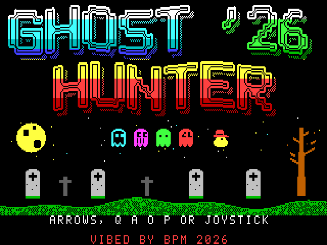
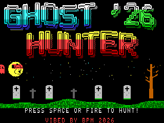
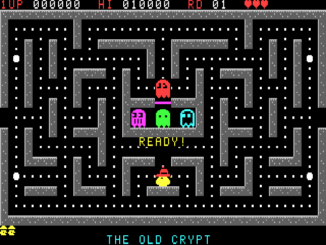
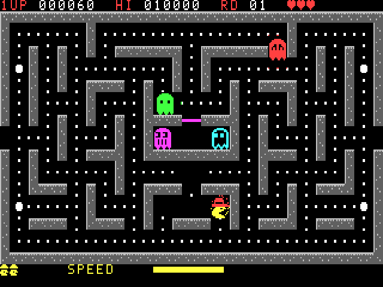
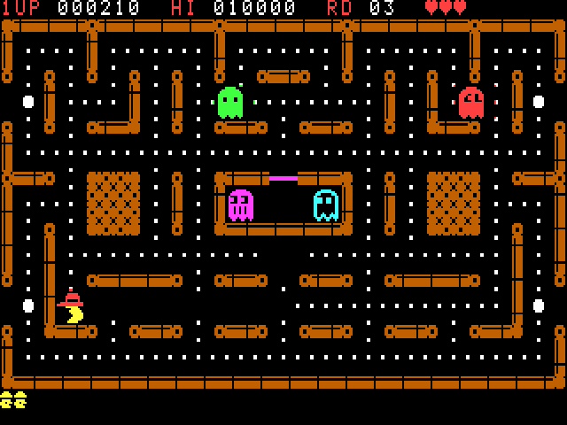
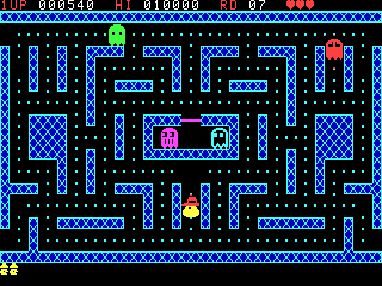
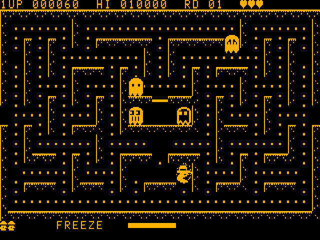

# GHOST HUNTER '26

A contemporary maze chase for the **Microbee Premium Plus** (1MB RAM, 32K PCG), in the 40-column mode. The Microbee never had a Ghost Hunter; this one is built for it from scratch, taking the ideas of *Ghost Hunter 2* (VZ300) but not its code or its mazes.

**VIBED BY BPM 2026**

## Status: first build, tested in the emulator model only

Everything below runs in the project's Premium Plus model at a steady 25 frames a second. It has not been on real hardware yet. The display set-up (40 × 25 cells of 8 × 8 pixels) is the same one KABOOMERANG uses, taken from the MODES.COM test that worked on BPM's machine.

## Play it

`release/GHOST26.DS8` is a DS80 disk image. It boots to CP/M's `A>` prompt with no shell. Type:

    GHOST26

Press **C** for a colour monitor or **M** for monochrome.

| Action | Keys |
|---|---|
| Move | arrow keys, or Q A O P, or a joystick |
| Start | SPACE, RETURN or fire |
| Pause | H |
| Sound on/off | S |
| Back to the title | ESC |

A tapped direction is remembered until the next junction, so you can turn early.

## What's in it

**The screen.** 320 × 200 in sixteen colours, every 8 × 8 cell with its own ink and paper. The maze is arcade scale: 13 lanes across and 7 down, lanes 16 pixels wide, 16-pixel characters. Characters only ever stand in lane cells, so they never discolour a wall.

**Forgiving play.** A ghost's touch costs a heart, not a life. The ghost that caught you is sent home as a pair of eyes and you flash, safe, for a couple of seconds. Three hearts a life, three lives, an extra life at 10,000 and then every 50,000.

**The ghosts** (names and habits from Ghost Hunter 2):

| Ghost | Colour | Habit |
|---|---|---|
| GRUMBLE | red | Heads straight for you. Gets cross (faster, never retreats) when under 30 dots are left. |
| SNEAKY | green | Aims two junctions ahead of you. |
| DIZZY | magenta | Chases from afar, loses his nerve up close, and turns on a whim more often each round. |
| PEEKABOO | cyan | Comes round the other side, using GRUMBLE's position. |

They take turns to scatter and chase, slow down in tunnels, and find the shortest way home as eyes. Each has its own shape (brows, slit eyes, stripes, hollow), so they can be told apart on a mono monitor.

**Power-ups** appear under the ghost pen, each with a timer bar:

- **Power pill:** ghosts turn blue. Chain 200 / 400 / 800 / 1600, with a pause and the score popping up.
- **SPEED:** faster, with a trail.
- **FREEZE:** ghosts on ice; they can't hurt you.
- **DOUBLE:** all points doubled.
- **SHIELD:** shrugs off one hit.
- **HEART:** one more heart (up to five). Only turns up when you are short.
- **HUNTER MODE:** eat all four ghosts on one pill and a star appears. Take it and every ghost is worth 1000.

**Treasures** rise in value by round: candy, pumpkin, potion, skull, gem, crown (100 to 2000). Thirty dots in a row without a pause is worth 300.

**Six mazes**, each with its own wall style and tunnels:

| Maze | Walls |
|---|---|
| THE OLD CRYPT | bevelled stone |
| HEDGE MAZE | leaves |
| BOILER ROOM | copper pipes, tunnels top and bottom of the sides |
| BRICK MANOR | red brick |
| NEON ARCADE | the arcade's blue double line |
| PHANTOM PALACE | ice-blue lattice, tunnels along the top and bottom lanes |

All are mirror-symmetric, fully connected and free of dead ends (checked by the generator in `src/tools/mazes.py`).

 

**Round cycle:** Crypt → Hedge → *intermission* → Boiler Room → **GHOST BUFFET** → Brick Manor → *intermission* → Neon Arcade → Phantom Palace → **PELLET PANIC** → round again, faster.

- **GHOST BUFFET:** 20 seconds, ghosts always blue and always coming back.
- **PELLET PANIC:** the ghosts sleep; clear the maze in 25 seconds for 5000.

**Attract round:** title with a chase across the graveyard → Meet the Ghosts → Power Up! → a demo game on the real engine → Hall of Fame. Five high scores with initials, kept until power-off.

**Sound:** a two-voice beeper engine that plays in each frame's spare time. Every note starts an octave up and drops onto its pitch (a squelch), and the bass voice jitters, so the tunes growl. Effects are sweeps, warbles, thumps and noise. In play the music is slow, sparse blips; it changes when ghosts are blue and in HUNTER MODE.

**Monochrome:** chosen at start-up. Patterns are inverted where needed so walls, hearts and ghosts read by shape.

## Tech specs

| | |
|---|---|
| Machine | Microbee Premium Plus, Z80 at 3.375 MHz, 1MB RAM, 32K PCG |
| Display | 6545 at half dot clock: 40 × 25 cells of 8 lines, 320 × 200 |
| Frame rate | 25 frames a second, two pages flipped in vertical blanking |
| Sprites | pre-shifted and masked, composited into private PCG glyphs (the HULLBREACH / KABOOMERANG engine) |
| Program | about 14K of Z80 at 8000h; no ROM calls, interrupts off |
| RAM blocks | 1 render tables, 4 and 5 sprites, 7 glyph stores and title, 8 the mazes |
| Disk | DS80, 80 tracks × 2 sides × 10 × 512 bytes |

## Build

Python 3 with numpy and Pillow, and gcc (for the emulator model). From `src/`:

    python3 tools/build.py            # -> build/GHOST26.DS8
    python3 tools/build.py --preview  # also preview PNGs of the mazes, sprites and title

| Script | What it does |
|---|---|
| `tools/soak.py` | The demo hunter plays for thousands of frames; checks for crashes and the frame rate |
| `tools/shoot.py` | Walks the attract round and the game states and takes screenshots (`--mono` for amber) |
| `tools/snd.py` | Records the speaker to WAV |
| `tools/gif.py` | Makes the showcase GIF |

The test emulator in `src/tools/emu` uses a Z80 core that looks like superzazu/z80 (MIT). It is only used for testing.
