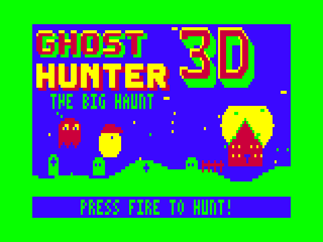
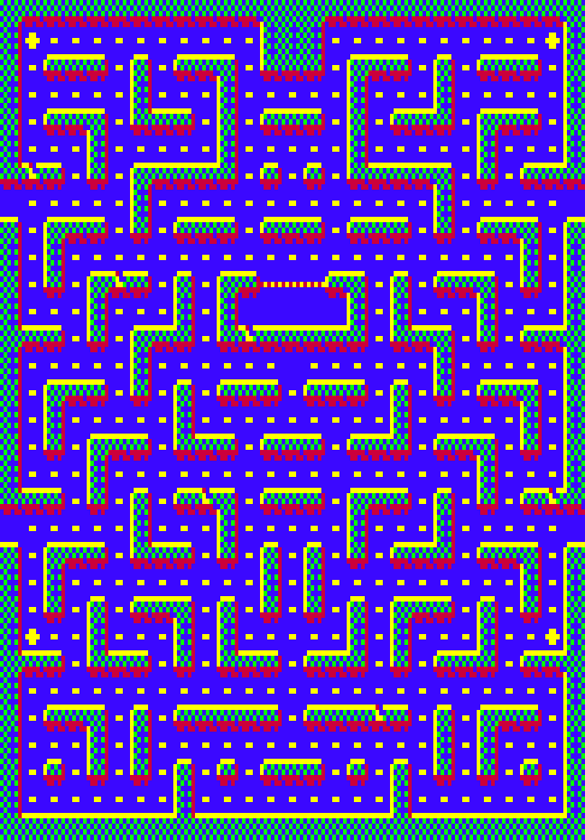
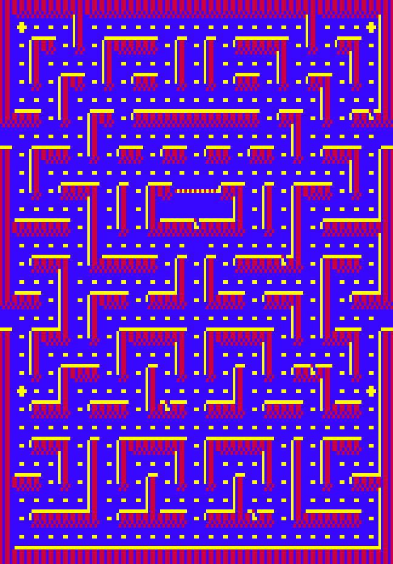
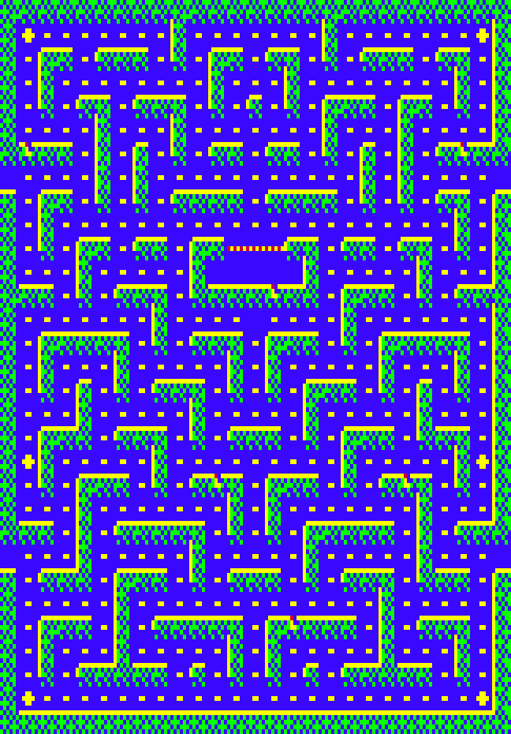
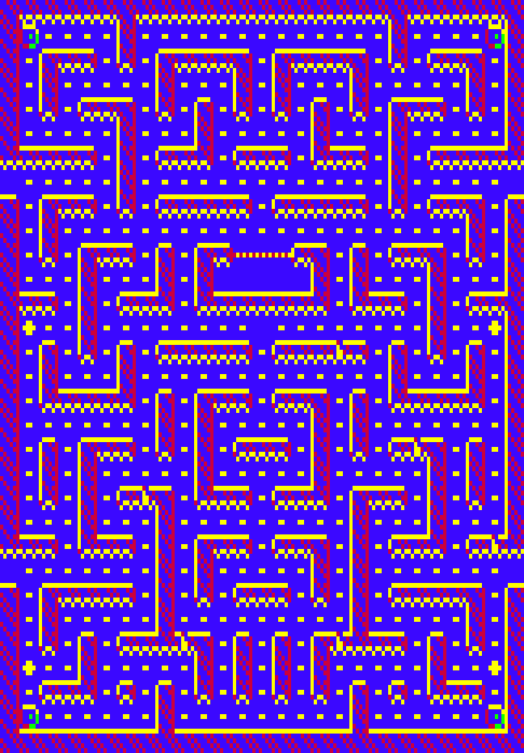
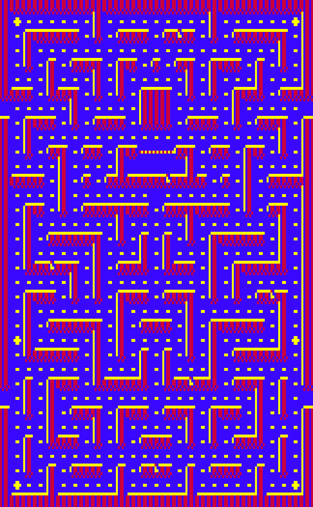
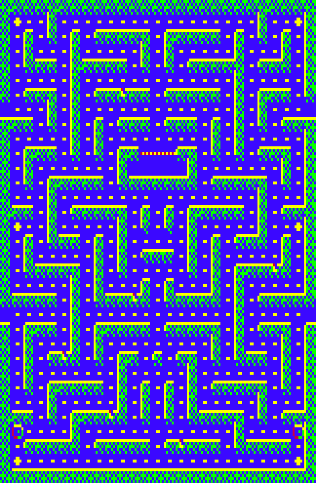

# GHOST HUNTER 3-D — THE BIG HAUNT

*For the Dick Smith VZ300 with a BennVenn SD loader + 128K RAM. ViBED by BPM 2026.*

The sequel to **Ghost Hunter 2**, which followed the original VZ **Ghost Hunter** by Dubois & McNamara. It keeps GH2's formula: four ghost personalities, power-ups, combos, bonus rounds, intermissions and the full attract sequence. The difference is that the mazes are now **full arcade scale**: 27 cells wide and 31–35 tall, about 3½ screens of maze. The VZ's viewport **pans smoothly in both directions** as the hunter nears the edge of the screen.

> Work in progress. Progress is saved here as it goes.

## Load and play
Copy `release/GHOST3.VZ` to the SD card and load it from the BennVenn menu. It loads low at $8000–$E49D.

* **Controls:** Q/A/M/, or joystick. P pauses, S toggles sound. Fire or Space starts a game.

## What's new
* **Big scrolling mazes.** There are six hand-designed mazes plus a Pellet Panic bonus maze. All of them are checked for connectivity, dead ends and 2×2 open areas.
  * The Crypt
  * Haunted Halls
  * The Graveyard
  * The Catacombs
  * The Belfry
  * Misty Manor
* **3-D bas-relief walls.** Each wall is a raised slab lit from the top-left, with a shadowed right edge. Where the corridor runs underneath, the slab's front face shows. There are four wall styles: mossy stone with brick faces, haunted wood panelling, overgrown hedges, and an ossuary with rows of little skulls.
* **Living walls.** While the view is still, eyes peek out of cracks in the walls and glance towards you, and candles flicker on the slab tops. Power pills pulse and teleporters swirl.
* **The hunt.** Ghosts that are off-screen show as coloured **blips** at the edge of the view. Treasures and power-ups appear at hiding spots around the maze and twinkle at the edge too.
* **Camera swoops.** Teleporters and respawns glide the camera across the maze.
* Each maze's name is shown at READY. Bonus rounds are 30 s (Ghost Buffet) and 50 s (Pellet Panic).
* A new title screen with an extruded "3D" logo and a haunted house whose windows flicker, plus a new title tune.

## How it works (technical)
* **The maze lives in BennVenn SRAM bank A** ($4000, port $37 = 1) as a **ring of 58 pixel rows**, exactly the viewport's height.
  * Each ring row holds the map row four times, pre-shifted by 0–3 pixels (4 × 42 bytes). That makes any camera position a plain byte copy, with 1-pixel horizontal steps.
  * When the camera moves a row, only that one new map row is rendered, from 6×5 tiles.
* **Frames where the camera moves** redraw the 58-row viewport with a generated unrolled stack copy, in two halves. Each half's sprites are drawn straight after it, so everything stays ahead of the beam and nothing flickers.
* **Frames where the camera is still** use GH2's cheap erase/redraw of the sprites.
* **Map changes** (pellets, pulsing power pills, decals) re-render just the affected bytes of the ring and mark a dirty rectangle.
* **The attract world** (title, intermissions, hi-score entry, big sprites, title music, full-screen background) runs from **SRAM bank B** ($4000, port $37 = 3). It is copied there at boot.
* No interrupts and no ROM calls. Port $37 only ever gets 1 or 3.

## Building
`src/build.sh` needs `sjasmplus` and Python 3 with Pillow. `tools/vzemu` is the test emulator; it models the BennVenn banks, frame timing and VRAM writes during the display.

## Maps
| | | |
|---|---|---|
|  |  |  |
|  |  |  |
