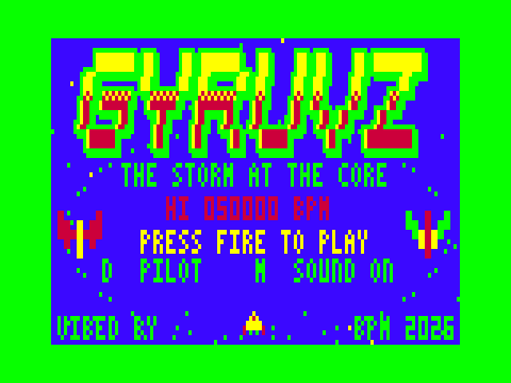
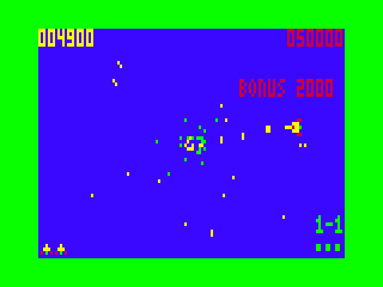
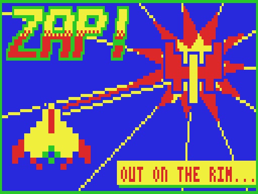
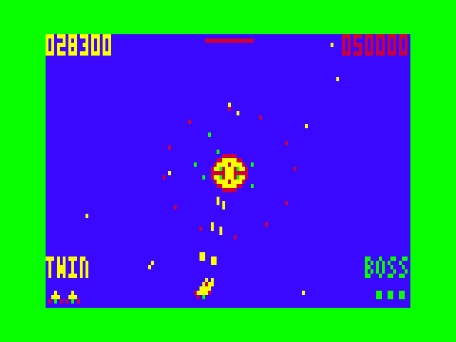

# GYRUVZ - The Storm at the Core

An original orbital arcade shooter for the **Dick Smith VZ300** with the **BennVenn SD loader + 128K expansion**, inspired by the feel of Gyruss. VIBED BY BPM 2026.

A spiral storm of stars is spitting a swarm out of its eye. You ride the rim of the storm, swing around the orbit and fire inward, pushing through five sectors to the heart of the storm. The title screen plays **J.S. Bach's Toccata and Fugue in D minor** (BWV 565), arranged for a 3-voice beeper player with an arcade beat.

 
 

## Loading

1. Copy `release/GYRUVZ.VZ` to the SD card (one file - no data files needed).
2. Load and run it from VZ-DECK or the DOS like any other `.VZ`. It loads at $8000-$EC93, unpacks its front end into the SRAM's second bank, builds its tables (under a second), and starts.

It needs the BennVenn 128K expansion. Without the SRAM it says so and stops.

## Controls

| | |
|---|---|
| Joystick, or W A S D | swing round to that side of the orbit (shortest way) |
| Z / X | turn anticlockwise / clockwise steadily |
| Fire, or SPACE | shoot (hold it to autofire) |
| P or RETURN | pause; while paused, Q quits to the title |
| M | music + effects / effects only / sound off |
| D (title) | skill: CADET (5 shields), PILOT (3), ACE (2, faster) |
| C (title / game over) | continue from the last sector reached (score starts again) |

## The game

- **5 sectors** (The Drift, The Ice Belt, Ember Reach, The Glass Nebula, The Eye of the Storm), 4 waves each. Sectors 3 and 4 use the second palette.
- **Formations** spiral out of the storm's eye, split and loop, gather in a turning holding ring, then peel off to dive. Entry formations stay inside the orbit; only divers (which blink and sound a warning first) and mines come out to your ring.
- **The swarm**: Glint, Moth (shoots), Spinner (two hits), Hornet (rams), Mine (drifts out and bursts), Pod (shoot it for TWIN SHOT).
- **Bosses** fight in three phases: (1) the core is sealed until you strip its armour pods; (2) the eye opens and shuts and it throws charged rings of plasma - a ring of sparks closes in before each volley - and launches hornets; (3) at a third strength it re-arms with fresh pods, then rages with aimed bursts. A hit stuns the core for a moment, so it can't be burned down in seconds.
- **Bonus round** after each boss: 40 harmless stars; hit them all for a 10,000 PERFECT bonus.
- **Shields** soak up hits; lose them all and you lose a ship. Extra ships at 30,000 and every 50,000.
- **Scoring**: formation bonuses (wipe out a whole formation while it flies in), point-blank x2 (kills close to the rim), no-damage boss bonus. Top 8 scores with initials, kept in the SRAM's second bank (they survive reloading, not power-off).

## The attract sequence

Title - comic panel (ZAP!) - the swarm - comic panel (KA-BOOM!) - top pilots - demo - comic panel (INCOMING!) - how to fly - ...

The front-end screens are still pictures so the CPU can give everything to the music: three pulse voices taking turns at the speaker each sample (about 18.6 kHz), each with a duty-cycle envelope that settles into a slow pulse-width sweep, fast arpeggio chords, and the third voice doubling as kick, snare and hi-hat. The Toccata arrangement (`src/music3.py`): the opening mordent phrases falling through three octaves, the diminished-seventh climb into the big D minor chord, the Prestissimo cascades over a driving beat, chord stabs, then the fugue subject over its A pedal and its answer up a fifth, and a drum-roll coda back to the top (about 41 s a loop).

## Technical

- Mode 1, 128x64, 4 colours, double-buffered with an IM2 field-sync copy (no snow or tearing in the game), 25 fps target.
- **Memory**: game in main RAM; screen-copy code and object arrays in SRAM bank 1; the whole front end (code, music player, Toccata, pictures) in SRAM bank 3. The front end ships packed (LZ) inside the .VZ above the game and is unpacked at power-up; that RAM then becomes the projection table and the sprite phases, which are built at power-up too (sprites are stored at one pixel phase; the other three are made by shifting). This keeps it a single file.
- The front end runs with the interrupt off and draws straight to the screen; the game runs in bank 1 with the frame interrupt. A small switch-over routine in main RAM changes banks and interrupt state each way.
- Starfield runs full screen (past the orbit to the edges, clear of the HUD corners).
- **Stress test** (fire held, sound on, densest waves, 60 s, emulator): 82-87% of frames at 25 fps in sectors 1, 3 and 5, the rest at 16.7 fps. Effects give way first when it gets crowded: fewer stars, no star trails.

## Building

Needs `python3` with Pillow, and `sjasmplus`.

```
cd src
./build.sh            # or SJASMPLUS=/path/to/sjasmplus ./build.sh
```

Two assembler passes: the first makes the bank-3 front end image, Python packs it, the second builds `build/GYRUVZ.VZ`. Tools in `tools/`: `vzemu` (test emulator with the BennVenn SRAM banks, snow check, input scripts, screenshots, WAV out, PC ring with `PCRING=`), `stress.sh` (frame-time histogram), `prof.sh` (where the CPU time goes).

## Status: what's verified where

Everything in this version has been run in the test emulator only. In it:
- The attract cycle, all screens, the demo, name entry, game over / one more go, pause, sound modes and continue all work.
- The Toccata plays at the right pitches.
- The sprite phases built at power-up match the stored versions byte for byte.

Carried over from builds that ran on your machine: the in-game engine (STARWHIRL), the SRAM bank switching and records layout, the joystick ports and the keyboard matrix.

**New and not yet tried on real hardware:**
- running the front end from SRAM bank 3 with the interrupt off
- the 3-voice music player on the real beeper
- the file loading as high as $EC93 (the previous build ended at $E7A2)

If the music sounds too buzzy, the player's per-tick pause can be shortened; if loading fails, the fallback is to split it into GYRUVZ.VZ plus a data file.
