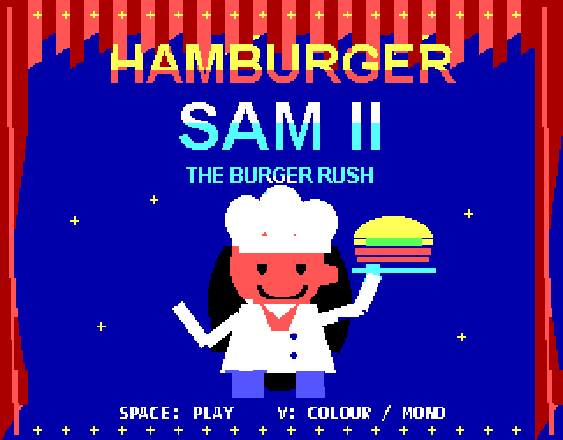
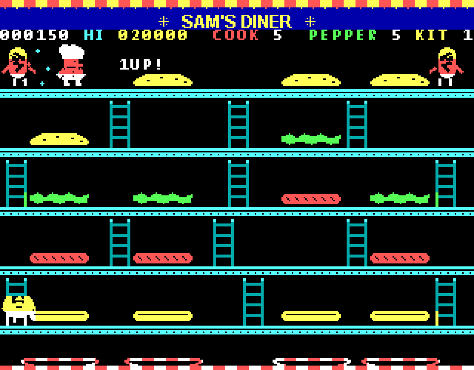
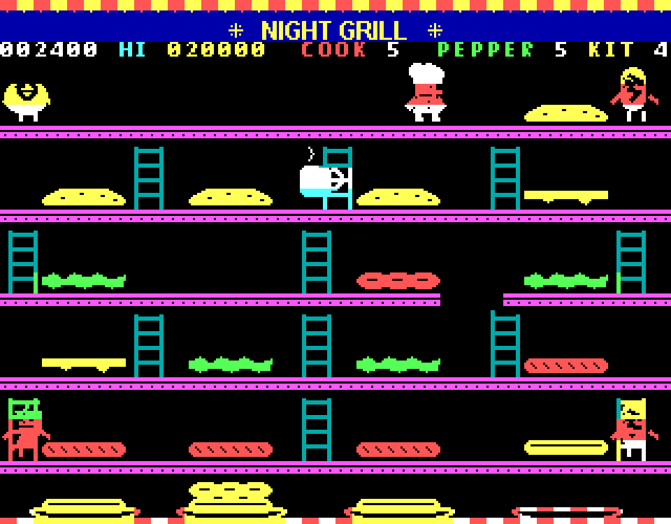
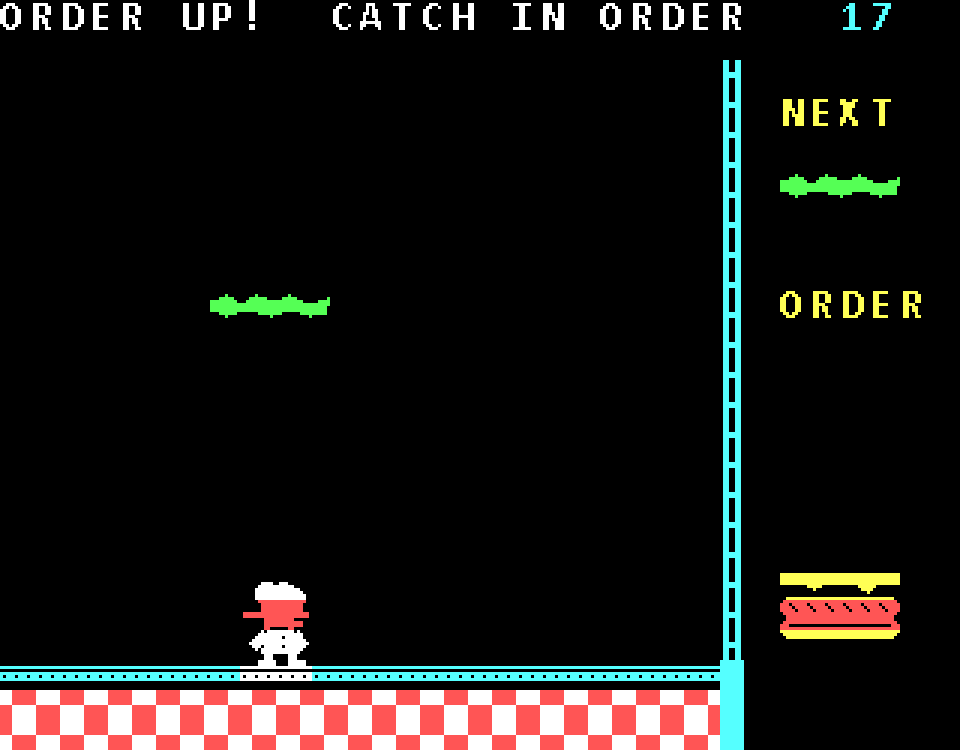
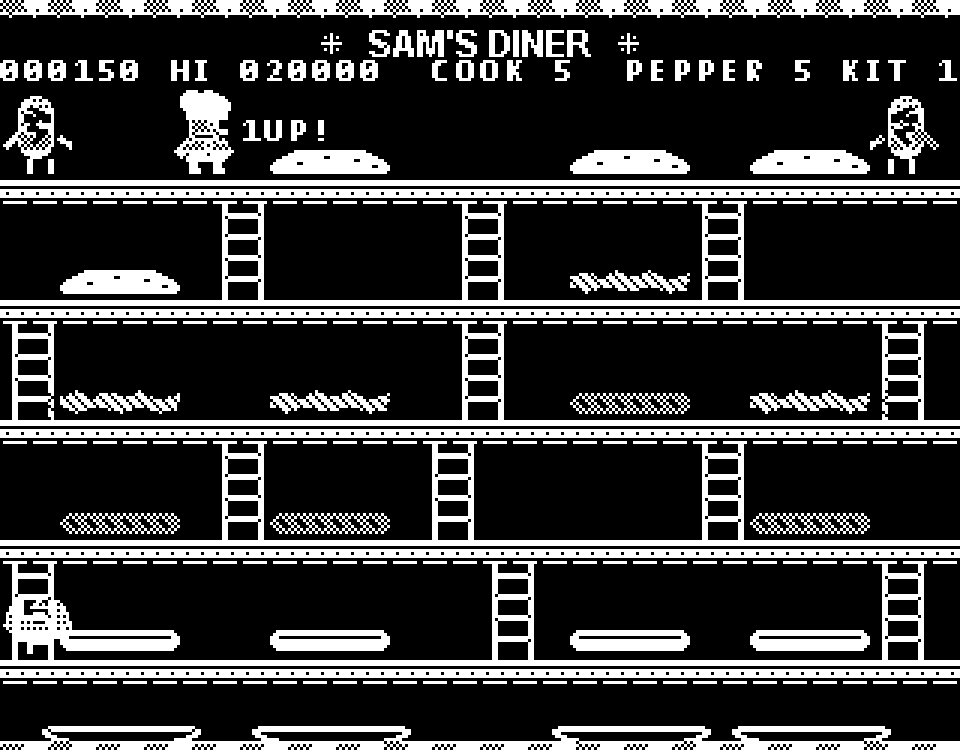

# Hamburger Sam II: The Burger Rush (Microbee Premium Plus edition v1.0)

A port of the VZ300 game *Hamburger Sam II* to the **Microbee Premium Plus**,
redrawn for the 320×250 PAL screen (40×25 cells of 8×10). It comes on a
bootable double-sided 80-track disk image that starts at the CP/M `A>` prompt.



## Running it

1. Boot `HAMSAM2.DS80` on a Premium Plus (1 MB RAM, 32 KB PCG RAM).
2. At `A>`, type `HAMSAM2` and press RETURN.

The disk holds `HAMSAM2.COM` (the game), `HAMSAM2.DAT` (480 KB of scenery and
pre-shifted sprites, loaded into extended RAM banks 4–18) and `READ.ME`.

## Controls

| Key | Action |
|---|---|
| `M` / `,` | walk left / right |
| `Q` / `A` | climb up / down (in menus: choose) |
| `SPACE` | throw pepper; start |
| `P` | pause (then `X` quits to the title) |
| `S` | sound: music + effects / effects / off |
| `V` (title) | colour or dithered monochrome |
| `C` (title or menu) | unlock Classic 1984 |
| name entry | `Q`/`A` letter, `SPACE` next, `RETURN` done |

## The game

You walk over each ingredient to drop it a floor, and build every burger on its
plate. Drop food on the chasers or give them a ride down. Pepper stuns them,
and coffee gives you more. There are eight kitchens, then the chasers come
back faster. An *Order Up!* bonus round comes every two kitchens, and the
original 1984 layout can be unlocked as a ninth kitchen.

| | |
|---|---|
|  |  |
|  |  |

## Technical notes

- **Display.** The CRTC runs a 40×25 screen where every cell is its own
  PCG character. Two complete 1000-character pages (PCG banks 0–7 and 8–15)
  are double-buffered, so nothing tears. The game draws into a 16 KB software
  copy of the screen (16 bytes per cell: 10 pixel rows plus colour). Only cells
  that changed are copied to the hidden page.
- **Colour clash.** Ingredients rest in the cell row above each girder, never in
  the girder's own cells. The kitchen marquee, HUD and title-logo colour bands
  are laid out on cell boundaries, so no cell needs more than two colours.
- **Monochrome.** Every scene has its own dithered mono version, and sprites
  have mono copies. Text and HUD stay solid white.
- **Pacing.** The game rules, music and effects advance once for every real
  50 Hz field, counted from the CRTC vertical-blank flag. A frame that takes two
  or three fields to draw still plays at the VZ original's speed. The picture
  typically updates every 2–3 fields (17–25 fps) on a 3.375 MHz Z80, and the
  rules run at 50 Hz.
- **Memory.** The scenery is 11 colour+mono scenes (9 kitchens, title, Order Up!
  stage). The sprite cache holds 46 poses × 8 pixel phases × colour/mono. The
  clean background mirror sits in bank 5 at native − $8000.

## Building

You need [sjasmplus](https://github.com/z00m128/sjasmplus) 1.24 (on PATH or at
`work\tools\sjasmplus.exe`) and Python 3.12 with Pillow. The tests also need
`pip install z80==1.2.0`. Set `HAMSAM_PYTHON` to choose which Python is used.

From `src\` (on the PC: `C:\Users\Owner\Documents\HamburgerSam2_Microbee`):

```
.\build.ps1 -Assets -Disk
```

This regenerates the scenery and sprite cache (`work\spectacle.py`,
`work\sprite_cache.py`) and assembles `work\port\src\main.asm`. It then writes
`outputs\HAMSAM2.DS80` using the CP/M boot tracks and `CCP.SYS` in
`resources\`. The scenery fonts are Windows' Arial Bold and Consolas Bold.

Tests run in the bundled Python Z80 harness:

- `work\regress.py`: input, play, all 9 layouts, mono
- `work\test_launch.py`: ROM boot to `A>`, then `HAMSAM2`
- `work\test_load.py`: the CP/M loader fills all 15 banks byte-exact
- `work\flow.py`: a whole game, from title to name entry
- `work\outest.py`: the Order Up! round
- `work\profile.py`: per-frame timing

## Known limitations

- It has only been tested in the project's own emulation harness (which boots
  the real `bn60` ROM and CP/M), not yet on real hardware or in a full
  emulator.
- The speaker is driven while the game waits for the next field, as on the VZ.
  On the busiest frames there is less idle time, so sound can be sparser there.
