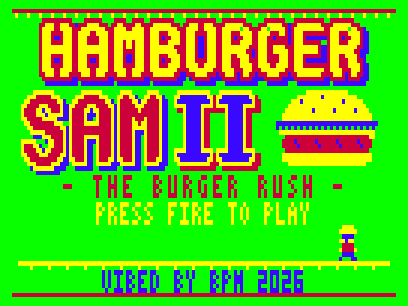
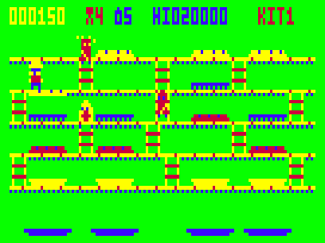
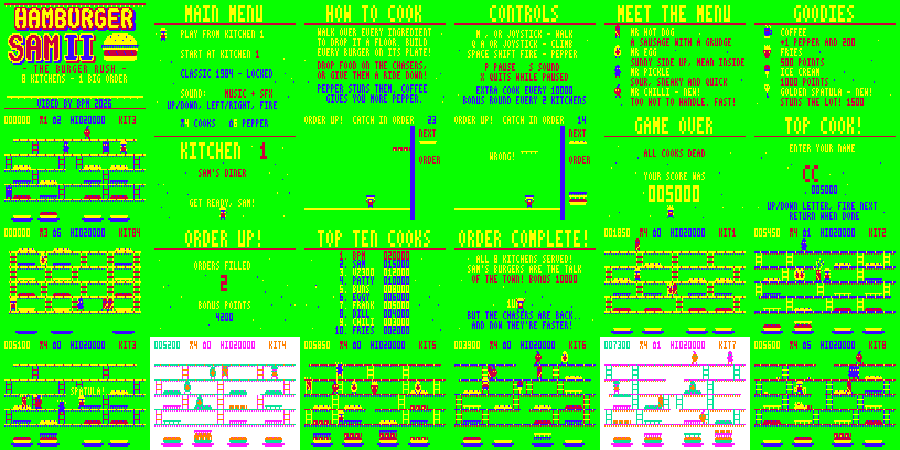

# HAMBURGER SAM II — THE BURGER RUSH

Sequel to the VZ200/VZ300 game *HAMBURGER SAM* (Dick Smith Electronics), for the Dick Smith
VZ300 / VZ200 with the **BennVenn SD loader + 128K**. ViBED by BPM 2026. Version 1.0.1 (shorter, softer ingredient-drop sound).
Original code, graphics and music. Nothing from the original game is included.



Release blurb and specs: [BLURB.md](BLURB.md). Screenshots: [gameplay](screenshots/gameplay/) · [attract sequence](screenshots/attract/) · [all screens](screenshots/info/)






## Play it

Copy `release/HAMSAM2.VZ` to the SD card and run it from the BennVenn SD loader.
- It's a single type F1 binary. It loads at $8000 (to $DB44) and runs from $8000. There are no other files.
- It needs the **128K expansion** (RAM up to $FFFF) and the **SD loader's SRAM** (the sprite cache lives there).
- It takes over the SRAM the loader's DOS sits in, so press reset to get back to the SD menu.

### Controls

| Action | Keyboard | Joystick |
|---|---|---|
| Walk | M left · `,` right | left / right |
| Climb | Q up · A down (lines up with a ladder within 3 pixels) | up / down |
| Throw pepper | SPACE or SHIFT | fire |
| Pause (X quits while paused) | P | — |
| Sound: music+SFX → SFX only → off | S | — |
| Menus | up/down, left/right, SPACE/fire or RETURN | stick + fire |
| Unlock Classic 1984 | C on the title or menu | — |

The keys are the 1984 original's. The joystick is detected automatically (no "JOYSTICK Y OR N" question).

## From the original to the sequel

**What the 1984 game was:** a green Mode 1 BurgerTime. It had five yellow girder floors joined by
ladders and three burger columns, with one ingredient type per floor (top bun, lettuce, cheese,
meat, bottom bun). Walk over an ingredient and it drops a floor, knocking down whatever is below.
Build every burger on its plate below the bottom floor. Hot dogs, fried eggs and pickles chase you.
Pepper stuns them, dropping an ingredient on them kills them, and a coffee cup gives +1 pepper.
You get 100 points a kill and 100 a floor. You start with 4 cooks and 6 peppers, get an extra man
every 10,000, and the top ten takes 5-letter names. "ALL COOKS DEAD" ends the game.

**What carries over:** the floors-and-ladders kitchen, the cascade, the three chasers, pepper,
coffee, 4 cooks and 6 peppers, +1 pepper per kitchen, a cook every 10,000, a top ten with 5-letter
names, the original's keys, and "ALL COOKS DEAD".

**What's new:**
- **8 kitchens** with their own girder gaps, ladders and ingredient layouts. Two of them are
  night-shift kitchens in the CSS1 palette.
  1. Sam's Diner
  2. Cheese Factory
  3. Pickle Pantry
  4. Night Grill
  5. Salad Bar (tomato slices join the menu)
  6. Fry-Up Factory
  7. Midnight Feast
  8. Burger Palace
- After kitchen 8 there's an ending, then **Lap 2**, where the chasers are faster and recover from pepper sooner.
- **Ingredients sag** under Sam's feet, segment by segment, before they fall.
- **Riders:** chasers standing on a falling ingredient ride it down, an extra floor each, for
  500 / 1000 / 2000 / 4000 points. Anything under a falling ingredient gets squashed for 500.
- **Mr Chilli** is new: fast and hot-headed. He joins Mr Hot Dog, Mr Egg and Mr Pickle from kitchen 3.
- **Goodies** appear after 6 and 14 drops:
  - coffee (+1 pepper, from 1984)
  - fries (500)
  - ice cream (1000)
  - the **golden spatula**, which stuns everyone on screen (1500)
- **ORDER UP!** is a bonus round after every second kitchen. Catch the falling layers on Sam's
  plate in burger order (bottom bun, meat, cheese, lettuce, top bun) to fill orders. It gets faster with each order.
- **BURGER UP!** pop-ups, sparkles, score pop-ups and a +1 cook fanfare.
- **Sam falls off the girders** when he's caught, as the 1984 instructions describe.
- **Classic 1984:** press C to unlock a recreation of the original kitchen (3 columns, one ingredient per floor).
- **Presentation:**
  - a rounded "bun" logo (hand-pixelled bubble letters)
  - the attract cycle: title chase → How to Cook → Controls → Meet the Menu → Goodies → computer-played demo → Top Ten
  - animated **salt and pepper** specks on the information screens, which drift across each other in a shake-shake-shake rhythm and slip behind the text
  - riveted girders with a dotted underside, and contrast-coloured ladder rungs
- **Sound:** a two-voice beeper engine with gritty, separated-note tunes (title, kitchen, info,
  bonus round, ending) and jingles. The S key cycles music+SFX → SFX only → off.
- **Records:** Top Ten, sound setting, Classic unlock and the furthest kitchen reached (for
  "START AT KITCHEN") are kept in BennVenn SRAM.

## Hardware notes

- **Loading:** one .VZ from the BennVenn SD loader, loading low at $8000. This is the same
  load-low pattern as Xevious v1.2, Cybernoid v1.1 and Tennis II.
  - There are no ROM calls and no mapper writes during loading. The DOS isn't needed after loading.
  - Interrupts stay off (DI throughout). Frame timing comes from polling field sync ($68xx bit 7, edge-triggered).
- **Memory:**

  | Range | Use |
  |---|---|
  | $4000–$5A9F, SRAM **bank 1** | the 46 pre-shifted sprites (built at start-up), in the window the loader leaves mapped (as Cybernoid v1.1 did) |
  | $6740–$67BF, SRAM **bank 3** | Top Ten, options, Classic unlock, furthest kitchen (signature "HS2R" + checksum), clear of Tennis II's $67C0 block |
  | $7800–$7B28 | variables |
  | $7C00–$7CFF | VRAM commit queue, pathfinding queue |
  | $7D00–$7DFF | kept-sprite tables (the recolour table during start-up) |
  | $7E00–$7F3F | kitchen floor/ladder graph, demo pathfinding distances |
  | $7F40–$7FFE | stack (measured peak use: 44 bytes) |
  | $8000–$DB44 | code and data (the .VZ, 23,365 bytes); the sprite sources at the end are copied away and overwritten at start-up |
  | $EE00–$EF6F | draw and erase lists |
  | $F000–$F7FF | clean kitchen backdrop (girders, ladders, plates) |
  | $F800–$FFFF | background buffer |

- **Records:** saved with `OUT ($37),3` and read back the same way, so they survive reloading the
  game but not power-off.
  - At start-up the game probes the bank switch: it writes one byte, checks it, then restores it.
    It only saves if bank 1 is untouched and bank 3 holds the byte. Otherwise saving is simply off.
  - The mapping is always put back to 1 straight afterwards.
- **Snow-free drawing:**
  - VRAM is written only in the vblank window after field sync, through the commit queue from Penguin 2 / Tennis II.
  - Sprites are POP-drawn. A new "kept sprite" scheme leaves sprites alone when they haven't moved
    and nothing near them changed, so they cost almost nothing.
  - The chasers move in two alternating halves: at most two step on any frame.
  - Ingredients, the bonus item, the pepper cloud, sparkles and pop-ups are all painted into the
    background buffer and repaired afterwards, so they never use sprite time.
- **Joysticks:**
  - Joystick 1 is read on $2E/$2D/$2C. Joystick 2 is read on $2B/$27, with its directions also from $29 (as your interface needs).
  - Either stick or the keyboard works.
  - "All four directions at once" is ignored, so having no interface plugged in reads as no input.

## Build

Needs Python 3 with Pillow, plus sjasmplus (https://github.com/z00m128/sjasmplus) if you have it.
Otherwise the bundled Python assembler `tools/zasm.py` is used. It's the Dracula's Castle II /
Tennis II assembler.

```
cd src
./build.sh          # -> ../release/HAMSAM2.VZ
```

- `gen.py` writes `data.inc` and `sprdata.inc`. It draws on:
  - `font.py`
  - `art.py`: sprites and ingredients
  - `levels.py`: the kitchens. These are validated at build time: every ingredient, spawn point and ladder must be reachable and placed legally.
  - `logo.py`: the bubble lettering
  - `pics.py`: the title picture
  - `music.py`: the tunes
- `mkvz.py` wraps `hamsam2.bin` into the .VZ file.
- `tools/fixjr.py` rebuilds with zasm and turns any out-of-range `jr` into `jp`.

`tools/vzemu/` is the small headless VZ300 emulator from Penguin 2 / Tennis II (superzazu/z80 CPU
core, MIT licence, see `LICENSE-z80`). Build it with
`gcc -O2 -o tools/vzemu/vzemu tools/vzemu/vzemu.c tools/vzemu/z80.c`.
- **New for this project:**
  - render-start marker and per-frame late-render log (`LATELOG=1`)
  - peak stack depth
- **Test scripts:**
  - `tools/run.py`: run with pokes by symbol name, e.g. `5:autoplay=1 170:kitchen=7`
  - `tools/fuzz.py`: random-input soak
  - `tools/prof2.py`: per-routine CPU profile
  - `tools/media.py`: screenshots, GIFs and audio

The original HAMSAM.VZ is kept in `orig/` on your PC only. It's a commercial Dick Smith release
with no redistribution permission, so it's git-ignored.

## Testing

Tested **in the emulator only:**
- **Every screen and route:** the attract cycle, every menu line, all 8 kitchens, Classic 1984, all three Order Up! rounds, the ending and Lap 2.
- **The whole game under the autopilot:** kitchen 1 → ending → lap 2 kitchen 4, in 30,000 frames.
- **Real keyboard and joystick play:** walking, ladder snapping, both pepper keys, pause / resume / quit, and the sound toggle.
- **Endings and records:**
  - game over → name entry → Top Ten
  - game over without a qualifying score → straight back to the title
  - records saved to and reloaded from the emulated SRAM bank 3, with signature checked
- **Random-input soaks:** 6 × 60,000 frames (about 2 hours of play). No crashes, and the stack never went deeper than 44 bytes.
- **Snow-free drawing:**
  - In the soaks, about 11–49 frames per 60,000 (under 0.1%) finished drawing 1–9 lines into the top of the picture. Every other frame finished inside the vblank window.
  - The attract cycle and kitchens 1–7 are essentially clean.
  - The worst case is kitchen 8 with god mode on and five chasers swarming Sam.

**Not yet checked on real hardware:**
- using SRAM bank 1 ($4000–$5A9F) for the sprite cache (your Cybernoid v1.1 test used the same window)
- the SRAM bank-3 records save
- the real machine's top-border length (the emulator assumes 25 lines, matching your RASTEST photos)
- speaker volume, and joystick feel on your interface

## Sound-effect fix (8 November 2026)

The sound-effect table had 9 bytes per entry, but the code that plays an effect looks entries up 8 bytes apart. So every effect after the first one played the wrong values, and some came out as long, chirpy, lingering sweeps. The table now has 8-byte entries, so every effect plays as designed. Every effect plays at its original length, including the warbly bonus and power-up sounds. Nothing else changed.
