# HOPPY 2 — "The Big Pond Move"

Remake of *HOPPY* (Dubois & McNamara) for the Dick Smith VZ300 / VZ200.
ViBED by BPM 2026. Original code, graphics and music.


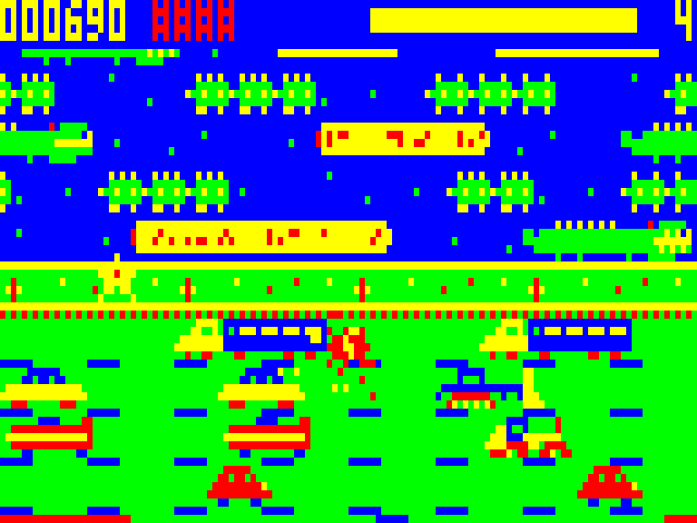

**Oh no!** The Mayor is draining Hoppy's pond to build a car park, and his froglets have leapt all over the countryside. Hoppy has to bring them home to the new pond, across busy roads, rushing rivers and anything that wants him for lunch.

It's the hop-and-dodge game you remember, rebuilt as a full-colour mode(1) game with a lot of character.

## Play it

Copy `release/HOPPY2.VZ` to the SD card and load it from the BennVenn SD loader. It's a type F1 binary that loads at $8000 (to $EF99) and runs from $8000. It needs the **BennVenn 128K** RAM expansion.

| Action | Keyboard | Joystick |
|---|---|---|
| Hop up / down | Q / A | up / down |
| Hop left / right | O / P, or M / `,` (same as the original) | left / right |
| Snail slow-mo | SPACE | fire |
| Start | SPACE or any key | fire |
| Pause | RETURN (X quits while paused) | — |
| Initials entry | Q/A change letter, P/SPACE next | up/down, fire |

The joystick is detected automatically. Holding a direction keeps hopping, and a press made mid-hop is buffered for when the frog lands.

## What's in it

- **8 themed levels:** Sunny Meadow, Market Day, Snake Pass, Croc Creek, the sugar-rush **Candy Creek** (alternate palette: cordial river, icing road), Double Trouble, Rush Hour and the **Freeway Finale**. Then the ending, and Lap 2 runs faster.
- **Scrolling playfield,** like the original's two-screen board. The double-length boards have two roads *and* two rivers.
- **Hazards you can read:** diving turtles flash red before they dunk, racers puff exhaust and rev before a dash, crocodiles snap their jaws (ride the back, not the head), a snake patrols the verge, and crocs lurk in the lily bays.
- **Pond treats:** bubble shield (absorbs one splat), snail slow-mo (stored, up to 3; use it when *you* choose), star (double score), heart (extra frog), and **Hoppina**, who sits on a log; carry her home for 1000.
- **Scoring:** 10 per new row, 50 per frog home plus a time bonus, 200 per bay fly, 1000 for all five home, Flawless +3000, Tidy Row (bays filled left to right) +2000. Extra frog every 20,000.
- **Lots of animation:** splats, splashes, dust puffs, sparkles, fireworks, butterflies and pop-up scores.
- **Two-voice music:** title theme and jingles (melody + bass) on the 1-bit speaker. Croaks, honks and squelches during play.
- **Attract sequence:** animated title (bouncing logo, parallax clouds, traffic, river, Hoppy catching flies, and a snail that finishes its crossing over several attract cycles), story scene, computer-played demo, three instruction pages, and the Top Frogs table. Any key starts.
- **Player-friendly touches:** hedges and occupied bays bounce you back instead of killing you, a flashing safety period after respawning, instant respawn, pause, continues (score resets), and a points tally after each level.

High scores last until power-off. They aren't saved to SD, because the game overwrites the SRAM the BennVenn DOS lives in.

## Screenshots

| | | |
|---|---|---|
| 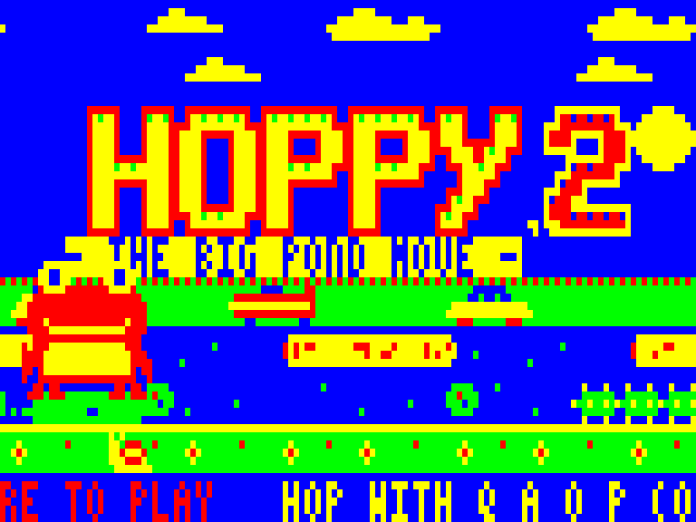 | 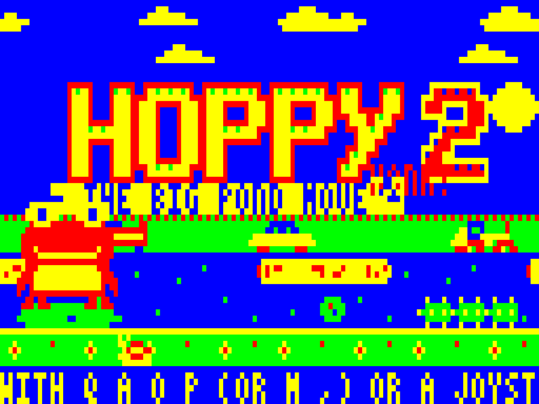 | 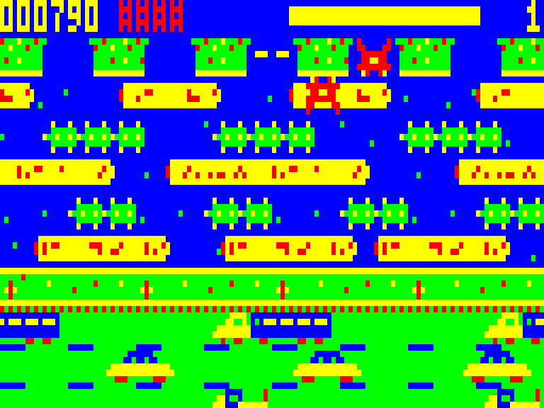 |
| 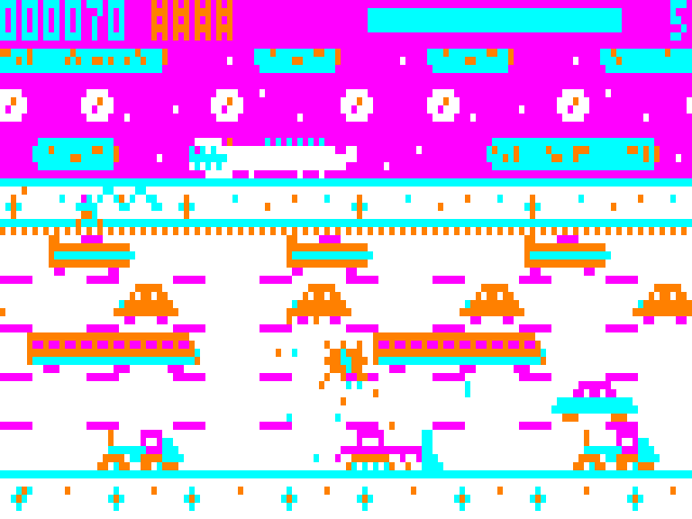 | 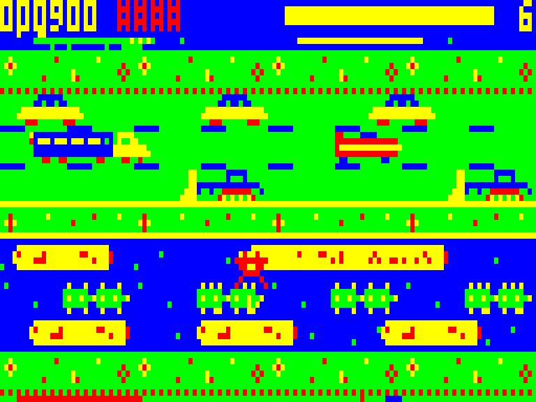 | 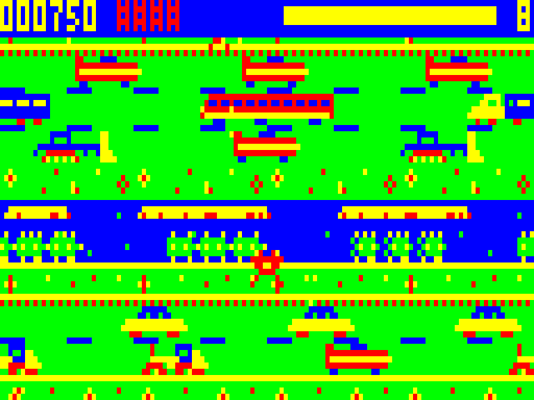 |
| 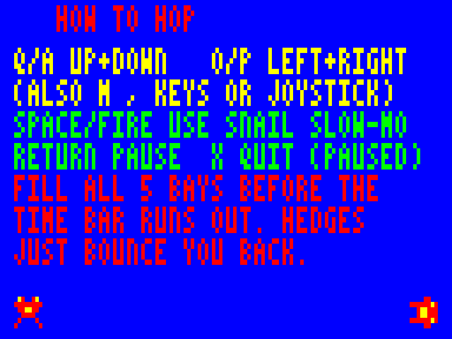 | 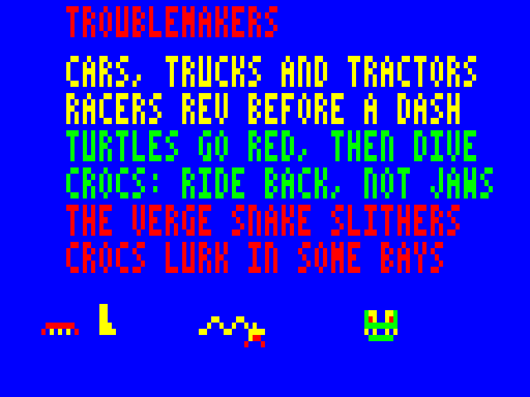 | 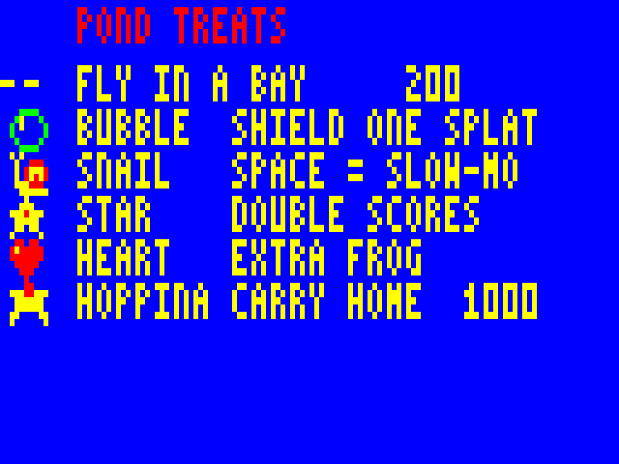 |
| 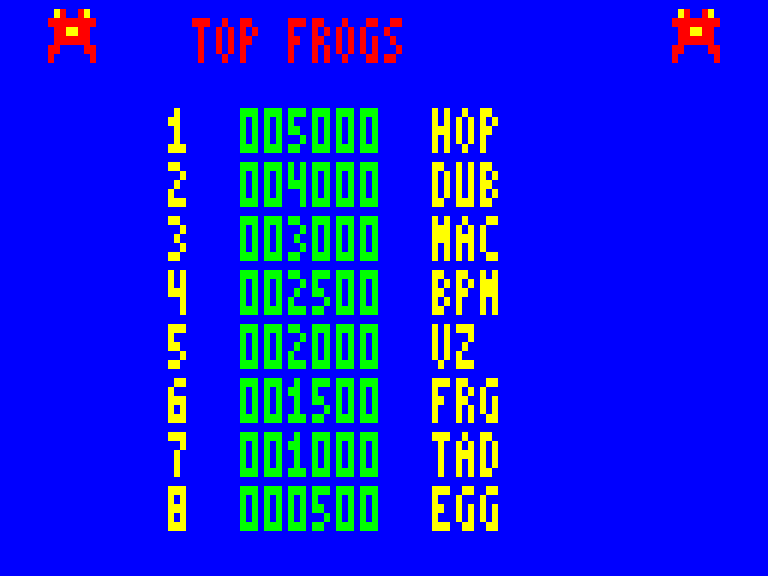 | 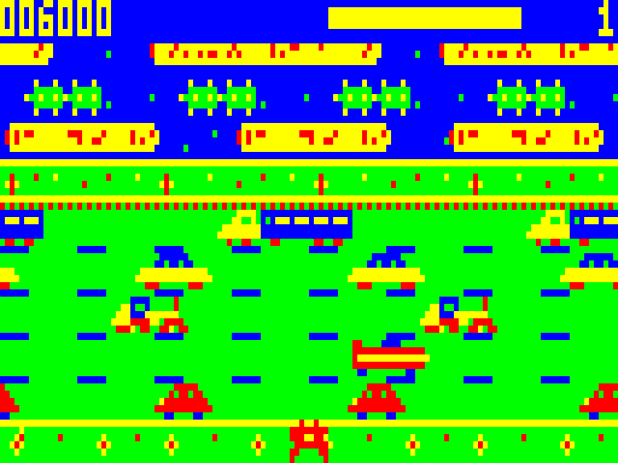 | 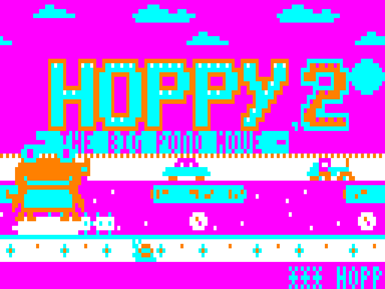 |

`media/title_music.mp3` is the title theme as rendered from the emulator's speaker output.

## Technical notes

- **Snow-free display:** every frame is built in an off-screen buffer at $F800 and copied to video RAM only during vertical blank, half the playfield per field. The game runs at 25 fps, and only rows that changed are redrawn and copied.
- **Lanes:** each lane is a 128-pixel loop stored in 4 pre-shifted copies, so traffic and logs scroll a pixel at a time. Diving turtles and croc jaws are re-stamped into the strips as they animate.
- **Sound:** in-game effects play in each frame's idle time, so they never slow the game. The title theme and jingles use a two-voice engine (about 25 kHz interleave) that takes the whole CPU. The speaker is driven differentially through latch bits 0 and 5.
- **Memory:** code $8000–$EF99. Lane strips go in the BennVenn SRAM window ($4000–$67FF) plus main RAM. Fixed tables live at $7800–$7FFF (free once BASIC isn't running), and the composition buffer at $F800–$FFFF. The game runs with interrupts off and makes no ROM calls.

## Building

```
cd src
SJASMPLUS=/path/to/sjasmplus ./build.sh
```

`tools/gen.py` turns the text-art in `tools/art.py` and `tools/titleart.py` into `gfx.inc`. `tools/music.py` turns the tunes into `music2.inc`. `main.asm` is then assembled with sjasmplus, and `tools/mkvz.py` writes `release/HOPPY2.VZ`.
