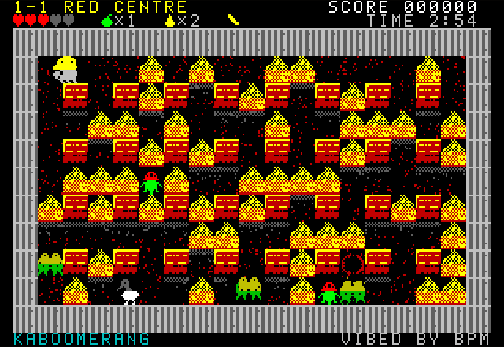
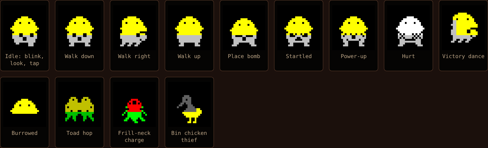

# KABOOMERANG

An original Bomberman-inspired arcade game for the **Microbee Premium Plus** (1MB RAM, 32K PCG). Wally the demolition wombat takes his gumnut bombs and his lucky boomerang across the outback to stop Baron Von Croak, the cane toad tycoon paving the bush into car parks.

**ViBED by BPM 2026**

## Status

**Design stage.** There is no disk image yet. What's here:

| File | What it is |
|---|---|
| `mockup/kaboomerang.html` | A playable browser mockup of World 1 on a model of the Premium Plus screen: 40 × 25 cells of 8 × 8 PCG characters, two colours per cell, with sprites composited into their own characters pixel by pixel as the Z80 will do it. Open it in a web browser. |
| `docs/DESIGN.md` | The game design and the technical plan: display, rendering, PCG and memory budgets, frame budget, build plan |
| `docs/BRIEF.md` | BPM's brief for the project |
| `screenshots/` | Pictures from the mockup |

## Mockup controls

| Action | Keys |
|---|---|
| Move | arrow keys or W A S D |
| Drop a gumnut bomb | SPACE |
| Throw the boomerang | X |
| Restart | R |

Buttons under the screen turn on the blast preview, amber mono view, the cell grid, the sprite-cell overlay and beeper-style sound.

## Next

A hardware test disk to try the 40-column mode on a real Premium Plus, then the Z80 engine.
