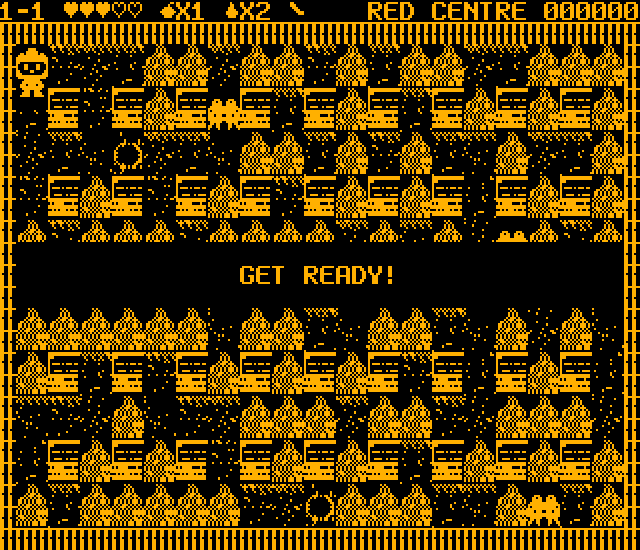

# KABOOMERANG

An original Bomberman-inspired arcade game for the **Microbee Premium Plus** (1MB RAM, 32K PCG). Wally the demolition wombat takes his gumnut bombs and his lucky boomerang across the outback to stop Baron Von Croak, the cane toad tycoon paving the bush into car parks.

**ViBED by BPM 2026**

## Status: engine build 0.2

World 1, Red Centre, is playable stage after stage. Build 0.2 fills the screen: 40 × 25 cells of **8 × 10** pixels (320 × 250), MODES.COM's tallest 40-column table.

- **The 40-column mode:** reading port 09h with 01h on the upper address lines (`LD A,1 : IN A,(09h)`) selects the half dot clock, as MODES.COM does. The CRTC table is MODES.COM's 40 × 25 (8 × 10) one: R4 1Eh, R5 03h, R7 1Ch, R9 09h.
- **New in 0.2:**
  - The arena fills the whole screen under a one-row HUD. The game-name bar at the bottom is gone, and the outer walls show as half tiles.
  - A bubbly, bursting title logo with bomb O's.
  - A rounded chunky font throughout.
  - A cuter, Bomberman-style Wally: a big round head with a visor face and a tiny lamp knob instead of a hat.
  - A new soundscape (see Sound below).
- Tested in the emulator model only so far. The first real-hardware run is next.

## What's in this build

- **The display:** 40 × 25 cells of 8 × 10 pixels (320 × 250). Row 0 is the HUD. The arena is 21 × 13 tiles of 2 × 2 cells (16 × 20 pixels), with a 19 × 11 open inside, and each cell has its own ink and paper.
- **The engine** (from HULLBREACH and AUSOPEN):
  - Two screen pages flipped in vertical blanking, with a sprite-glyph bank per page.
  - Sprites are pre-shifted, masked and composited into private glyphs. They move smoothly in 2-pixel steps at 25 frames a second.
- **Wally:**
  - walks in four directions
  - blinks, looks around and taps a foot when idle
  - crouches to set a bomb, and his lamp knob jumps at a nearby blast
  - hops on a power-up, goes dizzy when hit, does a victory dance and gets flattened
- **Bombs:**
  - Fuses pulse, then flash red in the last second.
  - Flames have centre, arm and tip shapes in three phases plus smoke.
  - Bombs set each other off in chain reactions.
  - Termite mounds crumble in nine stages with debris.
  - **Blast preview:** floor in a bomb's path is hatched red during its last second.
- **The Kaboomerang:** flies four tiles and comes back. It stuns wildlife and fetches power-ups, and it picks up a lit bomb and drops it at the end of its flight.
- **Burrows:** stand in one and blasts pass over you.
- **Wildlife:**
  - **Cane toads** hop and squat.
  - **Frill-necks** flare up and sprint when they see Wally down a lane.
  - **Bin chickens** go for power-ups, steal them and run away. Blast one and the item drops back.
- **Power-ups:** gumnuts (more bombs), fire (bigger blasts), hearts, thongs (speed). Find the hollow log to clear the stage.
- **Forgiving play:**
  - three hearts out of five
  - flashing safety after a hit
  - corner sliding and remembered taps
  - unlimited continues that keep your power-ups
- **Monochrome:** choose C or M at start-up. Mono uses inverted patterns where needed, and the HUD shows empty hearts and missing power-ups by shape, not colour.
- **Sound:**
  - No music in play: a square-wave beeper with a sample-and-hold noise channel instead of thin pulses.
  - Lit bombs fizz with a fuse hiss that spits in the last second.
  - Each blast is a deep KABOOM roar with a falling thump underneath, and chain blasts roar longer.
  - Pickups go *ching!*
  - The title tune and the short jingles stay.
  - The big moments play unbroken for a few fields, a short hit-pause, because the beeper only sounds in each frame's spare time.

## Play it

`release/KABOOM.DS8` is a DS80 disk image (80 tracks, 2 sides, 10 × 512 sectors). It boots to CP/M's `A>` prompt with no shell. Type:

    KABOOM

Press **C** for a colour monitor or **M** for monochrome.

| Action | Keys |
|---|---|
| Move | arrow keys or Q A O P, or a joystick |
| Gumnut bomb | SPACE / fire |
| Throw the Kaboomerang | X (or Z, B), or fire when no bomb can go down |
| Pause, sound, back to the title | H, S, ESC |

## Build

Python 3 with numpy and Pillow, and gcc (for the emulator model). From `src/`:

    python3 tools/build.py

This writes `build/KABOOM.DS8`. Tests:

| Script | What it does |
|---|---|
| `tools/soak.py` | Plays random inputs and checks for crashes |
| `tools/mechtest.py` | Checks that a bomb beats a toad and the boomerang carries a bomb |
| `tools/stagetest.py` | Clears stages one after another |
| `tools/perf.py` | Measures the frame rate and profiles the code |
| `tools/shoot.py` | Takes screenshots |

## Files

| Path | What it is |
|---|---|
| `src/` | Z80 source (`src/src`), art and build tools (`src/tools`) |
| `mockup/kaboomerang.html` | The browser design mockup |
| `docs/DESIGN.md` | Game design and technical plan |
| `docs/BRIEF.md` | BPM's brief |

The test emulator in `src/tools/emu` uses a Z80 core that looks like superzazu/z80 (MIT). It is only used for testing.
