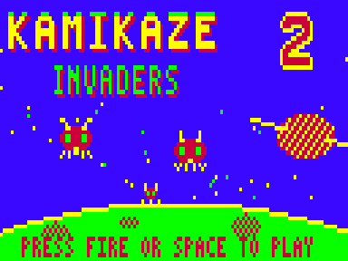
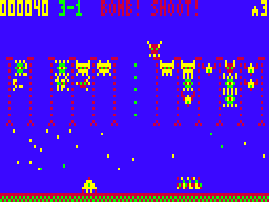
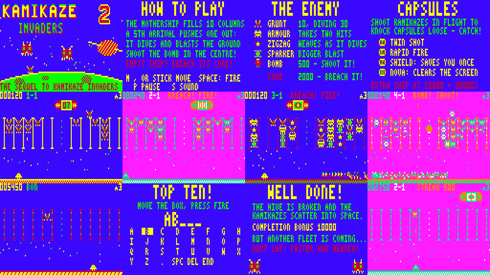

# KAMIKAZE INVADERS 2 — "The Mothership Strikes Back"

Sequel to the VZ200/VZ300 game *KAMIKAZE INVADERS* for the Dick Smith VZ300 / VZ200.
ViBED by BPM 2026. Original code, graphics and music. Nothing from the original game is included.







## Play it

Copy `release/KAMI2.VZ` to the SD card and load it from the BennVenn SD loader. It's a type F1 binary that loads at $8000 (to $C47F) and runs from $8000. It needs the **BennVenn 128K** RAM expansion (RAM up to $FFFF).

| Action | Keyboard | Joystick |
|---|---|---|
| Move | M left · `,` right (the original's arrow keys) | either stick; both work |
| Fire | SPACE or SHIFT (as the original) | fire |
| Start | SPACE, S, RETURN or fire | fire |
| Start at sector 1–4 | keys 1–4 on the title screen | — |
| Pause (X quits while paused) | P | — |
| Quit the game | CTRL + BREAK (as the original) | — |
| Sound: music+SFX → SFX only → off | S (in game) | — |
| Name entry | M , Q A move the box over the letter grid; SPACE or RETURN picks | stick + fire |

## What's in it

**The core loop is the original's.** A mothership slides along the top. The number in its centre box is how many kamikazes it still carries, as in the original.
- It drops them into **10 columns** between the rails, 5 on each side, 4 to a column.
- When a 5th arrives, the bottom one is **pushed out and dives**. If it reaches the ground it sets off an **electrical blast** along the floor.
- Each mothership also drops a **bomb down the centre lane**. Shoot it or lose a ship.
- **Scoring:** 10 for a kamikaze in a column, 30 for a diver, 500 for the bomb.
- **Three ships.** Extra ships come at 10,000, then every 20,000.

**New in the sequel:**
- **Columns stay full between motherships.** The pressure builds through a sector. Shots can't get past a column's bottom kamikaze, so the **centre lane** and empty columns are your only windows onto the ones flying in.
- **Warnings.** A full column's bottom kamikaze flashes when another is on its way in, and before a column drops one on its own (from mothership 2).
- **BREACH.** Once a mothership is empty its hatch opens and the core pulses for about 7 seconds. Shoot it 4 times (more on later laps) for **2000**. Otherwise it escapes. A closed hull just deflects shots.
- **Four kamikaze types:**
  - **GRUNT**
  - **ARMOUR**, which takes two hits and cracks after the first. It arrives from mothership 3, as in the original.
  - **ZIGZAG**, which weaves as it dives.
  - **SPARKER**, whose ground blast is twice as wide.
- **Capsules.** Shoot a kamikaze in flight and one in four drops a capsule. Catch it (100):
  - **T** twin shot
  - **R** rapid fire
  - **S** shield, which saves you from one blast
  - **N** nova, which pops every kamikaze on screen
- **Hit streaks.** Every 10 hits in a row is worth 500.
- **Bombs:** two per mothership in sector 4. From sector 3 they take two hits.

**Four sectors of four motherships**, each with its own palette and rail style:
- **OUTER RIM:** blue space, yellow rails.
- **ION STORM:** magenta, cyan dashed rails.
- **RED NEBULA:** blue, red dotted rails.
- **THE HIVE:** magenta, orange riveted rails.

The motherships get fuller (30 kamikazes rising to 60), release faster, fly faster, and later ones bring more types.

- **Sector clear:** 500 for every empty column, and the survivors are blown away.
- **Bonus round, KAMIKAZE RAIN:** 30 kamikazes rain down in the other palette, 100 each. Get all 30 for 10,000.
- **Ending:** after sector 4 a completion bonus of 10,000, then lap 2 runs faster and meaner.

**Presentation:**
- **Title screen (Mode 1):** a drop-shadowed KAMIKAZE INVADERS logo with a big red **2**, a ringed moon and a cratered planet. Big kamikazes bob above the planet, and the bottom line cycles through the messages.
- **Attract cycle:** title → How to Play → The Enemy → Capsules → a computer-played demo on the real engine → **TOP TEN**. Pages change with blinds wipes, and start works at any point.
- **Top ten table, entered the original's way.** Move a box over a letter grid (A–Z . SPC DEL END) and press fire. Names are 5 letters. The table is kept until power-off.
- **In game:**
  - The mothership moves smoothly a pixel at a time with its cargo count live in the box.
  - Kamikazes in the columns wiggle their legs.
  - Electric bolts crackle along the ground.
  - Particle bursts, score pop-ups and palette flashes.
  - Sector and mothership banners, and HUD messages (BREACH! FIRE!, BOMB! SHOOT!, TWIN SHOT! …).
- **Sound:** the two-voice pin-pulse beeper engine from Ghost Hunter 2 / Penguin 2, with short, separated notes for that gritty sound. All tunes are original:
  - title march
  - in-game loop, plus a breach alarm loop
  - bonus-round tune
  - jingles: start, mothership done, sector clear, death, game over, Top Ten, explosion
  - info and ending themes
  - 17 sound effects

  Effects play over the bass voice, so the tune carries on. `media/` has the emulator's speaker output for the title music and a stretch of gameplay.

## Hardware notes

- **Loading:** a single .VZ file from the BennVenn SD loader, with no extra files.
  - It makes no ROM calls and runs with interrupts off (DI throughout).
  - Frame timing comes from polling field sync on $68xx bit 7.
  - The only port reads are the joysticks. There are no port writes, and no writes to the mapper port ($37).
- **Memory:**
  - It doesn't touch the DOS SRAM window at $4000–$67FF, and doesn't need the DOS after loading.
  - The expansion is used as plain RAM up to $FFFF (on a VZ300 the 128K card supplies $B800–$FFFF). This is the same method as Penguin 2, Ghost Hunter 2 and Xevious v1.2, which already run on your machine.

| Range | Use |
|---|---|
| $7800–$7B81 | variables |
| $7C00–$7C7F | VRAM commit queue |
| $7FFE | stack (grows down) |
| $8000–$C47F | code and data (the .VZ) |
| $C480–$D43F | sprite table + pre-shifted, pre-masked sprites (built at start-up) |
| $E800–$EFFF | the empty playfield (stars, rails, ground) used to repaint |
| $F600–$F7FF | mask tables |
| $F800–$FFFF | background buffer |

- **Snow-free drawing:**
  - Outside vertical blank the game only draws into the background buffer and queues the changed rectangle. That covers the mothership (pre-shifted 4 ways, so it moves a pixel at a time), the column stacks, the ground blasts and the text.
  - Video RAM is written only in the vblank window after field sync:
    1. queued rectangles, within a per-frame budget
    2. sprite erase
    3. sprite draw
  - Sprites are stored as (mask, data) pairs and drawn with POP. The space colour (colour 2) is the transparent one, so stars show through the sprites.
  - Palette flashes are applied at the start of vblank.
- **Joysticks:** ports $2C, $29, $2E, $2D, $2B and $27 are all read and combined, so either stick on your custom interface works. Bit 4 is fire. Nothing to choose: there's no "JOYSTICK Y OR N" question as in the original.

## Build

Needs Python 3 with Pillow, and sjasmplus (https://github.com/z00m128/sjasmplus) on your PATH.

```
cd src
./build.sh          # -> ../build/KAMI2.VZ (a finished copy is in release/)
```

- `gen.py` (with `title_art.py` and `music.py`) writes `data.inc`. That holds:
  - the font
  - the sprites
  - the mothership images, pre-shifted
  - the bolt patterns
  - the sector tables
  - the title picture
  - the music

  It also writes previews to `build/preview/`.
- `mkvz.py` wraps `kami2.bin` into the .VZ file.

`tools/vzemu/` is the small headless VZ300 emulator from Ghost Hunter 2 / Penguin 2. Build it with `gcc -O2 -o vzemu vzemu.c z80.c`. It has two checks:
- a **snow detector**, which counts any CPU access to video RAM during the active display
- a **vblank timing marker**, which reports the scanline at which each frame's drawing finished

It uses the superzazu/z80 CPU core (MIT licence, see `LICENSE-z80`).

- `tools/playtest.py` runs a soak test. It pokes test-only RAM flags (`autoplay`, `godmode`, `forceclear`) so the demo AI plays a real game.
- `tools/media.py` captures the screenshots, GIFs and audio.

## Testing

Tested **in the emulator only**:
- all 4 sectors, all 16 motherships, breaches and escapes, the bonus rounds, the ending and lap 2
- deaths, game over, Top Ten name entry and the table
- the full attract cycle and the demo
- pause, quit (X and CTRL+BREAK), the sound modes, and start-at-sector keys

**Soak runs:** three runs of 40,000 frames each, about 40 minutes of play in total:
1. the AI playing for real
2. the AI invulnerable, with forced mothership finishes to cover every stage
3. a start at sector 3

Drawing finished inside vblank on more than 99.98% of frames. 12 frames, when nearly every possible sprite was on screen at once, ran 1–3 scanlines past the start of the picture. That would touch only the very top line of the HUD. The attract mode is snow-free apart from the one-off screen clear at power-on.

**Not yet checked on real hardware:**
- the exact top-border length of the real machine, which the emulator assumes
- the sound level on your speaker
- joystick feel
- difficulty for a human player (it was tuned with the demo AI)

The loading method and memory use match builds that already work on your VZ300 (Penguin 2, Ghost Hunter 2, Xevious v1.2).

## About the original

*KAMIKAZE INVADERS* was published on tape for the VZ200 by Dick Smith Electronics. It has no licence that allows redistribution, so neither the original program nor any of its graphics or code is included here. The sequel was written from scratch after playing it in the emulator.

## Sound-effect fix (8 November 2026)

The sound-effect table had 9 bytes per entry, but the code that plays an effect looks entries up 8 bytes apart. So every effect after the first one played the wrong values, and some came out as long, chirpy, lingering sweeps. The table now has 8-byte entries, so every effect plays as designed. Every effect plays at its original length, including the warbly bonus and power-up sounds. Nothing else changed.

## Versions

- **v1.0.1** (includes the 8 November sound-effect fix): the ship (and any 8-pixel sprite) no longer vanishes when pushed hard against the right edge. Sprites partly past the last screen column are now drawn clipped rather than skipped.
- **v1.0:** first release.
