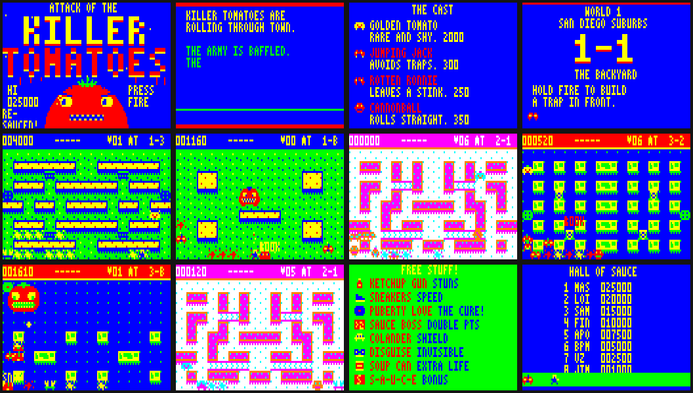

# ATTACK OF THE KILLER TOMATOES — RE-SAUCED!

A remake of *Attack of the Killer Tomatoes* (Apolon Ivankovic, 1984) for the Dick Smith VZ300 / Laser 310.
ViBED by BPM 2026. Original code, graphics and music; none of the 1984 code is used.



## Play it

Copy `release/KILLTOM2.VZ` to the SD card and load it from the BennVenn SD loader. It's a type F1 binary that loads at $8000 and runs from $8000.

It needs RAM up to $F7FF: a BennVenn 128K, or the standard 16K RAM pack. It never writes to the mapper (port $37), leaves the DOS area at $FA00+ alone, makes no ROM calls and runs with interrupts off.

| Action | Keyboard | Joystick (either stick) |
|---|---|---|
| Move | Q up · A down · O or M left · P or `,` right | stick |
| Build trap / whack (hold) | SPACE (or X, C) | FIRE |
| Ketchup gun | Z | ARM |
| Pause | RETURN (then R = quit to title) | — |
| Music on/off | S, any time | — |

**Title screen options:**
- **D** — skill: Easy / Normal / Hard
- **T** — trainer: infinite lives, no high score recorded
- **L** — level select, including the bosses
- **FIRE** — start

High-score initials can be typed on the keyboard, or picked with stick up/down and FIRE.

## How to play

- **Hold FIRE facing an empty floor tile** to build a trap in three stages. Tomatoes trample half-built traps.
- A tomato that walks into a **finished trap** is caught. **Whack it** (FIRE while facing it) until it goes SPLAT, before it struggles free.
- **Clear every tomato** to finish the stage.
- You can have up to 4 traps at once. FIRE on your own empty trap picks it back up.
- Armed traps act as bait: nearby tomatoes are drawn towards them.
- **Combos:** quick successive squashes multiply your points.
- **Hurry-up:** if a stage drags on, the tomatoes become ENRAGED, which is the original game's frenzy.

**Enemies:**
- **Cherry Tom** — wanders.
- **Roma Runner** — chases you.
- **Big Beefsteak** — 4 whacks, then splits into two cherries.
- **Unripe Greenie** — immune to traps until it ripens. Ketchup ripens it instantly.
- **Golden Tomato** — rare and flees. Touch it for 2000 points.
- **Jumping Jack** — dodges traps.
- **Rotten Ronnie** — leaves a stink cloud.
- **Cannonball** — rolls in straight lines.

**Power-ups:**
- **Ketchup Gun** — stuns. A second pick-up makes shots pierce; a third makes Hot Sauce, which splats in one shot.
- **Sneakers** — speed.
- **PUBERTY LOVE** — the film's cure. Tomatoes panic and you can stomp them.
- **Sauce Boss** — double points.
- **Colander** — a one-hit shield.
- **Disguise** — tomatoes ignore you.
- **Soup Can** — extra life.
- **S-A-U-C-E letters** — collect all five for +5000 and a life.

Extra lives also come every 20,000 points.

**Worlds:**
- **1. San Diego Suburbs** — BBQ grills, manholes.
- **2. The Cannery** — conveyors, steam vents.
- **3. Top Secret Lab** — zappers, teleports.

Each world has 3 stages, then a boss:
- **Mama Beefsteak** — trap her, then whack.
- **Baron von Beefsteak** — he charges in straight lines; dodge so he hits a wall and gets dizzy.
- **The Great Tomato** — only the song hurts it.

After each of the first two bosses comes a Tomato Smash bonus round. When you've finished all three worlds you get an ending, then a harder "Second Helping" lap.

## Technical specs

| | |
|---|---|
| Machine | Dick Smith VZ300 / Laser 310 (Z80 @ 3.54 MHz, PAL 50 Hz) |
| File | `KILLTOM2.VZ`, type F1, 22,355 bytes, loads $8000–$D752 |
| Graphics | Mode 1, 128×64, 4 colours, both colour sets used (a palette per world) |
| Playfield | 16×11 cells of 8×5 pixels, plus a status bar |
| Sprites | 8×5 masked sprites at 2-pixel steps; bosses up to 24×15. Drawn row by row ahead of the TV beam to avoid flicker |
| Sound | 1-bit beeper: pulse-width envelope music in game, two-voice melody and bass on front-end screens, 9 tunes, 19 sound effects. Played in each frame's spare time so the game never slows down |
| Code | 100% Z80 assembly |

More detail is in `KILLTOM2_blurb.txt`. `media/title_music.mp3` is the title tune as rendered by the test emulator, which is only a rough approximation of the real VZ speaker.

## Building

Needs sjasmplus and Python 3 with Pillow.

```
src/build.sh          # regenerates the data, assembles, writes release/KILLTOM2.VZ
src/autotest.sh N     # debug build where a bot plays from stage N (0-13), for soak tests
```

**Source files:**
- `src/main.asm` — boot, input, random numbers, RAM layout
- `src/gfx.asm` — masked sprite blitter, big sprites, text, logo letters
- `src/snd.asm` — the beeper engines
- `src/game.asm` — renderer, stages, player, items, hazards
- `src/ents.asm` — enemy AI, bosses, demo bot
- `src/front.asm` — title, attract mode, stage cards, high scores, ending

**Generators** (their output, `gen_data.inc` and `gen_title.inc`, is checked in):
- `src/build_data.py` — mazes, stages, text, music, sound effects
- `src/gfx.py` — all sprite and tile art, drawn as ASCII
- `src/font.py` — the 3×5 font
- `src/title_art.py` — the giant title tomato

**Test tools:**
- `tools/vzemu.c` — a headless VZ300 emulator used for testing: screenshots, profiling, a beam-race checker, and crash/stack/write watchpoints.
  - Build it with `gcc -O2 -o vzemu tools/vzemu.c tools/z80core/z80.c -Itools/z80core`.
- `tools/z80core/` — superzazu/z80 (MIT licence), with one fix: `BIT n,(HL)` no longer writes memory back.
