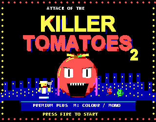
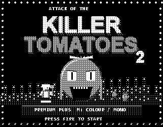
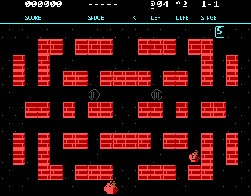
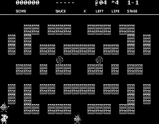
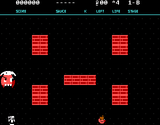
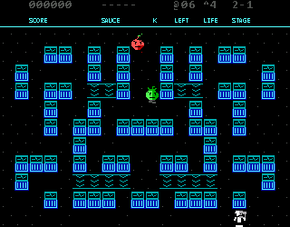
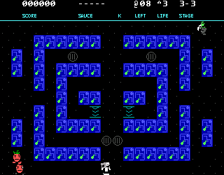
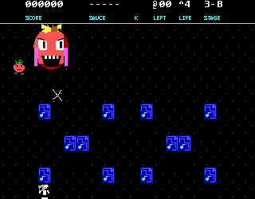
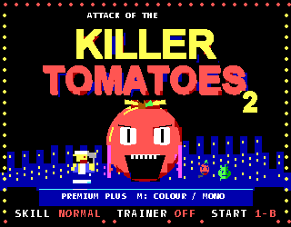
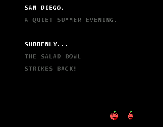

# Attack of the Killer Tomatoes 2: Microbee Premium Plus

A native Microbee port of *Attack of the Killer Tomatoes: Re-Sauced!* for the
VZ300 (ViBED by BPM 2026, after the 1984 original by Apolon Ivankovic). It
uses the Premium Plus's 1 MB RAM and 32 KB PCG for redrawn arcade-style
artwork in colour, plus a dithered monochrome mode.

 

## Run it

You need a **Microbee Premium Plus with 1 MB RAM and 32 KB PCG**.

`release/KILLTOM2.DS80` is an 819,200-byte disk with 80 tracks, two sides and ten
512-byte sectors per track. It boots CP/M to `A>`. Type:

```
KILLTOM2
```

The graphics then take about 15 seconds to load. A dot appears as each of
the 17 RAM banks loads, and the screen goes dark briefly before the title.

In uBee512 6.0.0, double-click `release/Run-KillerTomatoes2.cmd`. Set
`UBEE` to your uBee512 folder if it's elsewhere. It runs a working copy of
the disk, so the release disk is never written to. Or run:

```
ubee512 --config=none --model=p1024k --pcg=32 --vdu=2 --rom1=bn60.rom -a KILLTOM2.DS80
```

uBee512 6.0.0 does not recognise the `.DS8` extension, so the disk is `.DS80`.
ROMs and emulator binaries are not included.

## Controls

| Action | Key |
|---|---|
| Move | Q up, A down, O left, P right |
| Build trap / whack (hold) | SPACE |
| Ketchup gun | Z |
| Pause / resume | RETURN (R in pause returns to the title) |
| Music on/off | S |

**Title screen:**
- **M**: switch between colour and dithered monochrome.
- **D**: skill (Easy / Normal / Hard).
- **T**: trainer (infinite lives, no high score).
- **L**: start stage, including the bosses.
- **SPACE**: start.

The current options show along the bottom of the title for a few seconds
after each key press. Joysticks are not supported in this build; it is
keyboard only.

## What's in the game

There are 14 stages across three worlds: nine mazes, three bosses and two
bonus rounds. Then comes an ending and a harder second lap. Each 20 × 11
arena fills the full 320-pixel width; the side lanes were redesigned for
the Microbee. Eight tomato types, all the power-ups, S-A-U-C-E letters,
combos, news flashes, the attract sequence and the Hall of Sauce are all
there.

 

 

 

 

## How it works

- **Display:** 40 × 25 cells of 8 × 10 pixels give the 320 × 250 PAL screen.
  Every cell has its own PCG glyph, across 16 PCG banks. Two display pages
  flip at PAL frame edges. There is no VZ framebuffer and no VZ artwork.
- **Graphics:** every sprite is prepared at build time in 10 sub-cell
  alignments, in both colour and monochrome. That is 544 KB held in 17
  banks of expansion RAM. Blocks 0–3 are left to CP/M while loading.
- **Timing:** game logic runs on counted PAL frames, separately from
  rendering. Busy boss scenes can drop displayed frames without slowing
  the game rules.
- **Hardware:** Microbee keyboard-matrix scanning, beeper sound retuned
  for 3.375 MHz, and CRTC video replace the VZ hardware routines.

## Changes in this release (finishing pass)

- **Loading is 4–5 times faster** (about 64 s → 14 s in uBee512). The
  graphics are now LZ-compressed per bank, 236 KB → 100 KB on disk. The
  loader runs from common RAM and decompresses straight into each
  expansion bank with block moves, reading 4 KB per CP/M refill instead
  of one record at a time. A progress dot is shown per bank, and the
  loader now checks that every bank arrived.
- **Fixed a frame-timing bug.** A vblank starting at the wrong moment
  could be counted twice, giving an occasional extra logic step in busy
  scenes.
- **Faster video upload.** The per-cell PCG/colour upload loop was
  rewritten (about 25% less work). Stage 9 drops from about 150k to
  137k T-states per frame.
- **No startup flash.** Colour RAM is blanked before the switch to
  40 × 25, so CP/M's font no longer flashes up before the title.
- **Title options readout.** D/T/L previously drew a VZ-positioned panel
  over the title art that never cleared. They now show one tidy line
  that restores itself.
- The shipped disk now matches the final source. Codex's last disk was
  built before its final code changes.

## Testing and limitations

- **Real emulator.** In uBee512 6.0.0 (Premium Plus, 1 MB, 32 KB PCG) I
  checked boot to `A>`, launch, loading, the title, the attract
  sequence, colour/mono switching, the title options and stage 1
  gameplay. The screenshots here are real uBee512 window captures.
- **Hardware model.** A simplified Microbee model runs the assembled
  program. It boots the ROM and CP/M from the disk image and checks
  every graphics bank byte for byte. It then runs all 14 stages in both
  modes for 120 frames each and checks both PCG pages against the native
  framebuffer. It also checks PAL frame timing and the debounced
  monochrome switch.
- **Not checked by a person.** The full game hasn't been played through
  end to end, and it hasn't been run on real hardware. Sound quality
  hasn't been judged by ear.
- **Busy scenes.** The boss stages render at roughly 20–27 fps in the
  model, though game speed is unaffected.
- **Colour clashes.** Some can remain where sprites overlap cell edges.
- **Leaving the game.** The program takes over CP/M's RAM, so reset to
  return to CP/M.

## Rebuild

From `src/`:

```
.\build.ps1          # art -> banked LZ assets -> KILLTOM2.COM -> outputs\KILLTPP.DS80
.\build.ps1 -Test    # and run the boot + regression tests
```

The build needs:
- Python 3 with Pillow.
- sjasmplus, at `work\tools\sjasmplus.exe` or on PATH.
- Windows Consolas Bold, for the HUD labels.

The CP/M boot tracks and `CCP.SYS` come from `resources/`. The tests also
need `z80==1.2.0` and your own Microbee boot ROM at `work\ubee\bn60.rom`.
Neither the ROM nor the emulator is included.

The layout:
- `work/premiumplus/src`: Z80 source (sjasmplus). `loader.inc` holds the
  banked LZ loader, `plus.asm` the Premium Plus renderer and title, and
  `hardware.asm` the video/keyboard layer.
- `work/premiumplus/tools`: `arcade_art.py` draws the artwork,
  `prepare_assets.py` pre-shifts it, converts it to cells and packs the
  banks, and `make_disk.py` builds the DS80.
- `work/test_*.py`: the hardware-model tests.
- `work/emu_capture.ps1`: drives uBee512 for screenshots without taking
  keyboard focus.
